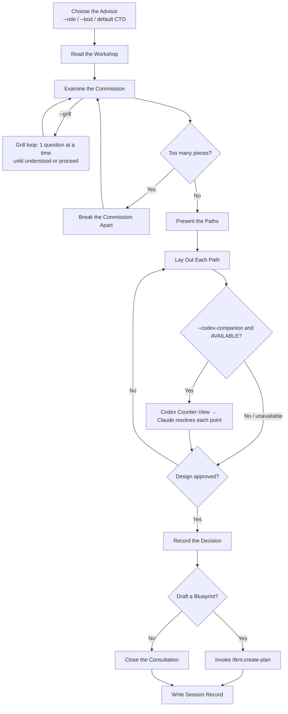

# Brainstorm — Consultation

Rigorous, honest examination of what should be built and why — consult and advise ONLY, never
implement (user's explicit instruction overrides). Brutal honesty over comfortable agreement;
challenge the first sketch — the client's initial idea is a starting point, not a specification.
Session coding-level guidance (0–5), when injected, governs explanation depth and layout.

## Processing Level

`--level low|medium|high|max` (default `medium`). Global semantics: `_shared/processing-levels.md`.

| Level | Paths explored | User gates | Research | Depth |
|-------|---------------|-----------|---------|-------|
| `low` | 2 | Final only | No | Quick trade-offs |
| `medium` *(default)* | 3 | Standard | Optional | Full consultation |
| `high` | 3+ | Each decision | Yes | Deep, challenges every path |
| `max` | All viable | Every stage | Forced | Exhaustive + adversarial |

When run AS the `brainstormer` agent, `--level` selects the capability tier
(`brainstormer-lite`/`brainstormer`/`brainstormer-max` per `_shared/processing-levels.md`);
run inline, the session's own model applies — depth rows hold either way.

## Advisor Lens (`--role`, `--bod`)

The consultation craft is identical across roles — only the lens (which concerns dominate the
questioning and verdict) changes. Default = **CTO**: structure, risk surfaces, sequencing,
developer experience, debt trajectory, performance.

| Invocation | Lens |
|------------|------|
| *(no flag)* | CTO (historical default) |
| `--role ceo\|cto\|cfo\|coo\|cmo\|cpo` | single advisor |
| `--bod` / `--bod=ceo,cfo,coo` | the board / a chosen subset |

Both flags → `--bod` wins (say so in one line). **Load `roles.md` whenever either flag is
present** — role catalog, lens-adoption rules, board synthesis format.
**Board execution:** at `--level` ≤ `high`, run the board as ONE multi-lens deliberation in this
context — each lens answers the others' arguments directly (real debate beats parallel
monologues). At `max`, spawn independent `brainstormer` agents per lens (anchor-free), then
synthesize. This overrides any per-level board scaling in `roles.md`.

## The Relentless Interview (`--grill`)

With `--grill`, the Examine stage drops batched questions and runs the grill loop
(`../../rules/grill-loop-protocol.md`): one question at a time, adaptive, until understood or
the user says proceed; **sink = the session report, recorded as each decision crystallizes**;
ignore any injected `questions=` bound. Orthogonal to `--level`/`--role`. With `--bod`: grill
in the main thread first, then convene the board on the resolved design.

## Consultation Flow (Authoritative)

**The diagram rules** — where prose disagrees, trust the diagram. Every consultation ends by
handing off to `/tkm:create-plan` or closing. Stage contracts the diagram cannot carry:

- **Read the Workshop:** survey the material first — `tkm:scan-codebase` + `<project-dir>/docs`
  for technical commissions; docs/briefs/prior plans for non-technical or non-CTO lenses.
  (`tkm:search-docs` for library docs, `psql` for live schema, `planner` agent for pattern
  research — as the commission warrants.)
- **Examine:** probe real requirements, constraints, timeline, success criteria via
  `AskUserQuestion`, framed by the advisor's signature questions.
- **Scope check:** 3+ independent concerns (e.g. "platform with chat, billing, analytics") →
  name them, decompose, build order; each piece gets its own consultation→blueprint→forge cycle.
  Never refine details of a piece that first needs separating.
- **Present the Paths:** 2–3 distinct approaches with honest trade-offs; feasibility validated
  before any path is endorsed; long-term maintainability outranks short-term convenience.
- **Blueprint handoff:** on Yes, `/tkm:create-plan` receives the consultation summary.
  **CRITICAL:** it lays down `plan.md` with YAML frontmatter whose `status` reads `pending`.
- **Close:** run `/tkm:capture-lessons`.

## Codex Counter-View (opt-in, `--codex-companion`)

Read `references/codex-companion.md` and follow it: after a recommended direction exists and
BEFORE sealing, a second model challenges it and Claude resolves each objection — the user
seals with those objections on the table. Flag absent → skip, zero cost.

## Report Output

Path pattern from the injected `## Naming` block; invoke `/tkm:organize-files` for placement.
Record: the commission (problem + real requirements) · paths examined (honest pros/cons) ·
agreed direction + reasoning · what to watch (risks/constraints) · success measures ·
what comes next · *(if companion ran)* `## Codex Counter-View` (objections + resolutions).
`--bod` → use the **board synthesis format** in `roles.md` instead (agreements,
conflicts-and-resolutions table, board verdict). Concision beats grammar; unresolved items last.

If `--html`: after the markdown report, render a self-contained editorial `.html` companion
next to it (same stem) per `../_shared/references/editorial-report-html.md`; markdown stays
the primary artifact.

## Workflow Position

Follows `tkm:debug-code` / `tkm:scan-codebase` · precedes `tkm:create-plan`.
## `--advice` (opt-in athena supervision, OFF by default)

Run this skill under `athena` supervision: at each decision gate it pauses for athena's one-shot
counsel before continuing, and passes `--advice` onward across handoffs. OFF by default — spend it
on high-stakes or error-prone work, not the everyday case. Full contract:
`../../rules/orchestration-protocol.md` → "Advisory Escalation".

`--advice` (athena counsel) is distinct from `--codex-companion` (a second-model counter-view) and the two may combine.
