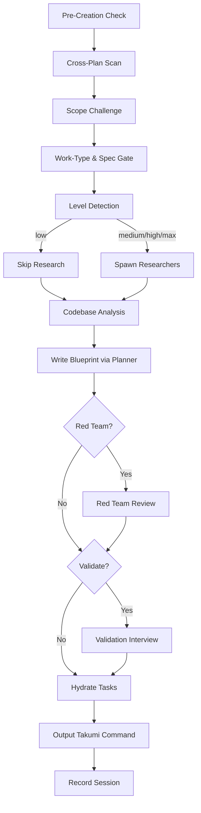

# Create Plan — Blueprint

Turn a request into a blueprint another session can execute verbatim; whatever lands here is
exactly what `/tkm:takumi` picks up. YAGNI/KISS/DRY; say it straight; never write implementation
code here — the deliverable is the blueprint, its file path, and a summary. Unsure or the
decision isn't yours → `AskUserQuestion`.

**Open by surveying unfinished plans under `./plans/`** (read each `plan.md`); overlap with the
new draft → fold the new reality into them too.

## Cross-Plan Dependencies (contract)

While scanning open plans (status not `completed`/`cancelled`), classify overlap and write links
into **BOTH** `plan.md` frontmatters:

```yaml
blockedBy: [260301-1200-auth-system]   # this plan waits on these
blocks: [260228-0900-user-dashboard]   # this plan gates these
```

Needs the other's output → `blockedBy`; changes what the other depends on → other side gets
`blockedBy`, this side `blocks`; mutual → both. Ambiguous → `AskUserQuestion` (header
"Plan Dependency") with the overlap shown. A plan with an incomplete blocker is flagged
`blocked`; the flag clears itself on a later scan when every blocker completes.

## Bare Call

No arguments / unreadable intent → `AskUserQuestion` (header "Blueprint Operation"):
`(default)` draft a blueprint · `archive` · `red-team` · `validate`.

## Processing Level & Flags

`--level low|medium|high|max` (default `medium`; `--auto`/no flag auto-detects — logic, per-level
workflow, alias resolution: `references/workflow-modes.md`). Level dials effort only; strategy
flags compose with any level. Global semantics: `_shared/processing-levels.md`.

| Level | Research | Scout | Red Team | Validation | Takumi handoff |
|-------|----------|-------|----------|------------|----------------|
| `low` | Skip | Skip | Skip | Skip | `--auto` |
| `medium` *(default)* | 1 light pass | Skip | Skip | Skip | — |
| `high` | 2 researchers | Optional | Yes | Optional | — |
| `max` | 2-3 researchers + per-phase scout | Yes | Yes | Yes | — |

| Flag | Effect |
|------|--------|
| `--parallel` | Concurrent research/work agents; passes `--parallel` to takumi; raises gates like `high` |
| `--two` | Two competing approaches, compare before committing; gates after selection |
| `--tdd` | Tests-first structure per phase |
| `--no-tasks` | Skip task hydration |
| `--html` | Also render editorial `plan.html` next to `plan.md` (`../_shared/references/editorial-report-html.md`); `plan.md` stays primary and the handoff contract |
| `--grill` | Validation/clarification as one-question-at-a-time loop (`../../rules/grill-loop-protocol.md`), main-thread even under `--parallel`; also `validate --grill` |
| `--codex-companion` | Codex joins as an extra independent red-team reviewer — active ONLY when Red Team actually runs (`red_team_runs && flag`); otherwise inert. Flow: `references/red-team-workflow.md` Step 4 |

Deprecated aliases (work, print a deprecation notice): `--fast`→low · `--hard`→high · `--deep`→max.

## Stage References (load on demand, with skip rules)

0. Scope Challenge — `references/scope-challenge.md` (skip: `low` or trivial task)
1. Research — `references/research-phase.md` (skip: `low`, or researcher reports in hand)
2. Codebase Understanding — `references/codebase-understanding.md` (skip: scout reports in hand)
3. Solution Design — `references/solution-design.md`
4. Blueprint Creation & Organization — `references/plan-organization.md`
5. Task Breakdown & Output Standards — `references/output-standards.md`

A `reviewer` dispatch renders `skills/_shared/templates/reviewer-prompt-template.md` at the tier picked by
`skills/_shared/dispatch-model-tiers.md` § Reviewer Dispatch. There is no `reviewer` agent type.

## Process Flow (Authoritative)



**The diagram is the source of truth.** Node contracts it cannot carry:

- **Pre-Creation Check:** read the injected `## Plan Context` — `Plan: {path}` → ask
  "Continue? [Y/n]"; `Suggested: {path}` → ask activate-or-fresh; `Plan: none` → new plan at the
  `Plan dir:` from `## Naming`. Once the blueprint exists:
  `node .claude/scripts/set-active-plan.cjs {plan-dir}`.
- **Work-Type & Spec Gate (BLOCKING, before any `F###` reservation):** classify
  `feature`/`deliverable`/`ambiguous`, run SDD-mode + promote-sentinel pre-checks, route the spec
  decision. **Load `references/work-type-spec-gate.md` — never run this gate from a summary.**
  Outcomes: `work_type:` plus exactly one of `spec:` / `spec_draft:` / `spec_waived:` in
  `plan.md` frontmatter (shapes + producer/consumer rules: `references/frontmatter-fields.md`).
- **Write Blueprint via Planner:** spawn the planner variant by level
  (`low`→`planner-lite`, `medium`/`high`→`planner`, `max`→`planner-max` — one blueprint contract,
  different model/effort). Draft authored → pass its path; planner MUST (a) reference FR/SC/US IDs
  from `{draft}/technical-spec.md` per phase — never re-derive captured requirements, (b) write
  `spec_draft: plans/<plan_dir>/spec/<slug>/` into frontmatter. A PROMOTED, unrevised spec in
  `docs/features/` → write `spec: docs/features/F###_Slug/` instead. <!-- layout-exempt: promoted spec path uses docs/ root (single-lang); mode-aware pointer in frontmatter-fields.md -->
  Never both; omit both for specless tasks; `spec:` is otherwise written only by takumi's promote.
  **`--level low`:** even a partial draft still gets `spec_draft:` written (promote repoints at
  implement-start); partial spec keeps `status: draft` — only a full
  `/tkm:rebuild-spec --features F###` completes the 2-file set (v27.0.0 — `functional-spec.md` +
  `technical-spec.md`) after promote.
- **Red Team / Validate:** `/tkm:create-plan red-team {plan-path}` at `high|max` or with
  `--parallel`/`--two`; `validate {plan-path}` at `max` (optional at `high`).
- **Output Takumi Command (MANDATORY):** emit the takumi command with the plan's absolute path.
- **Record Session:** `/tkm:capture-lessons`.

## Task Hydration

Blueprint files persist; tasks die with the session — hydration bridges them. On by default
(`--no-tasks` opts out). **3-Task Rule:** <3 phases → no tasks. One task per phase chained with
`addBlockedBy`, extra tasks for critical/high-risk steps, metadata: phase, priority, effort,
planDir, phaseFile. Task tools are CLI-only — on error use `TodoWrite`; blueprint files stay
authoritative. Patterns + takumi handoff: `references/task-management.md`.

## Output

Invoke `/tkm:organize-files` for placement. Blueprints are self-contained (carry their own
context; snippets/pseudocode where they clarify intent). Respect
`./claude/rules/development-rules.md`. **Plans/reports go in THE CURRENT WORKING PROJECT
DIRECTORY — never the user directory.**

## Subcommands

| Subcommand | Reference |
|------------|-----------|
| `archive` | `references/archive-workflow.md` |
| `red-team` | `references/red-team-workflow.md` |
| `validate` (`--grill` variant supported) | `references/validate-workflow.md` |
