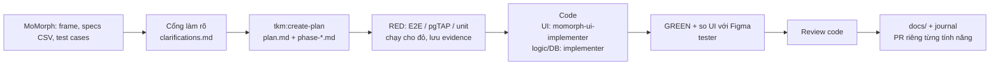

# agentic-coding-hands-on

Ứng dụng Next.js 16 (App Router) đăng nhập bằng Google qua Supabase Auth, giao diện vi/en. Có sáu màn hình: `/login`, trang chủ SAA 2025 `/` (đích sau đăng nhập; header, đếm ngược tới sự kiện, lưới giải thưởng, footer), trang Hệ thống giải `/awards-information` (menu 6 hạng mục, 6 thẻ giải, liên kết `#<slug>`), `/todo` (hiện email và nút đăng xuất), trang đếm ngược công khai `/prelaunch` và màn Sun* Kudos live board `/sun-kudos` (Highlight, Spotlight, ALL KUDOS cuộn vô hạn, bộ lọc hashtag/phòng ban, bấm tim, modal Viết Kudo; đọc và ghi vào Postgres của Supabase). Các trang `/sun-kudos/<id>`, `/standards`, `/profile`, `/admin` hiện chỉ là trang giữ chỗ "Coming soon"; `/admin` chỉ cho người dùng có `app_metadata.role = 'admin'`. Mọi trang trừ `/login` và `/prelaunch` đều cần đăng nhập. Trước `SITE_LAUNCH_AT`, mọi đường dẫn ngoài `/login`, `/auth/*`, `/_next/*` và `/prelaunch` bị chuyển 307 về `/prelaunch` (khóa site, xem bên dưới). Tài liệu thiết kế nằm ở [docs/README.md](docs/README.md).

## Quy trình AI Driven Development (AIDD)

Toàn bộ mã nguồn được sinh bằng **Claude Code + bộ kit Takumi**, đầu vào là **thiết kế Figma và Screen Specs trên MoMorph** (file `9ypp4enmFmdK3YAFJLIu6C`). Người làm chỉ trả lời câu hỏi làm rõ, duyệt plan và review PR.

### Luồng cho mỗi tính năng



1. **Lấy đầu vào từ MoMorph**: ảnh frame, specs và test cases của từng màn hình được tải về `plans/<plan>/momorph/`.
2. **Cổng làm rõ**: mọi chỗ spec còn hở (trạng thái lỗi, rỗng, phân quyền, đa ngôn ngữ…) được hỏi trước khi code; câu trả lời ghi vào `plans/<plan>/clarifications.md` theo dạng `Q → A`. Khi Figma và spec lệch nhau thì theo Figma.
3. **Lập plan** (`tkm:create-plan`): `plan.md` cùng các `phase-*.md` (file sở hữu, rủi ro, tiêu chí xong). Màn có tương tác dùng chính sách test `e2e-red-first`.
4. **Test đỏ trước**: viết E2E / pgTAP / unit cho yêu cầu, chạy cho đỏ, lưu mã thoát vào `plans/<plan>/evidence/*red*`.
5. **Code**: phần giao diện do agent `momorph-ui-implementer` dựng theo dữ liệu thiết kế (mỗi phần tử mang chú thích `mm:<node-id>`); logic, RPC và migration do agent thường làm.
6. **Xanh và so giao diện**: chạy lại đúng lệnh test cho xanh (`evidence/*green*`), agent `tester` chụp màn hình so với frame Figma.
7. **Review, tài liệu, PR**: review code, cập nhật `docs/` (sinh bằng `tkm:rebuild-spec`) và nhật ký bài học ở `docs/journals/`. Mỗi tính năng một nhánh và một PR vào `master`.

### Tính năng và nơi lưu dấu vết

| Tính năng | Màn MoMorph | Plan (spec, clarifications, evidence) | PR |
|---|---|---|---|
| F001 Đăng nhập Google, F002 Đa ngôn ngữ | `GzbNeVGJHz`, `hUyaaugye2` | `plans/261008-0850-login-page-supabase-google/`, `plans/261008-2253-login-parity-with-live-site/` | #1, #3 |
| F003 Trang chủ SAA | `i87tDx10uM` | `plans/261008-1705-homepage-saa/` | #2, #7 |
| F004 Hệ thống giải | `zFYDgyj_pD` | `plans/261013-0720-awards-information-page/` | #5 |
| F005 Countdown Prelaunch | `8PJQswPZmU` | `plans/261013-1638-countdown-prelaunch-page/` | #6 |
| F006 Sun* Kudos + Like Kudos | `MaZUn5xHXZ` | `plans/261014-0900-kudos-live-board/` | #9, #13 |
| F007 Viết Kudo | `ihQ26W78P2` | `plans/261015-0950-write-kudo-modal/`, `plans/261015-1700-auto-provision-sunner/`, `plans/261015-1900-fab-and-modal-polish/` | #10, #12 |
| Unit test, bù các lỗ hổng so với Definition of Done | — | `plans/261016-1000-unit-tests-and-dod-gaps/` | #14 |

Đặc tả sau khi dựng xong nằm ở `docs/features/F00x_*/` (functional/technical spec) và `docs/screens/SCR00x_*/`.

### Kiểm thử và TDD

| Tầng | Công cụ | Ở đâu | Lệnh |
|---|---|---|---|
| Unit | `bun test` (logic thuần; định dạng ngày giờ trên trình duyệt thật do E2E kiểm) | `lib/**/*.test.ts`, `app/**/_behavior/*.test.ts` | `bun run test:unit` |
| Database | pgTAP | `supabase/tests/database/` | `supabase test db` |
| E2E | Playwright + Supabase giả | `e2e/` | `bun run test:e2e` |

CI (`.github/workflows/ci.yml`) chạy lint, typecheck, unit, E2E (4 nhóm cấu hình môi trường) và pgTAP cho mọi PR.

Về TDD: mỗi plan đều chạy test đỏ trước khi code và lưu bằng chứng trong `plans/*/evidence/` (tệp `*red*` rồi `*green*`). Ở các tính năng đầu, test và code được commit trong cùng một PR, commit test đứng sau commit code, nên nhìn `git log` không thấy bước đỏ; bằng chứng nằm ở thư mục evidence. Từ `plans/261016-1000-unit-tests-and-dod-gaps/` trở đi, commit test đỏ đứng trước commit sửa.

### Phần đã tùy biến trên flow chuẩn của Takumi

- **Bộ nhớ của agent** (`.claude/agent-memory/`): planner, tester, debugger và momorph-ui-implementer ghi lại bài học giữa các phiên (cổng Supabase giả, cách khóa thời gian trong E2E…), nên phiên sau không lặp lỗi cũ.
- **Supabase giả cho E2E** (`e2e/support/mock-supabase-server.ts`): giả Auth (Google), 8 RPC của Kudos (6 của live board, `create_kudo`, `search_sunners`) và Storage trong bộ nhớ, để E2E chạy nhanh trên CI không cần Docker. Test pgTAP `kudos-seed-matches-e2e-fixture` giữ dữ liệu giả và `seed.sql` không lệch nhau.
- **Script chạy Supabase bằng Podman** (`scripts/start-local-supabase.sh`) cho máy không có Docker.
- **Quy tắc làm việc**: mỗi tính năng một nhánh và một PR; khi Figma và trang SAA thật lệch nhau thì theo Figma.

## Yêu cầu

| Công cụ | Ghi chú |
|---|---|
| [bun](https://bun.sh) | Trình quản lý gói và chạy script |
| Supabase CLI 2.120+ | Chạy Supabase cục bộ (`supabase start`) |
| Docker **hoặc** Podman | Supabase CLI chạy các container; xem phần Podman bên dưới |
| Google Cloud project | Tạo OAuth client kiểu Web application |

## Cài đặt cục bộ

```bash
bun install
```

### 1. Cấu hình Google OAuth

Trong Google Cloud, tạo OAuth client (Web application) với:

- Authorized redirect URI: `http://127.0.0.1:54321/auth/v1/callback`
- Authorized JavaScript origin: `http://localhost:3000`

Tạo file `supabase/.env` (đã nằm trong `.gitignore`, không commit):

```bash
SUPABASE_AUTH_EXTERNAL_GOOGLE_CLIENT_ID=<client id>
SUPABASE_AUTH_EXTERNAL_GOOGLE_CLIENT_SECRET=<client secret>
```

### 2. Chạy Supabase

```bash
bun run supabase:start   # tự dùng socket Podman nếu không có Docker
supabase status          # lấy Publishable key (sb_publishable_...)
```

`bun run supabase:start` (`scripts/start-local-supabase.sh`) gom các bước Podman bên dưới: không có `DOCKER_HOST` và không có `/var/run/docker.sock` thì trỏ sang socket Podman của user, tạo hai thư mục bind-mount rồi chạy `supabase start` với các dịch vụ phụ bị loại. Dừng bằng `bun run supabase:stop`.

#### Dùng Podman thay Docker

```bash
systemctl --user enable --now podman.socket
export DOCKER_HOST=unix:///run/user/$(id -u)/podman/podman.sock
mkdir -p supabase/snippets supabase/functions   # Podman cần sẵn hai thư mục bind-mount; git không lưu thư mục rỗng
supabase start -x vector,logflare,edge-runtime,imgproxy
```

Bốn dịch vụ bị loại (`vector`, `logflare`, `edge-runtime`, `imgproxy`) là các container analytics/phụ trợ cần docker socket; đăng nhập không dùng đến chúng.

#### Cơ sở dữ liệu (Kudos live board)

Schema nằm ở `supabase/migrations/` (ba tệp: bảng + RLS, hàm, quyền `execute`), dữ liệu mẫu ở `supabase/seed.sql`. Khi Supabase đang chạy:

```bash
supabase db reset      # áp migration rồi nạp seed.sql
supabase test db       # chạy pgTAP trong supabase/tests/database/
```

Seed để `sunners.user_id` rỗng, nên tài khoản Google của bạn chưa phải Sunner nào: màn Kudos xem được nhưng nút tim vô hiệu. Muốn thử tim thì gắn tay một hàng `sunners` vào user của bạn (xem chú thích đầu `supabase/seed.sql`). Cả hai lệnh cần container runtime (Docker hoặc Podman).

### 3. Biến môi trường cho ứng dụng

```bash
cp .env.example .env.local
# điền NEXT_PUBLIC_SUPABASE_PUBLISHABLE_KEY bằng key từ `supabase status`
```

Cả `NEXT_PUBLIC_SUPABASE_URL` và `NEXT_PUBLIC_SUPABASE_PUBLISHABLE_KEY` đều bắt buộc: `lib/supabase/config.ts` ném lỗi khi thiếu, nên `bun run build` cũng cần chúng (CI phải đặt cả hai).

`EVENT_START_AT` (không bắt buộc, chỉ đọc ở phía máy chủ, không có tiền tố `NEXT_PUBLIC_`) là mốc bắt đầu sự kiện của trang chủ: chuỗi ISO-8601 **bắt buộc kèm offset hoặc `Z`**, ví dụ `2025-12-26T18:30:00+07:00` (đã có sẵn trong `.env.example`). Thiếu, thiếu offset, sai định dạng hoặc ngày không có thật (ví dụ `2025-02-30`) thì đếm ngược hiện `00`, ẩn dòng "Coming soon" và ngày sự kiện hiện "—"; trang vẫn chạy bình thường và site không bị khóa.

`EVENT_START_AT` chỉ phục vụ trang chủ (đếm ngược và ngày sự kiện), không còn liên quan tới khóa site.

`SITE_LAUNCH_AT` (không bắt buộc, chỉ đọc ở phía máy chủ, không có tiền tố `NEXT_PUBLIC_`) là mốc ra mắt, điều khiển khóa trước ngày ra mắt (F005) và đích đếm ngược của `/prelaunch`; cùng định dạng ISO-8601 bắt buộc kèm offset hoặc `Z` như `EVENT_START_AT`. Khi mốc hợp lệ và giờ máy chủ còn sớm hơn mốc, proxy chuyển mọi đường dẫn (trừ `/login`, `/auth/*`, `/_next/*`, `/prelaunch`) tới `/prelaunch`, kể cả khi đã đăng nhập. Từ mốc, `/prelaunch` chuyển về `/`. Quyết định chỉ dựa vào đồng hồ máy chủ. Thiếu, để trống hoặc sai định dạng thì không khóa (`/prelaunch` chuyển về `/`); `.env.example` để trống nên mặc định không khóa, muốn thử khóa thì đặt mốc ở tương lai. Ngày hiển thị theo `dd/MM/yyyy`, múi giờ Asia/Ho_Chi_Minh.

### 4. Chạy ứng dụng

```bash
bun run dev
```

Mở **`http://localhost:3000`**, không dùng `127.0.0.1`: cookie PKCE của Supabase gắn theo host, đổi host giữa chừng làm bước đổi mã đăng nhập thất bại.

## Script

| Lệnh | Việc làm |
|---|---|
| `bun run dev` | Chạy dev server |
| `bun run build` | Build production |
| `bun run start` | Chạy bản build |
| `bun run supabase:start` | Chạy Supabase cục bộ (Docker hoặc Podman) |
| `bun run supabase:stop` | Dừng Supabase cục bộ |
| `bun run lint` | ESLint |
| `bun run typecheck` | Kiểm kiểu TypeScript |
| `bun run test:unit` | Unit test (`bun test`, không cần Supabase) |
| `bun run test:e2e` | Playwright E2E |

E2E không cần Supabase thật: `playwright.config.ts` tự khởi động một Supabase giả ở cổng `54399` (Auth, 8 RPC của Kudos và Storage, dữ liệu trong bộ nhớ) và ứng dụng ở cổng `3100` (4 worker khi chạy cục bộ, 2 trên CI), với `EVENT_START_AT` cố định `2025-12-26T18:30:00+07:00` và không đặt `SITE_LAUNCH_AT` (nên không khóa). Supabase giả có thêm hai danh tính để thử quyền admin: `app_metadata.role = 'admin'` và một tài khoản chỉ có `admin` trong `user_metadata` (không được cấp quyền). Muốn thử mốc sự kiện khác, đặt `E2E_EVENT_START_AT`; ví dụ `E2E_EVENT_START_AT=not-a-date bun run test:e2e --grep @event-env-invalid` chạy riêng nhóm kiểm giá trị sai của trang chủ. Mốc khóa đặt bằng `E2E_SITE_LAUNCH_AT`; nhóm `@prelaunch` cần mốc ở tương lai, ví dụ `E2E_SITE_LAUNCH_AT=2099-01-01T00:00:00+07:00 bun run test:e2e --grep @prelaunch`, và `E2E_SITE_LAUNCH_AT=not-a-date bun run test:e2e --grep @launch-env-invalid` chạy riêng nhóm kiểm giá trị sai của `/prelaunch`. Đặt `E2E_PROD=1` để chạy bằng `build` + `start` thay cho `next dev` (dùng khi một `next dev` khác đang giữ khoá thư mục). `E2E_SMOKE=1` bật các spec gắn tag `@smoke` (chạy với Supabase thật), nhưng hiện chưa có spec nào như vậy — luồng Google thật phải kiểm thủ công.

## Cấu trúc chính

| Đường dẫn | Nội dung |
|---|---|
| `proxy.ts`, `lib/supabase/` | Làm mới phiên và chặn route; client Supabase |
| `app/login/`, `app/todo/`, `app/prelaunch/` | Màn hình đăng nhập, `/todo` và trang đếm ngược `/prelaunch` (`_components`, `_wiring`, `_behavior`) |
| `app/(main)/` | Trang chủ `/`, `/awards-information` và các trang giữ chỗ; layout chung có header, footer (kiểm lại phiên); `_components` hiển thị, `_behavior` menu và hook, `_wiring` container |
| `lib/kudos/`, `app/(main)/sun-kudos/` | Truy vấn RPC và Server Action của Kudos live board (`kudo-board-queries.ts`, `load-more-kudos-action.ts`, `toggle-kudo-like-action.ts`); màn `/sun-kudos` (`_components`, `_behavior`, `_wiring`) |
| `supabase/migrations/`, `supabase/seed.sql`, `supabase/tests/` | Schema Postgres, dữ liệu mẫu và test pgTAP của Kudos |
| `lib/event/`, `lib/awards/`, `lib/auth/` | Đọc `EVENT_START_AT` và `SITE_LAUNCH_AT`, đếm ngược và quyết định khóa trước ngày ra mắt (`prelaunch-access.ts`); danh mục 6 giải thưởng và chi tiết giải (`award-categories`, `award-details`); người dùng hiện tại và vai trò admin |
| `app/auth/callback/`, `app/auth/logout/` | `GET` đổi mã OAuth; `POST` đăng xuất |
| `lib/i18n/` | Từ điển vi/en và cookie `NEXT_LOCALE` |
| `supabase/config.toml` | Cấu hình Supabase cục bộ (Google đã bật) |
| `e2e/` | Playwright và Supabase giả |
