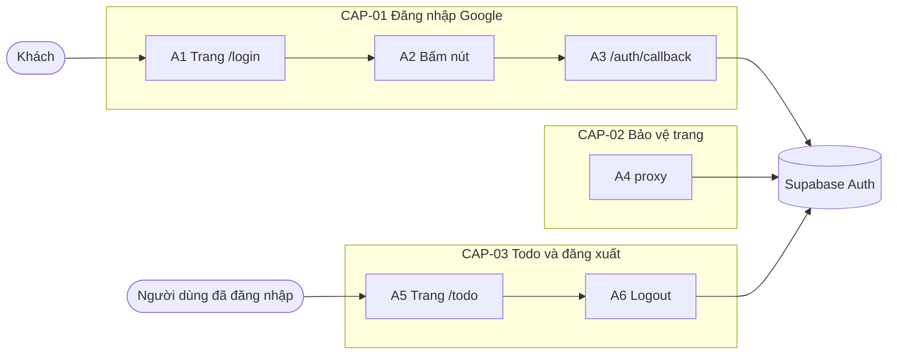
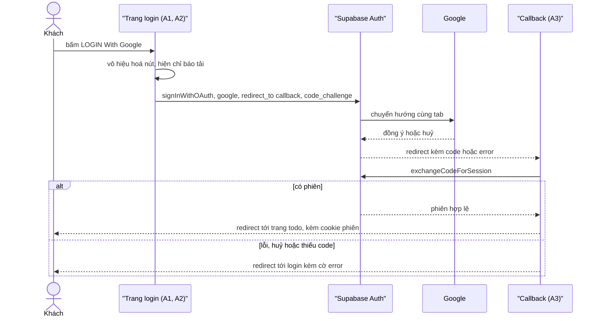
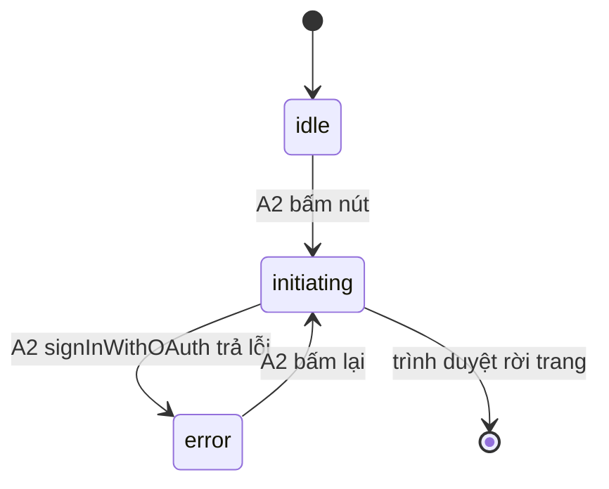

# F001_Auth — Technical Spec

## 1. Technical Overview

Tính năng Auth cho phép khách đăng nhập Google qua Supabase Auth bằng luồng chuyển hướng cùng tab (PKCE): nút trên trang `/login` gọi `signInWithOAuth` từ trình duyệt, Supabase đưa người dùng qua Google rồi trả về `/auth/callback`, tại đó route handler đổi mã lấy phiên và ghi cookie. `proxy.ts` (Next.js 16) làm mới phiên ở mọi request và chuyển hướng theo trạng thái đăng nhập; trang `/todo` kiểm tra lại phiên và có nút đăng xuất gửi form `POST /auth/logout` (Route Handler, không phải Server Action). Không có bảng dữ liệu riêng của ứng dụng — phiên và user nằm hoàn toàn trong Supabase Auth.



## 2. Action Index

| # | Action (handler) | Method · Path | Codes | Writes | Detail |
|---|---|---|---|---|---|
| **A0** | *cross-cutting — belongs to no single action* | — | FR-601 | — | § 4.4 |
| **A1** | `LoginPage` (`app/login/page.tsx`) | `GET` `/login` | FR-201, FR-202, FR-204, FR-205, BR-001, DEC-003, US002 | — *(read-only)* | § 3.1 |
| **A2** | `GoogleLoginContainer#handleClick` (`app/login/google-login-container.tsx`) | browser · `signInWithOAuth` | FR-203, FR-401, FR-403, BR-001, SM-001, INT-001, US001, US002 | — *(chỉ ghi cookie xác thực tạm của trình duyệt, không ghi bảng)* | § 3.1 ▸ **diagram** |
| **A3** | `GET` (`app/auth/callback/route.ts`) | `GET` `/auth/callback` | FR-002, FR-103, FR-402, BR-002, DEC-002, INT-001, US001, US002 | — *(ghi cookie phiên; không ghi bảng ứng dụng)* | § 3.1 ▸ **diagram** |
| **A4** | `proxy` (`proxy.ts`) → `updateSession` (`lib/supabase/proxy.ts`) | any · `/*` (trừ tài nguyên tĩnh) | FR-101, FR-102, FR-601, BR-003, BR-004, DEC-001, US005, US006 | — *(chỉ làm mới cookie phiên)* | § 3.2 |
| **A5** | `TodoPage` (`app/todo/page.tsx`) | `GET` `/todo` | FR-301, FR-601, US003 | — *(read-only)* | § 3.3 |
| **A6** | `POST` (`app/auth/logout/route.ts`) | `POST` `/auth/logout` *(Route Handler; `GET` → 405)* | FR-104, FR-404, US004 | — *(xoá cookie phiên)* | § 3.3 |

## 3. Actions

### 3.1 CAP-01 — Đăng nhập bằng Google

Luồng này trải qua ba handler (A1 → A2 → A3) và hai dịch vụ ngoài, không handler nào sở hữu cả chuỗi, nên sơ đồ đặt ở cấp capability.



#### A1 · Hiển thị màn Login
`GET /login` → `` `LoginPage` (`app/login/page.tsx`) ``
`FR-201` `FR-202` `FR-204` `FR-205` `BR-001` `DEC-003` `US002` · `SCR001_Login`

**Who** · Khách *(gate A0 — § 4.4; người đã đăng nhập bị A4 chuyển đi trước khi tới đây)*
**FE** · Trang server-rendered dựng header cố định (logo, vùng chọn ngôn ngữ của F002), hero, khối giới thiệu, nút đăng nhập (A2), vùng thông báo lỗi và footer cố định; chuỗi lấy từ từ điển theo locale của F002.
**Request** · query `error` *(chuỗi tuỳ ý, tuỳ chọn)*; cookie `NEXT_LOCALE` *(do F002 đọc)*
**BE** · `LoginPage` bọc nội dung trong `<Suspense>` (Cache Components), đọc `searchParams` và locale rồi chọn chuỗi từ từ điển; chỉ xét `error` có mặt và khác rỗng.
**Rule** · **BR-001 — Mọi giá trị `error` không rỗng đều hiện đúng một thông báo cố định, không in lại giá trị.** FR-204 (thông báo lỗi dưới nút) chỉ phụ thuộc việc `error` có mặt; thông báo lấy từ khoá từ điển, nên tham số giả mạo không chèn được nội dung. *(§ 4.4)*

| DEC | subtype | Condition | What the user sees | Source |
|---|---|---|---|---|
| **DEC-003** | render | `searchParams.error` có mặt và khác rỗng | Dòng "Đăng nhập không thành công. Vui lòng thử lại." dưới nút; thiếu `error` thì không có dòng nào | `app/login/page.tsx` |

**Result** · read-only — **no DB write**. Hiển thị trọn bộ FR-201 (header, hero, tiêu đề, subtitle, tagline, nút, footer), FR-202 (header/footer cố định, phần tử tĩnh không tương tác) và FR-205 (mọi chuỗi từ từ điển). US002 (thấy lỗi khi thất bại/huỷ) hoàn tất khi dòng lỗi hiện ra và nút A2 dùng lại được.
**Source:** `app/login/page.tsx`, `app/login/google-login-container.tsx`

<!-- No diagram: below threshold — read-only, không ghi bảng, đồng bộ. -->

---

#### A2 · Bấm nút "LOGIN With Google"
`browser · signInWithOAuth` → `` `GoogleLoginContainer#handleClick` (`app/login/google-login-container.tsx`) ``
`FR-203` `FR-401` `FR-403` `BR-001` `SM-001` `INT-001` `US001` `US002` · `SCR001_Login`

**Who** · Khách *(gate A0)*
**FE** · `GoogleLoginContainer` (client) giữ trạng thái SM-001, `LoginButton` là nút thuần hiển thị: khi bấm vô hiệu hoá nút và hiện chỉ báo `role="status"` (FR-203); rê chuột có bóng nổi. Gọi `signInWithGoogle()` (`lib/auth/sign-in-with-google.ts`, không bao giờ ném lỗi) trên client trình duyệt của Supabase; client tự chuyển hướng cùng tab (FR-401). Trang khôi phục từ bfcache (`pageshow` có `persisted`) thì đặt lại về `idle`.
**Request** · `provider` = `google`; `redirectTo` = `{origin}/auth/callback` *(không có tham số `next` — BR-002 ở A3)*
**BE** · Không có handler phía máy chủ; Supabase client tạo PKCE verifier (lưu cookie phía trình duyệt) và `code_challenge`, rồi điều hướng tới điểm `authorize` của Supabase. *(INT-001 — § 4.5: tích hợp ủy quyền đăng nhập Google cho Supabase Auth)*
**Rule** · **BR-001 — Mọi thất bại hiện cùng một thông báo cố định.** FR-403 (không khởi động được luồng): nếu lời gọi trả lỗi hoặc ném ngoại lệ thì bật lại nút, ẩn chỉ báo và hiện chính thông báo ở BR-001. *(§ 4.4)*
**Result** · Thành công: trình duyệt rời trang, trạng thái SM-001 chuyển *sẵn sàng → đang khởi động* và dừng ở đó vì trang bị thay. Thất bại: SM-001 sang *lỗi*. US001 (đăng nhập) bắt đầu từ đây; US002 (thấy lỗi) nhận nhánh lỗi. Không ghi bảng.
**State** · `SM-001`: `idle` → `initiating` → `error` *(§ 4.3)*
**Source:** `app/login/google-login-container.tsx`, `lib/auth/sign-in-with-google.ts`

---

#### A3 · Đổi mã đăng nhập lấy phiên
`GET /auth/callback` → `` `GET` (`app/auth/callback/route.ts`) ``
`FR-002` `FR-103` `FR-402` `BR-002` `DEC-002` `INT-001` `US001` `US002` · `SCR001_Login`

**Who** · Khách (trình duyệt vừa quay về từ Supabase/Google) *(gate A0)*
**FE** · Không có giao diện; chỉ trả redirect.
**Request** · query `code` *(mã PKCE, tuỳ chọn)*; query `error`, `error_description` *(khi Google/Supabase báo lỗi hoặc huỷ, tuỳ chọn)*; cookie PKCE verifier do A2 đặt.
**BE** · `GET` dùng server client của Supabase: có `error`, thiếu `code` hoặc `code` dài hơn 2048 ký tự thì thất bại ngay; còn lại gọi `exchangeCodeForSession(code)`; cookie phiên do `setAll` ghi vào response. Redirect là 307 với `Location` tương đối (`/todo` hoặc `/login?error=auth_failed`) và `Cache-Control: private, no-store`, nên đích không bao giờ phụ thuộc header `Host`/`X-Forwarded-Host`.
**Rule** · **BR-002 — Đích sau đăng nhập luôn là `/todo`; không đọc tham số đích (`next`).** Vì vậy FR-103 (đăng nhập thành công vào `/todo`) không phụ thuộc đầu vào bên ngoài và không có điểm open-redirect. FR-002 (mọi tài khoản Google được phép): không có kiểm tra tên miền ở bước này.

| DEC | subtype | Condition | What the user sees | Source |
|---|---|---|---|---|
| **DEC-002** | flow | có `error`, hoặc thiếu `code`, hoặc `exchangeCodeForSession` trả lỗi | Về `/login?error=auth_failed` (cờ cố định, không chép lại nội dung lỗi của Supabase) | `app/auth/callback/route.ts` |
| **DEC-002** | flow | có `code` và đổi mã thành công | Về `/todo` kèm cookie phiên | `app/auth/callback/route.ts` |

**Result** · Thành công: tạo phiên (cookie), redirect `/todo`. Thất bại/huỷ: không tạo phiên, redirect `/login?error=...` — đúng nhánh FR-402. US001 (đăng nhập thành công) khép lại ở đây; US002 (thấy lỗi) nhận nhánh lỗi. Không ghi bảng ứng dụng.
**Source:** `app/auth/callback/route.ts`

---

### 3.2 CAP-02 — Bảo vệ trang theo phiên

#### A4 · Làm mới phiên và chuyển hướng theo trạng thái đăng nhập
`ANY /*` → `` `proxy` (`proxy.ts`) → `updateSession` (`lib/supabase/proxy.ts`) ``
`FR-101` `FR-102` `FR-601` `BR-003` `BR-004` `DEC-001` `US005` `US006` · `SCR001_Login` · `SCR002_Todo`

**Who** · Khách hoặc người dùng đã đăng nhập *(gate A0)*
**FE** · Không có giao diện.
**Request** · mọi request khớp matcher (loại `_next/static`, `_next/image`, favicon và ảnh tĩnh); cookie phiên Supabase.
**BE** · `proxy#proxy` gọi hàm `updateSession`: tạo server client trên request, không chèn mã nào giữa lúc tạo client và lúc xác minh phiên, rồi áp DEC-001 và trả response mang cookie đã làm mới. Xác minh bằng `getUser()` (D005, đã chốt); nếu Auth server không trả lời (ném lỗi) thì coi như chưa đăng nhập (fail closed).
**Rule** · **BR-003 — Đường dẫn bắt đầu bằng `/auth/` không bị áp quy tắc chuyển hướng**, để A3 hoàn tất bước đổi mã. FR-601 (quyết định dựa trên phiên đã xác minh, không dùng `getSession()`) áp dụng cho bước xác minh này. **BR-004 — Redirect phải sao chép cookie (và header cache) của response đã làm mới**; thiếu bước này phiên vừa làm mới bị mất và người dùng bị đăng xuất ngầm.

| DEC | subtype | Condition | What the user sees | Source |
|---|---|---|---|---|
| **DEC-001** | flow | `pathname` bắt đầu bằng `/todo` và không có phiên hợp lệ | Chuyển về `/login` (FR-101: khách bị chặn khỏi `/todo`) | `lib/supabase/proxy.ts` |
| **DEC-001** | flow | `pathname` = `/login` và có phiên hợp lệ (kể cả khi có `error`) | Chuyển sang `/todo` (FR-102: người đã đăng nhập bỏ qua màn Login) | `lib/supabase/proxy.ts` |
| **DEC-001** | flow | trường hợp còn lại, hoặc `pathname` bắt đầu bằng `/auth/` | Cho đi tiếp, kèm cookie phiên đã làm mới | `lib/supabase/proxy.ts` |

**Result** · Cookie phiên được làm mới khi cần; chuyển hướng theo DEC-001. US005 (khách bị chặn khỏi `/todo`) và US006 (người đã đăng nhập bỏ qua `/login`) hoàn tất ở đây. Không ghi bảng.
**Source:** `proxy.ts`, `lib/supabase/proxy.ts`

<!-- No diagram: below threshold — không ghi bảng, đồng bộ, một nhánh quyết định dạng bảng DEC. -->

---

### 3.3 CAP-03 — Xem trang cá nhân và đăng xuất

#### A5 · Hiển thị trang Todo
`GET /todo` → `` `TodoPage` (`app/todo/page.tsx`) ``
`FR-301` `FR-601` `US003` · `SCR002_Todo`

**Who** · Người dùng đã đăng nhập *(gate A0; A4 đã chặn khách)*
**FE** · Trang bọc phần nội dung trong `<Suspense>` (Cache Components), hiện email người dùng và nút Logout nằm trong `<form action="/auth/logout" method="post">` (gửi A6 bằng điều hướng cả trang; nút bị vô hiệu hoá sau khi bấm); email và nhãn nút lấy từ từ điển `lib/i18n` do F002 sở hữu (D002, đã chốt).
**BE** · `TodoPage` gọi `await connection()` trước (supabase-js gọi `Date.now()` khi nạp phiên, Cache Components không cho phép lúc prerender), rồi tự xác minh lại phiên bằng `getUser()` của server client (FR-601 — không dựa riêng vào proxy), lấy email từ user; không có user thì redirect `/login`.
**Rule** · FR-601 (phiên xác minh phía máy chủ): trang kiểm tra lại như lớp bảo vệ thứ hai, không dựa riêng vào proxy.
**Result** · read-only — **no DB write**. Hiện email (FR-301: thấy mình đang đăng nhập bằng tài khoản nào — US003); email thiếu thì hiện "—".
**Source:** `app/todo/page.tsx`

---

#### A6 · Đăng xuất
`POST /auth/logout` → `` `POST` (`app/auth/logout/route.ts`) ``
`FR-104` `FR-404` `US004` · `SCR002_Todo`

**Who** · Người dùng đã đăng nhập *(gate A0; handler không từ chối ai — khách gọi POST chỉ nhận redirect)*
**FE** · Nút Logout trong `<form action="/auth/logout" method="post">` trên `/todo`: form POST gốc của trình duyệt nên điều hướng cả trang, không còn cây DOM `/todo` ẩn sau đăng xuất hoặc khi bấm Back. Nút bị vô hiệu hoá sau khi bấm (hoãn bằng `setTimeout` để không huỷ việc gửi form).
**BE** · `POST` (`app/auth/logout/route.ts`): `getUser()` (kết quả không dùng để chặn) → `signOut({ scope: 'local' })` của server client (chỉ thiết bị hiện tại — D004). Nếu `signOut` trả lỗi hoặc ném ngoại lệ thì xoá mọi cookie `sb-*-auth-token*` (kể cả các mảnh `.0`, `.1`, …). Luôn trả 303 `Location: /login` (tương đối) kèm `Cache-Control: private, no-store`. Chỉ export `POST`: `GET /auth/logout` nhận 405 mặc định của Next.js nên không đăng xuất được bằng liên kết. Proxy bỏ qua `/auth/` (BR-003) nên handler này không có lớp chặn phía trước.
**Rule** · FR-404 (đăng xuất xoá phiên): kể cả khi `signOut` báo lỗi hoặc phiên đã hết hạn, vẫn xoá cookie và chuyển về `/login`.
**Result** · Xoá cookie phiên (Supabase huỷ refresh token); redirect `/login` (FR-104: đăng xuất xong về màn Login — US004). Không ghi bảng ứng dụng.
**Source:** `app/auth/logout/route.ts`, `app/todo/page.tsx`, `app/todo/logout-button.tsx`

<!-- No diagram: below threshold — một lời gọi ra Supabase, không ghi bảng ứng dụng. -->

---

### 3.4 Edge cases

| Action | Scenario | Behavior |
|---|---|---|
| A1 | `?error=<script>` hoặc chuỗi bất kỳ | Chỉ hiện thông báo cố định (BR-001), giá trị bị bỏ qua |
| A2 | Bấm nhiều lần liên tiếp | Nút bị vô hiệu hoá từ lần đầu; một luồng duy nhất |
| A2 | `signInWithOAuth` trả lỗi hoặc mất mạng | SM-001 về `error`; bật nút, hiện thông báo |
| A3 | Không có `code`, không có `error` | DEC-002 → `/login?error=...` |
| A3 | Huỷ ở Google (`error=access_denied`, không có `code`) | DEC-002 → `/login?error=...`; tên tham số `[UNVERIFIED]` ở docs chính thức, cần xác nhận bằng e2e |
| A3 | Cookie PKCE verifier mất hoặc khác host (`localhost` ≠ `127.0.0.1`) | Đổi mã lỗi → `/login?error=...` |
| A3 | `code` đã dùng hoặc hết hạn | Đổi mã lỗi → `/login?error=...` |
| A4 | Access token hết hạn nhưng refresh token hợp lệ | Làm mới và gắn cookie mới vào redirect (BR-004) |
| A4 | Có phiên + `/login?error=...` | Vẫn chuyển sang `/todo` (DEC-001) |
| A5 | Request tới `/todo` lọt qua proxy | A5 tự `getUser()`, không có user thì redirect `/login` (A0 — FR-601) |
| A6 | `GET /auth/logout` (liên kết, prefetch) | 405, không đăng xuất |
| A6 | `signOut` lỗi | Xoá cookie `sb-*-auth-token*` (cả mảnh), vẫn 303 `/login` |
| A5 | Tài khoản không có email | Hiện "—" |
| A6 | Phiên hết hạn trước khi bấm Logout | Vẫn xoá cookie và về `/login`, không báo lỗi |
| A1-A6 | Không có cookie `NEXT_LOCALE` | Dùng `vi` mặc định (F002 sở hữu) |

## 4. Shared Foundation

### 4.1 Components

| Component | Responsibility | Used in | File |
|---|---|---|---|
| `LoginPage` | Trang `/login`: dựng màn Login, đọc `error` và locale | A1 | `app/login/page.tsx`, `app/login/_components/login-screen.tsx` |
| `GoogleLoginContainer` + `LoginButton` | Client: trạng thái SM-001, nút, chỉ báo tải, gọi `signInWithGoogle` → `signInWithOAuth` | A2 | `app/login/google-login-container.tsx`, `app/login/_components/login-button.tsx`, `lib/auth/sign-in-with-google.ts` |
| Callback `GET` | Route Handler `/auth/callback`: đổi mã, redirect | A3 | `app/auth/callback/route.ts` |
| `proxy` + `updateSession` | Làm mới phiên, chuyển hướng theo DEC-001 | A4 | `proxy.ts`, `lib/supabase/proxy.ts` |
| `TodoPage` + `LogoutButton` + logout `POST` | Trang `/todo`, nút gửi form, Route Handler đăng xuất | A5, A6 | `app/todo/page.tsx`, `app/todo/logout-button.tsx`, `app/auth/logout/route.ts` |
| Browser / server Supabase client factories | Tạo client mỗi lần gọi, không giữ biến toàn cục; `config.ts` ném lỗi khi thiếu biến môi trường | A2, A3, A4, A5, A6 | `lib/supabase/client.ts`, `lib/supabase/server.ts`, `lib/supabase/config.ts` |

### 4.2 Data Model

#### Key Entities

| Entity | Table | Key Columns | Purpose |
|--------|-------|-------------|---------|
| Supabase Auth user *(do Supabase quản lý, không có migration của ứng dụng; không có `MODEL###`, xem entities.md)* | `auth.users` | `id`, `email` | Danh tính người đăng nhập; app chỉ đọc email qua API xác thực |

#### Polymorphic Behavior

N/A — no discriminator fields in Key Entities.

### 4.3 State Management

### Trạng thái nút đăng nhập trên màn Login (SM-001)
**kind:** ui
**Linked FR:** FR-203
**Source:** `app/login/google-login-container.tsx`



**Action transitions:** guard và tác động của từng cạnh nằm ở rung **Result**/**State** của A2 (§ 3.1) — không lặp lại ở đây. Trạng thái `error` do trang A1 hiển thị khi quay về từ A3 là trang mới nên bắt đầu lại ở `idle` kèm thông báo (DEC-003).

### 4.4 Shared Rules

#### Bin 3 — cross-cutting, belongs to no single action

**A0 · FR-601 — Mọi quyết định cho vào/chặn dựa trên phiên được xác minh phía máy chủ.**
Proxy (A4) và trang cần phiên (A5) đều xác minh lại (A6 gọi `getUser()` nhưng không dùng kết quả để chặn); không dùng dữ liệu cookie chưa xác minh. Proxy bỏ qua tài nguyên tĩnh và mọi đường dẫn `/auth/` (BR-003), nên không thể chỉ dựa vào proxy: `/todo` tự kiểm lại, còn `/auth/logout` không gate bằng người dùng mà luôn kết thúc phiên cục bộ.
**Source:** `lib/supabase/proxy.ts`, `app/todo/page.tsx`, `app/auth/logout/route.ts`

#### Bin 2 — used by ≥2 named actions

**BR-001 — Mọi thất bại đăng nhập hiện cùng một thông báo cố định, lấy từ từ điển.**
Used in: **A1** · **A2**. A1 hiện thông báo khi có `error` trên URL; A2 hiện cùng thông báo khi không khởi động được luồng. Không bao giờ chép nội dung `error` hay thông báo của Supabase ra giao diện.
**Source:** `app/login/page.tsx`, `app/login/google-login-container.tsx`
```text
message = dictionary[locale]["login.error"]
show(message) iff (url.error is present and non-empty) or initiation_failed
```

### 4.5 Algorithms & Integrations

### Đăng nhập Google được ủy quyền cho Supabase Auth bằng PKCE (INT-001)
**Linked FR:** FR-401
**Used in:** A2 → A3
**Source:** `lib/auth/sign-in-with-google.ts`, `app/auth/callback/route.ts`
**Type:** api-call
**Target:** Supabase Auth (endpoint authorize, token, user, logout); Google OAuth đứng sau Supabase
**Payload:** `provider=google`, `redirect_to={origin}/auth/callback`, `code_challenge` + `code_challenge_method=s256`; đổi mã gửi `auth_code` và PKCE verifier. Không có secret trong payload từ ứng dụng; Google client secret chỉ nằm trong cấu hình Supabase.
**Failure handling:** none ở mức retry — mọi lỗi (mạng, huỷ, mã sai) chuyển về `/login?error=...` hoặc bật lại nút (A2), người dùng tự bấm lại.

### 4.6 Configuration

```text
NEXT_PUBLIC_SUPABASE_URL = http://127.0.0.1:54321            # URL API Supabase cục bộ (e2e trỏ tới server giả)
NEXT_PUBLIC_SUPABASE_PUBLISHABLE_KEY = <publishable key từ `supabase status`>   # tên biến đã chốt; chỉ khoá công khai
SUPABASE_AUTH_EXTERNAL_GOOGLE_CLIENT_ID = <từ Google Cloud>   # supabase/.env, KHÔNG commit
SUPABASE_AUTH_EXTERNAL_GOOGLE_CLIENT_SECRET = <từ Google Cloud>  # supabase/.env, KHÔNG commit
# supabase/config.toml (commit): auth.site_url = http://localhost:3000
#   auth.additional_redirect_urls = ["http://localhost:3000/**"]
#   auth.external.google.enabled = true ; skip_nonce_check = false
# Google Cloud (Web application): redirect URI = http://127.0.0.1:54321/auth/v1/callback ; JS origin = http://localhost:3000
```

Ghi chú: chỉ dùng một host trên trình duyệt (`localhost`) vì cookie PKCE verifier theo host. `.env.local` không commit; `.env.example` commit (tên biến, không giá trị). Cần Supabase CLI và Docker (hoặc Podman) để `supabase start`; các bước cài đặt xem [README.md](../../../README.md). Build/start cần cả hai biến `NEXT_PUBLIC_SUPABASE_*` (xem § 5.3 #5). `client_id` và `secret` trong `supabase/config.toml` đều dùng `env(...)`; việc `env()` thay cho `client_id` chưa được tài liệu chính thức xác nhận *(§ 5.3 #1)*.

**Client behavior:** see behavior-logic.md, permissions.md, architecture.md

## 5. Verification & Technical Notes

### 5.1 Technical Verification

Chính sách test: `e2e-red-first` — viết test Playwright (`@playwright/test`) trước, chạy phải đỏ vì đúng lý do, rồi mới cài đặt. Google/Supabase chỉ bị giả lập ở biên mạng trong test (server Supabase giả cho request phía máy chủ, `page.route` cho điều hướng của trình duyệt); không có mock trong mã ứng dụng.

- **SC-001** *(A2)* Bấm nút: nút bị vô hiệu hoá, có chỉ báo `role="status"`, và trình duyệt gọi endpoint authorize với `provider=google`, `redirect_to` chứa `/auth/callback`, `code_challenge`; không mở tab/popup mới (covers FR-203, FR-401).
- **SC-002** *(A3)* Callback với `code` giả hợp lệ → URL cuối là `/todo` có cookie phiên; với `error=access_denied`, không `code`, hoặc đổi mã trả 400 → URL cuối là `/login?error=...` (covers FR-402, DEC-002).
- **SC-003** *(A1)* `/login?error=x` hiện đúng thông báo cố định dưới nút; `/login` thì không; giá trị `error` chứa HTML không xuất hiện trong trang (covers FR-204, BR-001, DEC-003).
- **SC-004** *(A4)* Chưa đăng nhập vào `/todo` → `/login`; đã đăng nhập vào `/login` → `/todo` (cả khi có `error`); redirect không mất cookie (covers FR-101, FR-102, BR-004, DEC-001).
- **SC-005** *(A5, A6)* `/todo` hiện email; Logout (form `POST /auth/logout`) → `/login`; mở lại `/todo` hoặc Back → `/login`, không còn DOM `/todo` (covers FR-301, FR-104, FR-404). `GET /auth/logout` → 405; `signOut` lỗi vẫn xoá cookie và 303 `/login` (hành vi trong mã; test e2e hiện chỉ phủ luồng Logout → `/login` và Back).
- **SC-006** *(A1)* Bố cục: logo trái trên, vùng ngôn ngữ phải trên, footer cố định khi cuộn; logo/footer/dòng giới thiệu không phản ứng khi bấm (covers FR-201, FR-202). Test case `60bc5bbb` ("tab mới hoặc popup") bị thay thế bởi quyết định chuyển hướng cùng tab trong `clarifications.md`.
- **SC-007** *(A1)* Các chuỗi Login đổi theo locale từ F002 (covers FR-205; test thuộc F002 nhưng cần giả lập locale).
- **SC-008** *(A3)* Smoke tuỳ chọn `@smoke` chạy với Supabase cục bộ thật để xác nhận cấu hình Google và tên tham số khi huỷ (covers FR-001, FR-002; không chạy mặc định).

#### US001_Login *(A2, A3)*

**Independent Test:** Bấm nút, giả lập Google trả mã hợp lệ, kiểm tra kết thúc ở `/todo` có email.

**Acceptance Scenarios:**

1. **Given** khách ở `/login`, **When** bấm nút rồi callback nhận `code=stub-code`, **Then** URL là `/todo` và có cookie phiên.

#### US002_LoginFailure *(A1, A2, A3)*

**Independent Test:** Gọi callback với `error=access_denied`; kiểm tra thông báo.

**Acceptance Scenarios:**

1. **Given** callback nhận `error=access_denied`, **When** trình duyệt về `/login?error=...`, **Then** thông báo cố định hiện dưới nút và nút bấm lại được.
2. **Given** lời gọi `signInWithOAuth` bị chặn mạng, **When** bấm nút, **Then** nút bật lại và thông báo hiện.

#### US003_ViewTodo *(A5)*

**Independent Test:** Đặt phiên giả, mở `/todo`, kiểm tra email.

**Acceptance Scenarios:**

1. **Given** có phiên hợp lệ, **When** mở `/todo`, **Then** thấy email và nút Logout.

#### US004_Logout *(A6)*

**Independent Test:** Từ `/todo` bấm Logout.

**Acceptance Scenarios:**

1. **Given** có phiên, **When** bấm Logout, **Then** về `/login` và `/todo` lại bị chặn.

#### US005_GuardTodo *(A4)*

**Independent Test:** Mở `/todo` không cookie, và với cookie giả.

**Acceptance Scenarios:**

1. **Given** không có phiên hợp lệ, **When** mở `/todo`, **Then** về `/login`.

#### US006_SkipLogin *(A4)*

**Independent Test:** Mở `/login` có phiên.

**Acceptance Scenarios:**

1. **Given** có phiên hợp lệ, **When** mở `/login?error=x`, **Then** về `/todo`.

### 5.2 Assumptions

- *(A3)* Khi huỷ ở Google, dịch vụ xác thực chuyển về `redirectTo` với `error`/`error_description` và không có `code` — suy từ hành vi chung của GoTrue, chưa có xác nhận trong tài liệu chính thức.
- *(A4)* Next.js 16 dùng `proxy.ts` (export tên `proxy`) thay cho `middleware.ts`; đã được dùng đúng như vậy trong `proxy.ts` và chạy được trong e2e.
- *(A2, A3)* Phiên bản đang dùng: xem `package.json` (`@supabase/ssr` ~0.12.7, `@supabase/supabase-js` ^2.117.3, `@playwright/test` ^1.64.0, `next` 16.4.0).
- *(A4, A5)* Cache Components **đang bật** (`cacheComponents: true` trong `next.config.ts`; `app/layout.tsx` đặt `instant = false`): trang đọc cookie/`searchParams`/`getUser()` bọc trong `<Suspense>`, và `/todo` gọi `await connection()` trước `getUser()`.

### 5.3 Unresolved Questions

1. **`env()` cho `client_id`** *(A3)*: cấu hình `config.toml` hỗ trợ thay thế biến môi trường cho `client_id` hay chỉ cho `secret`? Nếu không, ghi cứng `client_id` (không phải bí mật).
2. **Tên tham số lỗi khi huỷ** *(A3)*: xác nhận bằng e2e hoặc smoke trên stack thật (SC-008).
3. ~~Cách xác minh phiên trong proxy~~ *(A4)* — **đã chốt**: `getUser()` (không cần JWKS trong server giả); `/todo` và logout kiểm lại bằng `getUser()` (clarifications.md, 2026-10-08).
4. ~~Tên biến khoá công khai~~ *(A2)* — **đã chốt**: `NEXT_PUBLIC_SUPABASE_PUBLISHABLE_KEY` (clarifications.md, 2026-10-08).

#### Quyết định và rủi ro đã ghi nhận (as-built)

5. **Build cần biến môi trường** *(A2-A6)*: `lib/supabase/config.ts` ném lỗi ngay khi import nếu thiếu `NEXT_PUBLIC_SUPABASE_URL` hoặc `NEXT_PUBLIC_SUPABASE_PUBLISHABLE_KEY`, nên `next build` thất bại khi thiếu. CI phải đặt cả hai biến (Playwright đặt giá trị mock cho server ứng dụng trong `playwright.config.ts`).
6. **Cookie `secure` ở production** *(A3, A4, A6)*: client Supabase không tự đặt `secure: true` cho cookie phiên trong mã hiện tại (`lib/supabase/server.ts`, `lib/supabase/proxy.ts` truyền nguyên `options`). Triển khai production qua HTTPS cần thêm `secure: true` vào tuỳ chọn cookie trước khi phát hành.
7. **P3 — chấp nhận** *(A1)*: query thô của `/login` (ví dụ `?error=<script>`) nằm trong payload RSC của Next dưới dạng chuỗi đã escape JSON, không bao giờ render thành HTML; callback chỉ phát `error=auth_failed` (clarifications.md, 2026-10-08).
8. **Các mục Low hoãn lại**: (a) `redirectWithCookies` trong `lib/supabase/proxy.ts` dựng URL tuyệt đối từ `request.nextUrl`, khác `Location` tương đối của `/auth/*`; (b) `setAll` trong `updateSession` ghi đè `cacheHeaders` ở mỗi lần gọi thay vì cộng dồn; (c) `POST /auth/logout` chưa kiểm tra `Origin` (CSRF đăng xuất chỉ làm người dùng bị đăng xuất cục bộ, không lộ dữ liệu).

### 5.4 Source References

| Thành phần | File |
|---|---|
| Trang Login | `app/login/page.tsx`, `app/login/google-login-container.tsx`, `app/login/_components/*` |
| Khởi động OAuth | `lib/auth/sign-in-with-google.ts` |
| Callback | `app/auth/callback/route.ts` |
| Đăng xuất | `app/auth/logout/route.ts`, `app/todo/logout-button.tsx` |
| Trang Todo | `app/todo/page.tsx` |
| Proxy và client Supabase | `proxy.ts`, `lib/supabase/{config,client,server,proxy}.ts` |
| Cấu hình | `supabase/config.toml`, `.env.example`, `playwright.config.ts` |
| Kiểm thử | `e2e/auth-flow-and-route-guards.spec.ts`, `e2e/login-screen-layout-and-button.spec.ts`, `e2e/support/*` |

#### Data Flow

```text
bấm nút -> signInWithOAuth (PKCE) -> Supabase authorize -> Google -> /auth/callback?code -> exchangeCodeForSession -> cookie phiên -> redirect /todo
mọi request -> proxy -> updateSession (làm mới cookie) -> DEC-001 -> trang hoặc redirect (kèm cookie)
```

### 5.5 Artifact References

| Artifact | File | Codes Used | Reviewed |
|----------|------|------------|----------|
| System Overview | [overview.md](../../system/overview.md) | — | [ ] |
| Architecture | [architecture.md](../../system/architecture.md) | — | [ ] |
| Feature List | [feature-list.md](../../generated/feature-list.md) | F001 | [x] |
| API Map | [api-map.md](../../generated/api-map.md) | ROUTE001, ROUTE002 | [ ] |
| Entities | [entities.md](../../generated/entities.md) | — | [ ] |
| Screens | [screen-list.md](../../generated/screen-list.md) | SCR001_Login, SCR002_Todo | [ ] |
| Behavior Logic | [behavior-logic.md](../../generated/behavior-logic.md) | — | [ ] |
| Permissions Matrix | [permissions-matrix.md](../../generated/permissions-matrix.md) | PERM001 – PERM009 | [ ] |
| User Stories | [user-stories.md](../../generated/user-stories.md) | US001_Login, US002_LoginFailure, US003_ViewTodo, US004_Logout, US005_GuardTodo, US006_SkipLogin | [ ] |
