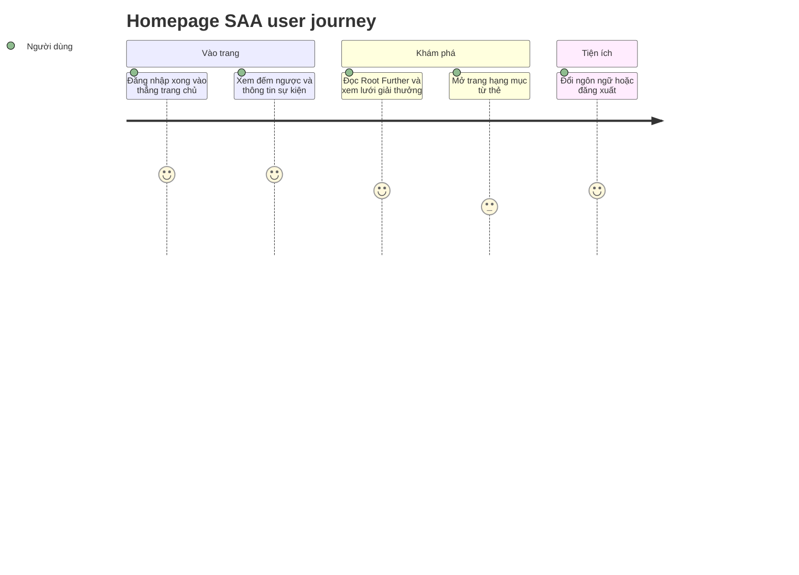

**Priority**: P0
**Type**: ui

## 1. Overview

**Problem:** Sau khi đăng nhập, người dùng hiện chỉ thấy trang `/todo` tối thiểu; chưa có trang chủ nào giới thiệu Sun* Annual Awards 2025 (chủ đề ROOT FURTHER), cho biết còn bao lâu tới sự kiện, các hạng mục giải thưởng và phong trào Sun* Kudos.
**Solution:** Trang chủ `/` dành cho người đã đăng nhập: header cố định (điều hướng, thông báo, ngôn ngữ, tài khoản), hero kèm đồng hồ đếm ngược tới giờ khai mạc, thông tin sự kiện, phần giới thiệu Root Further, lưới 6 hạng mục giải thưởng, khối quảng bá Sun* Kudos, nút widget cố định và footer. Đăng nhập xong người dùng vào thẳng trang này.
**Scope:** Màn trang chủ cùng vỏ header/footer của nó; menu tài khoản, bảng thông báo (trạng thái trống), nút widget; đồng hồ đếm ngược theo cấu hình; các trang đích còn thiếu làm trang "Coming soon" tối thiểu để không có link chết; việc đổi đích sau đăng nhập từ `/todo` sang `/`.
**Non-Scope:** Nội dung thật của trang Awards Information (nay do F004_AwardsInformation dựng) và các trang Sun* Kudos, Tiêu chuẩn chung, Profile, Admin Dashboard (chỉ có trang giữ chỗ). Dữ liệu thông báo thật. Nhóm hành động nhanh của nút widget do F007_WriteKudo mô tả (FR-106, FR-107); trang Thể lệ thật chưa có. Cơ chế đăng nhập/đăng xuất và bộ chọn ngôn ngữ (thuộc F001_Auth và F002_Localization, trang này chỉ dùng lại).

**Actors**

| Actor | Description | Primary goal |
|-------|--------------|---------------|
| Khách | Người chưa đăng nhập, mở thẳng địa chỉ trang chủ | Được đưa về màn Login để đăng nhập |
| Người dùng đã đăng nhập | Nhân sự Sun* có phiên hợp lệ | Nắm thông tin sự kiện SAA 2025 và đi tới giải thưởng, Kudos |
| Quản trị viên | Người dùng đã đăng nhập có vai trò admin | Như người dùng thường, thêm lối vào Admin Dashboard |

## 2. Functional Capabilities

| ID | Capability | What the user can do | User Stories | Requirements | Business Rules | Screens |
|----|------------|------------------------|-----------------|---------------|-------------------|---------|
| CAP-01 | Vào trang chủ sau đăng nhập | Đăng nhập xong thì vào thẳng trang chủ; khách mở trang chủ bị đưa về màn Login | US001, US002 | FR-101, FR-102, FR-103, FR-104, FR-105, FR-601 | BR-005, DEC-003 | SCR003_Homepage |
| CAP-02 | Điều hướng và tiện ích trên header, footer | Chuyển trang bằng header/footer, mở menu tài khoản và đăng xuất, xem bảng thông báo, đổi ngôn ngữ; không gặp link chết | US006, US007, US008, US009 | FR-002, FR-003, FR-201, FR-202, FR-211, FR-212, FR-401, FR-402, FR-403, FR-404, FR-405, FR-602, FR-603 | BR-003, BR-004, DEC-002, DEC-004 | — |
| CAP-03 | Xem thông tin sự kiện và đếm ngược | Biết thời gian còn lại tới sự kiện, ngày giờ, địa điểm và tinh thần Root Further | US003 | FR-001, FR-203, FR-204, FR-205, FR-207 | BR-001, BR-002, DEC-001, DEC-005 | — |
| CAP-04 | Khám phá giải thưởng và Sun* Kudos | Xem 6 hạng mục giải thưởng và mở đúng phần của hạng mục đó; đi tới Awards hoặc Kudos từ hero và khối Kudos | US004, US005 | FR-206, FR-208, FR-209, FR-210 | BR-006 | — |

## 3. Open Decisions

| D### | Decision | Default proposal | Rationale | Blocks work |
|------|----------|-------------------|-----------|--------------|
| D001 | Ai được vào `/` | **Đã chốt:** phải đăng nhập; khách bị chuyển về `/login`. Test case ID-0 (khách xem được trang chủ) bị thay thế (clarifications.md, 2026-10-08) | Cùng cách bảo vệ `/todo` của F001 | no |
| D002 | Đích sau đăng nhập | **Đã chốt:** `/` thay cho `/todo` (cả sau bước đổi mã và khi người đã đăng nhập mở `/login`); `/todo` giữ nguyên và vẫn được bảo vệ (clarifications.md, 2026-10-08) | Trang chủ là cửa vào chính của ứng dụng | no |
| D003 | Các trang đích chưa có (Awards Information, Sun* Kudos, Tiêu chuẩn chung) | **Đã chốt:** làm trang giữ chỗ `/awards-information`, `/sun-kudos`, `/standards` chỉ hiện "Coming soon"; thẻ giải thưởng trỏ `/awards-information#<slug>` (clarifications.md, 2026-10-08) | Không để link chết (TC ID-59); trang thật là việc sau | no |
| D004 | Phạm vi menu header | **Đã chốt:** menu tài khoản thật (Profile tới `/profile`, Sign out dùng đăng xuất hiện có, Admin Dashboard chỉ cho admin tới `/admin`); bảng thông báo mở ra trạng thái trống, không badge; nút widget chỉ vẽ, chưa có menu (clarifications.md, 2026-10-08) — **phần nút widget đã thay bằng D012 (2026-10-15)** | Chưa có nguồn dữ liệu thông báo, chưa có đặc tả hành động nhanh nên không bịa lựa chọn | no |
| D005 | Nguồn nội dung sự kiện khi đặc tả và Figma khác nhau | **Đã chốt:** theo Figma (ngày 26/12/2025, Âu Cơ Art Center, "Tường thuật trực tiếp qua sóng Livestream"); ngày hiển thị và đếm ngược cùng lấy từ `EVENT_START_AT`; giá trị sai hoặc thiếu thì đếm ngược về 00 và ẩn "Coming soon" (clarifications.md, 2026-10-08) | Figma là bản mới hơn | no |
| D006 | Mô tả ngắn và slug của 6 hạng mục giải thưởng | **Đã chốt:** mô tả lấy nguyên văn từ node Figma của từng thẻ (nội dung điền khi triển khai, không tự bịa); slug: `top-talent`, `top-project`, `top-project-leader`, `best-manager`, `signature-2025-creator`, `mvp` (clarifications.md, 2026-10-08) | Cần đủ nội dung để vẽ lưới; slug phải khớp mục neo của trang Awards Information sau này | no |
| D007 | Khối thông tin sự kiện hiện gì và theo múi giờ nào | **Đã chốt:** chỉ ngày, định dạng `dd/MM/yyyy`, tính theo múi giờ Asia/Ho_Chi_Minh (giống nhau ở server và client); không hiện giờ (clarifications.md, 2026-10-08) | Người xem ở đâu cũng thấy cùng một ngày | no |
| D008 | Dòng ngày sự kiện khi `EVENT_START_AT` thiếu hoặc sai | **Đã chốt:** hiện "—", bố cục giữ nguyên (clarifications.md, 2026-10-08) | Không hiện ngày sai; không làm hỏng trang | no |
| D009 | Người không phải admin gõ thẳng `/admin` | **Đã chốt:** bị chặn phía máy chủ và chuyển về `/` (clarifications.md, 2026-10-08) | Ẩn mục trong menu không phải là kiểm soát truy cập | no |
| D010 | Trang giữ chỗ có dùng lại header và footer không | **Đã chốt:** có; mục điều hướng đang chọn theo trang hiện tại (clarifications.md, 2026-10-08) | Người dùng quay về được mà không cần nút riêng | no |
| D011 | Trang giữ chỗ (`/awards-information`, `/sun-kudos`, `/standards`, `/profile`, `/admin`) có yêu cầu đăng nhập không | **Đã chốt:** có; proxy bảo vệ như `/`, khách bị chuyển về `/login` (clarifications.md, 2026-10-08) | Thống nhất với D001 | no |
| D012 | Hành vi nút widget (thay phần nút widget của D004) | **Đã chốt (2026-10-15):** bấm nút widget mở nhóm hành động nhanh theo thiết kế MoMorph `Sv7DFwBw1h`: "Thể lệ" mở "Coming soon", "Viết KUDOS" mở modal Viết Kudo (thẳng trên `/sun-kudos`, qua `/sun-kudos?compose=1` ở trang khác), nút × đỏ, Esc và click ngoài đóng nhóm; chi tiết ở F007_WriteKudo D017 | Đã có đặc tả hành động nhanh nên không còn lý do để nút chỉ vẽ | no |

## 4. Requirements

### Foundation (0xx)

- **FR-001** Thời điểm bắt đầu sự kiện lấy từ một biến cấu hình `EVENT_START_AT` (ISO-8601 kèm offset hoặc `Z`), là nguồn duy nhất cho ngày hiển thị và đếm ngược.
- **FR-002** Các trang `/awards-information`, `/sun-kudos`, `/standards`, `/profile`, `/admin` tồn tại, dùng lại header và footer của trang chủ; `/sun-kudos`, `/standards`, `/profile`, `/admin` chỉ có nội dung "Coming soon", còn `/awards-information` nay là trang Hệ thống giải của F004_AwardsInformation.
- **FR-003** Mọi chuỗi trên trang chủ lấy từ từ điển vi/en hiện có của F002_Localization.

### Navigation (1xx)

- **FR-101** Khách mở `/` thì bị chuyển về `/login`.
- **FR-102** Đăng nhập thành công đưa người dùng tới `/` thay vì `/todo`.
- **FR-103** Người đã đăng nhập mở `/login` thì được chuyển sang `/`.
- **FR-104** `/todo` giữ nguyên hành vi và vẫn chỉ dành cho người đã đăng nhập.
- **FR-105** Các trang giữ chỗ cũng chỉ dành cho người đã đăng nhập: khách mở trang nào trong số đó cũng bị chuyển về `/login`.

### Homepage (2xx)

- **FR-201** Header cố định khi cuộn: logo, ba mục điều hướng (chỉ hiện từ màn rộng 1024px trở lên; dưới mức đó header không có mục điều hướng; mục đang chọn theo trang hiện tại, trên `/` là About SAA 2025; còn lại Awards Information, Sun* Kudos), chuông thông báo, bộ chọn VN/EN, biểu tượng tài khoản.
- **FR-202** Bấm logo hoặc mục đang chọn thì cuộn lên đầu trang; bấm mục khác thì chuyển sang trang tương ứng.
- **FR-203** Hero hiển thị hình ROOT FURTHER, dòng "Coming soon" và ba ô đếm ngược DAYS, HOURS, MINUTES.
- **FR-204** Mỗi ô đếm ngược luôn đủ hai chữ số và cập nhật mỗi phút; tới hoặc qua mốc sự kiện (hay cấu hình sai) thì hiện 00 và ẩn "Coming soon".
- **FR-205** Khối thông tin sự kiện hiện ngày dạng `dd/MM/yyyy` theo múi giờ Asia/Ho_Chi_Minh (lấy từ `EVENT_START_AT`, thiếu hoặc sai thì hiện "—"), địa điểm Âu Cơ Art Center và ghi chú tường thuật trực tiếp qua Livestream.
- **FR-206** Hai nút ABOUT AWARDS và ABOUT KUDOS đưa tới `/awards-information` và `/sun-kudos`.
- **FR-207** Dưới hero có đoạn giới thiệu Root Further.
- **FR-208** Lưới 6 thẻ giải thưởng: 3 cột trên desktop, 2 cột trên tablet và mobile; mô tả tối đa 2 dòng; thẻ nhô nhẹ khi rê chuột.
- **FR-209** Bấm ảnh, tiêu đề hoặc "Chi tiết" của thẻ thì mở `/awards-information#<slug>` của hạng mục đó.
- **FR-210** Khối Sun* Kudos có nút "Chi tiết" dẫn tới `/sun-kudos`.
- **FR-211** Nút widget cố định ở góc phải dưới của mọi trang chính; bấm vào mở nhóm hành động nhanh "Thể lệ" (Coming soon), "Viết KUDOS" (mở modal Viết Kudo) và nút × đóng, xem F007_WriteKudo FR-106 và FR-107 (D012).
- **FR-212** Footer có logo (về đầu trang), liên kết About SAA 2025, Award Information, Sun* Kudos, Tiêu chuẩn chung (tới `/standards`) và dòng bản quyền.

### Interaction (4xx)

- **FR-401** Bấm chuông mở bảng thông báo ở trạng thái trống, không có badge.
- **FR-402** Bấm biểu tượng tài khoản mở menu gồm Profile (tới `/profile`) và Sign out; Admin Dashboard (tới `/admin`) chỉ có với admin.
- **FR-403** Sign out kết thúc phiên bằng luồng đăng xuất hiện có của F001_Auth rồi về `/login`.
- **FR-404** Mọi dropdown mở/đóng khi bấm nút, đóng khi bấm ra ngoài hoặc nhấn Escape, mở được bằng Enter hoặc Space.
- **FR-405** Chọn VN hoặc EN đổi toàn bộ chuỗi của trang chủ và được nhớ như F002_Localization.

### Security (6xx)

- **FR-601** Trang chủ chỉ hiển thị cho phiên đã được máy chủ xác thực xác minh; nếu không xác minh được thì coi như chưa đăng nhập.
- **FR-602** Mục Admin Dashboard chỉ hiện cho người dùng có vai trò admin.
- **FR-603** Người không phải admin mở thẳng `/admin` thì bị chặn phía máy chủ và chuyển về `/`.

## 5. Business Rules

- Số ngày, giờ, phút còn lại tính từ thời điểm hiện tại tới `EVENT_START_AT`, bỏ phần lẻ, không bao giờ âm (BR-001)
- `EVENT_START_AT` thiếu, hoặc không phải ISO-8601 kèm offset hoặc `Z` (thiếu offset là không hợp lệ), hoặc là ngày giờ không có thật (ví dụ `2025-02-30`, `24:00`), thì coi như đã tới mốc: đếm ngược 00 00 00, ẩn "Coming soon", dòng ngày sự kiện hiện "—", trang vẫn hiển thị bình thường (BR-002)
- Nội dung tiếng Việt lấy từ thiết kế Figma, không tự bịa; bản tiếng Anh do nhóm tự soạn và có thể sửa sau (BR-003)
- Admin Dashboard chỉ hiện khi vai trò của người dùng là admin; người dùng thường chỉ thấy Profile và Sign out (BR-004)
- Đích sau đăng nhập luôn là `/`, không đọc tham số quay lại (không có "quay về trang đang mở dở"); `/todo` vẫn là trang được bảo vệ (BR-005)
- Sáu hạng mục có slug cố định `top-talent`, `top-project`, `top-project-leader`, `best-manager`, `signature-2025-creator`, `mvp`; mô tả lấy nguyên văn từ Figma (BR-006)
- Trước mốc sự kiện hiện "Coming soon" và đếm ngược; từ mốc trở đi ẩn "Coming soon" và giữ 00 (DEC-001)
- Menu tài khoản của admin có ba mục, của người dùng thường có hai mục (DEC-002)
- Khách ở `/` bị chuyển về `/login`; người đã đăng nhập ở `/` thấy trang chủ (DEC-003)
- Trang giữ chỗ: khách bị chuyển về `/login`; người đã đăng nhập vào được, riêng `/admin` chỉ cho admin, người khác bị chuyển về `/` (DEC-004)
- Còn dữ liệu sự kiện hợp lệ thì dòng ngày hiện `dd/MM/yyyy`; thiếu hoặc sai thì hiện "—" (DEC-005)

## 6. Screens

| Screen Name | SCR### | What User Sees | What User Can Do |
|-------------|--------|-----------------|-------------------|
| Homepage SAA | SCR003_Homepage | Header cố định; hero ROOT FURTHER với đếm ngược; ngày, địa điểm, Livestream; đoạn giới thiệu Root Further; lưới 6 hạng mục; khối Sun* Kudos; nút widget; footer | Đi tới Awards Information, Sun* Kudos, Tiêu chuẩn chung; mở menu tài khoản, bảng thông báo, bộ chọn ngôn ngữ; bấm thẻ giải thưởng; đăng xuất |

Các trang giữ chỗ `/sun-kudos`, `/standards`, `/profile`, `/admin` chỉ hiện "Coming soon" (dùng lại header, footer, và chỉ cho người đã đăng nhập) nên không có đặc tả màn riêng; `/awards-information` đã có đặc tả riêng ở F004_AwardsInformation (SCR004_AwardsInformation).

### User Journey

1. Người dùng đăng nhập Google xong và đến Homepage SAA, thấy hero ROOT FURTHER, đồng hồ đếm ngược và thông tin sự kiện.
2. Người dùng cuộn xuống, đọc phần Root Further rồi xem lưới 6 hạng mục giải thưởng.
3. Người dùng bấm một thẻ, được chuyển tới trang Awards Information (F004_AwardsInformation) tại đúng mục của hạng mục.
4. Người dùng quay lại, xem khối Sun* Kudos và bấm "Chi tiết" để sang trang Sun* Kudos.
5. Bất cứ lúc nào, người dùng đổi ngôn ngữ, mở menu tài khoản để đăng xuất, hoặc bấm logo để về đầu trang.



## 7. User Stories

### US001 — Vào trang chủ sau khi đăng nhập

**Actor:** Người dùng đã đăng nhập
**Goal:** Đăng nhập xong là thấy ngay trang chủ SAA 2025.
**Business value:** Trang chủ trở thành cửa vào chính, người dùng không phải đi vòng qua trang tối thiểu.

**Acceptance Criteria:**
- [ ] Đăng nhập Google thành công thì trang đầu tiên là `/`
- [ ] Mở `/login` khi đã đăng nhập thì được chuyển sang `/`
- [ ] `/todo` vẫn mở được khi đã đăng nhập và vẫn chặn khách

### US002 — Khách mở trang chủ bị đưa về Login

**Actor:** Khách
**Goal:** Biết mình cần đăng nhập trước khi xem trang chủ.
**Business value:** Nội dung sự kiện chỉ dành cho người trong tổ chức.

**Acceptance Criteria:**
- [ ] Khách mở `/` thì tới `/login`, không thấy nội dung trang chủ dù chỉ thoáng qua

### US003 — Xem đếm ngược và thông tin sự kiện

**Actor:** Người dùng đã đăng nhập
**Goal:** Biết còn bao lâu tới sự kiện, diễn ra khi nào, ở đâu và theo dõi bằng cách nào.
**Business value:** Tạo háo hức và giúp mọi người sắp xếp lịch.

**Acceptance Criteria:**
- [ ] Ba ô DAYS, HOURS, MINUTES luôn có hai chữ số (05, 09) và đổi mỗi phút
- [ ] Trước mốc sự kiện thấy "Coming soon"; từ mốc trở đi ô về 00 và "Coming soon" biến mất
- [ ] Thấy ngày dạng `dd/MM/yyyy` (hiện "—" nếu cấu hình sai), địa điểm Âu Cơ Art Center và ghi chú tường thuật trực tiếp
- [ ] Đọc được đoạn giới thiệu Root Further bên dưới hero

### US004 — Khám phá hạng mục giải thưởng

**Actor:** Người dùng đã đăng nhập
**Goal:** Xem các hạng mục giải thưởng và mở đúng mục mình quan tâm.
**Business value:** Người dùng hiểu hệ thống giải thưởng ngay từ trang chủ.

**Acceptance Criteria:**
- [ ] Thấy 6 thẻ, mỗi thẻ có ảnh, tên, mô tả tối đa 2 dòng và "Chi tiết"
- [ ] Desktop 3 cột; tablet và mobile 2 cột
- [ ] Bấm ảnh, tên hoặc "Chi tiết" thì tới `/awards-information#<slug>` của hạng mục đó

### US005 — Đi tới Awards và Sun* Kudos từ hero và khối Kudos

**Actor:** Người dùng đã đăng nhập
**Goal:** Từ trang chủ nhảy nhanh sang trang giải thưởng hoặc trang Kudos.
**Business value:** Tăng lượt tham gia phong trào ghi nhận Sun* Kudos.

**Acceptance Criteria:**
- [ ] ABOUT AWARDS tới `/awards-information`, ABOUT KUDOS tới `/sun-kudos`
- [ ] "Chi tiết" ở khối Sun* Kudos tới `/sun-kudos`

### US006 — Điều hướng bằng header và footer

**Actor:** Người dùng đã đăng nhập
**Goal:** Chuyển giữa các trang chính và về đầu trang từ bất kỳ đâu.
**Business value:** Điều hướng nhất quán, không gặp link chết.

**Acceptance Criteria:**
- [ ] Header luôn thấy khi cuộn; "About SAA 2025" được tô nổi trên `/`
- [ ] Bấm logo hoặc mục đang chọn thì cuộn lên đầu trang
- [ ] Mọi liên kết ở header, footer (kể cả Tiêu chuẩn chung) mở ra một trang, không gặp lỗi 404
- [ ] Trang giữ chỗ cũng có header và footer, mục điều hướng đang chọn theo trang hiện tại
- [ ] Khách mở thẳng một trang giữ chỗ thì bị chuyển về Login
- [ ] Nút widget luôn nằm ở góc phải dưới; bấm vào thì nút ẩn và nhóm hành động nhanh hiện ở cùng chỗ

### US007 — Mở menu tài khoản và đăng xuất

**Actor:** Người dùng đã đăng nhập, Quản trị viên
**Goal:** Xem hồ sơ, đăng xuất, và (với admin) vào Admin Dashboard.
**Business value:** Kiểm soát phiên của mình; chỉ admin mới thấy lối vào quản trị.

**Acceptance Criteria:**
- [ ] Người dùng thường thấy Profile và Sign out
- [ ] Admin thấy thêm Admin Dashboard
- [ ] Người không phải admin mở thẳng `/admin` thì bị chuyển về `/`
- [ ] Sign out đưa về màn Login
- [ ] Menu đóng khi bấm ra ngoài hoặc nhấn Escape

### US008 — Mở bảng thông báo

**Actor:** Người dùng đã đăng nhập
**Goal:** Xem thông báo của mình.
**Business value:** Chỗ sẵn cho thông báo thật khi có nguồn dữ liệu.

**Acceptance Criteria:**
- [ ] Bấm chuông mở bảng với trạng thái trống ("Chưa có thông báo"), không có chấm đỏ

### US009 — Đổi ngôn ngữ ngay trên trang chủ

**Actor:** Người dùng đã đăng nhập
**Goal:** Đọc trang chủ bằng tiếng Việt hoặc tiếng Anh.
**Business value:** Người đọc ở đâu cũng hiểu nội dung.

**Acceptance Criteria:**
- [ ] Mặc định hiện VN; chọn EN thì toàn bộ chuỗi trên trang chủ đổi sang tiếng Anh và ngược lại

## 8. Scenarios

### US001 — Happy Path

**Given** khách chưa đăng nhập, **When** đăng nhập Google thành công, **Then** thấy trang chủ `/`.

### US001 — Error: Đăng nhập không thành công

**Given** khách đang ở màn Login, **When** đăng nhập thất bại hoặc bị huỷ, **Then** quay lại `/login` với thông báo lỗi như F001_Auth, không vào trang chủ.

### US002 — Happy Path

**Given** khách chưa đăng nhập, **When** mở `/`, **Then** được chuyển tới `/login`.

### US003 — Happy Path

**Given** thời điểm hiện tại trước mốc sự kiện, **When** mở trang chủ, **Then** thấy "Coming soon", ba ô đếm ngược hai chữ số, ngày, địa điểm và ghi chú Livestream.

### US003 — Error: Cấu hình mốc sự kiện sai

**Given** `EVENT_START_AT` thiếu hoặc không hợp lệ, **When** mở trang chủ, **Then** ba ô hiện 00, "Coming soon" ẩn, dòng ngày hiện "—", phần còn lại của trang bình thường.

### US004 — Happy Path

**Given** người dùng đang ở trang chủ, **When** bấm tiêu đề thẻ "Top Talent", **Then** vào `/awards-information#top-talent`.

### US004 — Error: Thẻ không có slug

**Given** một thẻ chưa có slug, **When** bấm thẻ, **Then** vào `/awards-information` và không tự cuộn tới đâu.

### US005 — Happy Path

**Given** người dùng đang ở hero, **When** bấm ABOUT KUDOS, **Then** vào `/sun-kudos`.

### US006 — Happy Path

**Given** người dùng đã cuộn xuống giữa trang, **When** bấm logo, **Then** trang cuộn lên đầu và header vẫn cố định.

### US006 — Error: Trang đích chưa làm

**Given** người dùng ở trang chủ, **When** bấm "Tiêu chuẩn chung" ở footer, **Then** vào trang giữ chỗ hiện "Coming soon" cùng header và footer, không có lỗi 404.

### US006 — Error: Khách mở thẳng trang giữ chỗ

**Given** khách chưa đăng nhập, **When** mở thẳng `/standards`, **Then** được chuyển về `/login`.

### US007 — Happy Path

**Given** người dùng thường đã đăng nhập, **When** bấm biểu tượng tài khoản rồi chọn Sign out, **Then** phiên kết thúc và về `/login`.

### US007 — Error: Không phải admin

**Given** người dùng thường, **When** mở menu tài khoản, **Then** không có mục Admin Dashboard.

### US007 — Error: Mở thẳng trang Admin

**Given** người dùng thường đã đăng nhập, **When** gõ thẳng `/admin`, **Then** bị chuyển về `/`.

### US008 — Happy Path

**Given** người dùng chưa có thông báo nào, **When** bấm chuông, **Then** bảng mở ra với "Chưa có thông báo" và chuông không có badge.

### US009 — Happy Path

**Given** trang chủ đang tiếng Việt, **When** chọn EN trong bộ chọn ngôn ngữ, **Then** mọi chuỗi chuyển sang tiếng Anh và lựa chọn được nhớ cho lần sau.

## 9. Edge Cases

| Scenario | What Happens | User-Facing Message |
|----------|--------------|----------------------|
| `EVENT_START_AT` thiếu hoặc không hợp lệ | Đếm ngược 00 00 00, ẩn "Coming soon", dòng ngày sự kiện hiện "—" (DEC-005) | None — silent handling |
| Tab trang chủ mở sẵn và qua mốc sự kiện | Lần cập nhật kế tiếp chuyển ba ô về 00 và ẩn "Coming soon", không cần tải lại | None — silent handling |
| Mô tả hạng mục dài hơn 2 dòng | Cắt ở dòng thứ hai và thêm dấu ba chấm | "…" ở cuối mô tả |
| Thẻ giải thưởng thiếu slug | Mở trang Awards Information, không cuộn tới mục nào | None — silent handling |
| Bấm chuông khi chưa có thông báo | Bảng mở với trạng thái trống, không badge | "Chưa có thông báo" |
| Người không phải admin gõ thẳng `/admin` | Bị chặn phía máy chủ, chuyển về `/` (DEC-004) | None — silent handling |
| Khách gõ thẳng một trang giữ chỗ | Chuyển về `/login` (DEC-004) | None — silent handling |
| Vai trò admin vừa đổi ở Supabase | Có hiệu lực từ lần làm mới phiên kế tiếp, chưa tức thì | None — silent handling |
| Phiên hết hạn rồi bấm một liên kết trên trang chủ | Chuyển về `/login` | None — silent handling |
| Xác thực không phản hồi khi mở `/` | Coi như chưa đăng nhập, chuyển về `/login` | None — silent handling |

## 10. Edge Behaviours to Verify

- **FR-001** → đổi `EVENT_START_AT` thì cả ngày hiển thị lẫn đếm ngược đổi theo, không có chỗ nào khác chứa mốc này
- **FR-002** → năm đường dẫn giữ chỗ đều mở ra "Coming soon" cùng header, footer, không 404
- **FR-003** → không còn chuỗi cứng nào trên trang chủ nằm ngoài từ điển vi/en
- **FR-101** → khách mở `/` luôn về `/login`
- **FR-102** → đăng nhập thành công luôn dừng ở `/`
- **FR-103** → người đã đăng nhập mở `/login` sang `/`
- **FR-104** → `/todo` vẫn chặn khách và vẫn mở được khi đã đăng nhập
- **FR-105** → khách mở trực tiếp từng trang giữ chỗ đều về `/login`
- **FR-201** → cuộn dài vẫn thấy header; "About SAA 2025" đang được tô nổi
- **FR-202** → bấm logo hoặc mục đang chọn cuộn lên đầu; mục khác chuyển trang; trên trang giữ chỗ mục đang chọn là trang đó
- **FR-203** → hero có ROOT FURTHER, "Coming soon" và ba ô có nhãn DAYS, HOURS, MINUTES
- **FR-204** → số một chữ số có số 0 đứng trước; qua mốc thì 00 và "Coming soon" biến mất
- **FR-205** → ngày hiển thị dạng `dd/MM/yyyy` theo Asia/Ho_Chi_Minh, khớp `EVENT_START_AT`, sai cấu hình thì "—"; thấy Âu Cơ Art Center và ghi chú Livestream
- **FR-206** → hai nút CTA tới đúng hai trang
- **FR-207** → đoạn Root Further hiện đầy đủ và tự xuống dòng khi màn nhỏ
- **FR-208** → 6 thẻ; 3 cột desktop, 2 cột tablet/mobile; hover nhô nhẹ
- **FR-209** → mỗi thẻ mở đúng `#<slug>` (slug theo BR-006), bấm ảnh, tên hay "Chi tiết" đều như nhau
- **FR-210** → "Chi tiết" của Kudos tới `/sun-kudos`
- **FR-211** → nút widget luôn ở góc phải dưới khi cuộn; bấm mở nhóm Thể lệ, Viết KUDOS, ×
- **FR-212** → footer có đủ bốn liên kết, logo và bản quyền
- **FR-401** → bảng thông báo mở trống, chuông không có chấm đỏ
- **FR-402** → người thường thấy 2 mục, admin thấy 3 mục
- **FR-403** → Sign out về `/login` và mở lại `/` thì bị chặn
- **FR-404** → bấm ra ngoài hoặc Escape đóng menu; Enter hoặc Space mở được bằng bàn phím
- **FR-405** → đổi EN rồi tải lại vẫn tiếng Anh
- **FR-601** → không có phiên hợp lệ thì không thấy nội dung trang chủ
- **FR-602** → người thường không thấy Admin Dashboard
- **FR-603** → người thường gõ `/admin` bị chuyển về `/`, admin vào được

## 11. Risks & Known Issues

| ID | Type | Description | Impact | Status |
|----|------|--------------|--------|--------|
| RISK-01 | risk | Đổi đích sau đăng nhập sang `/` làm các kiểm thử E2E hiện có của F001_Auth (đang chờ `/todo`) và các yêu cầu về đích sau đăng nhập của F001_Auth không còn đúng | F001_Auth phải được cập nhật cùng lúc, nếu không kiểm thử cũ sẽ đỏ | [EXPECTED] |
| RISK-02 | risk | "Thể lệ" trong nhóm hành động nhanh chỉ mở "Coming soon" vì chưa có trang thể lệ | Người dùng bấm thấy thông báo giữ chỗ | [EXPECTED] |
| RISK-03 | risk | Bản tiếng Anh do nhóm tự soạn, chưa qua duyệt nội dung | Có thể lệch giọng văn với thiết kế gốc | [EXPECTED] |
| RISK-04 | risk | Slug hạng mục chốt trước khi trang Awards Information thật tồn tại; trang thật phải dùng cùng slug | Link neo hỏng nếu hai bên lệch | [EXPECTED] |
| RISK-05 | risk | Đổi vai trò admin ở Supabase chỉ có hiệu lực khi phiên được làm mới (đã chấp nhận) | Admin mới có thể chưa thấy mục Admin Dashboard ngay; admin bị gỡ quyền còn thấy tới lần làm mới phiên | [EXPECTED] |

## 12. Dependencies

| Dependency | Type | Why this feature needs it | Evidence |
|------------|------|-----------------------------|----------|
| F001_Auth | feature | Bảo vệ `/`, đích sau đăng nhập, đăng xuất; phải cập nhật các yêu cầu về đích sau đăng nhập của F001_Auth và các kiểm thử đi kèm | FR-101, FR-102, FR-103, FR-403 |
| F002_Localization | feature | Từ điển vi/en, bộ chọn VN/EN và cách nhớ ngôn ngữ; thêm khoá chuỗi trang chủ | FR-003, FR-405 |
| Supabase Auth | external-service | Xác minh phiên và cung cấp vai trò người dùng | FR-601, FR-602, FR-603 |
| Hình ảnh và nội dung từ Figma | data | Ảnh hero, ảnh thẻ giải thưởng, ảnh Kudos, văn bản gốc và mô tả 6 thẻ (điền nguyên văn khi triển khai) | FR-203, FR-207, FR-208 |
| `EVENT_START_AT` | config | Mốc sự kiện cho ngày hiển thị và đếm ngược | FR-001, BR-001, BR-002 |
| Các trang giữ chỗ | infrastructure | Cho mọi liên kết có đích đến | FR-002, FR-105 |

## 13. Configuration

```text
EVENT_START_AT = <thời điểm ISO-8601 bắt buộc kèm offset hoặc Z, ví dụ 2025-12-26T18:30:00+07:00; biến chỉ phía máy chủ>   # mốc bắt đầu sự kiện: ngày hiển thị và đếm ngược cùng lấy từ đây; thiếu hoặc sai thì đếm ngược về 00, ẩn "Coming soon" và dòng ngày hiện "—"
```
