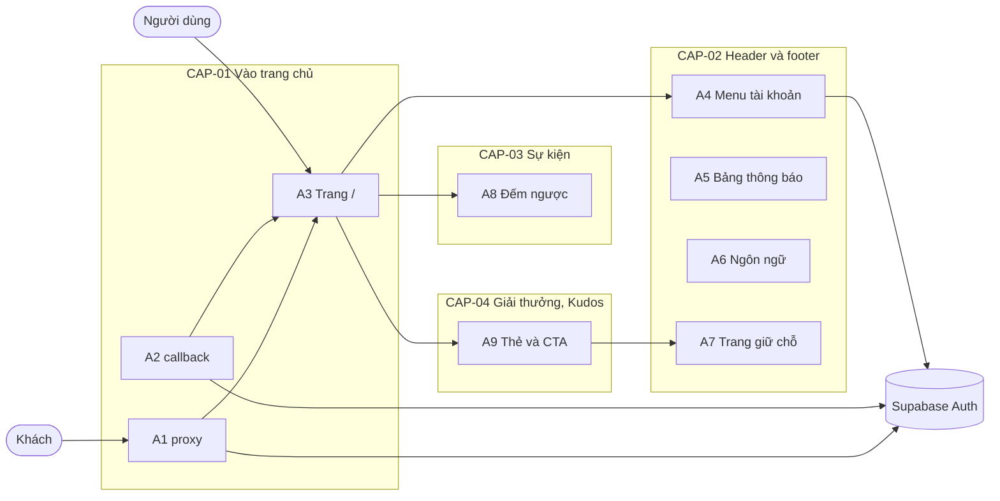

# F003_Homepage

## 1. Technical Overview

Trang chủ `/` là một route render theo request trong ứng dụng Next.js hiện có: `proxy.ts` (qua `updateSession`) chặn khách và đổi đích sau đăng nhập sang `/`; trang server đọc `EVENT_START_AT`, ngôn ngữ từ cookie `NEXT_LOCALE` và vai trò người dùng từ phiên đã xác minh, rồi dựng header, hero, lưới giải thưởng, khối Kudos và footer. Phần có tương tác (đồng hồ đếm ngược, menu tài khoản, bảng thông báo, bộ chọn ngôn ngữ) là các thành phần client nhỏ. Không có bảng dữ liệu mới; năm đường dẫn giữ chỗ chỉ là trang tĩnh "Coming soon".



## 2. Action Index

| # | Action (handler) | Method · Path | Codes | Writes | Detail |
|---|---|---|---|---|---|
| **A0** | *cross-cutting — belongs to no single action* | — | FR-003, FR-601, BR-003 | — | § 4.4 |
| **A1** | `proxy` → `updateSession` *(sửa đổi bản hiện có)* | any · `/*` (trừ tài nguyên tĩnh) | FR-101, FR-103, FR-104, FR-105, FR-601, BR-005, DEC-003, US001, US002 | — *(chỉ làm mới cookie phiên)* | § 3.1 |
| **A2** | `GET` của `auth/callback` *(sửa đổi bản hiện có)* | `GET` `/auth/callback` | FR-102, BR-005, US001 | — *(ghi cookie phiên; không ghi bảng)* | § 3.1 |
| **A3** | `HomePage` | `GET` `/` | FR-001, FR-201, FR-202, FR-203, FR-205, FR-207, FR-208, FR-211, FR-212, BR-002, DEC-005, US003, US006 | — *(read-only)* | § 3.1 |
| **A4** | `AccountMenu#onToggle` | browser · click | FR-402, FR-403, FR-404, FR-602, BR-004, DEC-002, US007 | — *(đăng xuất xoá cookie phiên, do F001_Auth xử lý)* | § 3.2 |
| **A5** | `NotificationPanel#onToggle` | browser · click | FR-401, FR-404, US008 | — *(read-only)* | § 3.2 |
| **A6** | `LanguageSelector` → `setLocale` *(dùng lại của F002_Localization)* | browser · server action | FR-404, FR-405, US009 | cookie `NEXT_LOCALE` | § 3.2 |
| **A7** | `ComingSoonPage` | `GET` `/awards-information`, `/sun-kudos`, `/standards`, `/profile`, `/admin` | FR-002, FR-603, DEC-004, US006, US007 | — *(read-only)* | § 3.2 |
| **A8** | `CountdownTimer#tick` | browser · timer mỗi phút | FR-001, FR-203, FR-204, BR-001, BR-002, DEC-001, ALG-001, US003 | — *(read-only)* | § 3.3 |
| **A9** | `AwardCard` · `HeroCtaButtons` · `KudosPromo` | browser · điều hướng | FR-206, FR-208, FR-209, FR-210, BR-006, US004, US005 | — *(read-only)* | § 3.4 |

## 3. Actions

### 3.1 CAP-01 — Vào trang chủ sau đăng nhập

#### A1 · Chặn khách và đổi đích sau đăng nhập ở proxy
`any /*` → `` `proxy` → `updateSession` ``
`FR-101` `FR-103` `FR-104` `FR-105` `FR-601` `BR-005` `DEC-003` `US001` `US002` · `SCR003_Homepage`

**Who** · Khách và người dùng đã đăng nhập *(gate A0 — § 4.4)*
**FE** · *none* — chạy trước khi trang render
**Request** · mọi request trừ tài nguyên tĩnh; cookie phiên Supabase
**BE** · `updateSession` giữ nguyên cách làm mới phiên và xác minh bằng máy chủ xác thực (fail closed); thay đổi là đưa `/` và năm đường dẫn giữ chỗ (A7) cùng đường dẫn con của chúng vào nhóm được bảo vệ (FR-105: khách mở trang giữ chỗ cũng về Login; `/` khớp đúng `/`, không khớp mọi đường dẫn, kẻo `/login` cũng thành được bảo vệ), và đổi đích khi người đã đăng nhập mở `/login` từ `/todo` sang `/`.
**Rule** · Quyết định theo phiên đã xác minh và đường dẫn:

| DEC | subtype | Condition | What the user sees | Source |
|---|---|---|---|---|
| **DEC-003** | flow | `không có người dùng đã xác minh` và đường dẫn là `/` hoặc một trang giữ chỗ | Bị chuyển về `/login` (FR-101: khách mở trang chủ thì về Login), không thấy nội dung trang chủ | `lib/supabase/proxy.ts:82` |
| **DEC-003** | flow | `có người dùng đã xác minh` và đường dẫn là `/login` | Được chuyển sang `/` (FR-103) thay cho `/todo` | `lib/supabase/proxy.ts:83` |
| **DEC-003** | render | `có người dùng đã xác minh` và đường dẫn là `/` | Thấy trang chủ | `app/(main)/layout.tsx:32-33` |

- **BR-005 — Đích sau đăng nhập luôn là `/`, không đọc tham số quay lại.** `/todo` không đổi: vẫn chỉ cho người đã đăng nhập (FR-104). FR-601: không xác minh được phiên thì coi như chưa đăng nhập. *(§ 4.4)*

**Result** · không ghi dữ liệu; mọi redirect mang theo cookie phiên và header cache đã làm mới như hiện nay. US001 (đăng nhập xong vào trang chủ) và US002 (khách mở trang chủ bị đưa về Login) được phục vụ ở đây.
**Source:** `lib/supabase/proxy.ts:7-27,82-87`, `proxy.ts`

---

#### A2 · Đổi đích của bước đổi mã đăng nhập sang `/`
`GET /auth/callback` → `` `GET` (route handler) ``
`FR-102` `BR-005` `US001` · `SCR003_Homepage`

**Who** · Khách vừa đăng nhập Google *(gate A0 — § 4.4)*
**FE** · *none*
**Request** · tham số `code`, hoặc `error` khi Google từ chối
**BE** · Route handler đổi `code` lấy phiên như F001_Auth; chỉ khác đích khi thành công
**Rule** · **BR-005 — Đích sau đăng nhập luôn là `/`, không đọc tham số quay lại.** FR-102: đăng nhập thành công đưa người dùng tới `/` thay `/todo`; thất bại, huỷ hay thiếu mã vẫn về `/login` kèm cờ lỗi cố định như hiện nay. *(§ 4.4)*
**Result** · redirect tương đối tới `/` (không phụ thuộc Host) kèm cookie phiên; đây là nửa còn lại của US001 (đăng nhập xong vào trang chủ).
**Source:** `app/auth/callback/route.ts:4,40`

---

#### A3 · Hiển thị trang chủ
`GET /` → `` `HomePage` ``
`FR-001` `FR-201` `FR-202` `FR-203` `FR-205` `FR-207` `FR-208` `FR-211` `FR-212` `BR-002` `DEC-005` `US003` `US006` · `SCR003_Homepage`

**Who** · Người dùng đã đăng nhập *(gate A1 và A0 — § 4.4)*
**FE** · `HomePage` dựng: header cố định có logo, ba mục điều hướng và ba nút chức năng (FR-201: mục "About SAA 2025" được tô nổi trên `/`; FR-202: bấm logo hoặc mục đang chọn thì cuộn lên đầu trang bằng cuộn mượt phía client); hero ROOT FURTHER với `CountdownTimer` (FR-203, xem A8); khối thông tin sự kiện (FR-205); đoạn Root Further (FR-207); lưới giải thưởng (FR-208, xem A9); khối Kudos; nút widget cố định góc phải dưới (FR-211); footer (FR-212). Mục điều hướng đang chọn theo đường dẫn hiện tại (FR-202 áp cả trên trang giữ chỗ). Bố cục và phần tử chi tiết: `SCR003_Homepage/spec.md`.
**Request** · không có tham số; cookie `NEXT_LOCALE` và cookie phiên
**BE** · Đọc `EVENT_START_AT` (FR-001: nguồn duy nhất của ngày hiển thị và đếm ngược), từ điển theo ngôn ngữ, và vai trò từ người dùng đã xác minh để truyền cho `AccountMenu`. Truyền mốc cho bộ đếm ngược (`CountdownContainer`) dưới dạng chuỗi ISO-8601 (`toISOString()`) hoặc `null`.
**Rule** · **BR-002 — Mốc sự kiện thiếu hoặc không hợp lệ được coi như đã tới mốc.** Không hợp lệ nghĩa là không phải ISO-8601 kèm offset hoặc `Z`, hoặc là ngày giờ không có thật (ví dụ `2025-02-30`, `24:00`). Ở đây nó khiến dòng ngày sự kiện hiện "—" thay vì ngày sai. *(§ 4.4)*

| DEC | subtype | Condition | What the user sees | Source |
|---|---|---|---|---|
| **DEC-005** | render | mốc hợp lệ | Dòng ngày hiện `dd/MM/yyyy`, tính theo Asia/Ho_Chi_Minh (cùng kết quả trên server và client), không hiện giờ | `lib/event/event-start-config.ts:23-27,65-67` |
| **DEC-005** | render | mốc thiếu hoặc không hợp lệ | Dòng ngày hiện "—", bố cục không đổi | `lib/event/event-start-config.ts:41-43,65-67` |
**Result** · read-only. Người dùng thấy toàn bộ trang theo ngôn ngữ đã chọn: đếm ngược (A8), ngày/địa điểm/Livestream, 6 thẻ giải thưởng, khối Kudos, footer. US003 (xem đếm ngược và thông tin sự kiện) và US006 (điều hướng bằng header, footer) được phục vụ ở đây cùng A7, A8.
**Source:** `app/(main)/page.tsx:20-36`, `app/(main)/_wiring/read-event-snapshot.ts:15-22`, `app/(main)/_wiring/build-home-screen-props.ts:20-35`, `lib/event/event-start-config.ts:41-67`

---

### 3.2 CAP-02 — Điều hướng và tiện ích trên header, footer

#### A4 · Menu tài khoản và đăng xuất
`browser · click` → `` `AccountMenu#onToggle` ``
`FR-402` `FR-403` `FR-404` `FR-602` `BR-004` `DEC-002` `US007` · `SCR003_Homepage`

**Who** · Người dùng đã đăng nhập; quản trị viên *(gate A0 — § 4.4)*
**FE** · Nút biểu tượng tài khoản mở dropdown (FR-404: mở/đóng khi bấm nút, đóng khi bấm ra ngoài hoặc nhấn Escape, mở được bằng Enter hoặc Space). Mục Sign out là một form gửi tới luồng đăng xuất hiện có của F001_Auth để trình duyệt điều hướng cả trang.
**Request** · Sign out: biểu mẫu gửi tới đường dẫn đăng xuất hiện có của F001_Auth, không thêm tham số
**BE** · Cờ `isAdmin` do `HomePage` (A3) tính từ vai trò của người dùng đã xác minh; client không tự suy ra vai trò. Đăng xuất do route handler đăng xuất của F001_Auth đảm nhiệm, không sửa.
**Rule** · **BR-004 — Admin Dashboard chỉ hiện khi vai trò là admin.** Đây cũng là FR-602: người dùng thường không có mục này trong menu. Ẩn mục chưa phải kiểm soát truy cập vào `/admin`; việc chặn thật nằm ở A7 (FR-603).

| DEC | subtype | Condition | What the user sees | Source |
|---|---|---|---|---|
| **DEC-002** | render | `isAdmin` là đúng | Menu có Profile, Sign out và Admin Dashboard | `app/(main)/_behavior/account-menu.tsx:27-31` |
| **DEC-002** | render | `isAdmin` là sai | Menu chỉ có Profile và Sign out | `app/(main)/_behavior/account-menu.tsx:24-26,33` |

**Result** · FR-402: menu gồm Profile và Sign out, thêm Admin Dashboard khi là admin (US007: mở menu tài khoản và đăng xuất). Profile dẫn tới `/profile`, Admin Dashboard dẫn tới `/admin` (đều là trang giữ chỗ, A7). FR-403: Sign out kết thúc phiên cục bộ rồi về `/login`; mở lại `/` sau đó bị A1 chặn.
**Source:** `app/(main)/_behavior/account-menu.tsx:15-48`, `app/(main)/_behavior/use-dropdown-menu.ts:26-64`, `app/(main)/layout.tsx:32,40-42`, `lib/auth/get-current-user.ts:15-24`, `lib/auth/user-role.ts`

---

#### A5 · Bảng thông báo
`browser · click` → `` `NotificationPanel#onToggle` ``
`FR-401` `FR-404` `US008` · `SCR003_Homepage`

**Who** · Người dùng đã đăng nhập *(gate A0 — § 4.4)*
**FE** · Nút chuông mở bảng; dropdown theo FR-404 (cùng cách đóng/mở với menu tài khoản, nên nên dùng chung một hook hoặc thành phần nền)
**Result** · US008 (mở bảng thông báo) và FR-401: bảng mở ra ở trạng thái trống ("Chưa có thông báo" / "No notifications"), chuông không có badge vì chưa có nguồn dữ liệu thông báo.
**Source:** `app/(main)/_behavior/notifications-menu.tsx:13-26`, `app/(main)/_behavior/use-dropdown-menu.ts:26-64`

---

#### A6 · Đổi ngôn ngữ trên trang chủ
`browser · server action` → `` `LanguageSelector` → `setLocale` ``
`FR-404` `FR-405` `US009` · `SCR003_Homepage`

**Who** · Người dùng đã đăng nhập *(gate A0 — § 4.4)*
**FE** · Dùng lại bộ chọn VN/EN của F002_Localization trong header; menu theo FR-404.
**Request** · giá trị ngôn ngữ `vi` hoặc `en`
**BE** · `setLocale` của F002_Localization ghi cookie `NEXT_LOCALE` rồi làm mới route; không sửa.
**Result** · Ghi cookie `NEXT_LOCALE`. US009 (đổi ngôn ngữ ngay trên trang chủ) và FR-405: mọi chuỗi trang chủ đổi theo ngôn ngữ và được nhớ cho lần sau. Từ điển cần thêm các khoá của trang chủ (xem § 4.4, A0).
**Source:** `app/(main)/_wiring/site-header-container.tsx:46`, `lib/i18n/set-locale-action.ts`, `lib/i18n/dictionary-home-vi.ts`, `lib/i18n/dictionary-home-en.ts`

---

#### A7 · Trang giữ chỗ "Coming soon"
`GET /awards-information`, `/sun-kudos`, `/standards`, `/profile`, `/admin` → `` `ComingSoonPage` ``
`FR-002` `FR-603` `DEC-004` `US006` `US007` · `SCR003_Homepage`

**Who** · Người dùng đã đăng nhập; riêng `/admin` chỉ admin *(gate A1 và A0 — § 4.4)*
**FE** · Mỗi trang dùng lại `HomeHeader` và `HomeFooter` của trang chủ (FR-002) với mục điều hướng đang chọn theo trang hiện tại; thân trang chỉ có chữ "Coming soon".
**BE** · Trang `/admin` tự kiểm tra phía máy chủ vai trò của người dùng đã xác minh trước khi render (FR-603: người không phải admin bị chặn); bốn trang còn lại không kiểm tra thêm ngoài proxy (A1).
**Rule** · Quyền vào từng trang giữ chỗ:

| DEC | subtype | Condition | What the user sees | Source |
|---|---|---|---|---|
| **DEC-004** | flow | `không có người dùng đã xác minh` | Bị A1 chuyển về `/login` | `lib/supabase/proxy.ts:82` |
| **DEC-004** | render | `có người dùng đã xác minh` và trang không phải `/admin` | Thấy "Coming soon" kèm header và footer | `app/(main)/_behavior/coming-soon-content.tsx:22-28`, `app/(main)/layout.tsx:27-33` |
| **DEC-004** | flow | `có người dùng đã xác minh`, trang là `/admin`, vai trò không phải admin | Bị chuyển về `/` | `lib/supabase/proxy.ts:85-87`, `app/(main)/admin/page.tsx:16-20` |
| **DEC-004** | render | `có người dùng đã xác minh`, trang là `/admin`, vai trò là admin | Thấy "Coming soon" kèm header và footer | `lib/supabase/proxy.ts:85-87`, `app/(main)/admin/page.tsx:16-20` |

**Result** · US006 (điều hướng không gặp link chết) và FR-002: mọi liên kết trên trang chủ có đích. US007 (với admin): Admin Dashboard mở được `/admin`. Thẻ giải thưởng trỏ `/awards-information#<slug>`; trang giữ chỗ không cần có mục neo thật.
**Source:** `app/(main)/{awards-information,sun-kudos,standards,profile,admin}/page.tsx`, `app/(main)/_behavior/coming-soon-content.tsx:22-28`, `lib/supabase/proxy.ts:7-27,82-87`, `app/(main)/admin/page.tsx:16-24`

---

### 3.3 CAP-03 — Xem thông tin sự kiện và đếm ngược

#### A8 · Đồng hồ đếm ngược
`browser · timer mỗi phút` → `` `CountdownTimer#tick` ``
`FR-001` `FR-203` `FR-204` `BR-001` `BR-002` `DEC-001` `ALG-001` `US003` · `SCR003_Homepage`

**Who** · Người dùng đã đăng nhập, đang mở trang *(gate A0 — § 4.4)*
**FE** · Thành phần client nhận chuỗi mốc sự kiện từ `HomePage` (A3), hiển thị ba ô DAYS, HOURS, MINUTES luôn hai chữ số (FR-204) và dòng "Coming soon" (FR-203). Tự cập nhật đúng lúc số phút còn lại đổi (mỗi lần tick được đặt tới mốc chuyển phút kế tiếp, không lệch dần); hủy bộ đếm khi rời trang.
**Request** · *no HTTP request* — giá trị đầu vào là mốc sự kiện và đồng hồ máy khách
**BE** · `ALG-001` tính phần còn lại; không gọi máy chủ. Giá trị ban đầu nên tính cùng thuật toán trên server để lần render đầu và lần hydrate không lệch.
**Rule**
- **BR-001 — Số ngày, giờ, phút còn lại tính từ hiện tại tới mốc, bỏ phần lẻ, không âm.** Giá trị âm bị chặn ở 0. *(ALG-001, § 4.5)*
- **BR-002 — Mốc thiếu hoặc không hợp lệ được coi như đã tới mốc.** Kết quả là 00 00 00 và ẩn "Coming soon", không ném lỗi. *(§ 4.4)*

| DEC | subtype | Condition | What the user sees | Source |
|---|---|---|---|---|
| **DEC-001** | render | `mốc hợp lệ` và `hiện tại < mốc` | Hiện "Coming soon" và số còn lại | `lib/event/event-start-config.ts:72-82` |
| **DEC-001** | render | `hiện tại >= mốc` hoặc `mốc không hợp lệ` | Ẩn "Coming soon", ba ô giữ 00 | `lib/event/event-start-config.ts:72-82` |

**Result** · read-only. FR-001: toàn bộ giá trị xuất phát từ `EVENT_START_AT`; US003 được phục vụ cùng A3.
**Source:** `lib/event/use-countdown.ts:15-51`, `app/(main)/_wiring/countdown-container.tsx:16-26`, `app/(main)/_components/countdown-display.tsx:41-52`

---

### 3.4 CAP-04 — Khám phá giải thưởng và Sun* Kudos

#### A9 · Thẻ giải thưởng, nút CTA và khối Kudos
`browser · điều hướng` → `` `AwardCard` · `HeroCtaButtons` · `KudosPromo` ``
`FR-206` `FR-208` `FR-209` `FR-210` `US004` `US005` · `SCR003_Homepage`

**Who** · Người dùng đã đăng nhập *(gate A0 — § 4.4)*
**FE** · Lưới 6 thẻ (FR-208: 3 cột desktop, 2 cột tablet và mobile; mô tả cắt ở 2 dòng; thẻ nhô nhẹ và sáng viền khi rê chuột). Dữ liệu 6 thẻ là danh sách tĩnh trong mã gồm slug, ảnh, tên, mô tả (BR-006). Cả thẻ là một liên kết: bấm ảnh, tên hay "Chi tiết" cho cùng kết quả. Hai nút CTA ở hero và nút "Chi tiết" của khối Kudos là liên kết thường.
**Request** · điều hướng phía client tới `/awards-information#<slug>` (FR-209), `/awards-information` (FR-206, nút ABOUT AWARDS), `/sun-kudos` (FR-206 nút ABOUT KUDOS, và FR-210 nút "Chi tiết" của Kudos)
**Rule** · **BR-006 — Sáu hạng mục có slug cố định.** `top-talent`, `top-project`, `top-project-leader`, `best-manager`, `signature-2025-creator`, `mvp`; mô tả lấy nguyên văn từ node Figma của từng thẻ (điền khi triển khai, không tự soạn). Thẻ không có slug thì liên kết tới `/awards-information` không kèm `#`.
**Result** · read-only; người dùng tới trang giữ chỗ (A7) và với thẻ có slug thì URL mang mục neo. US004 (mở đúng hạng mục) và US005 (đi tới Awards, Kudos từ hero và khối Kudos) được phục vụ ở đây.
**Source:** `lib/awards/award-categories.ts:1-29`, `app/(main)/_components/awards-section.tsx:30-37`, `app/(main)/_components/award-card.tsx:7-42`, `app/(main)/_wiring/build-home-screen-props.ts:31-60`

---

### 3.5 Edge cases

| Action | Scenario | Behavior |
|---|---|---|
| A3 · A8 | `EVENT_START_AT` thiếu hoặc không hợp lệ | Đếm ngược 00 00 00, ẩn "Coming soon", dòng ngày sự kiện "—"; trang không lỗi (BR-002, DEC-005) |
| A8 | Tab mở sẵn qua mốc sự kiện | Lần tick kế tiếp chuyển về 00 và ẩn "Coming soon" (DEC-001) |
| A8 | Đồng hồ máy khách lệch so với server | Đếm ngược theo đồng hồ máy khách; chấp nhận sai lệch [INFERRED] |
| A1 | Máy chủ xác thực không phản hồi | Coi như chưa đăng nhập, chuyển về `/login` (fail closed, như F001_Auth) |
| A1 · A2 | Có tham số `next` hoặc đích tuỳ ý trên callback | Bị bỏ qua, luôn về `/` (BR-005) |
| A7 | Người thường gõ `/admin` | Bị chặn phía máy chủ, chuyển về `/` (DEC-004) |
| A1 · A7 | Khách gõ thẳng một trang giữ chỗ | Chuyển về `/login` (DEC-004, FR-105) |
| A4 · A7 | Vai trò admin vừa đổi ở Supabase | Hiệu lực khi phiên được làm mới; chưa tức thì, đã chấp nhận |
| A9 | Thẻ thiếu slug | Liên kết tới `/awards-information` không có `#` |
| A1-A9 | Gọi mọi route khi chưa đăng nhập | Chuyển về `/login` theo A1 và A0 |

## 4. Shared Foundation

### 4.1 Components

| Component | Responsibility | Used in | File |
|---|---|---|---|
| `HomePage` | Route `/`; dựng các vùng và đọc cấu hình | A3 | `app/(main)/page.tsx` (+ `app/(main)/_components/home-screen.tsx`, `_wiring/build-home-screen-props.ts`) |
| `HomeHeader` | Header cố định: logo, nav, chuông, ngôn ngữ, tài khoản | A3, A4, A5, A6 | `app/(main)/_components/site-header.tsx`, `_components/header-nav.tsx`, `_wiring/site-header-container.tsx` |
| `CountdownTimer` | Ba ô đếm ngược client | A8 | `app/(main)/_wiring/countdown-container.tsx`, `_components/countdown-display.tsx`, `lib/event/use-countdown.ts` |
| `AccountMenu` · `NotificationPanel` | Dropdown tài khoản và thông báo; dùng chung cách đóng/mở (FR-404) | A4, A5, A6 | `app/(main)/_behavior/account-menu.tsx`, `_behavior/notifications-menu.tsx`, `_behavior/use-dropdown-menu.ts` |
| `AwardCard` | Một thẻ giải thưởng từ danh sách tĩnh | A9 | `app/(main)/_components/award-card.tsx` |
| `HomeFooter` | Logo, liên kết, bản quyền | A3 | `app/(main)/_components/site-footer.tsx`, `_wiring/site-footer-container.tsx` |
| `ComingSoonPage` | Nội dung giữ chỗ của 5 route | A7 | `app/(main)/_behavior/coming-soon-content.tsx` |

### 4.2 Data Model

#### Key Entities

| Entity | Table | Key Columns | Purpose |
|--------|-------|-------------|---------|
| `User` của Supabase Auth *(ngoài ứng dụng)* | — | `email`, vai trò trong `app_metadata` | Chỉ đọc vai trò để bật mục Admin Dashboard (A3, A4) |

Ứng dụng không có bảng riêng; danh sách 6 giải thưởng là dữ liệu tĩnh trong mã, không phải bảng.

#### Polymorphic Behavior

N/A — no discriminator fields in Key Entities.

### 4.3 State Management

None — trạng thái mở/đóng của menu và bảng, cùng giá trị đếm ngược, chỉ nằm trong client, không lưu bền và không đủ ngưỡng thành một state machine.

### 4.4 Shared Rules

#### Bin 3 — cross-cutting, belongs to no single action

**A0 · FR-601 / FR-003 / BR-003 — mọi hành động trên trang chủ cần phiên đã xác minh, chuỗi lấy từ từ điển, nội dung bám Figma.**
FR-601: lớp bảo vệ ở proxy (A1) áp cho mọi route trong phạm vi; không xác minh được phiên thì chuyển về `/login`. FR-003: toàn bộ chuỗi trang chủ nằm trong từ điển vi/en của F002_Localization (thêm khoá mới, không lập từ điển thứ hai); cặp khoá vi và en phải khớp ở lúc biên dịch như F002. BR-003: tiếng Việt lấy nguyên văn từ Figma/MoMorph; bản tiếng Anh do nhóm tự soạn. **Không phải quy tắc riêng của feature này** mà là kế thừa của F001_Auth và F002_Localization.
**Source:** `lib/auth/get-current-user.ts:15-24`, `app/(main)/layout.tsx:27-33`, `lib/supabase/proxy.ts:82`, `lib/i18n/dictionary-home-vi.ts`, `lib/i18n/dictionary-home-en.ts`

#### Bin 2 — used by ≥2 named actions

**BR-002 — Mốc sự kiện thiếu hoặc không hợp lệ được coi như đã tới mốc.**
Used in: **A3** · **A8**. A3 hiện "—" thay ngày; A8 hiển thị 00 00 00 và ẩn "Coming soon". Cả hai dùng cùng một hàm phân tích `EVENT_START_AT` để không lệch nhau; cách hiển thị ngày nằm ở DEC-005 trong A3.
**Source:** `lib/event/event-start-config.ts:41-67`

```text
parse(EVENT_START_AT):
  if value is empty -> invalid
  t = parse as ISO-8601 datetime WITH offset or Z (no offset -> invalid)
  if calendar/clock/offset is impossible (2025-02-30, 24:00, +25:00) -> invalid
  return t
invalid => treated as "already reached" (00 00 00, no "Coming soon", date shown as "—")
```

**BR-005 — Đích sau đăng nhập luôn là `/`, không đọc tham số quay lại.**
Used in: **A1** · **A2**. A2 chọn `/` khi đổi mã thành công; A1 chuyển người đã đăng nhập từ `/login` sang `/`. Cả hai thay cho `/todo` của F001_Auth; `/todo` vẫn được bảo vệ.
**Source:** `app/auth/callback/route.ts:4,40`, `lib/supabase/proxy.ts:83`

```text
after-login destination = "/"          # callback success, and signed-in visit to /login
/todo stays protected                  # unchanged
query "next" is never read             # no open redirect, no return-to (deep page -> login -> "/")
```

### 4.5 Algorithms & Integrations

### Tính số ngày, giờ, phút còn lại tới mốc sự kiện (ALG-001)

**Linked FR:** FR-204
**Used in:** A8
**Source:** `lib/event/event-start-config.ts:72-82`
**Input:** mốc sự kiện (hoặc rỗng) và thời điểm hiện tại · **Output:** ba số nguyên không âm (ngày, giờ, phút) và cờ hiển thị "Coming soon" · **Complexity:** O(1)
**Description:** Lấy phần chênh tính bằng phút, bỏ phần lẻ, chặn dưới ở 0, tách thành ngày, giờ, phút; cờ "Coming soon" chỉ bật khi mốc hợp lệ và chưa tới. Luôn định dạng hai chữ số khi hiển thị.
**Pseudocode:**
```text
t = parse(EVENT_START_AT)                      # BR-002
if t is invalid or now >= t: return (0, 0, 0, comingSoon=false)
m = floor((t - now) / 1 minute)
return (floor(m / 1440), floor(m % 1440 / 60), m % 60, comingSoon=true)
# display: pad each number to 2 digits
```

### 4.6 Configuration

```text
EVENT_START_AT = <ISO-8601 datetime kèm offset hoặc Z>   # biến chỉ phía máy chủ (không NEXT_PUBLIC_); mốc bắt đầu sự kiện: ngày hiển thị dd/MM/yyyy theo Asia/Ho_Chi_Minh (A3) và đếm ngược (A8)
```

**Client behavior:** see
[`behavior-logic.md`](../../generated/behavior-logic.md) (client-side patterns — debounce, optimistic UI, polling, upload, realtime),
[`permissions.md`](../../system/permissions.md) (feature flags / experiments / env / locale gates),
[`architecture.md`](../../system/architecture.md) (guards / deep-link state restoration / unsaved-changes protection).

## 5. Verification & Technical Notes

### 5.1 Technical Verification

Chính sách kiểm thử: `e2e-red-first` (Playwright đã có trong dự án): viết kịch bản E2E đỏ trước, rồi làm xanh. Cập nhật các kịch bản E2E hiện có của F001_Auth đang chờ `/todo` sau đăng nhập.

- **SC-001** *(A1)* Khách mở `/` được chuyển về `/login`; người đã đăng nhập mở `/` và `/login` thì ở `/` (covers FR-101, FR-103, DEC-003)
- **SC-002** *(A2)* Callback thành công đưa tới `/`; thất bại vẫn về `/login?error=auth_failed` (covers FR-102, BR-005)
- **SC-003** *(A1)* `/todo` vẫn chặn khách (covers FR-104)
- **SC-004** *(A3, A8)* Với `EVENT_START_AT` đặt cố định trong môi trường kiểm thử, ba ô đúng giá trị hai chữ số; thiếu hoặc sai thì 00 và "Coming soon" ẩn (covers FR-001, FR-204, BR-001, BR-002, DEC-001, DEC-005, ALG-001)
- **SC-005** *(A4)* Người thường thấy 2 mục, admin thấy 3 mục; Sign out về `/login` (covers FR-402, FR-403, FR-602, BR-004, DEC-002)
- **SC-006** *(A4, A5, A6)* Mở bằng Enter/Space, đóng bằng Escape và bấm ra ngoài (covers FR-404)
- **SC-007** *(A5)* Bảng thông báo trống, không badge (covers FR-401)
- **SC-008** *(A6)* Đổi EN thì chuỗi trang chủ đổi và còn giữ sau khi tải lại (covers FR-405, FR-003)
- **SC-009** *(A9, A7)* Mỗi thẻ tới đúng `#<slug>`; năm trang giữ chỗ và `/standards` mở không 404 (covers FR-002, FR-206, FR-208, FR-209, FR-210)
- **SC-010** *(A3)* Header cố định, bấm logo cuộn lên đầu, widget ở góc phải dưới, footer đủ liên kết (covers FR-201, FR-202, FR-211, FR-212)
- **SC-011** *(A1, A7)* Khách mở từng trang giữ chỗ về `/login`; người thường mở `/admin` về `/`; admin vào được (covers FR-002, FR-105, FR-603, DEC-004)

#### US001 *(A1, A2)*
**Independent Test:** Đăng nhập bằng phiên giả lập và kiểm tra URL cuối cùng.
**Acceptance Scenarios:**
1. **Given** khách chưa đăng nhập, **When** callback đổi mã thành công, **Then** URL cuối là `/`.
2. **Given** người đã đăng nhập, **When** mở `/login`, **Then** URL cuối là `/`.

#### US003 *(A3, A8)*
**Independent Test:** Đặt `EVENT_START_AT` cách hiện tại một khoảng biết trước (ví dụ 2 ngày 5 giờ 9 phút) rồi đọc ba ô.
**Acceptance Scenarios:**
1. **Given** mốc còn 2 ngày 5 giờ 9 phút, **When** mở trang chủ, **Then** thấy 02, 05, 09 và "Coming soon".
2. **Given** mốc ở quá khứ, **When** mở trang chủ, **Then** thấy 00, 00, 00 và không có "Coming soon".

### 5.2 Assumptions

- *(A3, A8)* Mốc sự kiện được truyền từ server sang client dưới dạng prop (không cần biến công khai); nếu cần đọc trực tiếp ở client thì phải đổi tên biến, việc này sẽ làm lộ giá trị ra trình duyệt (vốn không nhạy cảm).
- *(A4)* Vai trò admin nằm trong `app_metadata.role` của người dùng Supabase đã xác minh, đúng như clarifications.md; ứng dụng không có bảng vai trò riêng.
- *(A4, A7)* Đổi `app_metadata.role` chỉ có hiệu lực khi phiên được làm mới; độ trễ này đã được chấp nhận.
- *(A9)* Danh sách giải thưởng là dữ liệu tĩnh trong mã (không có nguồn dữ liệu động) cho tới khi có trang Awards Information thật.
- *(A1)* Đưa `/` vào nhóm bảo vệ không đụng tới tài nguyên tĩnh vì bộ lọc đường dẫn của proxy đã loại ảnh và tài nguyên Next.

### 5.3 Unresolved Questions

1. **Phiên bản Next.js** *(A3)*: Phiên bản Next.js của dự án có khác kiến thức quen thuộc (xem AGENTS.md); phải đọc hướng dẫn trong `node_modules/next/dist/docs/` trước khi viết route, `proxy`, thành phần client và `instant`.
2. **Cách gán vai trò admin** *(A4)*: Ai đặt `app_metadata.role` và bằng cách nào ở môi trường local và E2E (chưa có quy trình).
3. **Chặn hydration lệch** *(A8)*: Cần chọn cách render lần đầu của đồng hồ (tính ở server rồi client tiếp quản) để tránh cảnh báo lệch giữa hai bên.
4. **Ảnh và phông** *(A3)*: Nguồn ảnh hero, thẻ, Kudos và phông chữ của Figma chưa tải về; cần danh sách tài sản trước khi dựng giao diện.

### 5.4 Source References

Mã nguồn đã có. Điểm chạm: `lib/supabase/proxy.ts` (A1), `app/auth/callback/route.ts` (A2), nhóm route `app/(main)/**` (A3-A9; layout chung `app/(main)/layout.tsx`), `lib/auth/get-current-user.ts` và `lib/auth/user-role.ts` (vai trò), `lib/event/*` (A8), `lib/awards/award-categories.ts` (A9), `lib/i18n/dictionary-home-*.ts` gộp vào `dictionary-vi.ts`/`dictionary-en.ts` (A6, A0). Hành vi: xem `## 7. User Stories` trong functional-spec.md.

#### Data Flow

```text
Request / -> proxy (getUser, DEC-003) -> HomePage (EVENT_START_AT, NEXT_LOCALE, role) -> HTML
Browser tick (1 min) -> CountdownTimer -> ALG-001 -> 3 ô + cờ Coming soon
Click thẻ -> điều hướng /awards-information#<slug> -> ComingSoonPage
```

### 5.5 Artifact References

| Artifact | File | Codes Used | Reviewed |
|----------|------|------------|----------|
| System Overview | [overview.md](../../system/overview.md) | — | [ ] |
| Architecture | [architecture.md](../../system/architecture.md) | — | [ ] |
| Feature List | [feature-list.md](../../generated/feature-list.md) | F003 | [ ] |
| API Map | [api-map.md](../../generated/api-map.md) | — | [ ] |
| Entities | [entities.md](../../generated/entities.md) | — | [ ] |
| Screens | [functional-spec.md § 6](../../features/F003_Homepage/functional-spec.md#6-screens) | SCR003_Homepage | [ ] |
| Behavior Logic | [behavior-logic.md](../../generated/behavior-logic.md) | — | [ ] |
| Permissions Matrix | [permissions-matrix.md](../../generated/permissions-matrix.md) | TBD (draft) | [ ] |
| User Stories | [user-stories.md](../../generated/user-stories.md) | TBD (draft) | [ ] |
