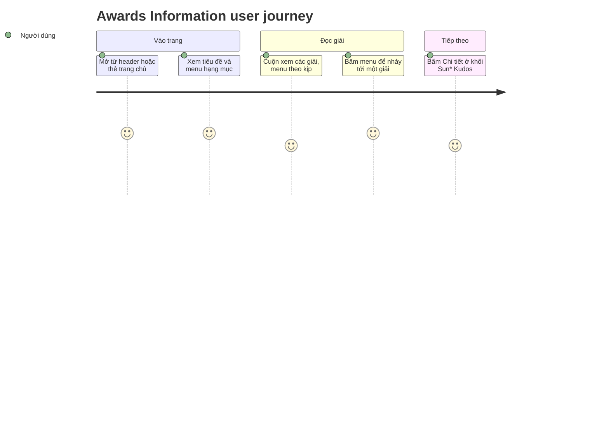

**Priority**: P1
**Type**: ui

## 1. Overview

**Problem:** Trang `/awards-information` hiện chỉ hiện "Coming soon", trong khi header, footer và 6 thẻ giải thưởng ở trang chủ đều đã trỏ tới đây. Người dùng không có chỗ nào đọc hệ thống giải SAA 2025: có những giải nào, mỗi giải bao nhiêu suất, giá trị bao nhiêu.
**Solution:** Trang Hệ thống giải cho người đã đăng nhập: hero keyvisual, tiêu đề phần, menu 6 hạng mục, 6 thẻ giải (ảnh, tên, mô tả, số lượng, giá trị) và khối quảng bá Sun* Kudos. Bấm menu thì cuộn tới đúng hạng mục, mục đang xem được tô vàng; thẻ ở trang chủ mở thẳng đúng hạng mục.
**Scope:** Màn Hệ thống giải thay trang giữ chỗ tại route hiện có; menu hạng mục (dọc dính trên desktop, tab ngang trên màn nhỏ), theo dõi cuộn, liên kết `#<slug>`; khối Sun* Kudos với nút "Chi tiết"; chuỗi vi/en.
**Non-Scope:** Trang Sun* Kudos thật, bất kỳ chức năng đề cử hay bình chọn, dữ liệu giải thưởng động hay trang quản trị nội dung giải. Đăng nhập, header, footer, bộ chọn ngôn ngữ (thuộc F001_Auth, F002_Localization và F003_Homepage, trang này chỉ dùng lại).

**Actors**

| Actor | Description | Primary goal |
|-------|--------------|---------------|
| Người dùng đã đăng nhập | Nhân sự Sun* có phiên hợp lệ | Đọc hệ thống giải SAA 2025 và tìm nhanh hạng mục mình quan tâm |
| Khách | Người chưa đăng nhập mở thẳng địa chỉ trang | Được đưa về màn Login để đăng nhập |

Feature này liên quan tới [F003_Homepage](../../../../docs/features/F003_Homepage/functional-spec.md) (thẻ giải thưởng và khối Kudos trỏ tới đây) và F002_Localization (chuỗi vi/en).

## 2. Functional Capabilities

| ID | Capability | What the user can do | User Stories | Requirements | Business Rules | Screens |
|----|------------|------------------------|-----------------|---------------|-------------------|---------|
| CAP-01 | Xem hệ thống giải thưởng | Mở trang, đọc tiêu đề và 6 thẻ giải đủ nội dung theo ngôn ngữ đã chọn; khách bị đưa về Login | US001, US005 | FR-001, FR-002, FR-101, FR-102, FR-201, FR-203, FR-205, FR-601 | BR-001, BR-003 | TBD (draft) |
| CAP-02 | Điều hướng giữa các hạng mục | Bấm menu để tới hạng mục, thấy mục đang xem được tô vàng khi cuộn, mở thẳng một hạng mục bằng liên kết `#<slug>` | US002, US003 | FR-202, FR-401, FR-402, FR-403, FR-404, FR-405, FR-406, FR-407 | BR-002, DEC-001, DEC-002 | — |
| CAP-03 | Đi tới Sun* Kudos | Xem khối Sun* Kudos ở cuối trang và bấm "Chi tiết" để sang trang Sun* Kudos | US004 | FR-204, FR-408 | — | — |

## 3. Open Decisions

| D### | Decision | Default proposal | Rationale | Blocks work |
|------|----------|-------------------|-----------|--------------|
| D001 | Đường dẫn trang | **Đã chốt:** giữ `/awards-information`, thay trang giữ chỗ tại chỗ; test case ID-0, ID-1, ID-2 chạy trên đường dẫn này thay cho `/he-thong-giai` (clarifications.md, 2026-10-13) | Header, footer và thẻ trang chủ đã trỏ tới đây | no |
| D002 | Menu hạng mục dưới 1024px (Figma chỉ có desktop) | **Đã chốt:** một hàng tab cuộn ngang ghim phía trên các thẻ, cùng kiểu active vàng và gạch chân (clarifications.md, 2026-10-13) | Giữ menu dùng được trên màn nhỏ mà không chiếm chiều ngang | no |
| D003 | Khi nào mục active đổi | **Đã chốt:** khi bấm (cuộn mượt tới phần), khi cuộn (phần đang xem quyết định) và khi mở bằng `#<slug>` (clarifications.md, 2026-10-13) | Menu luôn phản ánh vị trí người dùng đang đọc | no |
| D004 | Vị trí menu trên desktop | **Đã chốt:** dính ngay dưới header cố định khi các thẻ cuộn qua (clarifications.md, 2026-10-13) | Menu luôn trong tầm mắt | no |
| D005 | Văn bản mô tả đầy đủ của 6 giải | **Đã chốt:** lấy nguyên văn từ node Figma D.1 tới D.6 khi dựng; không dùng bản ngắn 2 dòng của trang chủ làm nội dung trang này | CSV chỉ ghi "description paragraph"; không bịa nội dung | no |
| D006 | Nhãn "Số lượng giải thưởng" và "Giá trị giải thưởng" cho thẻ 2 tới 6 | **Đã chốt:** dùng cùng nhãn như thẻ Top Talent, đơn vị và giá trị như CSV (ví dụ `02 Tập thể`, `15.000.000 VNĐ mỗi giải`) | CSV chỉ ghi giá trị, nhãn đầy đủ chỉ có ở thẻ đầu | no |
| D007 | Bấm menu có cập nhật `#hash` trên thanh địa chỉ không | **Đã chốt:** có, chỉ khi bấm (`replaceState`, không thêm mục lịch sử); scroll-spy không đổi URL để người dùng sao chép liên kết đúng hạng mục | Khớp với liên kết thẻ trang chủ; không làm nút Back dài ra | no |
| D008 | Khối Sun* Kudos dùng lại bản trang chủ hay văn bản node Figma `335:12023` | **Đã chốt:** dùng lại nếu văn bản và bố cục khớp node; lệch thì theo Figma | Figma thắng khi khác (clarifications.md) | no |
| D009 | Bố cục thẻ giải trên tablet và mobile | **Đã chốt:** dưới 768px xếp dọc (ảnh trên, nội dung dưới); từ 768px trở lên ảnh và nội dung nằm ngang, so le như Figma | Figma chỉ có desktop (ảnh trái, nội dung phải) | no |

## 4. Requirements

### Foundation (0xx)

- **FR-001** Mọi chuỗi trên trang lấy từ từ điển vi/en hiện có; bản tiếng Việt nguyên văn Figma, bản tiếng Anh do nhóm soạn.
- **FR-002** Mỗi trong 6 phần giải thưởng có định danh riêng (`top-talent`, `top-project`, `top-project-leader`, `best-manager`, `signature-2025-creator`, `mvp`) để liên kết `#<slug>` hoạt động.

### Navigation (1xx)

- **FR-101** Người đã đăng nhập mở `/awards-information` thì thấy trang Hệ thống giải.
- **FR-102** Bấm "Award Information" trên header thì tới trang này và mục đó được tô nổi.

### Awards Information (2xx)

- **FR-201** Đầu trang có hero keyvisual và tiêu đề: dòng phụ nhỏ, nhạt "Sun* annual awards 2025" và dòng chính lớn, màu vàng "Hệ thống giải thưởng SAA 2025".
- **FR-202** Menu hạng mục liệt kê 6 mục theo thứ tự Top Talent, Top Project, Top Project Leader, Best Manager, Signature 2025 - Creator, MVP.
- **FR-203** Mỗi trong 6 thẻ giải có ảnh 336x336, tên, mô tả, số lượng và giá trị giải thưởng theo Figma.
- **FR-204** Cuối trang có khối Sun* Kudos: nhãn "Phong trào ghi nhận", tiêu đề "Sun* Kudos", mô tả, hình minh hoạ và nút "Chi tiết".
- **FR-205** Bố cục desktop: tiêu đề ở trên, menu bên trái, các thẻ ở giữa, khối Sun* Kudos ở dưới, kèm header và footer dùng chung.

### Interaction (4xx)

- **FR-401** Bấm một mục menu thì trang cuộn mượt tới thẻ tương ứng, chỉ mục đó được tô vàng và gạch chân, mục trước mất trạng thái này.
- **FR-402** Rê chuột lên mục menu thì mục đó sáng lên.
- **FR-403** Khi người dùng tự cuộn, mục menu của hạng mục đang xem trở thành mục đang chọn.
- **FR-404** Mở `/awards-information#<slug>` (kể cả từ thẻ ở trang chủ) thì trang cuộn tới đúng hạng mục và mục đó được chọn.
- **FR-405** Liên kết có `#` không khớp hạng mục nào thì không báo lỗi, trang ở đầu và mục đầu tiên được chọn.
- **FR-406** Từ 1024px trở lên, menu nằm bên trái và dính ngay dưới header khi các thẻ cuộn qua.
- **FR-407** Dưới 1024px, menu là một hàng tab cuộn ngang ghim phía trên các thẻ, cùng kiểu mục đang chọn.
- **FR-408** Nút "Chi tiết" của khối Sun* Kudos mở `/sun-kudos` trong cùng tab; đích không tồn tại thì hiện trang 404 mặc định.

### Security (6xx)

- **FR-601** Khách mở `/awards-information` thì bị chuyển về `/login`.

## 5. Business Rules

- Sáu hạng mục theo thứ tự cố định và slug cố định, dùng chung một danh sách với thẻ giải ở trang chủ, nên liên kết từ trang chủ luôn đúng (BR-001)
- Tại mọi thời điểm đúng một mục menu đang được chọn, mặc định là mục đầu tiên; liên kết `#` sai không làm mất hay lệch mục này (BR-002)
- Nội dung tiếng Việt lấy nguyên văn từ Figma, không tự bịa; bản tiếng Anh do nhóm soạn và có thể sửa sau (BR-003)
- Mục đang chọn do ba nguồn quyết định: liên kết `#` hợp lệ lúc mở trang, bấm menu, và vị trí cuộn; `#` hợp lệ thắng khi tải, `#` sai thì giữ mặc định, không có `#` thì vị trí cuộn quyết định (DEC-001)
- Từ 1024px trở lên menu dọc dính bên trái; dưới 1024px menu là hàng tab cuộn ngang phía trên các thẻ (DEC-002)

## 6. Screens

| Screen Name | SCR### | What User Sees | What User Can Do |
|-------------|--------|-----------------|-------------------|
| Hệ thống giải (Awards Information) | TBD (draft) | Header cố định; hero keyvisual "ROOT FURTHER"; tiêu đề "Hệ thống giải thưởng SAA 2025"; menu 6 hạng mục; 6 thẻ giải (ảnh, tên, mô tả, số lượng, giá trị); khối Sun* Kudos; footer | Bấm mục menu để tới hạng mục, cuộn xem, rê chuột lên mục menu, bấm "Chi tiết" sang Sun* Kudos, đổi ngôn ngữ và dùng header, footer như các trang khác |

Chi tiết bố cục và phần tử: `screens/SCR004_AwardsInformation/spec.md`.

### User Journey

1. Người dùng đăng nhập rồi bấm "Award Information" trên header (hoặc một thẻ giải ở trang chủ) và đến Hệ thống giải, thấy tiêu đề và menu 6 hạng mục.
2. Người dùng cuộn xuống đọc từng giải; mục menu của giải đang xem được tô vàng theo.
3. Người dùng bấm một mục menu, trang cuộn mượt tới giải đó và chỉ mục đó sáng.
4. Người dùng cuộn tới cuối, xem khối Sun* Kudos và bấm "Chi tiết" để sang trang Sun* Kudos.

## 7. User Stories

### US001 — Xem hệ thống giải SAA 2025

**Actor:** Người dùng đã đăng nhập
**Goal:** Đọc đủ thông tin 6 giải: tên, mô tả, số lượng, giá trị.
**Business value:** Nhân sự biết rõ cơ cấu giải trước kỳ vinh danh, thay vì trang giữ chỗ.

**Acceptance Criteria:**
- [ ] Mở `/awards-information` khi đã đăng nhập thì thấy tiêu đề phụ, tiêu đề chính màu vàng, menu 6 mục, 6 thẻ và khối Sun* Kudos
- [ ] Mỗi thẻ có ảnh, tên, mô tả, số lượng và giá trị đúng Figma
- [ ] Đổi sang EN thì toàn bộ chuỗi đổi theo

### US002 — Chuyển nhanh giữa các hạng mục bằng menu

**Actor:** Người dùng đã đăng nhập
**Goal:** Nhảy tới giải mình quan tâm và biết mình đang ở giải nào.
**Business value:** Đọc 6 giải dài không phải cuộn tay tìm, giảm bỏ dở giữa chừng.

**Acceptance Criteria:**
- [ ] Bấm mục menu thì cuộn mượt tới đúng thẻ, chỉ mục đó active
- [ ] Rê chuột lên mục menu thì mục sáng lên
- [ ] Tự cuộn qua thẻ khác thì mục active đổi theo
- [ ] Từ 1024px trở lên menu dính dưới header; dưới 1024px là hàng tab cuộn ngang

### US003 — Mở thẳng một hạng mục bằng liên kết

**Actor:** Người dùng đã đăng nhập
**Goal:** Bấm thẻ ở trang chủ hoặc dùng liên kết `#<slug>` và đến đúng giải.
**Business value:** Thẻ ở trang chủ có tác dụng thật và liên kết chia sẻ được.

**Acceptance Criteria:**
- [ ] `/awards-information#mvp` cuộn tới thẻ MVP và MVP active
- [ ] Thẻ giải ở trang chủ mở đúng hạng mục
- [ ] `#` không khớp hạng mục nào thì không lỗi, trang ở đầu, mục đầu active

### US004 — Từ hệ thống giải sang Sun* Kudos

**Actor:** Người dùng đã đăng nhập
**Goal:** Biết về phong trào Sun* Kudos và mở trang chi tiết.
**Business value:** Dẫn người đang đọc giải sang phong trào ghi nhận đồng nghiệp.

**Acceptance Criteria:**
- [ ] Khối Sun* Kudos có nhãn, tiêu đề, mô tả và nút "Chi tiết"
- [ ] "Chi tiết" mở `/sun-kudos` trong cùng tab

### US005 — Khách bị đưa về màn Login

**Actor:** Khách
**Goal:** Được đăng nhập trước khi xem nội dung nội bộ.
**Business value:** Nội dung giải thưởng chỉ dành cho nhân sự Sun*.

**Acceptance Criteria:**
- [ ] Khách mở `/awards-information` thì bị chuyển về `/login`

## 8. Scenarios

### US001 — Happy Path

**Given** người dùng đã đăng nhập, **When** mở `/awards-information`, **Then** thấy đủ tiêu đề, menu 6 mục theo thứ tự, 6 thẻ giải với ảnh 336x336, và khối Sun* Kudos ở cuối.

### US001 — Error: ngôn ngữ EN

**Given** người dùng đã chọn EN, **When** mở trang, **Then** mọi chuỗi hiện bản tiếng Anh, không còn khoá thô hay chuỗi rỗng.

### US002 — Happy Path

**Given** trang vừa mở, **When** người dùng bấm "MVP" rồi "Top Talent", **Then** mỗi lần trang cuộn tới đúng thẻ và chỉ mục vừa bấm active.

### US002 — Error: bấm khi đang cuộn

**Given** trang đang cuộn mượt sau khi bấm một mục, **When** cuộn tới nơi, **Then** mục active vẫn là mục đã bấm, không nhấp nháy sang mục khác.

### US003 — Happy Path

**Given** người dùng ở trang chủ, **When** bấm thẻ Best Manager, **Then** tới `/awards-information#best-manager`, trang ở đúng thẻ và mục Best Manager active.

### US003 — Error: hash sai

**Given** URL là `/awards-information#abc`, **When** mở trang, **Then** không có lỗi, trang ở đầu và mục Top Talent active.

### US004 — Happy Path

**Given** người dùng ở cuối trang, **When** bấm "Chi tiết", **Then** vào `/sun-kudos` trong cùng tab.

### US004 — Error: đích không dùng được

**Given** `/sun-kudos` không tồn tại hoặc lỗi, **When** bấm "Chi tiết", **Then** thấy trang 404 mặc định, không phải trang trắng.

### US005 — Happy Path

**Given** khách chưa đăng nhập, **When** mở `/awards-information`, **Then** bị chuyển về `/login`.

### US005 — Error: không xác minh được phiên

**Given** không xác minh được phiên đăng nhập, **When** mở trang, **Then** coi như chưa đăng nhập và về `/login`.

## 9. Edge Cases

| Scenario | What Happens | User-Facing Message |
|----------|--------------|----------------------|
| Liên kết `#` không khớp hạng mục nào | Bỏ qua, trang ở đầu, mục đầu active | "None — silent handling" |
| Bấm menu khi trang đang cuộn mượt | Mục đã bấm giữ active tới khi cuộn xong | "None — silent handling" |
| Người dùng tự cuộn (lăn chuột, chạm, phím cuộn, kéo thanh cuộn) khi trang đang cuộn mượt | Mục active theo vị trí người dùng ngay lập tức | "None — silent handling" |
| Bấm mục menu kèm Ctrl, Meta, Shift, Alt | Trình duyệt tự theo liên kết (tab mới…), trang này không cuộn | "None — silent handling" |
| Cửa sổ đổi qua mốc 1024px | Menu đổi giữa dọc dính và tab ngang, mục active giữ nguyên | "None — silent handling" |
| Cuộn ở vùng hero, tiêu đề (trước thẻ đầu) | Mục đầu active | "None — silent handling" |
| Nút "Chi tiết" tới trang không tồn tại | Hiện trang 404 mặc định | Trang 404 mặc định của ứng dụng |
| Khách hoặc phiên không xác minh được | Chuyển về `/login` | "None — chuyển trang" |
| Thẻ Signature 2025 có hai mức giá trị (cá nhân và tập thể) | Hiện cả hai dòng giá trị | "None" |

## 10. Edge Behaviours to Verify

- **FR-101** → Đã đăng nhập mở `/awards-information` thấy trang Hệ thống giải
- **FR-102** → Bấm "Award Information" trên header tới trang này và mục đó tô nổi
- **FR-202** → Menu đủ 6 mục đúng thứ tự
- **FR-203** → 6 thẻ đủ ảnh, tên, mô tả, số lượng, giá trị; thẻ Signature 2025 có hai mức giá trị
- **FR-401** → Bấm lần lượt từng mục: đúng thẻ, chỉ mục vừa bấm active
- **FR-403** → Tự cuộn qua từng thẻ thì mục active theo kịp
- **FR-404** → `#mvp` tới MVP; thẻ trang chủ tới đúng hạng mục
- **FR-405** → `#abc` không lỗi, trang ở đầu, mục đầu active
- **FR-406** → Từ 1024px trở lên menu dính dưới header khi cuộn
- **FR-407** → Dưới 1024px menu là một hàng tab cuộn ngang
- **FR-408** → "Chi tiết" tới `/sun-kudos`; đích không có thì 404
- **FR-601** → Khách mở trang bị đưa về `/login`

## 11. Risks & Known Issues

| ID | Type | Description | Impact | Status |
|----|------|--------------|--------|--------|
| RISK-01 | risk | Hiệu ứng rê chuột, tab ngang và bố cục tablet/mobile không có trong Figma (chỉ có desktop) | Giao diện các cỡ nhỏ có thể lệch ý của designer | [NEEDS_DOMAIN_CONFIRMATION] |
| RISK-02 | risk | Mô tả đầy đủ 6 giải chưa có trong CSV; bản ngắn của trang chủ đã bị cắt 2 dòng | Nếu dùng nhầm bản ngắn, nội dung giải thiếu | [NEEDS_DOMAIN_CONFIRMATION] |

## 12. Dependencies

| Dependency | Type | Why this feature needs it | Evidence |
|------------|------|-----------------------------|----------|
| F001_Auth | feature | Bảo vệ route, khách về `/login` | FR-601 |
| F002_Localization | feature | Từ điển và chuyển ngôn ngữ vi/en | FR-001, BR-003 |
| F003_Homepage | feature | Header, footer, khối Sun* Kudos dùng lại; thẻ trang chủ trỏ tới trang này; trang `/sun-kudos` là đích của "Chi tiết" | FR-102, FR-404, FR-408 |
| Thiết kế MoMorph/Figma "Hệ thống giải" (node `313:8436`) | external-service | Nguồn nội dung và bố cục | FR-201, FR-203, BR-003 |

## 13. Configuration

N/A — no user-facing configuration constants for this feature.
