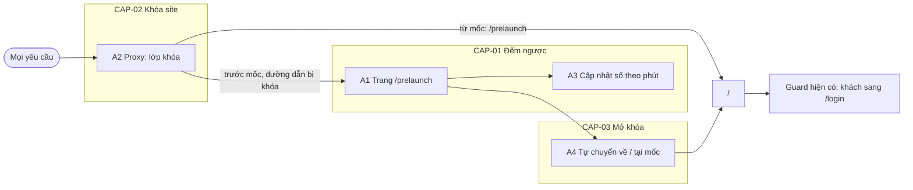

# F005_CountdownPrelaunch

## 1. Technical Overview

Feature thêm một route cấp cao công khai `/prelaunch` (ngoài nhóm `(main)`, nên không có header, footer, không kiểm phiên) và một lớp khóa nằm trong `updateSession` của `lib/supabase/proxy.ts`. Lớp khóa chạy sau bước làm mới phiên: nếu `EVENT_START_AT` hợp lệ và máy chủ chưa tới mốc thì mọi đường dẫn ngoài `/login`, `/auth/*`, `/prelaunch` (tài nguyên tĩnh đã nằm ngoài matcher) bị 307 tới `/prelaunch` kèm cookie vừa làm mới; từ mốc, hoặc khi biến thiếu hay sai, `/prelaunch` bị 307 về `/` và các guard cũ chạy như cũ. Hiển thị dùng lại `getCountdown`, `useCountdown` và ô số của trang chủ; chỉ thêm một thành phần client để tự chuyển về `/` khi tới mốc. Không có bảng dữ liệu, API hay biến môi trường mới.



## 2. Action Index

| # | Action (handler) | Method · Path | Codes | Writes | Detail |
|---|---|---|---|---|---|
| **A0** | *cross-cutting — belongs to no single action* | — | FR-001, FR-002, BR-002, BR-004 | — | § 4.4 |
| **A1** | `PrelaunchPage` (planned) | `GET` `/prelaunch` | FR-101, FR-201, FR-202, FR-203, FR-204, FR-205, FR-206, FR-602, US001 | — *(read-only)* | § 3.1 |
| **A2** | `updateSession` *(mở rộng `lib/supabase/proxy.ts`; nhánh khóa là planned)* | mọi `GET` qua matcher của proxy | FR-102, FR-103, FR-104, FR-105, FR-106, FR-601, BR-001, BR-003, BR-005, DEC-001, ALG-001, US002, US003, US004 | — *(read-only)* | § 3.2 |
| **A3** | `PrelaunchCountdownContainer#tick` (planned) | browser · timer mỗi lần phút đổi | FR-401, DEC-003, US001 | — *(read-only)* | § 3.1 |
| **A4** | `PrelaunchCountdownContainer#onReach` (planned) | browser · timer tại mốc thật | FR-402, FR-403, DEC-002, DEC-004, ALG-002, US004 | — *(read-only)* | § 3.3 |

## 3. Actions

### 3.1 CAP-01 — Xem đếm ngược trước ngày ra mắt

#### A1 · Hiển thị trang /prelaunch
`GET /prelaunch` → `` `PrelaunchPage` (planned) ``
`FR-101` `FR-201` `FR-202` `FR-203` `FR-204` `FR-205` `FR-206` `FR-602` `US001` · `SCR005_CountdownPrelaunch` (mã SCR### cấp lúc promote)

**Who** · Khách và người đã đăng nhập như nhau; trang không đọc phiên *(gate A2 — § 3.2)*
**FE** · Trang dựng tiêu đề, ba khối Days, Hours, Minutes (tái dùng `CountdownDisplay` hoặc một biến thể của nó nếu Figma lệch ô số, xem § 5.3) trên nền ảnh Figma phủ kín. Chữ lấy từ từ điển theo cookie ngôn ngữ (FR-002). Không dùng layout `(main)`. Bố cục và phần tử: `SCR005_CountdownPrelaunch/spec.md`.
**Request** · không có tham số; cookie `NEXT_LOCALE`
**BE** · Server component, đặt trong `<Suspense>` và gọi `connection()` (cacheComponents, như trang chủ), gọi `readEventSnapshot()` để lấy `targetIso`, giá trị đếm ngược ban đầu và thời gian còn lại tính ở máy chủ, rồi truyền xuống container client qua prop. Không gọi Supabase, không gọi dịch vụ ngoài.
**Rule** · **FR-203 — giá trị là phần còn lại tới mốc, bỏ phần lẻ theo phút, trong khoảng hợp lệ.** Lấy từ `getCountdown(target, now)` (`lib/event/event-start-config.ts`): `days = floor(remaining/1440)`, `hours = floor((remaining%1440)/60)`, `minutes = remaining%60`, đệm số 0 tới 2 chữ số (ngày từ 100 là 3 chữ số, FR-202); `diff <= 0` hoặc không có mốc trả `00 00 00` (FR-206). Hours 0 đến 23 và Minutes 0 đến 59 là hệ quả của phép chia, nên giá trị "-1", "25", "60" của test case không thể xuất hiện.
**Result** · read-only. Người xem thấy đúng ba khối theo thời gian còn lại (US001). Nếu máy chủ đã quá mốc lúc render (đua với proxy), container client thấy thời gian còn lại ≤ 0 và chuyển ngay về `/` (A4).
**Source:** TBD (draft)

---

#### A3 · Cập nhật số khi phút đổi
`browser · timer` → `` `PrelaunchCountdownContainer#tick` (planned) ``
`FR-401` `DEC-003` `US001` · `SCR005_CountdownPrelaunch`

**Who** · Người đang mở trang *(gate A2 — § 3.2)*
**FE** · Gọi `useCountdown(targetIso, initial)` (`lib/event/use-countdown.ts`): hook hẹn giờ đúng lúc phút hiển thị sắp đổi, tính lại từ `Date.now()` (không tích lũy sai số) và chỉ set state khi giá trị đổi. Lần render đầu dùng nguyên snapshot của máy chủ để không lệch hydration.
**Request** · không có; chỉ phía client
**BE** · *none*
**Rule** · **DEC-003 — ba khối có thể là 00 00 00 tới khoảng 59 giây trước mốc thật.** `getCountdown` làm tròn xuống theo phút và trả `comingSoon = true` cho tới khi `diff <= 0`; trang này không dùng cờ đó để quyết định chuyển trang (xem A4).
**Result** · số hiển thị theo kịp thời gian mà không tải lại (US001).
**Source:** TBD (draft)

---

### 3.2 CAP-02 — Khóa site trước ngày ra mắt

#### A2 · Lớp khóa trong proxy
`GET <mọi đường dẫn qua matcher>` → `` `updateSession` (mở rộng `lib/supabase/proxy.ts`; nhánh khóa là planned) ``
`FR-102` `FR-103` `FR-104` `FR-105` `FR-106` `FR-601` `BR-001` `BR-003` `BR-005` `DEC-001` `ALG-001` `US002` `US003` `US004` · `SCR005_CountdownPrelaunch`

**Who** · Mọi người, kể cả khách; quyết định khóa không phụ thuộc phiên. *(gate A0 — § 4.4)*
**FE** · không có; người dùng thấy một redirect 307.
**Request** · đường dẫn yêu cầu; cookie phiên; đồng hồ máy chủ (`Date.now()`); biến `EVENT_START_AT` đọc bằng `readEventStartFromEnv()`
**BE** · Thứ tự trong `updateSession`: (1) `/auth/*` đi thẳng như cũ (không chạm cookie); (2) tạo client Supabase và `getUser()` để làm mới phiên như cũ; (3) **lớp khóa mới** chạy ngay sau bước làm mới và trước các guard cũ, dùng `redirectWithCookies` sẵn có (BR-004: cookie và header cache mang theo); (4) các guard cũ (khách vào trang bảo vệ về `/login`, đã đăng nhập vào `/login` về `/`, `/admin`). Lớp khóa không đọc `user`.
**Rule** · **BR-001 / BR-003 / BR-005 — khóa chỉ khi mốc hợp lệ và `now < start`; miễn khóa chỉ `/login`, `/auth/*`, `/prelaunch`.** Chi tiết ở ALG-001 (§ 4.5). Hệ quả: đường dẫn lạ trước mốc cũng tới `/prelaunch` (không có 404).

| DEC | subtype | Condition | What the user sees | Source |
|---|---|---|---|---|
| **DEC-001** | access | `start` hợp lệ và `now < start`, đường dẫn không thuộc nhóm miễn | 307 tới `/prelaunch` (FR-102) | TBD (draft) |
| **DEC-001** | access | `start` hợp lệ và `now < start`, đường dẫn là `/login` | Không khóa; guard cũ của `/login` chạy (FR-103) | TBD (draft) |
| **DEC-001** | access | `start` hợp lệ và `now < start`, đường dẫn là `/prelaunch` | Cho qua, trang hiển thị, kể cả khi đã đăng nhập (FR-101) | TBD (draft) |
| **DEC-001** | access | `now >= start`, hoặc `EVENT_START_AT` thiếu hay sai, đường dẫn là `/prelaunch` | 307 về `/` (FR-104) | TBD (draft) |
| **DEC-001** | access | `now >= start`, hoặc `EVENT_START_AT` thiếu hay sai, đường dẫn khác | Lớp khóa không làm gì; guard cũ chạy như trước (FR-106) | TBD (draft) |

**Result** · read-only. Trước mốc mọi truy cập tập trung về `/prelaunch`; sau mốc ứng dụng chạy y như trước feature này. Đồng hồ máy người dùng không tham gia (FR-601). Máy chủ Auth không trả lời không làm thay đổi kết quả khóa.
**Source:** TBD (draft)

---

### 3.3 CAP-03 — Mở khóa khi tới mốc

#### A4 · Tự chuyển về / tại mốc
`browser · timer` → `` `PrelaunchCountdownContainer#onReach` (planned) ``
`FR-402` `FR-403` `DEC-002` `DEC-004` `ALG-002` `US004` · `SCR005_CountdownPrelaunch`

**Who** · Người đang mở trang *(gate A2 — § 3.2)*
**FE** · Container client nhận từ máy chủ `remainingMs` (thời gian còn lại lúc render, tính bằng đồng hồ máy chủ). Nó đặt một hẹn giờ cho `remainingMs`; khi hẹn giờ chạy (đúng mốc hoặc muộn hơn nếu tab ngủ) thì điều hướng cứng tới `/` (`window.location.replace('/')`, không thêm mục lịch sử). Nếu `remainingMs <= 0` ngay lúc mount (máy chủ đã quá mốc lúc render) thì vẫn chờ tối thiểu 1 giây rồi chuyển (kẹp chống vòng lặp). Khi tab ẩn lúc qua mốc, lúc hiện lại trình duyệt `reload` để proxy quyết định (FR-403).
**Request** · điều hướng `GET /`
**BE** · *none* ở bước này; proxy (A2) xử lý yêu cầu `/`. Sau mốc, khách được guard cũ đưa sang `/login`, người đã đăng nhập vào trang chủ (DEC-002).
**Rule** · **DEC-004 — chuyển trang theo thời gian còn lại do máy chủ gửi, không theo `Date.now()` của trình duyệt.** Lý do: nếu máy khách nhanh hơn máy chủ mà vẫn chuyển theo đồng hồ máy, `/` sẽ bị khóa và quay lại `/prelaunch`, rồi lặp mãi. Xem ALG-002 (§ 4.5).
**Result** · tab mở qua mốc tự vào `/` không cần tải lại (US004). Nếu proxy vẫn khóa (máy chủ chậm hơn dự kiến) thì trang `/prelaunch` mới tải với `remainingMs` mới, hẹn giờ lại; không lặp nhanh.
**Source:** TBD (draft)

---

### 3.4 Edge cases

| Action | Scenario | Behavior |
|---|---|---|
| A2 | Đường dẫn không tồn tại trước mốc | 307 tới `/prelaunch`, không 404 (FR-102) |
| A2 | `EVENT_START_AT` thiếu hoặc sai | Không khóa; `/prelaunch` về `/` (BR-001, FR-104) |
| A2 | `now` bằng đúng `start` | Không khóa (BR-005) |
| A2 | Máy chủ Auth không trả lời | Bước làm mới phiên coi như chưa đăng nhập; khóa vẫn áp dụng (FR-601) |
| A2 | Yêu cầu `/auth/*` trước mốc | Đi thẳng, không bị khóa (FR-103) |
| A2 | Đã đăng nhập mở `/login` trước mốc | Guard cũ sang `/`, khóa chuyển tiếp tới `/prelaunch` (hai bước 307) |
| A3 | Còn dưới 1 phút | Hiện 00 00 00 nhưng chưa chuyển trang (DEC-003) |
| A4 | Tab ngủ qua mốc | Hẹn giờ chạy muộn, chuyển ngay khi tỉnh (FR-403) |
| A4 | Đồng hồ máy lệch với máy chủ | Chuyển theo `remainingMs` của máy chủ; số hiển thị có thể lệch (DEC-004) |
| A1 | Máy chủ đã quá mốc lúc render | Client thấy `remainingMs <= 0`, chuyển về `/` sau tối thiểu 1 giây (kẹp chống vòng lặp) |

## 4. Shared Foundation

### 4.1 Components

| Component | Responsibility | Used in | File |
|---|---|---|---|
| `PrelaunchPage` (planned) | Route `/prelaunch`; nền, tiêu đề, snapshot từ máy chủ | A1 | `app/prelaunch/page.tsx` (route cấp cao, ngoài `(main)`) |
| `PrelaunchCountdownContainer` (planned, client) | `useCountdown` cho số hiển thị; hẹn giờ chuyển về `/` | A3, A4 | TBD (draft) trong `app/prelaunch/` (ví dụ `_wiring/`) |
| `CountdownDisplay` *(có sẵn)* | Ba khối và ô số LED; có thể cần biến thể (ô lớn hơn, không dòng "Coming soon") | A1 | `app/(main)/_components/countdown-display.tsx` |
| `useCountdown` *(có sẵn)* | Hook cập nhật theo phút | A3 | `lib/event/use-countdown.ts` |
| `getCountdown`, `parseEventStart`, `readEventStartFromEnv` *(có sẵn)* | Tính đếm ngược; đọc và kiểm `EVENT_START_AT` | A1, A2, A3 | `lib/event/event-start-config.ts` |
| `readEventSnapshot` *(có sẵn)* | Snapshot theo request (gọi sau `connection()`) | A1 | `app/(main)/_wiring/read-event-snapshot.ts` |
| `updateSession` *(mở rộng)* | Thêm nhánh khóa sau bước làm mới phiên | A2 | `lib/supabase/proxy.ts` |
| `home-fonts` *(có sẵn)* | Phông Montserrat và phông số LED (`--font-digital`) | A1 | `app/(main)/_components/home-fonts.ts` |

Dùng chung giữa `(main)` và `app/prelaunch` đòi hỏi `CountdownDisplay`, `readEventSnapshot` và phông phải import được từ ngoài nhóm `(main)`; có nên chuyển chúng ra thư mục dùng chung hay import chéo: xem § 5.3.

### 4.2 Data Model

#### Key Entities

| Entity | Table | Key Columns | Purpose |
|--------|-------|-------------|---------|
| — | — | — | Không có bảng; mốc là biến môi trường `EVENT_START_AT` |

#### Polymorphic Behavior

N/A — no discriminator fields in Key Entities.

### 4.3 State Management

None — giá trị đếm ngược là state cục bộ của `useCountdown`; trạng thái khóa không lưu ở đâu, được tính lại ở mỗi yêu cầu từ `Date.now()` và `EVENT_START_AT`. Không đủ ngưỡng thành state machine (chỉ hai trạng thái theo thời gian: DEC-001).

### 4.4 Shared Rules

#### Bin 3 — cross-cutting, belongs to no single action

**A0 · FR-001 / FR-002 / BR-002 / BR-004 — một mốc duy nhất, chuỗi từ từ điển, redirect giữ cookie.**
FR-001 và BR-002: khóa, đếm ngược của `/prelaunch` và của trang chủ cùng đọc `EVENT_START_AT` qua `lib/event/event-start-config.ts`; không đọc `process.env` ở chỗ khác, không thêm biến hay API. FR-002: khoá mới (tiêu đề `prelaunch.title` hoặc tương đương; nhãn Days, Hours, Minutes có thể dùng lại khoá `home.hero.*` hiện có nếu chữ giống) thêm vào từ điển vi/en hiện có, cặp khoá khớp lúc biên dịch. BR-004: redirect khóa đi qua `redirectWithCookies` để không mất cookie phiên vừa làm mới. **Không phải quy tắc riêng của feature này** mà kế thừa từ F001_Auth, F002_Localization và F003_Homepage.
**Source:** TBD (draft)

### 4.5 Algorithms & Integrations

### Quyết định khóa (ALG-001)

**Linked FR:** FR-102, FR-103, FR-104, FR-106
**Used in:** A2
**Source:** TBD (draft)
**Input:** `pathname`, `now` (ms), `start` (`Date` hợp lệ hoặc null) · **Output:** `lock` (chuyển tới `/prelaunch`), `unlock` (chuyển `/prelaunch` về `/`) hoặc `pass` (không làm gì) · **Complexity:** O(1)
**Description:** Hàm thuần, tách khỏi `updateSession` để kiểm bằng unit test mà không cần Supabase. Chạy sau bước làm mới phiên, trước các guard cũ.
**Pseudocode:**
```text
locked = start != null and now < start.getTime()        # BR-001, BR-005
if locked:
    if pathname == "/prelaunch" or pathname == "/login": return pass   # login keeps its own guard
    if pathname startsWith "/auth/": return pass                       # already handled earlier in updateSession
    return lock                                                        # includes unknown paths
else:
    if pathname == "/prelaunch": return unlock
    return pass                                                        # old guards run unchanged
```

### Hẹn giờ chuyển trang tại mốc (ALG-002)

**Linked FR:** FR-402, FR-403
**Used in:** A4
**Source:** TBD (draft)
**Input:** `remainingMs` do máy chủ gửi lúc render · **Output:** một lần điều hướng tới `/` · **Complexity:** O(1)
**Description:** Dùng `setTimeout(remainingMs)` thay vì so `Date.now()` với mốc, để đồng hồ máy khách lệch không gây chuyển sớm và vòng lặp. `setTimeout` không chạy sớm; tab ngủ chạy muộn, vẫn đúng. Nếu proxy còn khóa khi điều hướng (đồng hồ máy chủ chậm hơn) thì trang `/prelaunch` mới tải với `remainingMs` mới dương và tự hẹn giờ lại; mỗi vòng cách nhau ít nhất bằng `remainingMs`, kẹp tối thiểu một giây để không lặp nhanh.
**Pseudocode:**
```text
if remainingMs is not finite: return              # no trustworthy deadline: do nothing
delay = max(remainingMs, 1000)                    # clamp, including remainingMs <= 0: never a tight loop
setTimeout(() => location.replace("/"), delay)    # waits above 2^31-1 ms are split into steps
```

### 4.6 Configuration

`EVENT_START_AT` (có sẵn, chỉ phía máy chủ, không tiền tố `NEXT_PUBLIC_`): thời điểm ISO-8601 kèm offset hoặc `Z`. Nay còn điều khiển khóa site. Thiếu hoặc sai thì không khóa (BR-001). Không thêm cấu hình mới.

**Client behavior:** see behavior-logic.md, permissions.md, architecture.md

## 5. Verification & Technical Notes

### 5.1 Technical Verification

Chính sách kiểm thử: `e2e-red-first` (Playwright đã có, chạy bằng `bun run test:e2e`): viết kịch bản E2E đỏ trước rồi làm xanh. Lớp khóa thay đổi proxy (an toàn: auth, guard, cấu hình), nên các bộ E2E guard hiện có phải chạy đủ. Test case MoMorph có 17 ca; những ca về giá trị không hợp lệ (TC "-1", "25", "60") không thể tạo từ phép tính, kiểm bằng unit test của `getCountdown` (khoảng hợp lệ trên nhiều thời điểm) thay vì E2E. Các test này cần một máy chủ riêng với `EVENT_START_AT` ở tương lai (cơ chế `E2E_EVENT_START_AT` có sẵn trong `playwright.config.ts`); bộ E2E mặc định dùng mốc quá khứ nên không bị khóa.

- **SC-001** *(A1)* Trước mốc, khách và người đã đăng nhập đều mở được `/prelaunch`; trang không chuyển về `/login`; phiên hết hạn không làm trang này đổi hành vi (covers FR-101, FR-602; TC ACCESSING 1, 2, 3, 4)
- **SC-002** *(A2)* Trước mốc: `/`, `/awards-information`, `/admin` và một đường dẫn không tồn tại đều 307 tới `/prelaunch` (cả khách lẫn người đã đăng nhập), redirect mang `Set-Cookie` làm mới; `/login` hiển thị; `/auth/logout` vẫn chạy; ảnh tĩnh tải được (covers FR-102, FR-103, FR-105, FR-601, BR-001, BR-003, DEC-001; TC ACCESSING 1 bước 4). FR-601: đổi đồng hồ trình duyệt không mở khóa
- **SC-003** *(A1)* Có tiêu đề, ba khối với hai ô LED mỗi khối, nhãn "DAYS", "HOURS", "MINUTES" in hoa màu trắng, nền ảnh phủ kín, không header, footer (covers FR-002, FR-201, FR-204, FR-205; TC GUI 5, 6, 7, 8)
- **SC-004** *(A1)* Giá trị hai chữ số cho 0, 5, 9, 10, 23, 31, 59; Days 00 khi dưới một ngày; Hours trong 00 đến 23, Minutes trong 00 đến 59 trên nhiều thời điểm; ngày từ 100 hiện 3 chữ số; ở hoặc sau mốc là 00 00 00. Unit test `getCountdown` là chủ sở hữu, E2E kiểm hiển thị bằng đồng hồ trình duyệt giả (covers FR-202, FR-203, FR-206; TC GUI 9, 10, 11; FUNCTION 13, 14, 15, 16, 17)
- **SC-005** *(A3)* Đẩy đồng hồ trình duyệt thì số phút đổi mà không tải lại (covers FR-401, DEC-003; TC FUNCTION 12)
- **SC-006** *(A4)* Trang đang mở qua mốc thì tự vào `/`, khách thấy `/login`; đồng hồ trình duyệt nhanh hơn máy chủ không chuyển sớm và không tạo vòng lặp; mở `/prelaunch` sau mốc, hoặc với `EVENT_START_AT` sai, về `/` (covers FR-104, FR-402, FR-403, DEC-002, DEC-004, ALG-002; TC FUNCTION 16)
- **SC-007** *(A0)* EN: "Event starts in"; VN đúng nguyên văn Figma; khoá vi/en khớp; đổi `EVENT_START_AT` thì cả khóa lẫn đếm ngược đổi theo, không có nguồn mốc thứ hai (covers FR-001, FR-002, BR-002)
- **SC-008** *(A2)* Sau mốc, các bộ E2E guard hiện có (`auth-flow-and-route-guards`, `homepage-access-and-landing`, `awards-information-access-and-content`) vẫn xanh (covers FR-106)

#### US001 *(A1, A3)*
**Independent Test:** Mở `/prelaunch` trước mốc với đồng hồ trình duyệt giả, đọc ba khối.
**Acceptance Scenarios:**
1. **Given** còn 2 ngày 5 giờ 20 phút, **When** khách mở `/prelaunch`, **Then** thấy 02, 05, 20 và nhãn in hoa trắng.
2. **Given** trang đang mở, **When** một phút trôi qua, **Then** Minutes giảm 1 mà không tải lại.

#### US002 *(A2)*
**Independent Test:** Gọi các đường dẫn khác nhau trước mốc và đọc mã trạng thái.
**Acceptance Scenarios:**
1. **Given** chưa tới mốc, **When** mở `/awards-information`, **Then** 307 tới `/prelaunch` kèm cookie làm mới.
2. **Given** chưa tới mốc, **When** mở đường dẫn lạ, **Then** 307 tới `/prelaunch`.

#### US003 *(A2)*
**Independent Test:** Đăng nhập bằng Google giả lập trước mốc.
**Acceptance Scenarios:**
1. **Given** chưa tới mốc, **When** mở `/login` và đăng nhập thành công, **Then** cuối cùng ở `/prelaunch`.

#### US004 *(A2, A4)*
**Independent Test:** Mở `/prelaunch` sau mốc; mở trang trước mốc rồi đẩy đồng hồ qua mốc.
**Acceptance Scenarios:**
1. **Given** sau mốc, **When** mở `/prelaunch`, **Then** 307 về `/`.
2. **Given** trang đang mở và còn dưới một phút, **When** tới mốc, **Then** tự vào `/` rồi `/login` (khách).

### 5.2 Assumptions

- *(A2)* Proxy chạy ở runtime Node (mặc định của `proxy.ts` Next.js 16) nên đọc được `process.env.EVENT_START_AT` và `Date.now()` ở mỗi yêu cầu; bước đọc phải kiểm lại bằng tài liệu trong `node_modules/next/dist/docs/` trước khi dựng.
- *(A1)* Ảnh nền lấy từ node Figma `2268:35129`, lưu dưới `public/images/` với phần mở rộng thuộc matcher của proxy (png, jpg, webp) để không bị khóa.
- *(A1)* Ô số LED dùng lại kiểu của trang chủ (phông `--font-digital`, nền kính mờ viền vàng) trừ khi Figma `2268:35139` lệch; khi lệch thì Figma thắng (clarifications.md).
- *(A2)* Redirect 307 không bị trình duyệt cache lâu, nên mở khóa tại mốc có hiệu lực ngay.
- *(A4)* Điều hướng cứng tới `/` chấp nhận được vì trang không có trạng thái cần giữ.

### 5.3 Unresolved Questions

1. **Phiên bản Next.js** *(A1, A2)*: dự án dùng Next.js có khác biệt so với kiến thức quen thuộc (xem AGENTS.md); phải đọc hướng dẫn trong `node_modules/next/dist/docs/` (proxy, `connection()`, route cấp cao cạnh `(main)`) trước khi viết.
2. **Dùng chung thành phần ngoài `(main)`** *(A1)*: `CountdownDisplay`, `readEventSnapshot` và `home-fonts` đang nằm trong `app/(main)`. Chọn: import chéo từ `app/prelaunch` (ít đổi nhất, khuyến nghị), hoặc chuyển ra thư mục dùng chung (đụng F003_Homepage).
3. **Kích thước ô số theo Figma** *(A1)*: ảnh khung cho thấy ô lớn hơn trang chủ; cần số đo từ node `2268:35139` lúc dựng, rồi quyết định thêm biến thể (prop kích thước) vào `CountdownDisplay` thay vì nhân đôi thành phần.
4. **Tiêu đề thẻ trình duyệt** *(A1)*: đề xuất dùng lại khoá `meta.title` (D009).
5. **Kiểm thử cần mốc tương lai** *(A2, A4)*: E2E của trang này cần một máy chủ Playwright riêng (`E2E_EVENT_START_AT` tương lai); cách đặt tên và gắn thẻ (ví dụ `@event-env-prelaunch`) chốt lúc viết test.

### 5.4 Source References

None — mã chưa viết. Điểm chạm đã có để dựng lên: `lib/supabase/proxy.ts`, `proxy.ts`, `lib/event/event-start-config.ts`, `lib/event/use-countdown.ts`, `app/(main)/_components/countdown-display.tsx`, `app/(main)/_wiring/read-event-snapshot.ts`, `app/(main)/_components/home-fonts.ts`, `lib/i18n/*`, `playwright.config.ts`. Hành vi: xem `## 7. User Stories` trong functional-spec.md.

#### Data Flow

```text
Request <path> -> proxy: /auth/* bypass -> getUser (làm mới cookie) -> ALG-001
   lock   -> 307 /prelaunch (+ cookie làm mới)
   unlock -> 307 /            (khi path = /prelaunch)
   pass   -> guard cũ -> trang
GET /prelaunch -> PrelaunchPage (connection, readEventSnapshot: targetIso, initial, remainingMs) -> HTML
Client: useCountdown cập nhật số mỗi phút; setTimeout(remainingMs) -> location.replace("/") -> proxy -> "/" hoặc "/login"
```

### 5.5 Artifact References

| Artifact | File | Codes Used | Reviewed |
|----------|------|------------|----------|
| System Overview | [overview.md](../../system/overview.md) | — | [ ] |
| Architecture | [architecture.md](../system/architecture.md) | — | [ ] |
| Permissions | [permissions.md](../system/permissions.md) | — | [ ] |
| Feature List | [feature-list.md](../../generated/feature-list.md) | F### (cấp lúc promote) | [ ] |
| API Map | [api-map.md](../../generated/api-map.md) | TBD (draft) | [ ] |
| Entities | [entities.md](../../generated/entities.md) | TBD (draft) | [ ] |
| Screens | [functional-spec.md § 6](./functional-spec.md#6-screens) | TBD (draft) | [ ] |
| Behavior Logic | [behavior-logic.md](../../generated/behavior-logic.md) | TBD (draft) | [ ] |
| Permissions Matrix | [permissions-matrix.md](../../generated/permissions-matrix.md) | TBD (draft) | [ ] |
| User Stories | [user-stories.md](../../generated/user-stories.md) | TBD (draft) | [ ] |
