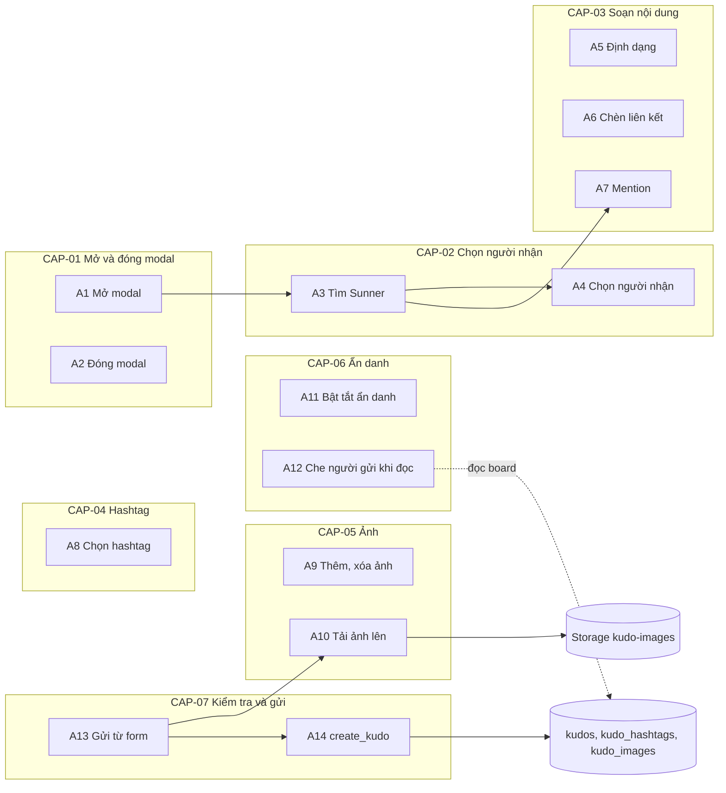
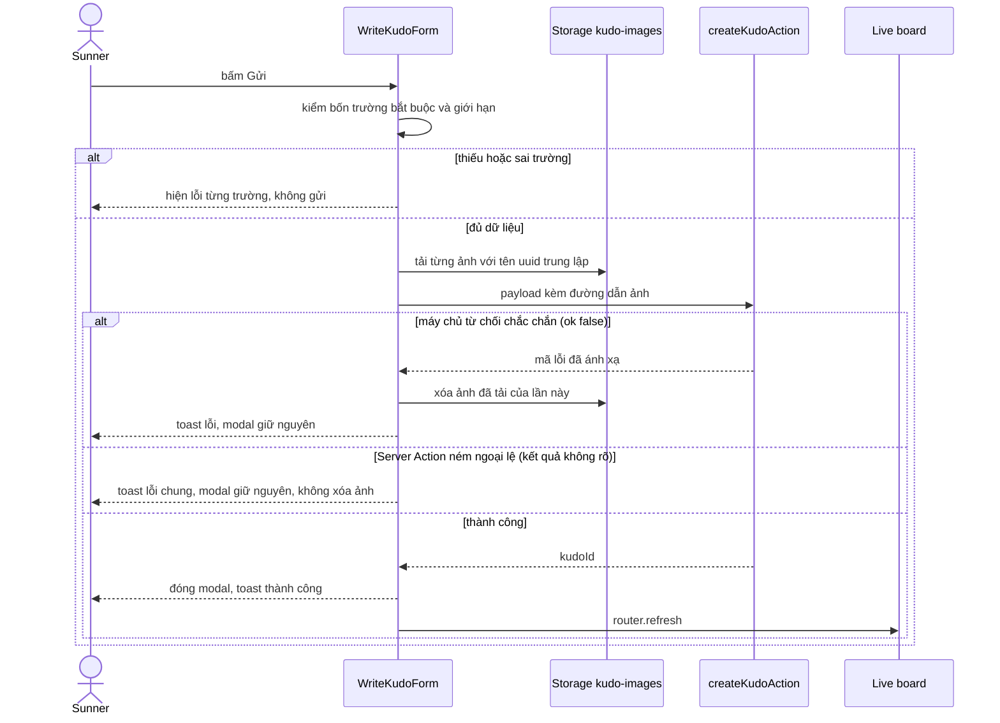
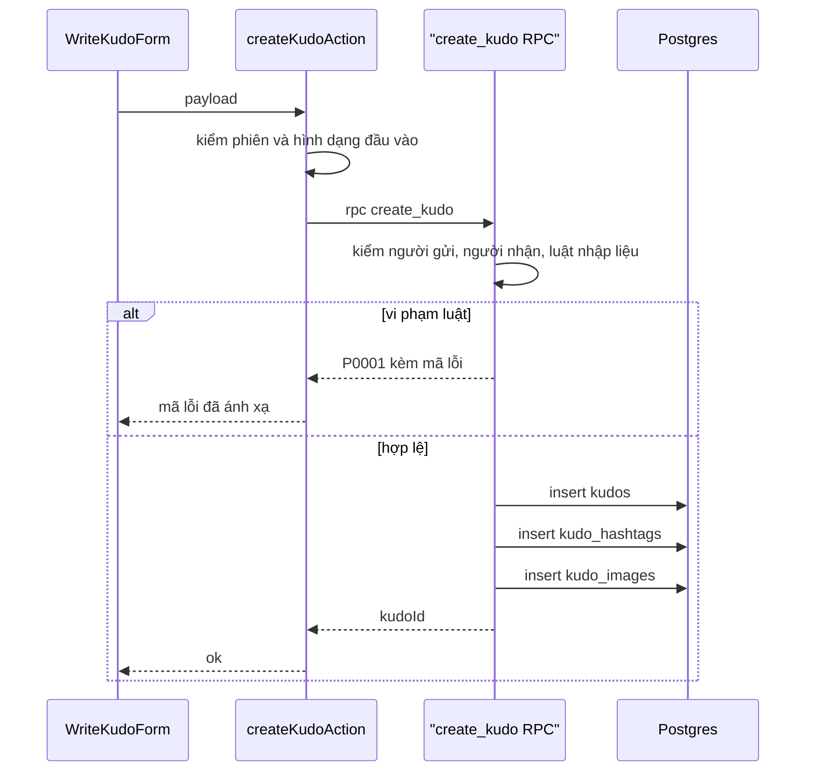
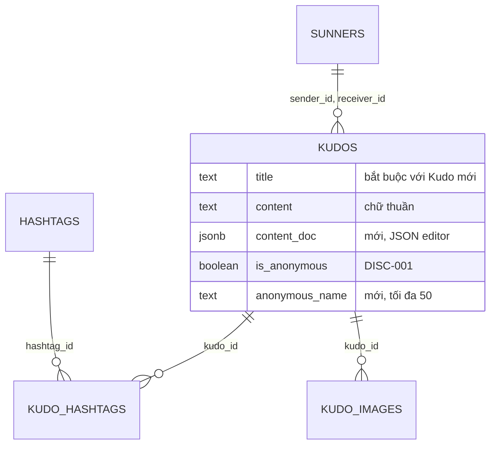
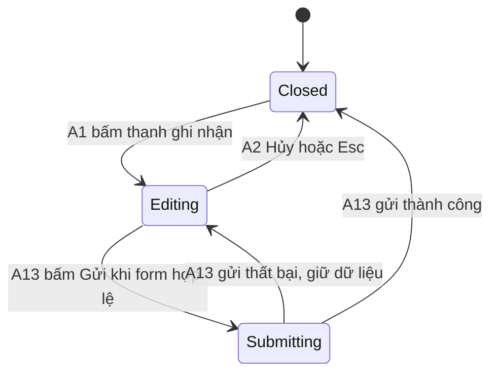

# F007_WriteKudo

## 1. Technical Overview

Feature thêm modal "Viết Kudo" trên `/sun-kudos` (nhóm route `(main)`): Sunner đã đăng nhập chọn người nhận, đặt danh hiệu, soạn lời cảm ơn trong trình soạn thảo ràng buộc theo lược đồ (đậm, nghiêng, gạch ngang, danh sách số, trích dẫn, liên kết, mention `@`), gắn 1 đến 5 hashtag có sẵn, đính tối đa 5 ảnh, tuỳ chọn gửi ẩn danh rồi gửi. Đây là đường ghi Kudo đầu tiên của repo và là lần đầu dùng Supabase Storage: ảnh đi vào bucket `kudo-images` ngay từ trình duyệt (phiên người dùng, policy Storage theo `owner_id`), sau đó một Server Action gọi RPC `SECURITY DEFINER` `create_kudo` kiểm lại toàn bộ luật và ghi `kudos`, `kudo_hashtags`, `kudo_images` trong một giao dịch. Tìm người nhận và mention dùng chung RPC đọc `search_sunners`. Kudo ẩn danh buộc sửa đường đọc của F006: cột `kudos.sender_id` và `sunners.user_id` không còn đọc được từ client, `kudos_private.kudo_cards` trả tên ẩn danh thay cho người gửi, và tên ảnh là `<uuid>.<ext>` ở gốc bucket nên URL ảnh không mang mã người gửi.



## 2. Action Index

| # | Action (handler) | Method · Path | Codes | Writes | Detail |
|---|---|---|---|---|---|
| **A0** | *cross-cutting — belongs to no single action* | — | FR-001, FR-002, FR-102, FR-226, FR-227, FR-601, FR-604 | — | § 4.4 |
| **A1** | `ActionPillsContainer#onCompose` | browser · click thanh ghi nhận | FR-101, FR-103, FR-201, FR-202, FR-206, FR-225, DEC-008, US001, US003 | — *(read-only)* | § 3.1 |
| **A2** | `WriteKudoFormContainer#onClose` | browser · click Hủy, phím Esc, click nền | FR-104, FR-221, FR-224, DEC-006, US012 | — *(read-only)* | § 3.1 |
| **A3** | `searchSunnersAction` (server action) → RPC `search_sunners` | `POST` server action · gõ vào ô Người nhận hoặc sau `@` | FR-203, FR-204, BR-008, DEC-009, ALG-001, INT-003, US002, US006 | — *(read-only)* | § 3.2 |
| **A4** | `useRecipientPicker#onPick` | browser · click dòng gợi ý hoặc nút xóa | FR-205, US002 | — *(read-only)* | § 3.2 |
| **A5** | `useKudoEditor#toggle` | browser · click nút trên thanh công cụ | FR-105, FR-207, FR-209, FR-605, US004 | — *(read-only)* | § 3.3 |
| **A6** | `useAddLinkDialog#onSave` | browser · click Lưu trong hộp thoại | FR-210, BR-007, US005 | — *(read-only)* | § 3.3 |
| **A7** | `useMentionSuggestion#pick` | browser · gõ `@` rồi chọn | FR-211, US006 | — *(read-only)* | § 3.3 |
| **A8** | `useHashtagPicker#onToggle` | browser · click dòng hashtag, click x trên chip | FR-212, FR-213, FR-214, BR-004, DEC-003, US007 | — *(read-only)* | § 3.4 |
| **A9** | `useImageAttachments#add` | browser · chọn tệp, click x trên thu nhỏ | FR-215, FR-216, BR-005, DEC-004, US008 | — *(read-only)* | § 3.5 |
| **A10** | `uploadKudoImages` (browser → Storage) | `POST` Storage · khi bấm Gửi | FR-002, FR-217, BR-005, ALG-003, INT-001, US008 | `storage.objects` | § 3.5 |
| **A11** | `useWriteKudoForm#toggleAnonymous` | browser · click ô ẩn danh | FR-218, BR-006, DEC-005, US009 | — *(read-only)* | § 3.6 |
| **A12** | `kudos_private.kudo_cards` (SECURITY DEFINER) | rpc · mọi RPC đọc của Live board | FR-401, FR-402, FR-604, BR-006, US009 | — *(read-only)* | § 3.6 |
| **A13** | `useSubmitKudo#submit` | browser · click Gửi | FR-208, FR-219, FR-220, FR-222, FR-223, FR-403, BR-001, BR-003, BR-009, BR-010, DEC-001, DEC-002, DEC-007, ALG-002, SM-001, US003, US010, US011 | — *(ghi qua A10, A14)* | § 3.7 ▸ **diagram** |
| **A14** | `createKudoAction` (server action) → RPC `create_kudo` | `POST` server action · từ A13 | FR-001, FR-003, FR-223, FR-601, FR-602, FR-603, BR-001, BR-002, BR-003, BR-004, BR-005, BR-006, BR-007, BR-009, ALG-002, ALG-003, INT-002, US011 | `kudos`, `kudo_hashtags`, `kudo_images` | § 3.7 ▸ **diagram** |

## 3. Actions

### 3.1 CAP-01 — Mở và đóng modal Viết Kudo

#### A1 · Mở modal Viết Kudo từ thanh ghi nhận
`browser · click` → `` `ActionPillsContainer#onCompose` ``
`FR-101` `FR-103` `FR-201` `FR-202` `FR-206` `FR-225` `DEC-008` `US001` `US003` · `SCR007_WriteKudo`

**Who** · Sunner đã đăng nhập đang ở `/sun-kudos` *(gate A0 — § 4.4)*
**FE** · `ActionPillsContainer` giữ pill đang mở làm cờ mở modal (`composeOpener`): pill ghi nhận `data-testid="kudos-compose-pill"` mở modal Viết Kudo, pill tìm hồ sơ `kudos-profile-search-pill` vẫn gọi `openModal` của `KudoFeedbackProvider` (Coming soon). Form nằm trong chunk riêng nạp lười (`dynamic`, `ssr: false`) nên JS đầu của board không mang Tiptap; chunk lỗi thì toast lỗi chung rồi đóng. Modal là lớp `fixed` phủ màn hình, không dùng portal; trường xếp theo thứ tự tiêu đề, Người nhận, Danh hiệu, thanh công cụ + ô soạn thảo, gợi ý "@", Hashtag, Image, ô ẩn danh, Hủy và Gửi (FR-201); chữ gợi ý và ô ẩn danh bỏ chọn mặc định (FR-202). Ô Danh hiệu có nhãn, dấu `*` đỏ, placeholder "Dành tặng một danh hiệu cho đồng đội" và hai dòng ví dụ (FR-206). Focus bị bẫy trong modal, focus đầu vào ô Người nhận (FR-225). Danh sách hashtag và `hasSunner` do `readComposeAccess()` đọc từ `getFilterOptions()` và `getSidebar()` (cùng lần đọc mà các khối khác của trang dùng, vì hai hàm có `cache`), không thêm RPC mới; đọc lỗi thì pill vô hiệu và không có hashtag.
**Request** · không có; props từ server: danh sách hashtag, `hasSunner` (từ `kudos_sidebar`), chuỗi i18n
**Rule** · Chỉ người xem có hàng `sunners` mới mở được modal, cùng luật với nút tim của F006:

| DEC | subtype | Condition | What the user sees | Source |
|---|---|---|---|---|
| **DEC-008** | render | `hasSunner = false` | Pill ghi nhận vô hiệu (`disabled`), không mở modal; RPC `create_kudo` vẫn là chốt chặn phía máy chủ | `app/(main)/sun-kudos/_components/kudos-banner.tsx:75` |
| **DEC-008** | render | `hasSunner = true` | Pill bấm được, mở modal | `app/(main)/sun-kudos/_wiring/action-pills-container.tsx:45` |

**Result** · không ghi DB. Modal chuyển từ trạng thái đóng sang đang soạn (SM-001, § 4.3).
**Source:** `app/(main)/sun-kudos/_wiring/action-pills-container.tsx:25-57`, `app/(main)/sun-kudos/_wiring/read-compose-access.ts:14-20`, `app/(main)/sun-kudos/_wiring/write-kudo-modal-container.tsx:9-34`

<!-- No diagram: below threshold — chỉ client, không ghi bảng nào. -->

---

#### A2 · Đóng modal bằng Hủy, Esc hoặc click nền
`browser · click Hủy, phím Esc, click nền` → `` `WriteKudoFormContainer#onClose` ``
`FR-104` `FR-221` `FR-224` `DEC-006` `US012` · `SCR007_WriteKudo`

**Who** · Sunner đang soạn Kudo *(gate A1 — § 3.1)*
**FE** · Nút Hủy luôn bật trừ khi đang gửi. Esc bắt ở cấp modal (`useModalFocusTrap`); mọi lớp con (hộp thoại liên kết A6, panel hashtag, danh sách người nhận, danh sách mention) tự xử Esc trước qua `useEscapeLayer`, chỉ lớp trên cùng đóng và modal ở lại. Lớp nền mờ không gắn handler đóng (`onBackdropClick` là prop tuỳ chọn mà wiring không truyền). Đóng thì unmount toàn bộ state của form, thu hồi `URL.createObjectURL` của ảnh xem trước, trả focus về pill đã mở modal.
**Rule** · Cách đóng modal và khi nào bị khóa:

| DEC | subtype | Condition | What the user sees | Source |
|---|---|---|---|---|
| **DEC-006** | flow | Bấm Hủy, hoặc Esc, khi không đang gửi | Modal đóng, bỏ mọi dữ liệu, không hỏi lại (FR-221, FR-224) | `app/(main)/sun-kudos/_behavior/use-modal-focus-trap.ts:40-42` |
| **DEC-006** | interaction | Click nền mờ ngoài modal | Không có gì xảy ra; modal và dữ liệu giữ nguyên (FR-224) | `app/(main)/sun-kudos/_components/write-kudo-modal-view.tsx:19-21` |
| **DEC-006** | interaction | Đang gửi (SM-001 `submitting`) | Hủy bị khóa (`disabled`), Esc bị bỏ qua | `app/(main)/sun-kudos/_components/write-kudo-footer-view.tsx:17` |

**Result** · không ghi DB, không lưu nháp. Ảnh chưa được tải lên (chỉ tải khi gửi, A10) nên không có gì phải dọn. Focus về thanh ghi nhận (FR-104). Modal về trạng thái đóng (SM-001, § 4.3).
**Source:** `app/(main)/sun-kudos/_behavior/use-modal-focus-trap.ts:36-78`, `app/(main)/sun-kudos/_behavior/use-escape-layer.ts:13-31`, `app/(main)/sun-kudos/_components/write-kudo-modal-view.tsx:12-45`

<!-- No diagram: below threshold — chỉ client. -->

---

### 3.2 CAP-02 — Chọn người nhận

#### A3 · Tìm Sunner theo tên (dùng cho Người nhận và mention)
`POST` server action → `` `searchSunnersAction` `` → RPC `search_sunners`
`FR-203` `FR-204` `BR-008` `DEC-009` `ALG-001` `INT-003` `US002` `US006` · `SCR007_WriteKudo`

**Who** · Sunner đã đăng nhập *(gate A0 — § 4.4)*
**FE** · `useSunnerSearch` gọi action sau debounce 250 ms. Chuỗi gõ được `trim`; rỗng thì trạng thái `idle`, không gọi và đóng danh sách. Mỗi lần gọi mang số thứ tự, kết quả không phải của lần mới nhất bị bỏ; đang chờ thì trạng thái `loading` (khung chờ), lỗi mạng tính như không có kết quả. Mỗi dòng hiện avatar, họ tên, phòng ban (FR-203). Dùng chung cho ô Người nhận và danh sách mention của A7.
**Request** · param `query` *(string, đã trim, 1 đến 100 ký tự)*
**BE** · `searchSunnersAction` gọi `getCurrentUser()` (không có phiên thì `{ ok: false }`); `query` không phải chuỗi, rỗng sau `trim` hoặc dài quá 100 ký tự thì trả `{ ok: true, options: [] }` mà không gọi RPC; còn lại gọi `supabase.rpc('search_sunners', { p_query })` qua `lib/supabase/server.ts` (INT-003). Trả `{ ok: true, options }` với mỗi dòng `{ id, name, avatarUrl, department }` (`toSunnerOptions` bỏ dòng sai hình dạng) — không trả `user_id`; RPC lỗi thì `{ ok: false }`.
**Rule** · Luật tìm và hiển thị kết quả rỗng:
- **BR-008 — Tìm người nhận bỏ khoảng trắng đầu cuối, không phân biệt hoa thường và dấu, khớp theo tên, tối đa 10 kết quả, loại chính người gửi.** Phép khớp là chuỗi con nguyên văn (không `LIKE`, nên `%`, `_` không là ký tự đại diện) nhờ ALG-001 *(§ 4.5)*.

| DEC | subtype | Condition | What the user sees | Source |
|---|---|---|---|---|
| **DEC-009** | render | Kết quả rỗng sau khi gõ ≥ 1 ký tự | Danh sách hiện một dòng "Không tìm thấy kết quả" (FR-204); gõ "@ # $" cũng vào nhánh này | `app/(main)/sun-kudos/_behavior/use-sunner-search.ts:46` |
| **DEC-009** | render | Có kết quả | Tối đa 10 dòng avatar, họ tên, phòng ban | `supabase/migrations/20261015035946_write_kudo_functions.sql:78` |

**Result** · read-only. Không đổi dữ liệu.
**Source:** `lib/kudos/search-sunners-action.ts:15-33`, `app/(main)/sun-kudos/_behavior/use-sunner-search.ts:20-47`, `supabase/migrations/20261015035946_write_kudo_functions.sql:59-79`
**Shared structure:** `ALG-001` — chuẩn hóa chuỗi gõ và khớp chuỗi con theo tên không dấu, full detail *(§ 4.5)*; `INT-003` — RPC đọc `search_sunners`, full detail *(§ 4.5)*

<!-- No diagram: below threshold — một lần đọc, không ghi. -->

---

#### A4 · Chọn hoặc xóa người nhận
`browser · click dòng gợi ý, click nút xóa` → `` `useRecipientPicker#onPick` ``
`FR-205` `US002` · `SCR007_WriteKudo`

**Who** · Sunner đang soạn Kudo *(gate A1 — § 3.1)*
**FE** · Click một dòng gợi ý (A3) lưu `receiverId` vào state của form, điền ô bằng tên kèm avatar, đóng danh sách. Ô có nút xóa/đổi: xóa thì `receiverId` về null và ô về chế độ tìm kiếm. Lỗi "Không được để trống" của ô tự mất khi đã chọn (DEC-002, A13). Danh sách có Enter và mũi tên lên xuống để chọn; xóa người nhận thì ô tìm hiện lại và nhận focus.
**Result** · không ghi DB; chỉ state của form.
**Source:** `app/(main)/sun-kudos/_behavior/use-recipient-picker.ts:41-108`, `app/(main)/sun-kudos/_components/recipient-picker-view.tsx:12-86`, `app/(main)/sun-kudos/_components/sunner-option-list-view.tsx:19-70`

<!-- No diagram: below threshold — chỉ client. -->

---

### 3.3 CAP-03 — Soạn nội dung Kudo

#### A5 · Định dạng lời cảm ơn và nút Tiêu chuẩn cộng đồng
`browser · click nút B, I, S, danh sách số, trích dẫn` → `` `useKudoEditor#toggle` ``
`FR-105` `FR-207` `FR-209` `FR-605` `US004` · `SCR007_WriteKudo`

**Who** · Sunner đang soạn Kudo *(gate A1 — § 3.1)*
**FE** · Trình soạn thảo Tiptap 3.32.0 ràng buộc theo lược đồ (`createKudoEditorExtensions`, `immediatelyRender: false` để khỏi lệch hydration): mark `bold`, `italic`, `strike`; node `paragraph`, `orderedList`, `listItem`, `blockquote`, `mention`, `hardBreak` và mark `link` (A6). Không có node HTML thô. Nút trên thanh công cụ bật/tắt mark hay node cho đoạn đang chọn hoặc nội dung gõ tiếp (FR-207). Dưới ô soạn thảo là dòng gợi ý "Bạn có thể “@ + tên” để nhắc tới đồng nghiệp khác", không bộ đếm ký tự (FR-209). Cạnh thanh công cụ có link "Tiêu chuẩn cộng đồng" tới `/standards`, `target="_blank"` kèm `rel="noopener noreferrer"` (FR-105). Dán nội dung ngoài vào bị lọc theo lược đồ (mọi thứ ngoài whitelist thành chữ thuần): StarterKit tắt heading, bulletList, codeBlock, code, horizontalRule, underline, và mark `link` tắt `autolink`, `linkOnPaste`, `openOnClick`.
**Rule** · **BR-007 — Liên kết chỉ nhận http hoặc https** áp lên nội dung dán vào, giống hộp thoại A6 *(§ 4.4)*.
**Result** · không ghi DB. State của editor (JSON tài liệu) được A13 đọc lúc gửi. Nội dung người dùng chỉ render qua node của lược đồ, không `dangerouslySetInnerHTML` (FR-605).
**Source:** `app/(main)/sun-kudos/_behavior/use-kudo-editor.ts:47-96`, `app/(main)/sun-kudos/_behavior/kudo-editor-extensions.ts:16-45`, `app/(main)/sun-kudos/_components/kudo-editor-frame-view.tsx:45-100`

<!-- No diagram: below threshold — chỉ client. -->

---

#### A6 · Chèn liên kết qua hộp thoại Addlink
`browser · click Lưu` → `` `useAddLinkDialog#onSave` ``
`FR-210` `BR-007` `US005` · `SCR007_WriteKudo`

**Who** · Sunner đang soạn Kudo *(gate A1 — § 3.1)*
**FE** · Nút liên kết (C.5) mở hộp thoại xếp trên modal, có bẫy focus riêng và trả focus về nút liên kết khi đóng. Ô Text (bắt buộc, 1 đến 100 ký tự, không toàn khoảng trắng), ô Link (bắt buộc, 5 đến 2048 ký tự, chỉ http hoặc https), nút Hủy và Lưu. Lưu cắt khoảng trắng đầu cuối của Text và Link, kiểm giá trị đã cắt, rồi chèn đúng Text đó mang mark `link` (href đã cắt) thay vùng chọn hiện tại (hoặc tại con trỏ nếu không chọn gì) và đóng hộp thoại; lỗi thì không chèn và hộp thoại ở lại. Ô Text điền sẵn bằng chữ đang chọn. Liên kết hiển thị mở tab mới với `rel="noopener noreferrer"`.
**Rule** · **BR-007 — Liên kết chỉ nhận http hoặc https, dài 5 đến 2048 ký tự, phần chữ 1 đến 100 ký tự không toàn khoảng trắng; máy chủ kiểm lại.** `javascript:`, `data:` và địa chỉ không có scheme bị từ chối ở hộp thoại và lần nữa ở A14 *(§ 4.4)*.
**Result** · không ghi DB; thêm mark `link` vào tài liệu của editor.
**Source:** `app/(main)/sun-kudos/_behavior/use-add-link-dialog.ts:51-110`, `app/(main)/sun-kudos/_components/add-link-dialog-view.tsx:53-99`, `lib/kudos/kudo-write-rules.ts:54-71`

<!-- No diagram: below threshold — chỉ client. -->

---

#### A7 · Nhắc đồng nghiệp bằng "@"
`browser · gõ @ kèm chữ rồi chọn` → `` `useMentionSuggestion#pick` ``
`FR-211` `US006` · `SCR007_WriteKudo`

**Who** · Sunner đang soạn Kudo *(gate A1 — § 3.1)*
**FE** · Plugin Suggestion của Tiptap bắt chuỗi sau `@`, `useMentionSuggestion` gọi A3 qua `useSunnerSearch` (cùng debounce, cùng danh sách tối đa 10, loại chính người gửi); chỉ gõ `@` thì chưa tìm, danh sách mở khi có chữ theo sau. Chọn một dòng (Enter hoặc click) thì chèn node `mention` mang `id` Sunner và `label` là tên, hiển thị "@Họ tên". Esc đóng danh sách mà không đổi chữ đang gõ. Mention không có bảng riêng và không phát thông báo.
**Rule** · Tìm kiếm tuân theo luật của A3: tối đa 10 kết quả, bỏ dấu, không phân biệt hoa thường, loại người gửi (BR-008 ở A3); chữ thuần lưu kèm sẽ viết mention thành "@Họ tên" (ALG-002 ở A13).
**Result** · không ghi DB; thêm node `mention` vào tài liệu.
**Source:** `app/(main)/sun-kudos/_behavior/use-mention-suggestion.ts:47-100`, `app/(main)/sun-kudos/_behavior/kudo-editor-extensions.ts:39-44`

<!-- No diagram: below threshold — chỉ client; phần đọc là A3. -->

---

### 3.4 CAP-04 — Gắn hashtag

#### A8 · Chọn hoặc gỡ hashtag
`browser · click dòng hashtag, click x trên chip` → `` `useHashtagPicker#onToggle` ``
`FR-212` `FR-213` `FR-214` `BR-004` `DEC-003` `US007` · `SCR007_WriteKudo`

**Who** · Sunner đang soạn Kudo *(gate A1 — § 3.1)*
**FE** · "+ Hashtag" mở panel danh sách hashtag có sẵn (nhãn có "#"); click dòng bật/tắt chọn, dòng chọn nền đậm kèm dấu tick (FR-212). Chip dưới nhãn có nút "x" gỡ từng cái (FR-214). Không có ô nhập tự do, không tạo hashtag mới. Panel mở giữ nguyên qua các lần chọn; click ra ngoài hoặc Esc đóng panel (Esc trả focus về nút "+ Hashtag"), và việc đóng lần đầu tính là "đã chạm" cho lỗi DEC-002.
**Rule** · Giới hạn và trạng thái các dòng:
- **BR-004 — Hashtag đã chọn từ 1 đến 5, đều có sẵn trong dữ liệu, không trùng nhau.** Phía client chỉ cho chọn từ danh sách đã nạp; A14 kiểm lại theo `slug` *(§ 4.4)*.

| DEC | subtype | Condition | What the user sees | Source |
|---|---|---|---|---|
| **DEC-003** | render | Đã chọn 5 hashtag | Các dòng chưa chọn bị vô hiệu, panel hiện "Tối đa 5 hashtag" (FR-213) | `app/(main)/sun-kudos/_behavior/use-hashtag-picker.ts:66` |
| **DEC-003** | render | Đã chọn dưới 5 | Mọi dòng bấm được | `app/(main)/sun-kudos/_components/hashtag-picker-view.tsx:87-91` |
| **DEC-003** | render | Chưa chọn cái nào lúc bấm Gửi | Lỗi "Không được để trống" ở hàng Hashtag (DEC-002, A13) | `app/(main)/sun-kudos/_behavior/use-write-kudo-form.ts:61-64` |

**Result** · không ghi DB; state form giữ danh sách `slug`.
**Source:** `app/(main)/sun-kudos/_behavior/use-hashtag-picker.ts:30-80`, `app/(main)/sun-kudos/_components/hashtag-picker-view.tsx:13-96`

<!-- No diagram: below threshold — chỉ client. -->

---

### 3.5 CAP-05 — Đính ảnh

#### A9 · Thêm hoặc xóa ảnh trên form
`browser · chọn tệp, click x trên thu nhỏ` → `` `useImageAttachments#add` ``
`FR-215` `FR-216` `BR-005` `DEC-004` `US008` · `SCR007_WriteKudo`

**Who** · Sunner đang soạn Kudo *(gate A1 — § 3.1)*
**FE** · "+ Image" mở file picker (`accept="image/jpeg,image/png,image/webp"`, nhiều tệp). Mỗi tệp kiểm loại thật bằng chữ ký byte đầu tệp (JPEG, PNG, WebP; không tin tên tệp hay `File.type`) rồi kích thước ≤ 5 MB trước khi nhận; tệp sai định dạng (pdf, mp4, txt) bị bỏ và hiện "Định dạng file không hợp lệ"; quá 5 MB hiện "Ảnh vượt quá 5 MB" (một dòng lỗi cho lần chọn, lấy lý do đầu tiên). Tệp nhận được hiện thu nhỏ ngay từ `URL.createObjectURL` kèm nút "x"; URL thu nhỏ bị thu hồi khi xóa ảnh và khi form unmount. Chưa gửi gì lên mạng.
**Rule** · Giới hạn ảnh và trạng thái nút:
- **BR-005 — Tối đa 5 ảnh, chỉ JPEG, PNG, WebP, mỗi ảnh ≤ 5 MB, tải lên khi gửi, tên tệp trung lập `<uuid>.<ext>` ở gốc bucket.** Client kiểm ở đây, A10 đặt tên và tải lên, A14 kiểm lại tên và quyền sở hữu *(§ 4.4)*.

| DEC | subtype | Condition | What the user sees | Source |
|---|---|---|---|---|
| **DEC-004** | render | Số ảnh < 5 | Nút "+ Image" hiện (FR-216) | `app/(main)/sun-kudos/_behavior/use-image-attachments.ts:97` |
| **DEC-004** | render | Số ảnh = 5 | Nút "+ Image" ẩn; không thêm được ảnh thứ 6 | `app/(main)/sun-kudos/_components/image-picker-view.tsx:52` |
| **DEC-004** | render | Xóa một ảnh khi đang đủ 5 | Nút "+ Image" hiện lại | `app/(main)/sun-kudos/_behavior/use-image-attachments.ts:88-93` |

**Result** · không ghi DB, không ghi Storage. State form giữ mảng `File` và URL xem trước.
**Source:** `app/(main)/sun-kudos/_behavior/use-image-attachments.ts:48-105`, `app/(main)/sun-kudos/_components/image-picker-view.tsx:14-77`, `lib/kudos/kudo-write-rules.ts:73-81`

<!-- No diagram: below threshold — chỉ client. -->

---

#### A10 · Tải ảnh lên Storage khi bấm Gửi
`POST` Storage `kudo-images` → `` `uploadKudoImages` (browser → Storage) ``
`FR-002` `FR-217` `BR-005` `ALG-003` `INT-001` `US008` · `SCR007_WriteKudo`

**Who** · Sunner đã đăng nhập, chạy trong phiên của chính họ *(gate A0 — § 4.4)*
**FE** · Gọi từ A13 sau khi kiểm form hợp lệ và trước A14. `uploadKudoImages` dùng `lib/supabase/client.ts` (browser client, phiên người dùng): tuần tự từng ảnh, loại lấy từ chữ ký byte (không từ `File.type`), tên `<uuid v4>.<ext>`, `storage.from('kudo-images').upload(name, file, { contentType, upsert: false })`. Chọn client-direct vì 5 ảnh × 5 MB vượt xa giới hạn thân Server Action mặc định; không đổi `serverActions.bodySizeLimit` (§ 5.3).
**Request** · mỗi tệp: `name` *(ALG-003)*, `file`, `contentType`
**Rule** · **BR-005 — Ảnh chỉ nhận JPEG, PNG, WebP, ≤ 5 MB, tối đa 5, tải vào thư mục của người gửi.** Bucket tự từ chối định dạng và cỡ sai (`allowed_mime_types`, `file_size_limit`); policy `insert` chỉ nhận tên đúng mẫu uuid v4 + đuôi cho phép ở gốc bucket và `owner_id` bằng `auth.uid()`; `select` chỉ cho hàng của chính mình; không có `update`; `delete` chỉ cho tệp của mình chưa được dòng `kudo_images` nào tham chiếu *(§ 4.4)*.
**Result**
- Ghi mỗi ảnh thành một đối tượng ở `storage.objects` (bucket `kudo-images`), tên theo ALG-003; INT-001 tải tệp lên kho đối tượng của Supabase *(§ 4.5)*
- Một ảnh lỗi (kể cả tệp không phải JPEG/PNG/WebP) thì dừng, tự xóa các ảnh đã tải và ảnh đang tải dở của lần này (best-effort), ném `KudoImageUploadError`; A13 hiện toast lỗi tải ảnh
**State** · `SM-001`: `Submitting` → `Editing` khi một ảnh lỗi; thành công thì vẫn `Submitting` và chuyển sang A14 *(§ 4.3)*
**Source:** `lib/kudos/kudo-image-storage.ts:35-59`, `supabase/migrations/20261015035942_write_kudo_columns_and_storage.sql:26-27`, `supabase/migrations/20261015035942_write_kudo_columns_and_storage.sql:34-50`

<!-- No diagram: below threshold (một bảng Storage, tuần tự); thứ tự cả luồng gửi nằm ở sơ đồ cấp capability § 3.7. -->

---

### 3.6 CAP-06 — Gửi ẩn danh

#### A11 · Bật hoặc tắt ẩn danh trên form
`browser · click ô ẩn danh` → `` `useWriteKudoForm#toggleAnonymous` ``
`FR-218` `BR-006` `DEC-005` `US009` · `SCR007_WriteKudo`

**Who** · Sunner đang soạn Kudo *(gate A1 — § 3.1)*
**FE** · Checkbox mặc định bỏ chọn (FR-202). Ô "Tên ẩn danh" là text input tuỳ chọn, `maxLength` 50.
**Rule** · Hiển thị ô tên và luật tên:
- **BR-006 — Tên ẩn danh tối đa 50 ký tự; để trống thì hiển thị "Người gửi ẩn danh" (do UI dịch theo ngôn ngữ, DB lưu `null`); người gửi thật vẫn nằm ở `sender_id` để tính tim và số liệu.** Dùng ở A11, A12, A14 *(§ 4.4)*.

| DEC | subtype | Condition | What the user sees | Source |
|---|---|---|---|---|
| **DEC-005** | render | Checkbox được chọn | Hiện ô "Tên ẩn danh" (FR-218) | `app/(main)/sun-kudos/_components/anonymous-field-view.tsx:25-26` |
| **DEC-005** | render | Checkbox bị bỏ chọn | Ô ẩn đi và giá trị bị xóa; bật lại thì ô trống | `app/(main)/sun-kudos/_behavior/use-write-kudo-form.ts:72-75` |

**Result** · không ghi DB; state form giữ `isAnonymous` và `anonymousName`.
**Source:** `app/(main)/sun-kudos/_behavior/use-write-kudo-form.ts:45-83`, `app/(main)/sun-kudos/_components/anonymous-field-view.tsx:8-43`

<!-- No diagram: below threshold — chỉ client. -->

---

#### A12 · Che người gửi thật của Kudo ẩn danh ở mọi đường đọc
`rpc · mọi RPC đọc của Live board` → `` `kudos_private.kudo_cards` (SECURITY DEFINER) ``
`FR-401` `FR-402` `FR-604` `BR-006` `US009` · `SCR007_WriteKudo`

**Who** · Sunner khác đang xem Live board hoặc gọi thẳng PostgREST *(gate A0 — § 4.4, FR-604)*
**FE** · Thẻ Kudo ẩn danh (`isAnonymous` hoặc `sender === null`) hiện tên ẩn danh (nếu `anonymousName` rỗng thì dùng chuỗi i18n `writeKudo.anonymous.default`, "Người gửi ẩn danh"), hình người trung lập thay cho avatar, không huy hiệu hero, không liên kết `/profile`. Sửa `kudo-card.tsx` và `kudo-person.tsx` của F006; `KudoCard.sender` thành `null` đúng khi ẩn danh.
**BE** · `kudos_private.kudo_cards` (nay `SECURITY DEFINER`, `search_path = ''`) trả thêm `isAnonymous` và `anonymousName` (null nếu không ẩn danh) và đặt `sender: null` cho thẻ ẩn danh với mọi người xem, kể cả chính người gửi; không còn `id`, `avatarUrl`, `department`, `heroTitle`, `receivedCount` của người gửi thật. `kudos_highlight`, `kudos_feed_page` gọi nó nên đổi theo (vẫn `SECURITY INVOKER`, không đọc cột bị che). `canLike` vẫn so người xem với người gửi thật, nên chỉ chính người gửi thấy `false`. Ba hàm cần cột bị che chuyển sang `SECURITY DEFINER` hẹp: `kudos_private.kudo_cards`, `public.kudos_sidebar`, `kudos_private.viewer_sunner_id`; `toggle_kudo_like` đã là DEFINER từ F006. `search_sunners` vẫn `SECURITY INVOKER` vì chỉ đọc cột còn được cấp và gọi `viewer_sunner_id()` (cơ chế § 4.4 Bin 3). Đường đọc ảnh đi qua `withResolvedImages` ở `kudo-board-queries.ts`, đổi `kudo-images/<tên>` thành URL công khai của Storage.
**Rule** · **BR-006 — Kudo ẩn danh hiển thị tên ẩn danh (mặc định "Người gửi ẩn danh") thay người gửi; người gửi thật vẫn được tính tim và "Kudos đã gửi".** `kudos_sidebar` vẫn đếm `sent` và `hearts` theo `sender_id` thật (FR-402) *(§ 4.4)*.
**Result** · read-only. Không đường đọc nào trả người gửi thật cho người khác: không RPC đọc, không `select` trực tiếp `kudos.sender_id`, không URL ảnh mang mã người gửi (FR-604). pgTAP phải chứng minh cả ba (§ 5.1 SC-006).
**Source:** `supabase/migrations/20261015035944_write_kudo_sender_masking.sql:10-51`, `app/(main)/sun-kudos/_components/kudo-card.tsx:38-56`, `app/(main)/sun-kudos/_components/kudo-person.tsx:20-33`, `lib/kudos/kudo-board-types.ts:32-36`, `lib/kudos/kudo-board-queries.ts:43-46`

<!-- No diagram: below threshold — read-only, không ghi bảng. -->

---

### 3.7 CAP-07 — Kiểm tra và gửi Kudo

Luồng gửi trải trên ba action (A13 trên trình duyệt, A10 vào Storage, A14 ở máy chủ), không action nào sở hữu trọn thứ tự, nên sơ đồ đặt ở cấp capability:



#### A13 · Kiểm tra form, tải ảnh, gửi và báo kết quả
`browser · click Gửi` → `` `useSubmitKudo#submit` ``
`FR-208` `FR-219` `FR-220` `FR-222` `FR-223` `FR-403` `BR-001` `BR-003` `BR-009` `BR-010` `DEC-001` `DEC-002` `DEC-007` `ALG-002` `SM-001` `US003` `US010` `US011` · `SCR007_WriteKudo`

**Who** · Sunner đang soạn Kudo *(gate A1 — § 3.1)*
**FE** · Nút Gửi luôn bấm được; khi thiếu trường bắt buộc hoặc nội dung vượt 2000 ký tự nó mang `aria-disabled="true"` và kiểu mờ (DEC-001). Mỗi trường bắt buộc có trạng thái "đã chạm"; lỗi hiện khi bấm Gửi hoặc khi rời ô đã chạm mà trống, và tắt ngay khi hợp lệ (DEC-002): viền đỏ + "Không được để trống", riêng hashtag hiện tại hàng Hashtag. Bấm khi thiếu thì hiện mọi lỗi và không gửi. Đang gửi thì nút Gửi quay vòng tải (`aria-busy`), khóa mọi ô, soạn thảo thành chỉ đọc và Hủy (DEC-007); bấm Gửi lần nữa bị bỏ qua nhờ cờ `inFlight`. Toast dùng `KudoFeedbackProvider.show`; thành công gọi `onClose` rồi `router.refresh()` (FR-403). `useSubmitKudo` lấy bản chụp field lúc gửi: `title` đã `trim`, `content` là chữ thuần đã `trim` của editor, `contentDoc` là `editor.getJSON()`.
**Request** · gửi cho A14: `receiverId`, `title`, `content` (chữ thuần, ALG-002), `contentDoc` (JSON editor), `hashtagSlugs[]`, `imagePaths[]` (từ A10), `isAnonymous`, `anonymousName`
**Rule** · Form kiểm trước khi gọi mạng, bằng đúng các luật mà A14 kiểm lại:
- **BR-001 — Bốn trường bắt buộc: Người nhận, Danh hiệu, nội dung, ít nhất 1 hashtag; ảnh và ẩn danh tuỳ chọn.** *(§ 4.4)*
- **BR-003 — Nội dung: chữ thuần không rỗng sau `trim`, tối đa 2000 ký tự; mention thành "@Họ tên"; lưu cả chữ thuần và bản JSON.** *(§ 4.4)*
- **BR-009 — Danh hiệu dài 1 đến 100 ký tự sau `trim`.** *(§ 4.4)*
- **BR-010 — Gửi thất bại thì modal giữ nguyên dữ liệu; ảnh đã tải chỉ bị xóa khi kết quả là thất bại chắc chắn.** Một ảnh tải lỗi: `uploadKudoImages` tự xóa phần đã tải rồi ném lỗi. Server trả `{ ok: false }` (từ chối chắc chắn): A13 gọi `removeKudoImages` (best-effort). Server Action ném ngoại lệ (mạng, kết quả không rõ): **không dọn**, vì RPC có thể đã ghi và ảnh đã được tham chiếu; ảnh mồ côi chấp nhận được (tên uuid không đoán được, không có dòng `kudo_images` nào). Chỉ A13 sở hữu việc dọn này, vì chỉ nó biết tên vừa tải.

| DEC | subtype | Condition | What the user sees | Source |
|---|---|---|---|---|
| **DEC-001** | render | Còn thiếu Người nhận, Danh hiệu, nội dung hoặc hashtag | Gửi `aria-disabled="true"`, kiểu mờ, vẫn bấm được; bấm thì hiện mọi lỗi, không gọi mạng (FR-219) | `app/(main)/sun-kudos/_components/write-kudo-footer-view.tsx:28` |
| **DEC-001** | render | Đủ bốn trường | Gửi bình thường, bấm thì gửi | `app/(main)/sun-kudos/_behavior/use-submit-kudo.ts:78-84` |
| **DEC-002** | interaction | Bấm Gửi, hoặc `blur` ở trường đã chạm mà trống | Viền đỏ + "Không được để trống" (hashtag: ở hàng Hashtag) (FR-220) | `app/(main)/sun-kudos/_behavior/use-write-kudo-form.ts:54-63` |
| **DEC-002** | interaction | Trường trở nên hợp lệ | Lỗi và viền đỏ biến mất ngay | `app/(main)/sun-kudos/_behavior/use-write-kudo-form.ts:61-64` |
| **DEC-007** | render | Đang gửi | Gửi quay vòng tải; mọi ô nhập, Hủy bị khóa; bấm Gửi lần nữa bị bỏ qua (FR-222) | `app/(main)/sun-kudos/_behavior/use-submit-kudo.ts:73-85` |

**Result** · không ghi trực tiếp; sau khi hợp lệ gọi A10 (ảnh) rồi A14 (Kudo). Thành công: modal đóng, toast "Đã gửi Kudos thành công!", `router.refresh()` nạp lại board để Kudo mới đứng đầu All Kudos (FR-403). Thất bại: toast lỗi theo mã (`writeKudo.error.<mã>`; mã lạ là `unknown`, không chuyển tiếp nguyên văn lỗi RPC), modal ở lại, dọn ảnh theo luật BR-010 (FR-223). Vòng đời modal: đang soạn → đang gửi → đóng hoặc đang soạn (SM-001, § 4.3).
**Source:** `app/(main)/sun-kudos/_behavior/use-submit-kudo.ts:44-88`, `app/(main)/sun-kudos/_wiring/write-kudo-form-container.tsx:39-176`, `app/(main)/sun-kudos/_behavior/use-write-kudo-form.ts:45-83`
**Shared structure:** `ALG-002` — dựng chữ thuần từ tài liệu editor và kiểm lược đồ, full detail *(§ 4.5)*

---

#### A14 · Ghi Kudo trọn gói qua RPC create_kudo
`POST` server action → `` `createKudoAction` `` → RPC `create_kudo`
`FR-001` `FR-003` `FR-223` `FR-601` `FR-602` `FR-603` `BR-001` `BR-002` `BR-003` `BR-004` `BR-005` `BR-006` `BR-007` `BR-009` `ALG-002` `ALG-003` `INT-002` `US011` · `SCR007_WriteKudo`

**Who** · Sunner đã đăng nhập và có hàng `sunners` *(gate A0 — § 4.4)*
**Request** · `receiverId` *(uuid)*, `title`, `content`, `contentDoc` *(object)*, `hashtagSlugs` *(1 đến 5)*, `imagePaths` *(0 đến 5)*, `isAnonymous` *(boolean)*, `anonymousName` *(≤ 50, tuỳ chọn)*
**BE** · `createKudoAction(input: unknown)` gọi `getCurrentUser()` (không có phiên thì `{ ok: false, code: 'unauthenticated' }`), kiểm đầu vào bằng `parseCreateKudoInput` (cùng số liệu với client; chỉ chép các khóa đã biết; `invalid_input` nếu sai; `contentDoc` ≤ 64 KiB UTF-8; tên ảnh đúng mẫu `KUDO_IMAGE_NAME`, không trùng) rồi `supabase.rpc('create_kudo', {...})` qua `lib/supabase/server.ts` (INT-002), với `p_anonymous_name` là `null` khi không ẩn danh. `error.message` của RPC được ánh xạ sang một trong chín mã (`sunner_not_found`, `receiver_not_found`, `self_kudo`, `title_invalid`, `content_invalid`, `content_doc_invalid`, `hashtags_invalid`, `images_invalid`, `anonymous_name_invalid`), mọi thứ khác là `unknown` và không chuyển tiếp nguyên văn. Trả `{ ok: true, kudoId }` hoặc `{ ok: false, code }`.
**Rule** · RPC `SECURITY DEFINER`, `set search_path = ''`, lấy người gửi từ `auth.uid()` (qua `kudos_private.viewer_sunner_id()`) rồi kiểm lại mọi luật theo thứ tự dưới đây trong một giao dịch; lỗi đầu tiên dừng hàm:
- **BR-002 — Người gửi lấy từ phiên (`auth.uid()` → `sunners`), không nhận từ tham số, và không được trùng người nhận.** Không có hàng `sunners` thì `sunner_not_found`; người nhận không tồn tại thì `receiver_not_found`; trùng thì `self_kudo` (ràng buộc `sender_id <> receiver_id` là lớp thứ hai).
- **BR-001 — Bốn trường bắt buộc đều có giá trị hợp lệ** (người nhận, danh hiệu, nội dung, ≥ 1 hashtag) *(§ 4.4)*.
- **BR-009 — Danh hiệu 1 đến 100 ký tự sau khi cắt khoảng trắng (`kudos_private.trim_whitespace`, cùng tập ký tự với `String#trim`).** *(§ 4.4)*
- **BR-003 — Nội dung chữ thuần 1 đến 2000 ký tự sau khi cắt khoảng trắng; `content_doc` đúng lược đồ và ≤ 64 KiB (ALG-002).** *(§ 4.4)*
- **BR-007 — Mọi mark `link` trong `content_doc` là http hoặc https, 5 đến 2048 ký tự.** *(§ 4.4)*
- **BR-004 — 1 đến 5 hashtag, mỗi `slug` phải có trong `hashtags`, không trùng.** *(§ 4.4)*
- **BR-005 — 0 đến 5 ảnh, mỗi tên đúng mẫu ALG-003, không trùng, là tệp do chính người gọi tải lên bucket `kudo-images` (`storage.objects.owner_id = auth.uid()`) và chưa được Kudo nào dùng.** *(§ 4.4)*
- **BR-006 — `anonymous_name` ≤ 50 ký tự sau khi cắt và chỉ có khi `is_anonymous` (để trống thì lưu `null`); `sender_id` luôn là người gửi thật; ràng buộc `kudos_anonymous_name_check` là lớp thứ hai.** *(§ 4.4)*

**Result**
- Ghi `kudos` ← `sender_id` (người gọi), `receiver_id`, `title` (đã cắt khoảng trắng), `content`, `content_doc`, `is_anonymous`, `anonymous_name`; `created_at` mặc định giữ độ chính xác mili giây của F006
- Ghi `kudo_hashtags` ← một dòng mỗi hashtag đã đối chiếu theo `slug`
- Ghi `kudo_images` ← một dòng mỗi ảnh, `position` 1 đến N theo thứ tự chọn, `url` là `kudo-images/<tên>` (không phải URL tuyệt đối; app đổi sang URL công khai lúc đọc, § 5.3)
- Trả `{ kudoId }`; vi phạm luật thì không ghi gì (INT-002 chạy trọn trong một giao dịch); hai lần gửi đua nhau cùng một tệp ảnh thì lần sau gặp `unique_violation` của chỉ mục `kudo_images_uploaded_url_key` và trả `images_invalid`
**State** · `SM-001`: `Submitting` → `Closed` khi `{ ok: true }`, hoặc → `Editing` khi lỗi *(§ 4.3)*
**Source:** `lib/kudos/create-kudo-action.ts:18-51`, `lib/kudos/create-kudo-input.ts:49-71`, `supabase/migrations/20261015035946_write_kudo_functions.sql:90-164`
**Shared structure:** `ALG-002` — kiểm lược đồ `content_doc` ở phía SQL, `ALG-003` — kiểm đường dẫn ảnh theo người gọi, `INT-002` — RPC ghi `create_kudo`, đều ở *(§ 4.5)*



---

### 3.8 Edge cases

| Action | Scenario | Behavior |
|---|---|---|
| A1 | Người xem không có hàng `sunners` | Pill vô hiệu; `create_kudo` vẫn báo `sunner_not_found` nếu bị gọi trực tiếp |
| A2 | Esc khi đang gửi | Bỏ qua (`submitting` chặn `onEscape`); modal đóng theo kết quả gửi |
| A2 · A13 | Hủy hoặc Esc ngay sau khi ảnh đã tải xong nhưng trước khi gửi xong | Không xảy ra: Hủy và Esc bị khóa từ lúc bấm Gửi |
| A3 | Kết quả của chuỗi gõ cũ về sau kết quả của chuỗi mới | Bỏ qua theo số thứ tự yêu cầu |
| A3 | Gõ `%` hoặc `_` | Khớp nguyên văn như ký tự thường (ALG-001), không phải ký tự đại diện |
| A3 | Chuỗi gõ toàn khoảng trắng | Sau `trim` là rỗng nên trạng thái `idle`, không gọi, đóng danh sách |
| A3 | Chuỗi gõ dài hơn 100 ký tự | Server Action và RPC đều trả mảng rỗng, danh sách hiện "Không tìm thấy kết quả" |
| A3 | Danh sách có người trùng tên | Hiển thị cả hai, phân biệt bằng phòng ban |
| A5 | Dán HTML hoặc nội dung ngoài lược đồ | Giữ chữ thuần, bỏ định dạng và thẻ không nằm trong whitelist |
| A6 | Link nhập `javascript:alert(1)` hoặc `ftp://` | Hộp thoại không cho Lưu; A14 vẫn từ chối nếu `content_doc` bị chèn tay |
| A6 | Esc khi hộp thoại mở | Chỉ đóng hộp thoại, modal ở lại [EXPECTED] |
| A7 | Gõ `@` rồi xóa | Danh sách đóng, không chèn mention |
| A8 | Chọn hashtag đã bị xóa khỏi DB giữa lúc soạn | A14 trả `hashtags_invalid`; form giữ nguyên, toast lỗi |
| A9 | Chọn nhiều tệp làm vượt 5 ảnh | Nhận đủ 5, phần dư bỏ không báo lỗi; khóa i18n `writeKudo.image.tooMany` ("Tối đa 5 ảnh") có trong từ điển nhưng chưa được nối vào giao diện |
| A9 | Tệp đuôi `.jpg` nhưng thực là pdf | Kiểm chữ ký byte nên từ chối; bucket cũng từ chối lần nữa (`allowed_mime_types`) |
| A10 | Một ảnh tải lỗi giữa chừng | Dừng, xóa ảnh đã tải và ảnh đang tải dở, A13 báo "lỗi tải ảnh" |
| A10 · A14 | Người gọi RPC nhét tên ảnh do người khác tải lên, tên đã dùng cho Kudo khác, hoặc tên sai mẫu | `images_invalid`, không ghi gì (BR-005) |
| A11 | Bật ẩn danh, gõ tên, tắt, bật lại | Ô trống (DEC-005) |
| A12 | `select sender_id` trực tiếp từ `kudos` bằng token người dùng | Từ chối do thiếu quyền cột (FR-604) |
| A12 | Người gửi chính mình xem Kudo ẩn danh của mình | Thấy tên ẩn danh như mọi người; `canLike = false` (D007) |
| A13 | Bấm Gửi hai lần nhanh | Lần hai bị bỏ qua vì đang ở `submitting` (DEC-007) |
| A13 | Mất mạng hoặc Server Action ném lỗi sau khi ảnh đã tải xong | Toast lỗi chung, modal giữ nguyên; **không** xóa ảnh vì kết quả không rõ (BR-010) |
| A13 | Server trả `{ ok: false }` sau khi ảnh đã tải xong | Toast theo mã, modal giữ nguyên, ảnh đã tải bị xóa best-effort (BR-010) |
| A13 · A14 | Hai lần gửi trùng nội dung | Tạo hai Kudo riêng; không chống trùng (YAGNI, D015) |
| A14 | Người nhận bị xóa giữa lúc soạn | `receiver_not_found`, không ghi gì |
| A14 | Lỗi ghi `kudo_images` sau khi đã ghi `kudos` | Cả giao dịch lùi lại; không còn Kudo mồ côi |
| A14 | Hai lần gửi dùng chung một tệp ảnh | Lần sau gặp `unique_violation` của `kudo_images_uploaded_url_key`, trả `images_invalid` |
| A1-A14 | Khách gọi thẳng RPC hoặc Server Action | Proxy/`getCurrentUser()` chặn; RPC chỉ cấp `EXECUTE` cho `authenticated` (A0, § 4.4) |

## 4. Shared Foundation

### 4.1 Components

| Component | Responsibility | Used in | File |
|---|---|---|---|
| `ActionPillsContainer` | Giữ pill đã mở làm cờ mở modal; pill ghi nhận mở Viết Kudo, pill tìm hồ sơ vẫn mở Coming soon | A1 | `app/(main)/sun-kudos/_wiring/action-pills-container.tsx` |
| `readComposeAccess`, `buildWriteKudoLabels` | Server: `hasSunner`, hashtag, và toàn bộ chuỗi i18n của modal | A1 | `app/(main)/sun-kudos/_wiring/read-compose-access.ts`, `app/(main)/sun-kudos/_wiring/build-write-kudo-labels.ts` |
| `WriteKudoModalContainer` | Nạp lười form (`dynamic`, `ssr: false`), không render khi đóng | A1, A2 | `app/(main)/sun-kudos/_wiring/write-kudo-modal-container.tsx` |
| `WriteKudoFormContainer` | Ghép các hook vào view không state, điều phối gửi | A2–A13 | `app/(main)/sun-kudos/_wiring/write-kudo-form-container.tsx` |
| `WriteKudoEditorContainer` | Ghép editor, thanh công cụ, hộp thoại liên kết, danh sách mention | A5–A7 | `app/(main)/sun-kudos/_wiring/write-kudo-editor-container.tsx` |
| `WriteKudoModalView`, `WriteKudoFieldRow`, `WriteKudoFooterView` | Khung modal, hàng trường (nhãn, lỗi), chân Hủy/Gửi | A1, A2, A13 | `app/(main)/sun-kudos/_components/write-kudo-modal-view.tsx`, `write-kudo-field-row.tsx`, `write-kudo-footer-view.tsx` |
| `RecipientPickerView`, `SunnerOptionListView` | Ô Người nhận và danh sách gợi ý dùng chung với mention | A3, A4, A7 | `app/(main)/sun-kudos/_components/recipient-picker-view.tsx`, `sunner-option-list-view.tsx` |
| `KudoEditorFrameView`, `AddLinkDialogView` | Thanh công cụ, link Tiêu chuẩn cộng đồng, ô soạn thảo; hộp thoại Addlink | A5, A6 | `app/(main)/sun-kudos/_components/kudo-editor-frame-view.tsx`, `add-link-dialog-view.tsx` |
| `HashtagPickerView`, `ImagePickerView`, `AnonymousFieldView` | Panel hashtag và chip; chọn ảnh và thu nhỏ; checkbox và tên ẩn danh | A8, A9, A11 | `app/(main)/sun-kudos/_components/hashtag-picker-view.tsx`, `image-picker-view.tsx`, `anonymous-field-view.tsx` |
| Hook hành vi | `useWriteKudoForm`, `useRecipientPicker`, `useSunnerSearch`, `useKudoEditor`, `useMentionSuggestion`, `useAddLinkDialog`, `useHashtagPicker`, `useImageAttachments`, `useSubmitKudo`, `useModalFocusTrap`, `useEscapeLayer` | A2–A13 | `app/(main)/sun-kudos/_behavior/use-*.ts` |
| `createKudoEditorExtensions` | Lược đồ Tiptap whitelist (StarterKit rút gọn, `link` http/https, `Mention`) | A5–A7 | `app/(main)/sun-kudos/_behavior/kudo-editor-extensions.ts` |
| `KudoFeedbackProvider` | Toast thành công/lỗi dùng chung (đã có) | A13 | `app/(main)/sun-kudos/_behavior/kudo-feedback-provider.tsx` |
| `searchSunnersAction`, `createKudoAction` | Hai Server Action mới, mỗi cái tự kiểm phiên và đầu vào | A3, A14 | `lib/kudos/search-sunners-action.ts`, `lib/kudos/create-kudo-action.ts` |
| `parseCreateKudoInput`, `toCreateKudoErrorCode`, `toSunnerOptions` | Hàm thuần của hai action (tách khỏi file `'use server'`) | A3, A14 | `lib/kudos/create-kudo-input.ts` |
| `kudo-write-rules`, `kudo-write-types` | Hằng số và luật kiểm dùng chung client, server, upload; kiểu payload và mã lỗi | A2–A14 | `lib/kudos/kudo-write-rules.ts`, `lib/kudos/kudo-write-types.ts` |
| `uploadKudoImages`, `removeKudoImages`, `newKudoImageName` | Tải ảnh thẳng lên Storage từ trình duyệt, dọn, đặt tên trung lập | A10, A13 | `lib/kudos/kudo-image-storage.ts` |
| `resolveKudoImageUrl`, `withResolvedImages` | Đổi `kudo_images.url` đã lưu thành URL tải được hoặc bỏ ảnh | A12 | `lib/kudos/resolve-kudo-image-url.ts`, dùng ở `lib/kudos/kudo-board-queries.ts` |
| `kudo-card.tsx`, `kudo-person.tsx` | Hiện tên ẩn danh, hình người trung lập, không liên kết hồ sơ | A12 | `app/(main)/sun-kudos/_components/kudo-card.tsx`, `kudo-person.tsx` (sửa) |
| Từ điển | Chuỗi `writeKudo.*` tách file, gộp vào `dictionary-vi.ts`, `dictionary-en.ts` | A1–A14 | `lib/i18n/dictionary-write-kudo-vi.ts`, `lib/i18n/dictionary-write-kudo-en.ts` |
| Migration | Cột mới, quyền cột, bucket + policy Storage, hàm đọc và ghi, quyền `EXECUTE` | A3, A10, A12, A14 | `supabase/migrations/20261015035942_write_kudo_columns_and_storage.sql`, `…44_write_kudo_sender_masking.sql`, `…46_write_kudo_functions.sql`, `…48_write_kudo_grants.sql` |
| pgTAP | Luật `create_kudo`, tìm Sunner + Storage, che người gửi | A3, A10, A12, A14 | `supabase/tests/database/write-kudo-create-rules.test.sql`, `write-kudo-search-and-storage.test.sql`, `write-kudo-sender-masking.test.sql` |
| Mock E2E | Route tìm Sunner, `create_kudo`, Storage, cùng luật với SQL | A3, A10, A14 | `e2e/support/mock-supabase-server.ts`, `mock-kudos-create-rules.ts`, `mock-kudos-sunner-search.ts`, `mock-storage-routes.ts` |

### 4.2 Data Model



#### Key Entities

| Entity | Table | Key Columns | Purpose |
|--------|-------|-------------|---------|
| Kudo | `kudos` | `id`, `sender_id` (người gửi thật; client mất quyền đọc cột này), `receiver_id`, `title`, `content` (chữ thuần, hiện trên board), `content_doc` (jsonb, mới), `is_anonymous` (DISC-001, mới, mặc định false), `anonymous_name` (mới, 1 đến 50 ký tự, chỉ khi ẩn danh), `created_at` | Kudo; thêm ba cột, ghi duy nhất qua `create_kudo`; `title` vẫn nullable ở cấp bảng (chỉ `create_kudo` ép) |
| KudoHashtag | `kudo_hashtags` | `kudo_id`, `hashtag_id` | Nối Kudo và hashtag, 1 đến 5 dòng mỗi Kudo |
| KudoImage | `kudo_images` | `kudo_id`, `url` (`/images/…`, `https://…` hoặc `kudo-images/<uuid>.<ext>`; ràng buộc `kudo_images_url_check`), `position` | Ảnh đính kèm, 0 đến 5 dòng mỗi Kudo; chỉ mục duy nhất từng phần `kudo_images_uploaded_url_key` (`url like 'kudo-images/%'`) cho một tệp một dòng; đóng mục theo dõi L7 của F006 ở đường ghi và đường đọc |
| Hashtag | `hashtags` | `slug`, `label` | Danh sách hashtag có sẵn để chọn (đọc, không ghi) |
| Sunner | `sunners` | `id`, `full_name`, `avatar_url`, `department_id`, `hero_title`, `user_id` (client mất quyền đọc cột này) | Nguồn của tìm người nhận, mention; "người dùng hiện tại" |
| Department | `departments` | `id`, `name` | Phòng ban hiện ở dòng gợi ý (đọc) |
| Ảnh đối tượng | `storage.objects` (bucket `kudo-images`, công khai) | `bucket_id`, `name` (`<uuid v4>.<jpg|png|webp>` ở gốc bucket), `owner_id` | Tệp ảnh Kudo; bucket giới hạn MIME và 5 MiB; quyền sở hữu xác định bằng `owner_id` do Storage gán từ JWT |

#### Polymorphic Behavior

##### DISC-001 — Kudo.is_anonymous

| Value | Render | Validation | Persistence |
|-------|--------|------------|-------------|
| `true` | Thẻ hiện `anonymous_name` hoặc "Người gửi ẩn danh"; hình người trung lập, không huy hiệu, liên kết hồ sơ (A12) | `anonymous_name` ≤ 50, được phép có (BR-006) | A14 ghi `is_anonymous = true`; `sender_id` vẫn là người gửi thật |
| `false` | Thẻ hiện người gửi như F006 | `anonymous_name` phải null | A14 ghi `false` (mặc định); `anonymous_name` = null |

**Source:** `supabase/migrations/20261015035942_write_kudo_columns_and_storage.sql:10-16`, `supabase/migrations/20261015035944_write_kudo_sender_masking.sql:36-38`, `app/(main)/sun-kudos/_components/kudo-card.tsx:38-56` — mã DISC-001 cấp lại lúc rebuild cho khớp bảng `entities.md`; bảng này chưa có mục nào cho cột mới.

### 4.3 State Management

### Vòng đời của modal Viết Kudo từ đóng tới đã gửi (SM-001)
**kind:** ui
**Linked FR:** FR-222
**Used in:** A1, A2, A13
**Source:** `app/(main)/sun-kudos/_behavior/use-submit-kudo.ts:44-88`, `app/(main)/sun-kudos/_wiring/action-pills-container.tsx:25-57`



**Action transitions:** guard và tác dụng phụ của từng cạnh nằm ở rung **Result** của action ghi trên cạnh (§ 3.1, § 3.7); không lặp lại ở đây.

### 4.4 Shared Rules

#### Bin 2 — dùng bởi từ hai action trở lên

**BR-001 — Bốn trường bắt buộc: Người nhận, Danh hiệu, nội dung, ít nhất 1 hashtag; ảnh và ẩn danh tuỳ chọn.**
Used in: **A13** (kiểm trước khi gọi mạng, quyết định DEC-001 và DEC-002) · **A14** (kiểm lại ở RPC). Client chỉ để UX; RPC mới là chốt.
**Linked FR:** FR-219, FR-603
**Source:** `lib/kudos/kudo-write-rules.ts:93-101`, `supabase/migrations/20261015035946_write_kudo_functions.sql:103-130`
```text
valid = receiverId != null
        and 1 <= len(trim(title)) <= 100
        and 1 <= len(trim(plainText(contentDoc))) <= 2000
        and 1 <= count(distinct hashtagSlugs) <= 5
```

**BR-003 — Nội dung gồm chữ thuần 1 đến 2000 ký tự sau `trim` và bản JSON đúng lược đồ; mention thành "@Họ tên" trong chữ thuần.**
Used in: **A13** (dựng chữ thuần bằng ALG-002) · **A14** (kiểm `content` và `content_doc`). Chữ thuần là cái Live board hiện; bản JSON dành cho trang chi tiết sau này.
**Linked FR:** FR-208, FR-603
**Source:** `lib/kudos/kudo-write-rules.ts:39-42`, `supabase/migrations/20261015035946_write_kudo_functions.sql:115-120`

**BR-004 — Hashtag đã chọn từ 1 đến 5, mỗi cái có sẵn trong `hashtags`, không trùng.**
Used in: **A8** (chỉ chọn trong danh sách đã nạp, chặn ở 5) · **A14** (đối chiếu `slug`, đếm lại).
**Linked FR:** FR-213, FR-214
**Source:** `app/(main)/sun-kudos/_behavior/use-hashtag-picker.ts:60-75`, `supabase/migrations/20261015035946_write_kudo_functions.sql:122-130`

**BR-005 — Ảnh: tối đa 5, JPEG, PNG, WebP, mỗi ảnh ≤ 5 MB; tên trung lập `<uuid v4>.<ext>` ở gốc bucket, quyền sở hữu qua `storage.objects.owner_id`; tải lên khi gửi.**
Used in: **A9** (kiểm MIME và cỡ ở client) · **A10** (đặt tên, tải lên; bucket và policy chặn lần nữa) · **A14** (kiểm từng tên đúng mẫu, do chính người gọi tải lên, chưa dùng). Tên không mang mã người gửi nên URL ảnh không làm lộ danh tính Kudo ẩn danh (D010, § 5.3).
**Linked FR:** FR-215, FR-216, FR-217
**Source:** `lib/kudos/kudo-write-rules.ts:23-28`, `supabase/migrations/20261015035946_write_kudo_functions.sql:132-143`, `supabase/migrations/20261015035942_write_kudo_columns_and_storage.sql:34-39`

**BR-006 — Tên ẩn danh ≤ 50 ký tự, để trống thì UI hiện "Người gửi ẩn danh"; `sender_id` luôn là người gửi thật.**
Used in: **A11** (ô tên), **A12** (che khi đọc), **A14** (lưu và kiểm).
**Linked FR:** FR-218, FR-401, FR-402
**Source:** `app/(main)/sun-kudos/_behavior/use-write-kudo-form.ts:72-75`, `supabase/migrations/20261015035942_write_kudo_columns_and_storage.sql:10-16`, `supabase/migrations/20261015035944_write_kudo_sender_masking.sql:36-38`

**BR-007 — Liên kết chỉ http hoặc https, 5 đến 2048 ký tự; phần chữ 1 đến 100 ký tự không toàn khoảng trắng.**
Used in: **A5** (lọc nội dung dán) · **A6** (hộp thoại) · **A14** (duyệt mọi mark `link` của `content_doc`).
**Linked FR:** FR-210, FR-605
**Source:** `lib/kudos/kudo-write-rules.ts:59-71`, `supabase/migrations/20261015035946_write_kudo_functions.sql:44-48`

**BR-009 — Danh hiệu 1 đến 100 ký tự sau `trim`.**
Used in: **A13** (kiểm form) · **A14** (kiểm lại).
**Linked FR:** FR-206
**Source:** `lib/kudos/kudo-write-rules.ts:35-37`, `supabase/migrations/20261015035946_write_kudo_functions.sql:112-114`

#### Bin 3 — cross-cutting, belongs to no single action

**A0 · FR-001 / FR-002 / FR-102 / FR-226 / FR-227 / FR-601 / FR-604 — cross-cutting: dữ liệu, kho ảnh, chỉ người đã đăng nhập, i18n, responsive và giữ kín người gửi ẩn danh.**
FR-001: ba cột mới của `kudos` (`content_doc`, `is_anonymous`, `anonymous_name`; `title` thành bắt buộc cho Kudo mới qua RPC, vẫn nullable ở cấp bảng) do migration mới thêm, các dòng seed của F006 giữ `null`/`false`. FR-002: bucket `kudo-images` tạo bằng migration (`insert into storage.buckets` với `public = true`, `file_size_limit` 5 MiB, `allowed_mime_types` JPEG/PNG/WebP), đọc công khai theo URL không đoán được (D009 đã chốt: công khai); policy trên `storage.objects` chỉ cho `authenticated`: `insert` khi `name` đúng mẫu uuid v4 + `jpg|png|webp` ở gốc bucket và `owner_id = auth.uid()::text`; `select` chỉ hàng của mình (upload và remove dùng `RETURNING`, nên không được lộ hàng người khác khi liệt kê); không có `update`; `delete` chỉ khi là tệp của mình và chưa dòng `kudo_images` nào tham chiếu. FR-102, FR-601: modal chỉ có trong `(main)`, đã có proxy lớp 1 và layout kiểm lại phiên; hai Server Action tự gọi `getCurrentUser()` vì là endpoint công khai; `search_sunners` và `create_kudo` chỉ cấp `EXECUTE` cho `authenticated` (thu của `PUBLIC`, `anon`; migration `…48_write_kudo_grants.sql` chạy sau khi mọi hàm đã tồn tại, và chạy lại cấp quyền cho cả schema `kudos_private`), `create_kudo` lấy người gửi từ `auth.uid()`. FR-226: chuỗi mới (`writeKudo.*`) vào `dictionary-write-kudo-vi.ts` và `dictionary-write-kudo-en.ts`, gộp vào `dictionary-vi.ts`/`dictionary-en.ts`, khớp khóa lúc biên dịch; nội dung người dùng không dịch. FR-227: modal `width: min(752px, 100vw − 32px)`, `max-height: calc(100dvh − 32px)` cuộn trong; dưới 640 px nhãn và ô xếp dọc.
FR-604 (cơ chế giữ kín, như đã xây): (1) thu `select` ở cấp bảng của `anon` và `authenticated` trên `kudos` và `sunners`, cấp lại `authenticated` `select` theo cột, trừ `kudos.sender_id` và `sunners.user_id` — PostgREST không đọc, không lọc, không join được hai cột này (kể cả `select=*`); cột thêm sau này không tự được đọc cho tới khi cấp rõ; (2) ba hàm cần hai cột đó là `SECURITY DEFINER` hẹp, `search_path = ''`, chỉ trả dữ liệu đã che: `kudos_private.viewer_sunner_id`, `kudos_private.kudo_cards`, `public.kudos_sidebar`; các RPC đọc khác và `search_sunners` vẫn `SECURITY INVOKER` vì không đọc cột bị che; (3) `kudo_cards` trả `sender: null` cùng `isAnonymous` và `anonymousName` cho thẻ ẩn danh; (4) tên ảnh `<uuid>.<ext>` ở gốc bucket không chứa mã người gửi, quyền sở hữu nằm ở `storage.objects.owner_id` (D010 đã chốt). Mỗi lớp có pgTAP trong `write-kudo-sender-masking.test.sql` và `write-kudo-search-and-storage.test.sql`.
**Source:** `supabase/migrations/20261015035942_write_kudo_columns_and_storage.sql:10-50`, `supabase/migrations/20261015035944_write_kudo_sender_masking.sql:10-19`, `supabase/migrations/20261015035948_write_kudo_grants.sql:4-14`, `lib/kudos/create-kudo-action.ts:19`, `lib/kudos/search-sunners-action.ts:16`

### 4.5 Algorithms & Integrations

### Chuẩn hóa chuỗi gõ và khớp tên người nhận (ALG-001)
**Linked FR:** FR-203, FR-204
**Used in:** A3
**Source:** `supabase/migrations/20261015035946_write_kudo_functions.sql:59-79`
**Input:** `p_query` (chuỗi thô) · **Output:** tối đa 10 Sunner, sắp theo tên · **Complexity:** O(n) trên bảng `sunners` (n nhỏ, chưa cần chỉ mục trigram)
**Description:** Cắt khoảng trắng bằng `kudos_private.trim_whitespace` (cùng tập ký tự với `String#trim`); rỗng hoặc dài hơn 100 ký tự thì trả mảng rỗng. Khớp bằng `strpos(lower(unaccent(full_name)), lower(unaccent(query))) > 0`, không dùng `LIKE`/`ILIKE` nên `%` và `_` là chữ thường. `unaccent` gọi dạng hai đối số `extensions.unaccent('extensions.unaccent'::regdictionary, …)` vì dạng một đối số không tìm được từ điển khi `search_path = ''`; đổi cả "đ/Đ" thành "d" (pgTAP `write-kudo-search-and-storage.test.sql` xác nhận). Loại hàng có `id` bằng người gọi (`viewer_sunner_id()`). Sắp theo `full_name collate "C"` rồi `id` để thứ tự không đổi theo collation của CSDL và khớp mock E2E.

**Pseudocode:**
```text
q = lower(unaccent(trim(p_query)))
if q = '' or len(trim(p_query)) > 100 then return []
return select id, full_name, avatar_url, department_name
       from sunners left join departments
       where strpos(lower(unaccent(full_name)), q) > 0
         and id is distinct from viewer_sunner_id()
       order by full_name collate "C", id limit 10
```

### Dựng chữ thuần từ tài liệu editor và kiểm lược đồ (ALG-002)
**Linked FR:** FR-208, FR-603, FR-605
**Used in:** A13, A14
**Source:** `app/(main)/sun-kudos/_behavior/use-kudo-editor.ts:31`, `app/(main)/sun-kudos/_behavior/kudo-editor-extensions.ts:39-44`, `supabase/migrations/20261015035946_write_kudo_functions.sql:17-50`
**Input:** `content_doc` (JSON editor) · **Output:** chữ thuần, hoặc từ chối · **Complexity:** O(số node)
**Description:** Phía client không có hàm dựng riêng: `editor.getText({ blockSeparator: '\n' })` đi cây tài liệu, text giữ nguyên, node `mention` được `renderText` thành "@" + `label` (tên), các khối nối bằng xuống dòng; kết quả đã `trim` là `content`. Phía SQL (`kudos_private.content_doc_is_valid`, gọi từ `create_kudo`) đi cùng cây để kiểm: JSON ≤ 65536 byte (kiểm trước để việc đi cây có trần), gốc là `doc`, chỉ nhận node `doc`, `paragraph`, `text`, `orderedList`, `listItem`, `blockquote`, `hardBreak`, `mention` và mark `bold`, `italic`, `strike`, `link`; mọi `link` có `href` là http/https dài 5 đến 2048 ký tự; `mention.attrs.id` phải là chuỗi trùng `sunners.id` có thật. Chỉ kiểm kiểu node và mark, `attrs` khác để tự do; không có trần độ sâu riêng, chỉ trần dung lượng [D011]. Server không dựng lại `content` từ `content_doc`: hai giá trị lệch nhau chỉ làm hỏng Kudo của chính người gửi (§ 5.2).

**Pseudocode:**
```text
plain(node):
  text    -> node.text
  mention -> "@" + node.attrs.label
  block   -> join(map(plain, node.content), "\n")
validate(doc): byte_size(doc) <= 65536 and doc.type = "doc"
               and every node.type, mark.type in WHITELIST
               and every mention.attrs.id is an existing sunners.id
               and every link.href matches ^https?:// and 5 <= len <= 2048
```

### Đặt tên và kiểm tên ảnh (ALG-003)
**Linked FR:** FR-002, FR-215, FR-217
**Used in:** A10, A14
**Source:** `lib/kudos/kudo-image-storage.ts:20-23`, `lib/kudos/kudo-write-rules.ts:27-28`, `supabase/migrations/20261015035946_write_kudo_functions.sql:132-143`
**Input:** loại ảnh đọc từ chữ ký byte · **Output:** tên đối tượng hoặc từ chối · **Complexity:** O(1) mỗi ảnh
**Description:** Client đặt tên `<uuid v4>.<ext>` bằng `crypto.randomUUID()`, `ext` ∈ `jpg`, `png`, `webp` suy từ loại đã kiểm; không có thư mục, không có mã người gửi, để tên không lộ ai tải lên (FR-604). `create_kudo` kiểm từng phần tử của `p_image_paths`: đúng mẫu `^[0-9a-f]{8}-[0-9a-f]{4}-4[0-9a-f]{3}-[89ab][0-9a-f]{3}-[0-9a-f]{12}\.(jpg|png|webp)$` (cùng mẫu ở `KUDO_IMAGE_NAME`, policy `insert` và mock), không trùng nhau, tối đa 5, có trong `storage.objects` của bucket `kudo-images` với `owner_id = auth.uid()::text` (khóa `FOR SHARE`), và chưa có dòng `kudo_images` nào dùng `kudo-images/<tên>`. Quyền sở hữu vì thế dựa trên `owner_id` do Storage gán, không dựa trên đường dẫn. `FOR SHARE` không chặn được một lệnh xóa có snapshot cũ hơn lúc commit, nên client chỉ xóa sau khi gửi thất bại chắc chắn (BR-010).

**Pseudocode:**
```text
name = uuid4() + "." + ext
ok = name matches ^<uuid v4>\.(jpg|png|webp)$
     and count(names) <= 5 and distinct(names)
     and each name is a storage.objects row in kudo-images owned by auth.uid()
     and no kudo_images.url = "kudo-images/" + name
```

### Tải ảnh lên Supabase Storage từ trình duyệt (INT-001)
**Linked FR:** FR-002, FR-217
**Used in:** A10
**Source:** `lib/kudos/kudo-image-storage.ts:35-59`
**Type:** api-call
**Target:** Supabase Storage, bucket `kudo-images` (qua `lib/supabase/client.ts`, phiên người dùng)
**Payload:** tệp ảnh, `contentType` (từ chữ ký byte), tên từ ALG-003, `upsert: false`
**Failure handling:** Một ảnh lỗi (mọi trạng thái; Storage thật trả 400 kèm `statusCode: "403"`, mock trả 403) thì dừng, xóa ảnh đã tải và ảnh đang tải dở (best-effort, lỗi xóa bị bỏ qua), ném `KudoImageUploadError`, A13 báo lỗi tải ảnh; không retry tự động.

### RPC đọc tìm Sunner theo tên (INT-003)
**Linked FR:** FR-203, FR-211
**Used in:** A3 → A7
**Source:** `lib/kudos/search-sunners-action.ts:15-33`, `supabase/migrations/20261015035946_write_kudo_functions.sql:59-79`
**Type:** api-call
**Target:** Postgres RPC `public.search_sunners(p_query text)` qua PostgREST, `SECURITY INVOKER` (chỉ đọc cột còn được cấp; gọi `kudos_private.viewer_sunner_id()` là hàm DEFINER để loại người gọi), chỉ cấp `EXECUTE` cho `authenticated`
**Payload:** `p_query` đã `trim`; trả `{ id, name, avatarUrl, department }[]`, không `user_id`
**Failure handling:** Lỗi thì `searchSunnersAction` trả `{ ok: false }`; `useSunnerSearch` coi như không có kết quả, UI hiện "Không tìm thấy kết quả", không crash.

### RPC ghi Kudo create_kudo (INT-002)
**Linked FR:** FR-001, FR-003, FR-601, FR-603
**Used in:** A14
**Source:** `lib/kudos/create-kudo-action.ts:18-51`, `supabase/migrations/20261015035946_write_kudo_functions.sql:90-164`
**Type:** api-call
**Target:** Postgres RPC `public.create_kudo(p_receiver_id uuid, p_title text, p_content text, p_content_doc jsonb, p_hashtag_slugs text[], p_image_paths text[], p_is_anonymous boolean, p_anonymous_name text)` trả `jsonb { kudoId }`, `SECURITY DEFINER`, `set search_path = ''`, `EXECUTE` chỉ cho `authenticated`
**Payload:** tám tham số trên; không có tham số người gửi
**Failure handling:** Vi phạm luật thì `raise exception` với `errcode P0001` và mã cố định trong `message`, cả giao dịch lùi lại; Server Action ánh xạ sang mã và client hiện toast theo mã, không retry.

### 4.6 Configuration

```text
SEARCH_DEBOUNCE_MS = 250            # chờ sau lần gõ cuối rồi mới gọi tìm người (A3)
SEARCH_QUERY_MAX_LENGTH = 100       # trần độ dài chuỗi tìm (A3)
SEARCH_MAX_RESULTS = 10             # trần kết quả của search_sunners (ALG-001)
CONTENT_DOC_MAX_BYTES = 65536       # D011: trần dung lượng content_doc (ALG-002)
KUDO_IMAGES_BUCKET = kudo-images    # tên bucket (công khai)
IMAGES_MAX = 5                      # trần số ảnh (BR-005)
IMAGE_MAX_BYTES = 5 MiB             # trần mỗi ảnh ở client (BR-005)
TITLE_MAX = 100, CONTENT_MAX = 2000, HASHTAGS_MAX = 5, ANON_NAME_MAX = 50
KUDO_IMAGES_FILE_SIZE_LIMIT = 5 MiB
KUDO_IMAGES_ALLOWED_MIME = image/jpeg, image/png, image/webp
```

`serverActions.bodySizeLimit` không đổi (ảnh không đi qua Server Action). Biến môi trường mới: không có. Phụ thuộc mới (`package.json`): `@tiptap/core`, `@tiptap/extension-mention`, `@tiptap/extensions`, `@tiptap/pm`, `@tiptap/react`, `@tiptap/starter-kit`, `@tiptap/suggestion`, cùng phiên bản 3.32.0. Hằng số nằm ở `lib/kudos/kudo-write-rules.ts:8-21`.

**Client behavior:** see
[`behavior-logic.md`](../../generated/behavior-logic.md) (debounce tìm người, bỏ kết quả cũ, xem trước ảnh bằng object URL, tải ảnh trực tiếp),
[`permissions.md`](../../system/permissions.md) (policy Storage, quyền cột, chốt chặn `create_kudo`),
[`architecture.md`](../../system/architecture.md) (bucket mới, hai Server Action mới, browser client dùng cho Storage).

## 5. Verification & Technical Notes

### 5.1 Technical Verification

Chính sách test `e2e-red-first`: hành vi UI (mở, đóng, validate, dropdown, gửi) viết E2E Playwright đỏ trước; luật dữ liệu, RLS, Storage, che người gửi kiểm bằng pgTAP (`supabase test db`). Máy chủ mock E2E cài lại cùng luật (bản SQL là chuẩn). Case E2E "thanh ghi nhận mở Coming soon" của F006 đổi thành mở modal Viết Kudo. Tệp test: `e2e/write-kudo-modal-access-and-layout.spec.ts`, `write-kudo-recipient-and-mention.spec.ts`, `write-kudo-editor-and-link.spec.ts`, `write-kudo-hashtags-images-anonymous.spec.ts`, `write-kudo-submit-and-anonymous.spec.ts`; pgTAP `supabase/tests/database/write-kudo-create-rules.test.sql`, `write-kudo-search-and-storage.test.sql`, `write-kudo-sender-masking.test.sql`.

- **SC-001** *(A1, A2)* Bấm thanh ghi nhận mở modal đủ trường theo thứ tự; Hủy và Esc đóng, click nền không đóng, focus về pill; pill tìm hồ sơ và nút mở Secret Box ở sidebar vẫn mở Coming soon (covers FR-101, FR-104, FR-201, FR-224, DEC-006)
- **SC-002** *(A3, A4, A7)* Gõ "Nguyễn", "An", "  Nguyễn  ", "@ # $" cho đúng kết quả hoặc "Không tìm thấy kết quả"; tối đa 10 dòng; không có chính người gửi; chọn điền ô và đóng danh sách (covers FR-203, FR-204, FR-205, BR-008)
- **SC-003** *(A5, A6, A13)* B, I, S, danh sách số, trích dẫn áp được; hộp thoại liên kết nhận https và từ chối `javascript:`; nội dung trống báo lỗi (covers FR-207, FR-208, FR-210, BR-007)
- **SC-004** *(A8, A9)* Chọn tới 5 hashtag, dòng còn lại vô hiệu và hiện "Tối đa 5 hashtag"; ảnh jpg/png nhận, pdf/mp4/txt bị từ chối, đủ 5 ảnh ẩn "+ Image", xóa thì hiện lại (covers FR-213, FR-215, FR-216, DEC-003, DEC-004)
- **SC-005** *(A13)* Gửi `aria-disabled` khi thiếu trường nhưng bấm vẫn hiện đủ lỗi ở Người nhận, Danh hiệu, nội dung, Hashtag và không gọi mạng; đủ trường thì gửi, có vòng tải, modal đóng, toast, Kudo mới đứng đầu All Kudos (covers FR-219, FR-220, FR-222, FR-403, DEC-001, DEC-002)
- **SC-006** *(A12, A14)* pgTAP: người nhận ≠ người gửi; danh hiệu, nội dung, hashtag, ảnh, tên ẩn danh, liên kết sai đều bị `P0001` và không ghi gì; Kudo ẩn danh không lộ người gửi qua `kudos_feed_page`, `kudos_highlight`, `select` trực tiếp `kudos.sender_id`, `sunners.user_id` và đường dẫn ảnh; `sent`, `hearts` vẫn tính cho người gửi thật (covers FR-401, FR-402, FR-602, FR-603, FR-604, BR-002)
- **SC-007** *(A10, A13)* pgTAP và E2E: insert Storage chỉ nhận tên uuid trung lập với `owner_id` là người gọi, MIME và cỡ sai bị từ chối; gửi thất bại giữ form, từ chối chắc chắn thì xóa ảnh đã tải, kết quả không rõ thì giữ ảnh; hủy trước khi gửi không để tệp nào (covers FR-002, FR-217, FR-223, BR-005, BR-010)

#### Ánh xạ test case MoMorph (57 case) sang user story

| User story | Test case | Tầng kiểm |
|---|---|---|
| US001 | ID-0, ID-1, ID-2, ID-3, ID-4, ID-5, ID-6 | E2E |
| US002 | ID-8, ID-9, ID-10, ID-25, ID-26 | E2E + pgTAP (ALG-001) |
| US004 | ID-27, ID-28, ID-29, ID-30, ID-32 | E2E |
| US005 | ID-31 | E2E |
| US006 | ID-12, ID-13, ID-33 | E2E |
| US007 | ID-15, ID-16, ID-17, ID-34, ID-35, ID-36, ID-53 | E2E |
| US008 | ID-18, ID-19, ID-20, ID-21, ID-22, ID-23, ID-24, ID-37, ID-38, ID-39, ID-40, ID-54, ID-55 | E2E + pgTAP (Storage) |
| US009 | ID-41, ID-42, ID-43, ID-44 | E2E + pgTAP (che người gửi) |
| US010 | ID-7, ID-11, ID-14, ID-48, ID-49, ID-50, ID-51, ID-52, ID-56 | E2E |
| US011 | ID-46, ID-47 | E2E + pgTAP (`create_kudo`) |
| US012 | ID-45 | E2E |
| US003 | không có case MoMorph (Danh hiệu chỉ có trong Figma) | E2E mới theo D002 |

Đủ 57 case, ID-0 đến ID-56, mỗi case đúng một story.

#### US001 *(A1)*

**Independent Test:** Đăng nhập, mở `/sun-kudos`, bấm thanh ghi nhận, kiểm modal.

**Acceptance Scenarios:**

1. **Given** người dùng có hàng `sunners`, **When** bấm `kudos-compose-pill`, **Then** modal hiện, focus ở ô Người nhận, pill không còn mở Coming soon.
2. **Given** người dùng không có hàng `sunners`, **When** mở trang, **Then** pill `disabled`.

#### US002 *(A3, A4)*

**Independent Test:** Gọi `search_sunners` với chuỗi có dấu, không dấu, có khoảng trắng và ký tự đặc biệt; kiểm kết quả và giới hạn 10.

**Acceptance Scenarios:**

1. **Given** có "Nguyễn Văn An", **When** gõ "nguyen van", **Then** dòng đó nằm trong kết quả, không có chính người gọi.
2. **Given** chuỗi `%`, **When** tìm, **Then** chỉ khớp tên chứa ký tự `%`, không trả mọi người.

#### US003 *(A1, A13)*

**Independent Test:** Điền Danh hiệu rồi gửi, đọc thẻ trên All Kudos.

**Acceptance Scenarios:**

1. **Given** Danh hiệu "Người truyền động lực", **When** gửi thành công, **Then** thẻ hiện đúng chữ đó làm tiêu đề.
2. **Given** Danh hiệu toàn khoảng trắng, **When** bấm Gửi, **Then** lỗi tại ô và không gửi.

#### US004 *(A5)*

**Independent Test:** Gõ chữ, chọn, bấm từng nút công cụ, đọc JSON tài liệu của editor.

**Acceptance Scenarios:**

1. **Given** chữ "Cảm ơn bạn" được chọn, **When** bấm B, **Then** mark `bold` bật trên đúng đoạn đó.

#### US005 *(A6)*

**Independent Test:** Mở hộp thoại, nhập Text và Link hợp lệ rồi sai.

**Acceptance Scenarios:**

1. **Given** Link `https://example.com`, **When** bấm Lưu, **Then** mark `link` được chèn, hộp thoại đóng.
2. **Given** Link `javascript:alert(1)`, **When** bấm Lưu, **Then** lỗi tại ô Link, không chèn.

#### US006 *(A3, A7)*

**Independent Test:** Gõ "@Nguyen" trong editor, chọn một dòng.

**Acceptance Scenarios:**

1. **Given** có "NguyenVanA", **When** chọn trong danh sách sau `@`, **Then** node `mention` mang `id` đúng và chữ thuần chứa "@NguyenVanA".

#### US007 *(A8)*

**Independent Test:** Chọn và gỡ hashtag trong panel với ít nhất 6 hashtag mẫu.

**Acceptance Scenarios:**

1. **Given** đã chọn 5, **When** thử chọn cái thứ 6, **Then** dòng vô hiệu và hiện "Tối đa 5 hashtag".
2. **Given** 2 chip, **When** bấm "x" trên chip đầu, **Then** chỉ chip đó mất.

#### US008 *(A9, A10)*

**Independent Test:** Chọn tệp hợp lệ và không hợp lệ; gửi; kiểm `storage.objects` và `kudo_images`.

**Acceptance Scenarios:**

1. **Given** 5 ảnh hợp lệ, **When** thêm xong, **Then** nút "+ Image" ẩn; xóa một thì nút hiện lại.
2. **Given** tệp pdf, **When** chọn, **Then** "Định dạng file không hợp lệ" và không thêm.
3. **Given** Hủy sau khi chọn ảnh, **When** modal đóng, **Then** `storage.objects` không có đối tượng mới.

#### US009 *(A11, A12)*

**Independent Test:** Gửi một Kudo ẩn danh rồi đọc bằng token của Sunner thứ ba qua RPC và PostgREST.

**Acceptance Scenarios:**

1. **Given** bật ẩn danh với tên "Một người bạn", **When** gửi và người khác xem board, **Then** thẻ hiện "Một người bạn", không avatar, không liên kết.
2. **Given** Kudo ẩn danh, **When** người khác `select sender_id` từ `kudos`, **Then** bị từ chối thiếu quyền.
3. **Given** người khác thả tim, **When** tính số liệu, **Then** tim cộng cho người gửi thật.

#### US010 *(A13)*

**Independent Test:** Để trống các trường theo từng tổ hợp rồi bấm Gửi.

**Acceptance Scenarios:**

1. **Given** mọi trường bắt buộc trống, **When** bấm Gửi, **Then** bốn lỗi hiện đồng thời, RPC không được gọi.
2. **Given** đủ Người nhận, Danh hiệu, nội dung, 1 hashtag, **When** nhìn nút Gửi, **Then** không còn `aria-disabled="true"`.

#### US011 *(A13, A14)*

**Independent Test:** Gửi form đủ dữ liệu với 2 hashtag và 2 ảnh; sau đó ép RPC lỗi.

**Acceptance Scenarios:**

1. **Given** form đủ dữ liệu, **When** bấm Gửi, **Then** có một dòng `kudos`, 2 dòng `kudo_hashtags`, 2 dòng `kudo_images`, modal đóng, Kudo đứng đầu All Kudos.
2. **Given** RPC từ chối (`{ ok: false }`), **When** gửi, **Then** không có dòng nào được ghi, modal giữ dữ liệu, ảnh đã tải bị xóa.

#### US012 *(A2)*

**Independent Test:** Nhập dữ liệu rồi Hủy, Esc, click nền.

**Acceptance Scenarios:**

1. **Given** đã nhập dữ liệu, **When** bấm Hủy, **Then** modal đóng, không ghi gì, focus về pill.
2. **Given** đã nhập dữ liệu, **When** click nền mờ, **Then** modal ở lại.

### 5.2 Assumptions

- *(A1)* Next.js của dự án có khác biệt so với kiến thức quen thuộc (AGENTS.md): trước khi sửa Server Action, `router.refresh` hay Cache Components phải đọc `node_modules/next/dist/docs/`.
- *(A5)* Tiptap 3.32.0 chạy với `next` 16.4.0 và `react` 19.3.0 (`package.json`); form nạp lười để bundle đầu của board không mang editor.
- *(A3)* `extensions.unaccent` có trong stack Supabase local và đổi "đ/Đ" thành "d": pgTAP `write-kudo-search-and-storage.test.sql` xác nhận.
- *(A10)* Browser client với phiên người dùng gọi được Storage `upload`; policy `insert` dựa trên `owner_id = auth.uid()` do Storage gán từ JWT.
- *(A14)* Server dùng `content` do client gửi (dựng từ editor) mà không dựng lại từ `content_doc`: nếu hai giá trị lệch nhau thì chỉ Kudo của chính người gửi bị hỏng, không có hệ quả bảo mật.
- *(A12)* Thu `select` theo cột trên `kudos.sender_id` và `sunners.user_id` không làm hỏng đường đọc nào của F006: toàn bộ đi qua RPC, và các RPC cần hai cột đó đã chuyển sang `SECURITY DEFINER` hẹp.
- *(A13)* Một lệnh xóa ảnh có snapshot cũ hơn lúc `create_kudo` commit vẫn có thể xóa tệp đã được tham chiếu (`FOR SHARE` không chặn được); vì thế client chỉ xóa sau thất bại chắc chắn (BR-010).

### 5.3 Unresolved Questions

Không còn câu hỏi mở của riêng F007. Các điểm trước đây còn mở đã được chốt khi xây:

| # | Câu hỏi | Chốt (như đã xây) | Source |
|---|---|---|---|
| 1 | Cơ chế giữ kín người gửi ẩn danh | Quyền `select` theo cột + hàm `SECURITY DEFINER` hẹp + `sender: null` | `supabase/migrations/20261015035944_write_kudo_sender_masking.sql:10-51` |
| 2 | Đường dẫn ảnh của Kudo ẩn danh (D010) | Tên trung lập `<uuid>.<ext>` ở gốc bucket; quyền sở hữu qua `storage.objects.owner_id` | `supabase/migrations/20261015035942_write_kudo_columns_and_storage.sql:29-39` |
| 3 | Dạng lưu của `kudo_images.url` | Lưu `kudo-images/<tên>`; ứng dụng đổi sang URL công khai lúc đọc | `lib/kudos/resolve-kudo-image-url.ts:15-30` |
| 4 | Client-direct upload hay Server Action | Client-direct, vì giới hạn thân Server Action | `lib/kudos/kudo-image-storage.ts:35-59` |
| 5 | Esc khi đang gửi và Esc trong hộp thoại liên kết | Bỏ qua khi đang gửi; lớp con tự đóng, modal ở lại | `app/(main)/sun-kudos/_behavior/use-modal-focus-trap.ts:36-45`, `app/(main)/sun-kudos/_behavior/use-escape-layer.ts:13-31` |
| 6 | `title` null của Kudo cũ | Không thêm `check` ở bảng; chỉ `create_kudo` ép 1 đến 100 ký tự | `supabase/migrations/20261015035946_write_kudo_functions.sql:112-114` |
| 7 | Hàm DEFINER mới trong `kudos_private` | Cấp lại `EXECUTE` cho `authenticated`, `service_role`; thu của `PUBLIC`, `anon` | `supabase/migrations/20261015035948_write_kudo_grants.sql:4-5` |
| 8 | Bucket công khai hay riêng (D009) | Công khai, URL không đoán được; `select` trên `storage.objects` chỉ hàng của mình | `supabase/migrations/20261015035942_write_kudo_columns_and_storage.sql:26-27`, `supabase/migrations/20261015035942_write_kudo_columns_and_storage.sql:41-43` |

Còn sai khác nhỏ giữa đặc tả và giao diện: khóa i18n `writeKudo.image.tooMany` có trong từ điển nhưng chưa được nối, nên chọn quá 5 ảnh chỉ bỏ phần dư mà không báo (§ 3.8, A9).

### 5.4 Source References

| Vùng | Source |
|---|---|
| Mở, đóng modal, nạp lười | `app/(main)/sun-kudos/_wiring/action-pills-container.tsx:25-57`, `app/(main)/sun-kudos/_wiring/write-kudo-modal-container.tsx:9-34`, `app/(main)/sun-kudos/_behavior/use-modal-focus-trap.ts:36-78` |
| Tìm người nhận, mention | `lib/kudos/search-sunners-action.ts:15-33`, `app/(main)/sun-kudos/_behavior/use-sunner-search.ts:20-47`, `app/(main)/sun-kudos/_behavior/use-recipient-picker.ts:41-108`, `app/(main)/sun-kudos/_behavior/use-mention-suggestion.ts:47-100` |
| Editor, liên kết | `app/(main)/sun-kudos/_behavior/use-kudo-editor.ts:47-96`, `app/(main)/sun-kudos/_behavior/kudo-editor-extensions.ts:16-45`, `app/(main)/sun-kudos/_behavior/use-add-link-dialog.ts:51-110` |
| Hashtag, ảnh, ẩn danh | `app/(main)/sun-kudos/_behavior/use-hashtag-picker.ts:30-80`, `app/(main)/sun-kudos/_behavior/use-image-attachments.ts:48-105`, `app/(main)/sun-kudos/_behavior/use-write-kudo-form.ts:45-83` |
| Gửi, tải ảnh, Server Action | `app/(main)/sun-kudos/_behavior/use-submit-kudo.ts:44-88`, `lib/kudos/kudo-image-storage.ts:35-59`, `lib/kudos/create-kudo-action.ts:18-51`, `lib/kudos/create-kudo-input.ts:49-71` |
| Luật dùng chung | `lib/kudos/kudo-write-rules.ts:8-101`, `lib/kudos/kudo-write-types.ts:7-47` |
| Đọc ảnh, thẻ ẩn danh | `lib/kudos/resolve-kudo-image-url.ts:15-39`, `app/(main)/sun-kudos/_components/kudo-card.tsx:38-56`, `app/(main)/sun-kudos/_components/kudo-person.tsx:20-33` |
| SQL: cột, bucket, policy | `supabase/migrations/20261015035942_write_kudo_columns_and_storage.sql:10-50` |
| SQL: che người gửi | `supabase/migrations/20261015035944_write_kudo_sender_masking.sql:10-51` |
| SQL: `search_sunners`, `create_kudo` | `supabase/migrations/20261015035946_write_kudo_functions.sql:59-79`, `supabase/migrations/20261015035946_write_kudo_functions.sql:90-164` |
| SQL: quyền `EXECUTE` | `supabase/migrations/20261015035948_write_kudo_grants.sql:4-14` |

Hành vi: xem `## 7. User Stories` trong functional-spec.md.

#### Data Flow

```text
Bấm pill -> modal mở (props: hashtag từ kudos_filter_options, hasSunner từ kudos_sidebar)
Gõ ô Người nhận / "@" -> debounce 250 ms -> searchSunnersAction(query) -> rpc search_sunners (ALG-001)
   -> [{id, name, avatarUrl, department}] x <= 10 -> chọn: receiverId vào state form (mention: node vào JSON editor)
Bấm Gửi -> kiểm form (BR-001, 003, 009) -> plain = editor.getText (ALG-002)
   -> upload từng ảnh vào kudo-images/<uuid>.<ext> (ALG-003, INT-001) -> imagePaths[] (tên, không có thư mục)
   -> createKudoAction(payload) -> rpc create_kudo (INT-002): kiểm lại -> insert kudos, kudo_hashtags, kudo_images (url = kudo-images/<tên>) -> { kudoId }
   -> thành công: đóng modal, toast, router.refresh() -> kudos_feed_page (kudo_cards che người gửi ẩn danh) -> Kudo mới đứng đầu
   -> { ok: false }: toast theo mã, xóa ảnh đã tải, modal giữ nguyên
   -> ngoại lệ (kết quả không rõ): toast lỗi chung, giữ ảnh, modal giữ nguyên
```

### 5.5 Artifact References

| Artifact | File | Codes Used | Reviewed |
|----------|------|------------|----------|
| System Overview | [overview.md](../../system/overview.md) | — | [ ] |
| Architecture | [architecture.md](../../system/architecture.md) | — | [ ] |
| Permissions | [permissions.md](../../system/permissions.md) | — | [ ] |
| Feature List | [feature-list.md](../../generated/feature-list.md) | F007_WriteKudo | [ ] |
| API Map | [api-map.md](../../generated/api-map.md) | — (chưa có mục F007) | [ ] |
| Entities | [entities.md](../../generated/entities.md) | — (chưa có mục F007) | [ ] |
| Screens | [functional-spec.md § 6](./functional-spec.md#6-screens) | SCR007_WriteKudo | [ ] |
| Behavior Logic | [behavior-logic.md](../../generated/behavior-logic.md) | — (chưa có mục F007) | [ ] |
| Permissions Matrix | [permissions-matrix.md](../../generated/permissions-matrix.md) | — (chưa có mục F007) | [ ] |
| User Stories | [user-stories.md](../../generated/user-stories.md) | — (chưa có mục F007) | [ ] |
