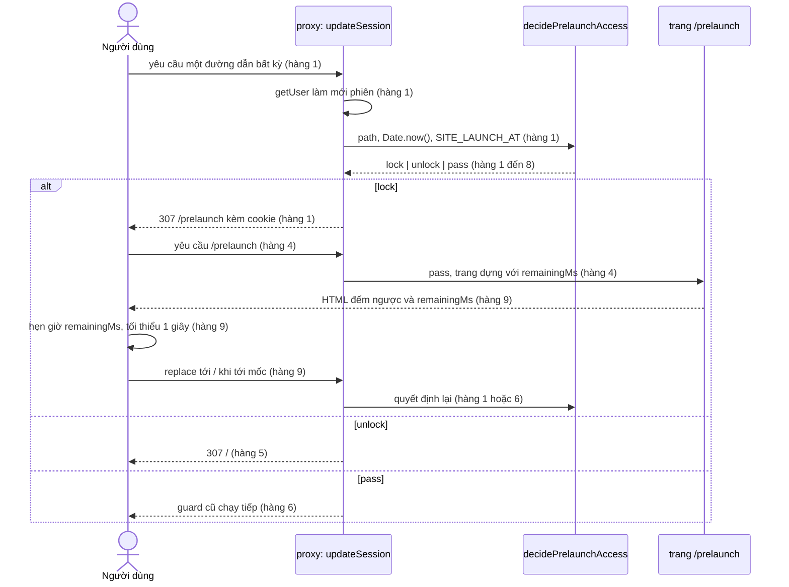

<!-- AI draft — human renames/refines. Large flows (>400 lines) chunk into sub-flow files. -->

---
status: ai-draft
kind: process-flow
subject_entity: "SITE_LAUNCH_AT (biến môi trường, không có bảng hay cột trạng thái)"
derived_views: ["pre_launch_locked"]
depth: thin
source:
  screens: [SCR001_Login, SCR003_Homepage, SCR004_AwardsInformation, SCR005_CountdownPrelaunch]
  features: [F001_Auth, F003_Homepage, F004_AwardsInformation, F005_CountdownPrelaunch, F006_KudosLiveBoard, F007_WriteKudo]
generated: "2026-10-15"
---

# FLOW001_SiteLaunchGate --- Cổng khóa site trước ngày ra mắt

> Điều kiện "site đang khóa" không nằm ở đâu trong dữ liệu. Mỗi request, proxy tự tính lại từ giờ máy chủ và biến môi trường `SITE_LAUNCH_AT`. Trước mốc, gần như mọi trang của ứng dụng bị đẩy về `/prelaunch`, nên điều kiện này chặn đường vào của F001, F003, F004, F006 và F007 cùng lúc. Flow này ở dạng thin: không có trạng thái lưu nào, nên không có bảng States và Transitions. Giá trị nằm ở các luật chặn và hệ quả dây chuyền bên dưới.

**Subject entity:** `SITE_LAUNCH_AT` (biến môi trường, chỉ đọc phía máy chủ) . **State field:** không có (điều kiện suy ra, không lưu)
**Enum source:** không có enum; kết quả của hàm quyết định là `lock`, `unlock`, `pass` (`lib/event/prelaunch-access.ts:12`)

Không đủ ngưỡng của một state machine: mọi thay đổi chỉ do trục thời gian và hai kiểu kích hoạt (request tới proxy, hẹn giờ ở trình duyệt) tạo ra, không có cột nào được ghi. Đây là ngoại lệ "điều kiện suy ra từ thời gian chặn nhiều feature", nên được ghi lại dưới dạng guard.

---

## Derived Condition

Điều kiện dưới đây là giá trị suy ra, không phải trạng thái lưu. Không có chỗ nào ghi nó xuống DB, cookie hay file; chỉ có đọc và so sánh.

| View | Cách tính | Nguồn |
|------|-----------|-------|
| `pre_launch_locked` | `SITE_LAUNCH_AT` hợp lệ **và** giờ máy chủ hiện tại nhỏ hơn mốc (so sánh `<` chặt) | `lib/event/prelaunch-access.ts:32` |
| không khóa (phần bù) | mốc thiếu, để trống, sai định dạng, hoặc giờ máy chủ đã bằng hay qua mốc | `lib/event/prelaunch-access.ts:32`, `lib/event/event-start-config.ts:41-43` |

Giờ lấy từ `Date.now()` của máy chủ ở mỗi request (`lib/supabase/proxy.ts:85`). Đồng hồ trình duyệt không tham gia vào quyết định khóa.

---

## Features bị chặn bởi điều kiện này

| Feature | Đường vào bị khóa trước mốc | Source |
|---------|-----------------------------|--------|
| F001_Auth | `/` (đích sau đăng nhập), `/todo`; riêng `/login` và `/auth/*` vẫn mở | `lib/supabase/proxy.ts:13-20`, `lib/event/prelaunch-access.ts:35-39`, `app/auth/callback/route.ts:4` |
| F003_Homepage | `/` | `lib/supabase/proxy.ts:10`, `lib/supabase/proxy.ts:85-86` |
| F004_AwardsInformation | `/awards-information` | `lib/supabase/proxy.ts:15`, `lib/supabase/proxy.ts:85-86` |
| F006_KudosLiveBoard | `/sun-kudos` và đường dẫn con | `lib/supabase/proxy.ts:16`, `lib/supabase/proxy.ts:85-86` |
| F007_WriteKudo | modal không có route riêng, nằm trên `/sun-kudos` nên không mở được | `docs/generated/feature-list.md:255`, `lib/supabase/proxy.ts:16` |

F002_Localization chỉ dùng được ở `/login`, đường dẫn được miễn khóa (`lib/event/prelaunch-access.ts:35-39`); bộ chọn ngôn ngữ trong header của các trang `(main)` (`app/(main)/_wiring/site-header-container.tsx:3`, `app/(main)/_wiring/site-header-container.tsx:46`) bị khóa cùng các trang đó. F005_CountdownPrelaunch là chủ của cổng này.

---

## Guard & Cascade Rules

| # | Edge | Actor | Guard | Cascade / side effect | Source |
|---|------|-------|-------|----------------------|--------|
| 1 | `pre_launch_locked + đường dẫn không được miễn -> 307 /prelaunch` | Proxy, với mọi người (khách và người đã đăng nhập) | Mốc hợp lệ, `now < start`, đường dẫn không phải `/prelaunch`, `/login`, `/auth/*`, `/_next/*`. Không đọc `user`. | Trả 307 kèm cookie phiên vừa làm mới. Các guard đăng nhập và admin ở dưới không chạy. Phủ cả `/`, `/todo`, `/awards-information`, `/sun-kudos`, `/standards`, `/profile`, `/admin` lẫn đường dẫn không tồn tại (không có 404 trước mốc). | `lib/event/prelaunch-access.ts:32`, `lib/event/prelaunch-access.ts:35-39`, `lib/supabase/proxy.ts:66-70`, `lib/supabase/proxy.ts:73-82`, `lib/supabase/proxy.ts:85-86`, `proxy.ts:8-13` |
| 2 | `pre_launch_locked + /login -> pass` | Proxy | Đường dẫn đúng bằng `/login` | Guard cũ của `/login` vẫn chạy: người đã đăng nhập bị đưa về `/`, request tiếp theo tới `/` bị khóa nên cuối cùng ở `/prelaunch` (hai bước 307). Khách thấy trang đăng nhập bình thường. | `lib/event/prelaunch-access.ts:3`, `lib/event/prelaunch-access.ts:35-39`, `lib/supabase/proxy.ts:90` |
| 3 | `pre_launch_locked + /auth/* -> pass` | Proxy | Đường dẫn bắt đầu bằng `/auth/` | Proxy cho đi thẳng, chưa kịp tạo client Supabase. Callback đăng nhập thành công luôn trả 307 về `/`, nên đăng nhập thành công trước mốc cũng kết thúc ở `/prelaunch`; thất bại trả 307 về `/login?error=auth_failed`, đường dẫn vẫn mở trước mốc. | `lib/supabase/proxy.ts:40`, `lib/event/prelaunch-access.ts:5`, `app/auth/callback/route.ts:4`, `app/auth/callback/route.ts:6`, `app/auth/callback/route.ts:36-40` |
| 4 | `pre_launch_locked + /prelaunch -> pass` | Proxy | Đường dẫn đúng bằng `/prelaunch` | Trang đếm ngược mở cho khách lẫn người đã đăng nhập: `/prelaunch` không nằm trong danh sách trang cần đăng nhập, và quyết định khóa chạy trước các guard phiên. | `lib/event/prelaunch-access.ts:36`, `lib/supabase/proxy.ts:13-20`, `lib/supabase/proxy.ts:27-28`, `lib/supabase/proxy.ts:85-89` |
| 5 | `không khóa + /prelaunch -> 307 /` | Proxy | Không khóa (mốc đã qua, hoặc thiếu hay sai) và đường dẫn đúng bằng `/prelaunch` | Trang đếm ngược mất tác dụng nên bị chuyển về `/`; sau đó guard cũ đưa khách sang `/login`, người đã đăng nhập vào trang chủ. | `lib/event/prelaunch-access.ts:33`, `lib/supabase/proxy.ts:87` |
| 6 | `không khóa + đường dẫn khác -> pass` | Proxy | Không khóa, đường dẫn không phải `/prelaunch` | Cổng không làm gì; các guard cũ (khách vào trang bảo vệ về `/login`, người đã đăng nhập vào `/login` về `/`, role admin cho `/admin`) chạy y như trước. | `lib/event/prelaunch-access.ts:33`, `lib/supabase/proxy.ts:89-95` |
| 7 | `mốc thiếu hoặc sai -> không khóa` | Proxy | `SITE_LAUNCH_AT` trống, thiếu offset hay `Z`, ngày giờ không có thật (ví dụ ngày 30 tháng 2) thì `parseEventStart` trả `null`, và `null` được coi là đã bắt đầu | Cấu hình hỏng không bao giờ khóa cả site; `/prelaunch` chuyển về `/` (như hàng 5). | `lib/event/event-start-config.ts:41-43`, `lib/event/event-start-config.ts:49-50`, `lib/event/event-start-config.ts:65-67`, `lib/event/prelaunch-access.ts:32` |
| 8 | `now == start -> không khóa` | Proxy | So sánh `now < start` chặt, nên đúng thời điểm mốc đã tính là mở | Không có khoảng trống nào giữa khóa và mở. | `lib/event/prelaunch-access.ts:32` |
| 9 | `đang ở /prelaunch + tới mốc -> điều hướng cứng tới /` | Trình duyệt (hẹn giờ một lần) | `remainingMs` do máy chủ gửi là số hữu hạn; độ trễ = lớn hơn của `remainingMs` và 1 giây; chờ quá mức trần của `setTimeout` thì chia thành nhiều bước | Gọi `window.location.replace('/')`, không thêm lịch sử. Proxy quyết định lại: nếu máy chủ vẫn coi là khóa thì `/prelaunch` tải lại với `remainingMs` mới và hẹn giờ lại, nhiều nhất mỗi giây một vòng. | `app/prelaunch/_behavior/use-navigate-home-at-event-start.ts:5-8`, `app/prelaunch/_behavior/use-navigate-home-at-event-start.ts:25-46`, `app/prelaunch/_wiring/prelaunch-countdown-container.tsx:25`, `app/prelaunch/page.tsx:28-37` |
| 10 | `tab ẩn lúc qua mốc -> tải lại khi tab hiện` | Trình duyệt (sự kiện đổi hiển thị) | Tab trở lại `visible` và thời gian đã trôi (theo `Date.now()` từ lúc mount) không nhỏ hơn `remainingMs` | Gọi `window.location.reload()` để proxy quyết định; đồng hồ máy lệch nhiều nhất làm tốn thêm một lần tải lại mỗi lần người dùng tự chuyển tab. | `app/prelaunch/_behavior/use-navigate-home-at-event-start.ts:48-57` |

### Trigger Sequence

Mọi mũi tên dưới đây là "derived from Guard & Cascade Rules table above"; số hàng ghi trong ngoặc, nguồn `file:line` nằm ở cột Source của hàng đó.

---

## Open Questions

- **Q:** Nhánh khóa không tự đặt tiêu đề cache cho 307. `redirectWithCookies` chỉ chép tiêu đề cache mà Supabase yêu cầu khi nó ghi cookie (`lib/supabase/proxy.ts:80`). Giả định "trình duyệt không giữ 307 lâu, nên mở khóa có hiệu lực ngay" mới nằm trong tài liệu thiết kế (`docs/features/F005_CountdownPrelaunch/technical-spec.md:259`), chưa có dòng code nào bảo đảm. Cần kiểm bằng phản hồi thật.
- **Q:** Proxy không có nhánh nào lọc theo phương thức request (không có `method` trong `lib/supabase/proxy.ts` và `proxy.ts`). Các Server Action ghi của F006 và F007 (`lib/kudos/create-kudo-action.ts:1`, `lib/kudos/toggle-kudo-like-action.ts:1`) có bị 307 khi gửi tới đường dẫn đang khóa hay không là hành vi của Next.js, chưa kiểm chứng trong đợt này (không chạy E2E).
- **Q:** Chưa chạy các spec `@prelaunch` (cần `E2E_SITE_LAUNCH_AT` ở tương lai, xem `playwright.config.ts:14-27`), nên các hàng ở trên chỉ được kiểm bằng đọc code, chưa kiểm bằng chạy thật.
