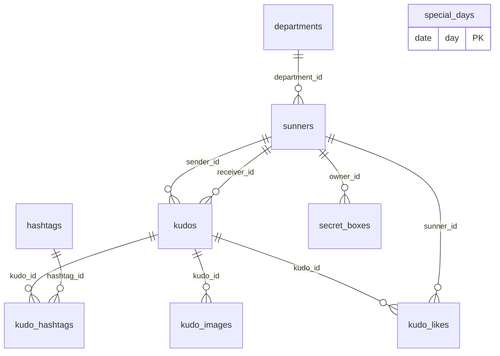

<!-- layout-exempt: rebuild-spec owns all docs/system|features|generated|flows paths — all references here are output targets or internal definitions -->
<!-- Output path: docs/generated/entities.md -->

# Entities

**Project**: agentic-coding-hands-on
**Generated**: 2026-10-08

## Entity Relationship Diagram

Từ F006 (Kudos live board) repo có schema Postgres đầu tiên, 9 bảng trong `public` (`supabase/migrations/20261014095439_kudos_live_board_tables.sql`). Trước F006 không có thực thể nào của ứng dụng.

## Entities

Mọi bảng bật RLS: `authenticated` chỉ có `SELECT` (policy `using (true)`); quyền ghi bị thu khỏi `anon` và `authenticated`. Dữ liệu đến từ migration/seed; ghi duy nhất của client là RPC `toggle_kudo_like` (SECURITY DEFINER) lên `kudo_likes`.

| Bảng | Khoá và cột chính | Quan hệ, ràng buộc |
|------|-------------------|--------------------|
| `departments` | `id` uuid PK; `code` (unique), `name` | Được `sunners.department_id` tham chiếu |
| `sunners` | `id` uuid PK; `user_id` (unique, nullable), `full_name`, `avatar_url`, `department_id`, `hero_title` | `user_id` → `auth.users(id)` `on delete set null`; `hero_title` ∈ `new_hero`, `rising_hero`, `super_hero`, `legend_hero` hoặc null. "Người dùng hiện tại" là hàng có `user_id = auth.uid()` |
| `hashtags` | `id` uuid PK; `slug` (unique), `label` | Gắn vào Kudo qua `kudo_hashtags` |
| `kudos` | `id` uuid PK; `sender_id`, `receiver_id`, `title`, `content`, `created_at` | `sender_id <> receiver_id`; `content` không rỗng; `created_at` tròn mili giây (con trỏ phân trang đi qua JS `Date`) |
| `kudo_hashtags` | PK `(kudo_id, hashtag_id)` | Cả hai khoá ngoại `on delete cascade` |
| `kudo_images` | `id` uuid PK; `kudo_id`, `url`, `position` | unique `(kudo_id, position)`; `on delete cascade` theo Kudo |
| `kudo_likes` | PK `(kudo_id, sunner_id)`; `hearts_awarded`, `created_at` | `hearts_awarded` ∈ {1, 2}, lưu lúc thích (2 vào ngày đặc biệt); xoá hàng là thu hồi đúng giá trị đó. Số tim của Sunner = tổng `hearts_awarded` trên các lượt thích của Kudo họ gửi |
| `special_days` | `day` date PK | Ngày lịch `Asia/Ho_Chi_Minh` mà một lượt thích tính 2 tim |
| `secret_boxes` | `id` uuid PK; `owner_id`, `opened_at`, `prize_description` | `opened_at` null là hộp chưa mở; `owner_id` → `sunners` `on delete cascade` |

Chỉ mục: `kudos_created_at_id_idx (created_at desc, id desc)` cho phân trang keyset; `kudos_receiver_id_idx`, `kudos_sender_id_idx`, `kudo_hashtags_hashtag_id_idx`, `kudo_likes_sunner_id_idx`, `secret_boxes_owner_id_idx`, `secret_boxes_opened_at_idx` (một phần, `opened_at is not null`), `sunners_department_id_idx`.

### External reference (not an application entity)

Chỉ để tham khảo (`sunners.user_id` trỏ tới bảng này, nhưng bảng thuộc Supabase Auth, không phải thực thể của ứng dụng). Mục này không phải thực thể của ứng dụng: không có mã định danh thực thể, không có sơ đồ ER, không có trường phân biệt (discriminator), và các spec tính năng không được tham chiếu tới nó như một model.

- **Supabase Auth `User`**: bản ghi người dùng do Supabase Auth sở hữu và quản lý (bảng trong schema `auth` của Supabase, ngoài tầm kiểm soát của mã nguồn này). Ứng dụng chỉ đọc qua `supabase.auth.getUser()`.
- Hai trường ứng dụng dùng:

| Trường | Cách dùng | Nguồn |
|--------|-----------|-------|
| `user` (có hay không) | Có người dùng hợp lệ hay không quyết định chuyển hướng. `proxy.ts` và `/todo` đều chặn khi không có `user`, rồi `redirect('/login')` | `lib/supabase/proxy.ts:47`, `app/todo/page.tsx:27-28` |
| `email` | Hiển thị cho người dùng ở trang `/todo`, kèm giá trị thay thế khi thiếu (`todo.emailMissing`) | `app/todo/page.tsx:37` |

- `id` và các trường khác của `User` không được ứng dụng đọc. Không có chỗ nào trong `app/`, `lib/`, `proxy.ts` dùng `user.id`, `user_metadata` hay `getSession()`.

## Validation Rules

- Một lượt thích mỗi Sunner mỗi Kudo (khoá chính `kudo_likes`); người gửi không thích Kudo của mình (RPC báo `self_like`); người dùng không có hàng `sunners` không thích được (`sunner_not_found`).
- `kudos.content` không rỗng sau `btrim`; `sender_id <> receiver_id`; `created_at` tròn mili giây; `hearts_awarded` ∈ {1, 2}; `hero_title` thuộc 4 giá trị cho phép.
- Việc kiểm tra tính hợp lệ của người dùng đăng nhập vẫn do Supabase Auth thực hiện qua `getUser()`.

## Summary

- **Total Entities**: 9 (bảng `public`, F006)
- **Total Relationships**: 9 khoá ngoại giữa các bảng ứng dụng (mỗi cạnh trong sơ đồ ER trên), cộng `sunners.user_id` → `auth.users`
