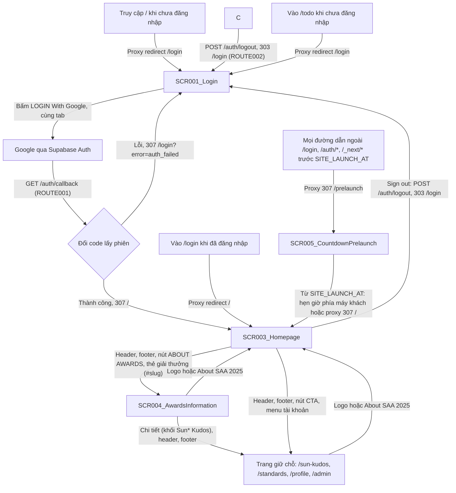
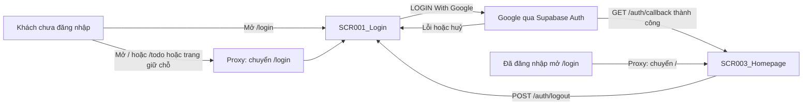

# Screen Flow

**Project**: agentic-coding-hands-on
**Generated**: 2026-10-08
**Analysis Scope**: Luồng chuyển màn hình của SCR001_Login, SCR002_Todo, SCR003_Homepage và SCR004_AwardsInformation: `app/page.tsx` đã xoá (`/` là trang chủ), guard ở `proxy.ts` + `lib/supabase/proxy.ts`, `GET /auth/callback` (ROUTE001), `POST /auth/logout` (ROUTE002). Toàn bộ chuyển màn hình là chuyển hướng phía máy chủ hoặc điều hướng của trình duyệt; không có `<Link>`, `useRouter` hay `window.location` điều hướng trong `app/` (chỉ `window.location.origin` để dựng `redirectTo`, `lib/auth/sign-in-with-google.ts:17`; menu của SCR004 chỉ ghi hash bằng `history.replaceState`, không chuyển trang).

**Code Format**: All SCR codes MUST follow `SCR###_NameSlug` format (e.g., SCR001_LoginForm, SCR002_Dashboard) | `SCR###/REG###` for region-scoped transitions

## Navigation Map



## Feature Entry Points

<!-- Feature Entry Points: run /tkm:rebuild-spec --feature-specs to populate -->

---

## Screen Access Paths

| From Screen | To Screen | Action/Trigger | Conditions | Region |
|-------------|-----------|----------------|------------|--------|
| Mọi đường dẫn ngoài `/login`, `/auth/*`, `/_next/*` (kể cả không tồn tại) | SCR005_CountdownPrelaunch | Proxy `redirect /prelaunch` (`lib/supabase/proxy.ts:84-86`, `decidePrelaunchAccess` = `lock`) | Trước `SITE_LAUNCH_AT` (mốc hợp lệ, `now < start`), mọi vai trò | |
| SCR005_CountdownPrelaunch | SCR003_Homepage | Hẹn giờ phía máy khách `window.location.replace('/')` theo `remainingMs` máy chủ gửi, kẹp tối thiểu 1 giây (`app/prelaunch/_behavior/use-navigate-home-at-event-start.ts`); hoặc proxy `redirect /` khi mở `/prelaunch` (`decidePrelaunchAccess` = `unlock`) | Từ `SITE_LAUNCH_AT` hoặc `SITE_LAUNCH_AT` thiếu/sai; đã đăng nhập (khách được guard cũ đưa tiếp sang `/login`) | |
| Truy cập `/` | SCR001_Login | Proxy `redirect /login`, bỏ query (`lib/supabase/proxy.ts:82`); layout `(main)` kiểm lại (`app/(main)/layout.tsx:32-33`) | Chưa đăng nhập hoặc Auth server không trả lời (fail closed) | |
| Truy cập `/` | SCR003_Homepage | Tải trang (`app/(main)/page.tsx`) | Đã đăng nhập | |
| SCR003_Homepage | SCR004_AwardsInformation | Bấm mục "Awards Information" ở header, nút ABOUT AWARDS, thẻ giải thưởng (mở `/awards-information#<slug>`) hoặc liên kết ở footer (`app/(main)/_wiring/build-home-screen-props.ts:6`, `lib/awards/award-categories.ts:27-29`) | Đã đăng nhập | |
| SCR004_AwardsInformation | SCR003_Homepage | Bấm logo hoặc About SAA 2025 (header dùng lại) | Đã đăng nhập | |
| SCR004_AwardsInformation | Trang giữ chỗ `/sun-kudos` | Nút "Chi tiết" của khối Sun* Kudos, liên kết cùng tab (`app/(main)/_wiring/build-kudos-promo-props.ts:5,15`); header và footer tới `/sun-kudos`, `/standards` | Đã đăng nhập | |
| URL trực tiếp `/awards-information#<slug>` | SCR004_AwardsInformation | Tải trang; hash hợp lệ thì cuộn tức thì tới thẻ, hash sai thì ở đầu trang (`app/(main)/_behavior/use-award-category-spy.ts:84-91`) | Đã đăng nhập; khách bị proxy chuyển về `/login` (`lib/supabase/proxy.ts:82`) | |
| SCR003_Homepage | Trang giữ chỗ (`/sun-kudos`, `/standards`, `/profile`, `/admin`) | Bấm mục điều hướng, nút CTA, footer hoặc menu tài khoản | Đã đăng nhập; `/admin` chỉ khi `app_metadata.role === 'admin'`, người khác bị proxy chuyển về `/` (`lib/supabase/proxy.ts:85-87`) | |
| Trang giữ chỗ | SCR003_Homepage | Bấm logo hoặc About SAA 2025 (header dùng lại) | Đã đăng nhập | |
| SCR003_Homepage | SCR001_Login | Sign out trong menu tài khoản: form `POST /auth/logout`, `303 Location: /login` (`app/(main)/_behavior/account-menu.tsx:33`) | Luôn chuyển về `/login` | |
| URL trực tiếp `/login` | SCR001_Login | Tải trang | Chưa đăng nhập (`getUser()` không trả người dùng) | |
| URL trực tiếp `/login` | SCR003_Homepage | Proxy `redirect /` (`lib/supabase/proxy.ts:83`) | Đã đăng nhập | |
| URL trực tiếp `/todo` | SCR001_Login | Proxy `redirect /login`, bỏ query (`lib/supabase/proxy.ts:82`) | Chưa đăng nhập hoặc Auth server không trả lời (fail closed) | |
| URL trực tiếp `/todo` | SCR002_Todo | Tải trang | Đã đăng nhập | |
| SCR001_Login | Google (Supabase Auth), ngoài ứng dụng | Bấm nút LOGIN With Google: `signInWithOAuth` chuyển trình duyệt đi, cùng tab (`lib/auth/sign-in-with-google.ts:15-18`) | `status` không phải `initiating`; khởi tạo OAuth không lỗi | |
| Google (Supabase Auth) | SCR003_Homepage | `GET /auth/callback` đổi `code`, `307 Location: /` (`app/auth/callback/route.ts:4,40`) | Có `code` hợp lệ (không rỗng, dài tối đa 2048), không có tham số `error`, `exchangeCodeForSession` không lỗi | |
| Google (Supabase Auth) | SCR001_Login | `GET /auth/callback`, `307 Location: /login?error=auth_failed` (`app/auth/callback/route.ts:36-40`) | Có `?error=`, thiếu `code`, `code` dài hơn 2048, đổi `code` lỗi hoặc ném ngoại lệ | |
| SCR002_Todo | SCR001_Login | Bấm Đăng xuất: form `POST /auth/logout`, `303 Location: /login` (`app/todo/page.tsx:39`, `app/auth/logout/route.ts:32-35`) | Luôn chuyển về `/login`, kể cả khi `signOut` lỗi | |
| SCR002_Todo | SCR001_Login | `redirect('/login')` khi `getUser()` không trả người dùng (`app/todo/page.tsx:28`) | Phiên mất hiệu lực sau khi qua proxy (guard lớp hai) | |

> Region column: fill with `SCR###/REG###` for region-scoped transitions; leave blank for whole-screen transitions. Cả hai màn hình đều atomic nên cột Region để trống (xem screen-list.md § Notes).

## Screen Transitions

### SCR001_Login (Login)

**Entry Points**:
- Truy cập `/` khi chưa đăng nhập: proxy chuyển về `/login`
- URL trực tiếp `/login` khi chưa đăng nhập
- Từ SCR002_Todo: đăng xuất (`POST /auth/logout`, 303)
- Từ SCR002_Todo hoặc proxy: phiên mất hiệu lực, chuyển về `/login`
- Từ `GET /auth/callback` khi đăng nhập thất bại: `/login?error=auth_failed`

**Exit Points**:
- Tới Google (ngoài ứng dụng) rồi `GET /auth/callback`: bấm nút LOGIN With Google
- Tới SCR003_Homepage: đăng nhập thành công (qua `GET /auth/callback`), hoặc người đã đăng nhập mở `/login` (proxy)
- Ở lại SCR001_Login (cùng URL): chọn VN/EN gọi Server Action `setLocale` (ghi cookie `NEXT_LOCALE`, `refresh()`, render lại chuỗi theo ngôn ngữ mới, không đổi màn hình); chọn đúng ngôn ngữ đang dùng hoặc giá trị không hợp lệ thì không làm gì (`lib/i18n/set-locale-action.ts:17-20`)

**Decision Points**:
- Proxy khi vào `/login`: nếu `getUser()` có người dùng → SCR003_Homepage, ngược lại → hiện SCR001_Login (`lib/supabase/proxy.ts:83`)
- Khởi tạo OAuth: nếu `signInWithGoogle()` trả `ok: true` → trình duyệt đang rời trang, nút giữ trạng thái `initiating`; nếu `ok: false` → trạng thái `error`, hiện lỗi, đưa focus về nút (`app/login/google-login-container.tsx:35-39`)
- Có `?error=` không rỗng khi mở trang → hiện lỗi cố định ngay ở trạng thái `idle` (`app/login/page.tsx:22-24`, `google-login-container.tsx:31`)

---

### SCR002_Todo (Todo)

**Entry Points**:
- URL trực tiếp `/todo` khi đã đăng nhập

**Exit Points**:
- Tới SCR001_Login: bấm Đăng xuất (`POST /auth/logout`, 303 `/login`)
- Tới SCR001_Login: phiên mất hiệu lực (proxy hoặc `redirect('/login')` ở `app/todo/page.tsx:28`)

**Decision Points**:
- Proxy khi vào `/todo` hoặc `/todo/*`: có người dùng → cho qua, không có → `/login` (`lib/supabase/proxy.ts:82`)
- Trang `/todo`: `getUser()` không trả người dùng → `redirect('/login')`, ngược lại hiện email và nút đăng xuất (`app/todo/page.tsx:27-28`)

---

### SCR003_Homepage (Homepage)

**Entry Points**:
- Từ SCR001_Login: `GET /auth/callback` thành công (307 `/`)
- Từ proxy khi người đã đăng nhập mở `/login` (redirect `/`)
- URL trực tiếp `/` khi đã đăng nhập; từ SCR004_AwardsInformation hoặc trang giữ chỗ (logo, About SAA 2025)

**Exit Points**:
- Tới SCR004_AwardsInformation (`/awards-information`, kèm `#<slug>` từ thẻ giải thưởng; header, footer, nút ABOUT AWARDS)
- Tới trang giữ chỗ `/sun-kudos`, `/standards`, `/profile`, `/admin` (header, footer, nút CTA, menu tài khoản)
- Tới SCR001_Login: Sign out (`POST /auth/logout`, 303 `/login`) hoặc phiên mất hiệu lực (`app/(main)/layout.tsx:33`)
- Ở lại SCR003_Homepage: đổi VN/EN (`setLocale`), mở hoặc đóng menu tài khoản và bảng thông báo, bấm logo (cuộn lên đầu trang)

**Decision Points**:
- Proxy khi vào `/`: có người dùng → cho qua, không có → `/login` (`lib/supabase/proxy.ts:82`); layout `(main)` kiểm lại, không có người dùng → `redirect('/login')` (`app/(main)/layout.tsx:32-33`)
- Proxy khi vào `/admin*`: không phải admin → `/` (`lib/supabase/proxy.ts:85-87`); trang `/admin` kiểm lại (`app/(main)/admin/page.tsx:20`)
- Mục Admin Dashboard chỉ hiện khi `isAdmin` (`app/(main)/_behavior/account-menu.tsx:27-31`)

---

### SCR004_AwardsInformation (Awards Information)

**Entry Points**:
- Từ SCR003_Homepage: thẻ giải thưởng (`/awards-information#<slug>`), nút ABOUT AWARDS, header, footer
- URL trực tiếp `/awards-information` hoặc `/awards-information#<slug>` khi đã đăng nhập

**Exit Points**:
- Tới `/sun-kudos` (trang giữ chỗ): nút "Chi tiết" của khối Sun* Kudos, cùng tab
- Tới SCR003_Homepage, `/sun-kudos`, `/standards`, `/profile`, `/admin`: header, footer, menu tài khoản
- Tới SCR001_Login: Sign out, hoặc phiên mất hiệu lực (`app/(main)/layout.tsx:33`)
- Ở lại SCR004: bấm mục menu (cuộn mượt, ghi `#<slug>` bằng `history.replaceState`), cuộn tay (mục active đổi theo)

**Decision Points**:
- Proxy khi vào `/awards-information*`: có người dùng → cho qua, không có → `/login` (`lib/supabase/proxy.ts:82`)
- Hash lúc tải: khớp một trong 6 slug → cuộn tới thẻ đó; không khớp → ở đầu trang, mục đầu active (`app/(main)/_behavior/award-hash.ts:8-18`)

### SCR005_CountdownPrelaunch (Countdown Prelaunch)

**Entry Points**:
- Mọi đường dẫn bị khóa trước `SITE_LAUNCH_AT` (proxy 307 `/prelaunch`)
- URL trực tiếp `/prelaunch` (công khai, kể cả đã đăng nhập)

**Exit Points**:
- Tới `/`: hẹn giờ phía máy khách tại mốc, hoặc proxy 307 khi mở `/prelaunch` từ mốc / khi `SITE_LAUNCH_AT` thiếu hay sai; khách sau đó bị guard cũ đưa sang `/login`
- Tab ẩn lúc qua mốc: khi tab hiện lại thì `window.location.reload()` để proxy quyết định
- Tới SCR001_Login: truy cập thẳng `/login` (không bị khóa)

**Decision Points**:
- Proxy: `decidePrelaunchAccess(pathname, now, start)` trả `lock` / `unlock` / `pass` (`lib/event/prelaunch-access.ts`)
- Phía máy khách: không so `Date.now()` với mốc; chờ `remainingMs` do máy chủ gửi, kẹp mọi độ trễ tối thiểu 1 giây (kể cả `remainingMs <= 0`) để đồng hồ máy lệch không gây vòng lặp

---

## Region Transitions

N/A — SCR001_Login và SCR002_Todo đều atomic, không có vùng (REG) nào (xem screen-list.md § Notes). Chọn ngôn ngữ trên SCR001_Login là chuyển trạng thái cùng màn hình, đã ghi ở Screen Transitions.

---

## Authentication Flow



| Screen | Authentication Required | Authorization Level |
|--------|------------------------|-------------------|
| SCR001_Login | No (người đã đăng nhập bị chuyển sang SCR003_Homepage) | Public |
| SCR003_Homepage | Yes (proxy chặn khách; layout `(main)` kiểm lại bằng `getCurrentUser()`) | User; mục Admin Dashboard và `/admin` chỉ cho `app_metadata.role === 'admin'` |
| SCR002_Todo | Yes (phiên Supabase, xác minh bằng `getUser()`) | User (mọi tài khoản Google đều được, không phân vai trò) |

---

## Error Handling Flows

| Screen | Error | Handling | Scope |
|--------|-------|----------|-------|
| SCR001_Login | Callback thất bại (có `?error=` không rỗng) | Hiện dòng lỗi cố định `login.error` dưới nút (`role="alert"`); nội dung tham số không hiển thị (`app/login/page.tsx:22-24`, `login-error-message.tsx:8`) | screen |
| SCR001_Login | `signInWithOAuth` lỗi hoặc ném ngoại lệ | `signInWithGoogle()` trả `ok: false`, trạng thái `error`, hiện lỗi, focus về nút, người dùng bấm lại được (`app/login/google-login-container.tsx:35-39`) | screen |
| SCR001_Login | Trang được khôi phục từ bfcache đang kẹt `initiating` | Sự kiện `pageshow` có `persisted` đặt lại `idle` (`google-login-container.tsx:23-29`) | screen |
| SCR001_Login | `setLocale` nhận giá trị lạ hoặc đúng ngôn ngữ hiện tại | Bỏ qua, không ghi cookie, không báo lỗi (`lib/i18n/set-locale-action.ts:17-20`) | screen |
| SCR001_Login | `GET /auth/callback` nhận `?error=`, thiếu `code`, `code` dài hơn 2048, đổi `code` lỗi hoặc ném ngoại lệ | `307 Location: /login?error=auth_failed`, `Cache-Control: private, no-store`; không chuyển nội dung lỗi của nhà cung cấp, không đọc tham số `next` (`app/auth/callback/route.ts:36-40`) | screen |
| SCR002_Todo | Chưa đăng nhập hoặc phiên hết hạn | Proxy `redirect /login`; nếu lọt qua, trang `redirect('/login')` (`lib/supabase/proxy.ts:82`, `app/todo/page.tsx:28`) | screen |
| SCR002_Todo | Auth server không trả lời khi proxy gọi `getUser()` | Coi như chưa đăng nhập (fail closed), chuyển `/login` (`lib/supabase/proxy.ts:49-51`) | screen |
| SCR002_Todo | `signOut` lỗi hoặc ném ngoại lệ khi đăng xuất | Xóa cookie có tên `sb-*-auth-token*` rồi vẫn `303 /login` (`app/auth/logout/route.ts:25-30`) | screen |
| SCR002_Todo | Thiếu email trong `User` | Hiện giá trị thay thế `todo.emailMissing` (`app/todo/page.tsx:37`) | screen |
| SCR002_Todo | Gọi `GET /auth/logout` | Chỉ export `POST`, nên Next trả `405`, không đăng xuất được bằng GET (`app/auth/logout/route.ts:12`) | screen |

> Scope values: `screen` (affects entire screen) | `region:REG###` (error contained within the named region). Không có vùng nên chỉ dùng `screen`.

---

## Circular Dependencies Check

- [x] Có một vòng điều hướng do người dùng điều khiển: SCR001_Login → (Google, callback) → SCR002_Todo → (đăng xuất) → SCR001_Login. Đây là chu trình đăng nhập/đăng xuất bình thường, mỗi bước cần một thao tác của người dùng, không phải vòng chuyển hướng tự động.
- [x] Hai guard của proxy loại trừ nhau theo trạng thái phiên (`/todo` chỉ chặn khi không có người dùng, `/login` chỉ chuyển khi có người dùng, `lib/supabase/proxy.ts:82-83`), nên với phiên không đổi không có vòng chuyển hướng vô hạn
- [x] All screens have valid entry/exit points
- [x] All navigation paths terminate (mọi đường đều kết thúc ở một trong hai màn hình hoặc dừng chờ thao tác người dùng)

---

## Guard Logic

Guard của ứng dụng gồm một lớp ở proxy (Next.js 16 dùng `proxy.ts` thay cho `middleware.ts`) và một lớp phòng thủ chiều sâu ngay trong trang. Chi tiết quyền xem permissions.md.

### GUARD-001 — SignedOutToLogin on /, /todo và trang giữ chỗ (kèm đường dẫn con; `/` khớp đúng)
**trigger:** `proxy` (`proxy.ts:4-6` gọi `updateSession`; matcher `proxy.ts:8-12` bỏ qua `_next/static`, `_next/image`, `favicon.ico` và ảnh tĩnh)
**source:** `lib/supabase/proxy.ts:25-27,82`
**logic:**
```pseudo
if (path startsWith "/auth/") → pass through, no cookie change   // lib/supabase/proxy.ts:21
user = getUser()   // on error → user = null (fail closed)
if (!user && (path == "/" || path under /todo, /awards-information, /sun-kudos, /standards, /profile, /admin)) → redirect /login (query stripped)
```
**failure path:** redirect `/login`, mang theo cookie đã làm mới và header cache của Supabase (`lib/supabase/proxy.ts:55-63`)

---

### GUARD-004 — PrelaunchSiteLock (khóa trước ngày ra mắt, chạy trước GUARD-001)
**trigger:** `proxy` (`lib/supabase/proxy.ts:84-87`), sau bước làm mới phiên, trước mọi guard phiên
**source:** `lib/event/prelaunch-access.ts` (`decidePrelaunchAccess`)
**logic:**
```pseudo
start = readEventStartFromEnv()            // null nếu thiếu hoặc sai
locked = start != null and now < start     // now == start là đã mở
if (!locked) → path == "/prelaunch" ? redirect "/" : pass
if (locked) → path == "/prelaunch" or "/login" or startsWith "/auth/" or "/_next/" ? pass : redirect "/prelaunch"
```
**failure path:** không đọc `user`; redirect mang theo cookie đã làm mới (BR-004)

---

### GUARD-002 — SignedInToHome on /login
**trigger:** `proxy` (`lib/supabase/proxy.ts:83`)
**source:** `lib/supabase/proxy.ts:83`
**logic:**
```pseudo
if (user && path == "/login") → redirect / (query stripped)
if (user && path under /admin && role != "admin") → redirect / (lib/supabase/proxy.ts:85-87)
```
**failure path:** không có nhánh lỗi; người chưa đăng nhập được cho qua và thấy SCR001_Login

---

### GUARD-003 — TodoPageSessionCheck on /todo
**trigger:** kiểm tra trong Server Component `UserPanel` (guard lớp hai, đứng sau `connection()`)
**source:** `app/todo/page.tsx:26-28`
**logic:**
```pseudo
await connection()
user = createClient().auth.getUser()
if (!user) → redirect /login
```
**failure path:** `redirect('/login')`

---

## Deep-Link State Restoration

### SCR001_Login
**URL pattern:** `/login?error={giá trị bất kỳ}`
**State restored:**

| Param | Restores | Default if missing |
|-------|----------|--------------------|
| error | Hiện dòng lỗi `login.error` dưới nút ở trạng thái `idle` (cờ `initialError` truyền từ server, `app/login/page.tsx:22-24`, `app/login/google-login-container.tsx:31`) | Không hiện lỗi |

**Failure mode:** chỉ xét tham số có mặt và không rỗng; giá trị bất kỳ cho cùng một kết quả và không bao giờ được hiển thị. Tham số lặp lại thì lấy giá trị đầu (`Array.isArray`), giá trị rỗng coi như không có lỗi. Bấm lại nút làm trạng thái thành `initiating` và dòng lỗi biến mất.

---

## Unsaved-Changes Protection

N/A — no unsaved-changes guards detected. (Tìm `beforeunload|useBeforeUnload|isDirty|usePrompt` trong `app/`, `lib/`, `proxy.ts`: 0 kết quả; hai màn hình không có ô nhập liệu.)

---

## Extraction Signatures

Framework-agnostic identifier patterns for locating the above constructs.

### Guard Logic
Function/method definitions tied to a route: `beforeEnter|canActivate|middleware|loader|before_action|authenticate|authorize` — check if called from a router config or route registration.

### Deep-Link State Restoration
URL param reads at component mount synced to state: `useSearchParams|useQuery|router\.query|URLSearchParams|params\[|$route\.query` — look for these at top of component with corresponding `setState` or reactive assignment.

### Unsaved-Changes Protection
`beforeunload|onbeforeunload|usePrompt|useBeforeUnload|leaveGuard|isDirty|formState\.isDirty|data-turbo-confirm` — presence confirms protection; absence is a potential gap to flag.
