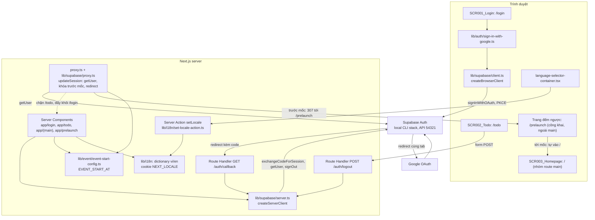
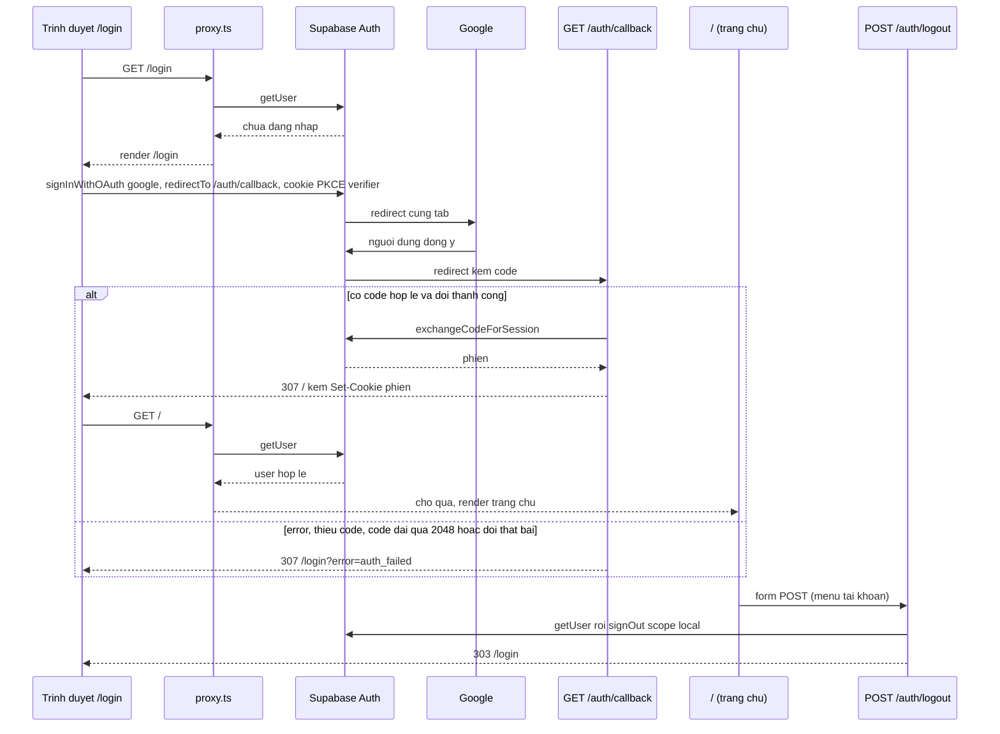

# Architecture

## System Architecture

App Next.js 16 (App Router) có các màn hình: SCR001_Login (`/login`), SCR002_Todo (`/todo`, cần đăng nhập), SCR003_Homepage (`/`, cần đăng nhập, nằm trong nhóm route `(main)`), cùng trang đếm ngược trước ngày ra mắt `/prelaunch` (công khai, route cấp cao ngoài `(main)`, `SCR005_CountdownPrelaunch`). Supabase Auth giữ phiên và gọi Google; app không có bảng dữ liệu, không ORM, không migration. Kiến trúc tách ba phần: Server Component render theo request, một lớp chặn truy cập chạy ở `proxy.ts` (thay cho `middleware.ts` ở Next.js 16; nay gồm cả khóa site trước `EVENT_START_AT`), và hai Route Handler cho OAuth callback và logout.

| Thành phần | Vai trò | Vị trí |
|------------|---------|--------|
| Pages | Render phía server. `/login` đọc cookie locale và `?error=`; `/todo` gọi `getUser()` lần nữa (phòng thủ nhiều lớp). `app/page.tsx` đã xoá, `/` do `app/(main)/page.tsx` phục vụ | `app/login/page.tsx`, `app/todo/page.tsx` |
| Trang `/prelaunch` (planned) | Route cấp cao công khai ngoài `(main)`: không header, footer, không kiểm phiên. Server component dựng nền, tiêu đề và snapshot `EVENT_START_AT` (thời gian còn lại tính ở máy chủ); thành phần client dùng lại `useCountdown` để cập nhật số theo phút và hẹn giờ chuyển về `/` khi tới mốc (theo thời gian còn lại do máy chủ gửi, không theo đồng hồ trình duyệt). Dùng lại `CountdownDisplay`, `readEventSnapshot` và phông của trang chủ | `app/prelaunch/` (TBD (draft) tên tệp) |
| Nhóm route `(main)` | Layout chung có header và footer (`SiteHeaderContainer`, `SiteFooterContainer`) cho `/`, trang Hệ thống giải `/awards-information` (F004: server component dựng màn từ `AWARD_CATEGORIES` và `AWARD_DETAILS`; chỉ menu hạng mục là client component) và các trang giữ chỗ `/sun-kudos`, `/standards`, `/profile`, `/admin`. Layout kiểm lại phiên (`getCurrentUser()` → `redirect('/login')`); `/admin` kiểm lại vai trò. Tách thư mục `_components` (hiển thị), `_behavior` (hook, menu), `_wiring` (container, props) | `app/(main)/layout.tsx`, `app/(main)/_components`, `_behavior`, `_wiring` |
| Cấu hình sự kiện | `EVENT_START_AT` (biến môi trường chỉ phía máy chủ, không có tiền tố `NEXT_PUBLIC_`): ISO-8601 bắt buộc kèm offset hoặc `Z`, sai thì hiện "—" và đếm ngược 00. Giá trị đọc ở server rồi truyền xuống client qua prop. Danh mục giải thưởng ở `lib/awards`. Mốc này còn là đầu vào của khóa site trong proxy (một nguồn duy nhất cho khóa, đếm ngược trang chủ và `/prelaunch`); thiếu hoặc sai thì không khóa | `lib/event/event-start-config.ts`, `lib/event/use-countdown.ts`, `lib/awards/award-categories.ts` |
| Proxy | Làm mới phiên; **khóa trước ngày ra mắt** (sau bước làm mới phiên, trước các guard cũ): trước `EVENT_START_AT` mọi đường dẫn ngoài `/login`, `/auth/*`, `/prelaunch` bị 307 tới `/prelaunch` kèm cookie vừa làm mới, từ mốc hoặc khi biến thiếu hay sai thì `/prelaunch` bị 307 về `/` và không khóa gì; quyết định là hàm thuần theo `pathname`, `Date.now()` và mốc, không đọc phiên. Redirect theo trạng thái đăng nhập: khách vào `/` hoặc trang giữ chỗ về `/login`, người đã đăng nhập vào `/login` về `/`, không phải admin vào `/admin*` về `/` (`lib/auth/user-role.ts`). Bỏ qua `/auth/*`. Loại trừ `_next/static`, `_next/image`, `favicon.ico`, ảnh tĩnh khỏi matcher | `proxy.ts`, `lib/supabase/proxy.ts` |
| Route Handler | `GET /auth/callback` đổi PKCE `code` lấy phiên, luôn redirect tương đối 307; `POST /auth/logout` gọi `signOut({ scope: "local" })`, trả 303 về `/login`, `GET` nhận 405 | `app/auth/callback/route.ts`, `app/auth/logout/route.ts` |
| Server Action | Duy nhất `setLocale`: ghi cookie `NEXT_LOCALE` rồi `refresh()`. Logout không phải Server Action | `lib/i18n/set-locale-action.ts` |
| Supabase clients | Browser client cho nút đăng nhập; server client đọc/ghi cookie qua `next/headers`, tạo mới mỗi lần gọi, không giữ global. Thiếu biến môi trường thì ném lỗi ngay khi import | `lib/supabase/client.ts`, `lib/supabase/server.ts`, `lib/supabase/config.ts` |
| i18n | Từ điển tự viết `vi` (mặc định) và `en`, khớp khoá kiểm bằng kiểu lúc biên dịch; không dùng thư viện. Chuỗi trang chủ nằm ở `dictionary-home-vi.ts`/`dictionary-home-en.ts`, gộp vào `dictionary-vi.ts`/`dictionary-en.ts` | `lib/i18n/*` |

Cấu hình Next.js bất thường so với bản quen thuộc: `cacheComponents: true`, `partialPrefetching: true` (`next.config.ts`), `export const instant = false` ở `app/layout.tsx`; API đọc request (`cookies()`, `searchParams`, `connection()`) đặt trong `<Suspense>`.

## Tech Stack

Phiên bản lấy đúng chuỗi khai báo trong `package.json`.

| Layer | Technology | Version |
|-------|------------|---------|
| Framework | Next.js (App Router, `proxy.ts`, Turbopack) | 16.4.0 |
| UI | React, react-dom | 19.3.0 |
| Ngôn ngữ | TypeScript | ^5 |
| Styling | Tailwind CSS, `@tailwindcss/turbopack` | ^4, ^4 |
| Font | `next/font/google` (Geist, Geist Mono, Montserrat, Montserrat Alternates), đi kèm Next.js | n/a (theo Next.js 16.4.0) |
| Auth SDK | `@supabase/ssr` | ~0.12.7 |
| Auth SDK | `@supabase/supabase-js` | ^2.117.3 |
| Auth backend | Supabase Auth, chạy local bằng Supabase CLI (`supabase/config.toml`) | n/a (CLI quản lý, repo không khai báo) |
| Identity provider | Google OAuth, bật tại `[auth.external.google]` | n/a (dịch vụ ngoài) |
| Database | PostgreSQL của stack Supabase local, `major_version = 17`; app không truy vấn | 17 |
| i18n | Từ điển `vi`/`en` tự viết (`lib/i18n`) | n/a (không phải thư viện) |
| E2E test | `@playwright/test` (chromium, mock Supabase bằng `node:http`) | ^1.64.0 |
| Lint | `eslint`, `eslint-config-next` | ^9, 16.4.0 |
| Kiểu | `@types/node`, `@types/react`, `@types/react-dom` | ^20, ^19, ^19 |
| Package manager | bun | 1.4.2 |

Không có cache, hàng đợi, ORM, job nền hay HTTP client gọi ra ngoài trong mã nguồn.

## Data Flow

- Lỗi hoặc huỷ: callback chỉ đặt cờ cố định `auth_failed`, không chuyển tiếp nội dung lỗi của nhà cung cấp; `/login` chỉ kiểm `error` có rỗng hay không và hiện thông báo cố định dưới nút.
- Callback không đọc tham số `next`; đăng nhập thành công luôn về `/` (trang chủ).
- Khóa trước ngày ra mắt: trước `EVENT_START_AT`, proxy làm mới phiên rồi 307 mọi đường dẫn khác (kể cả đường dẫn lạ) tới `/prelaunch`, trừ `/login`, `/auth/*` và tài nguyên tĩnh; sau đó `/prelaunch` tự đưa người xem về `/` khi tới mốc, và từ mốc `/prelaunch` bị 307 về `/`. Mốc thiếu hoặc sai nghĩa là không khóa. Các guard dưới đây chỉ có hiệu lực với đường dẫn bị khóa từ mốc trở đi.
- Chưa đăng nhập mà vào `/`, `/todo`, trang giữ chỗ (kể cả đường dẫn con) thì proxy redirect về `/login` (xoá query); đã đăng nhập mà vào `/login` thì redirect về `/`. Auth server không trả lời thì coi như chưa đăng nhập (fail closed).
- Logout: `signOut` lỗi hoặc ném ngoại lệ thì handler xoá cookie `sb-*-auth-token*`; luôn trả 303 về `/login`.
- Đổi ngôn ngữ: `setLocale` ghi cookie `NEXT_LOCALE` (path `/`, 1 năm, SameSite=Lax) rồi `refresh()`; giá trị lạ hoặc trùng locale hiện tại thì không làm gì.
- Local dev: trình duyệt phải dùng `localhost:3000` (không dùng `127.0.0.1`), vì cookie PKCE verifier gắn theo host; `site_url` và `additional_redirect_urls` trong `supabase/config.toml` đều là `http://localhost:3000`.
- E2E: một máy chủ Playwright có đúng một `EVENT_START_AT` (mặc định mốc quá khứ nên không bị khóa); kịch bản `/prelaunch` cần máy chủ riêng với mốc tương lai (`E2E_EVENT_START_AT`). Playwright chạy app ở cổng 3100, Supabase Auth được mock ở cổng 54399; Google bị chặn ở biên trình duyệt bằng `page.route` trên `/auth/v1/authorize`.

## Deployment View

> Derived from repository infrastructure-as-code — not verified against production.

N/A — no infrastructure-as-code found in repository.
