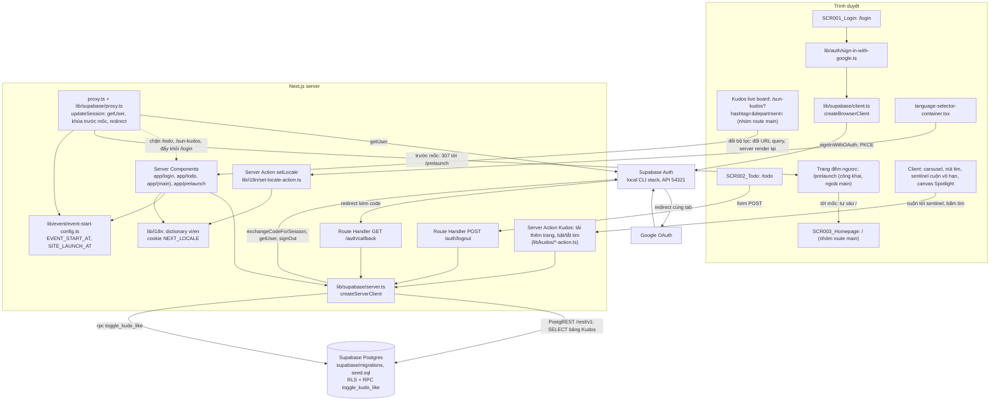
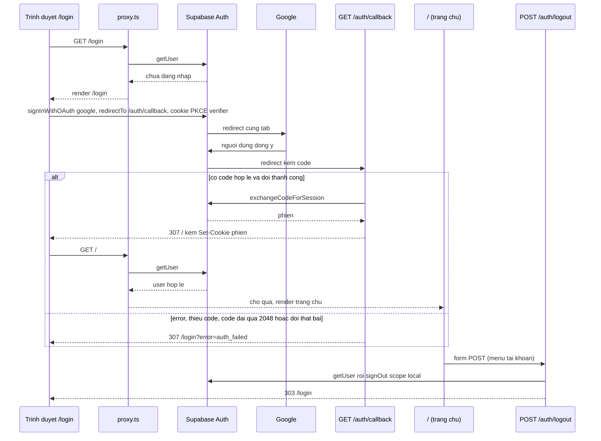
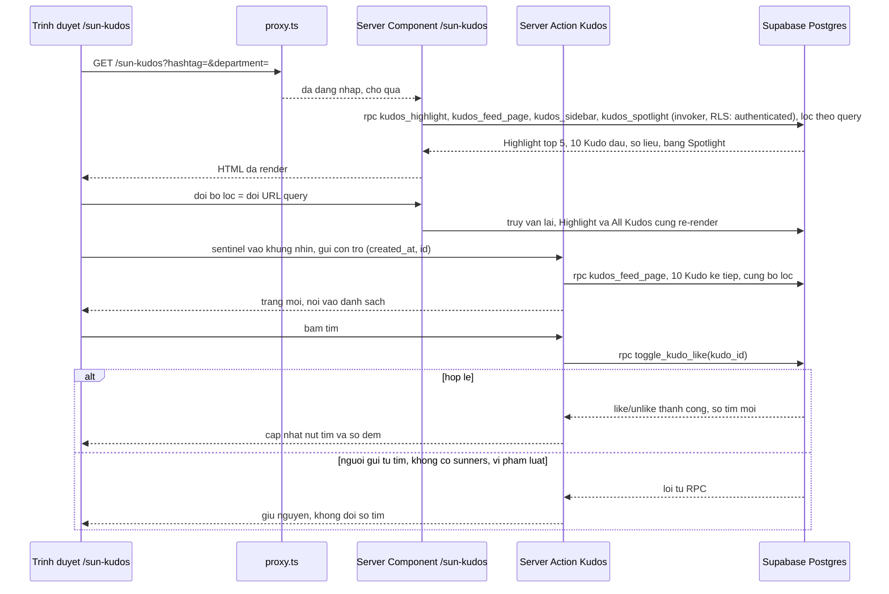

# Architecture

## System Architecture

App Next.js 16 (App Router) có các màn hình: SCR001_Login (`/login`), SCR002_Todo (`/todo`, cần đăng nhập), SCR003_Homepage (`/`, cần đăng nhập, nằm trong nhóm route `(main)`), trang đếm ngược trước ngày ra mắt `/prelaunch` (công khai, route cấp cao ngoài `(main)`, `SCR005_CountdownPrelaunch`), và màn Sun* Kudos - Live board `/sun-kudos` (cần đăng nhập, trong `(main)`, `SCR006_KudosLiveBoard`). Supabase Auth giữ phiên và gọi Google. **Từ tính năng Kudos live board, app có kho dữ liệu đầu tiên: PostgreSQL của Supabase**, schema nằm trong `supabase/migrations/` (migration đầu tiên của repo) và dữ liệu mẫu trong `supabase/seed.sql`. Vẫn không có ORM; app đọc bảng qua `@supabase/supabase-js` (PostgREST). Kiến trúc tách ba phần: Server Component render theo request, một lớp chặn truy cập chạy ở `proxy.ts` (thay cho `middleware.ts` ở Next.js 16; nay gồm cả khóa site trước `SITE_LAUNCH_AT`), và các điểm vào ghi/đọc thêm: hai Route Handler cho OAuth callback và logout, cùng Server Action cho thao tác Kudos.

| Thành phần | Vai trò | Vị trí |
|------------|---------|--------|
| Pages | Render phía server. `/login` đọc cookie locale và `?error=`; `/todo` gọi `getUser()` lần nữa (phòng thủ nhiều lớp). `app/page.tsx` đã xoá, `/` do `app/(main)/page.tsx` phục vụ | `app/login/page.tsx`, `app/todo/page.tsx` |
| Trang `/prelaunch` | Route cấp cao công khai ngoài `(main)`: không header, footer, không kiểm phiên. Server component dựng nền, tiêu đề và snapshot `SITE_LAUNCH_AT` (thời gian còn lại tính ở máy chủ); thành phần client dùng lại `useCountdown` để cập nhật số theo phút và hẹn giờ chuyển về `/` khi tới mốc (theo thời gian còn lại do máy chủ gửi, không theo đồng hồ trình duyệt). Dùng lại `CountdownDisplay`, `readEventSnapshot` và phông của trang chủ | `app/prelaunch/` (`page.tsx`, `_components`, `_behavior`, `_wiring`) |
| Nhóm route `(main)` | Layout chung có header và footer (`SiteHeaderContainer`, `SiteFooterContainer`) cho `/`, trang Hệ thống giải `/awards-information` (F004: server component dựng màn từ `AWARD_CATEGORIES` và `AWARD_DETAILS`; chỉ menu hạng mục là client component), màn Kudos live board `/sun-kudos` (xem dòng riêng bên dưới), trang giữ chỗ `/sun-kudos/<id>` (chi tiết Kudo, hiện dựng lại trang Coming soon), `/standards`, `/profile`, `/admin`. Layout kiểm lại phiên (`getCurrentUser()` → `redirect('/login')`); `/admin` kiểm lại vai trò. Tách thư mục `_components` (hiển thị), `_behavior` (hook, menu), `_wiring` (container, props) | `app/(main)/layout.tsx`, `app/(main)/_components`, `_behavior`, `_wiring` |
| Màn `/sun-kudos` (Kudos live board) | Server Component đọc `searchParams` (`hashtag=<slug>`, `department=<code>`) rồi gọi các RPC đọc của Postgres qua `lib/supabase/server.ts` (`lib/kudos/kudo-board-queries.ts`): Highlight (top 5 theo số tim, hoà thì mới nhất, sau khi áp bộ lọc), trang đầu All Kudos (10 mục, mới nhất trước, con trỏ `(created_at, id)`), tuỳ chọn bộ lọc (hashtag, phòng ban), số liệu của người dùng hiện tại, danh sách 10 hộp quà mới mở, dữ liệu bảng Spotlight (tối đa 100 người nhận) và tổng số Kudos. Bộ lọc là **trạng thái trong URL**: click hashtag trên thẻ hoặc chọn dropdown đổi query, server render lại cả Highlight lẫn All Kudos, không giữ state lọc ở client. Phần tương tác là client component nhỏ: carousel Highlight, nút tim, sentinel `IntersectionObserver`, canvas Spotlight (pan/zoom bằng CSS transform, không thư viện), toast sao chép link, modal Coming soon. Vị trí các node Spotlight tính xác định từ băm có seed theo id để SSR và CSR khớp nhau. Chuỗi UI ở `lib/i18n/dictionary-kudos-{vi,en}.ts` gộp vào từ điển chung | `app/(main)/sun-kudos/` (`page.tsx`, `_components`, `_behavior`, `_wiring`), `lib/kudos/`, `lib/i18n/dictionary-kudos-vi.ts`, `lib/i18n/dictionary-kudos-en.ts` |
| Server Action Kudos | Hai thao tác gọi từ client, cả hai là Server Action (không có Route Handler): (1) `loadMoreKudos` tải trang kế tiếp của All Kudos (cùng bộ lọc, theo con trỏ `(created_at, id)`, size 10) qua RPC `kudos_feed_page`; (2) `toggleKudoLikeAction` bật/tắt tim bằng RPC `toggle_kudo_like` qua server client, rồi trả `{ liked, likeCount }`. Cả hai tự kiểm lại phiên (`getCurrentUser()`) và kiểm đầu vào, vì Server Action là endpoint POST công khai. Server Action không tự kiểm luật tim: mọi luật nằm ở RPC trong Postgres | `lib/kudos/load-more-kudos-action.ts`, `lib/kudos/toggle-kudo-like-action.ts` |
| Cấu hình sự kiện | `EVENT_START_AT` (biến môi trường chỉ phía máy chủ, không có tiền tố `NEXT_PUBLIC_`): ISO-8601 bắt buộc kèm offset hoặc `Z`, sai thì hiện "—" và đếm ngược 00. Giá trị đọc ở server rồi truyền xuống client qua prop. Danh mục giải thưởng ở `lib/awards`. `EVENT_START_AT` chỉ phục vụ trang chủ (đếm ngược, ngày sự kiện, "Coming soon"). Khóa site trong proxy và đếm ngược `/prelaunch` dùng biến riêng `SITE_LAUNCH_AT` (cùng định dạng, đọc bằng `readSiteLaunchFromEnv()`); thiếu hoặc sai thì không khóa | `lib/event/event-start-config.ts`, `lib/event/use-countdown.ts`, `lib/awards/award-categories.ts` |
| Proxy | Làm mới phiên; **khóa trước ngày ra mắt** (sau bước làm mới phiên, trước các guard cũ): trước `SITE_LAUNCH_AT` mọi đường dẫn ngoài `/login`, `/auth/*`, `/prelaunch` bị 307 tới `/prelaunch` kèm cookie vừa làm mới, từ mốc hoặc khi biến thiếu hay sai thì `/prelaunch` bị 307 về `/` và không khóa gì; quyết định là hàm thuần theo `pathname`, `Date.now()` và mốc, không đọc phiên. Redirect theo trạng thái đăng nhập: khách vào `/` hoặc trang giữ chỗ (gồm `/sun-kudos` và `/sun-kudos/<id>`) về `/login`, người đã đăng nhập vào `/login` về `/`, không phải admin vào `/admin*` về `/` (`lib/auth/user-role.ts`). Bỏ qua `/auth/*`. Loại trừ `_next/static`, `_next/image`, `favicon.ico`, ảnh tĩnh khỏi matcher | `proxy.ts`, `lib/supabase/proxy.ts` |
| Route Handler | `GET /auth/callback` đổi PKCE `code` lấy phiên, luôn redirect tương đối 307; `POST /auth/logout` gọi `signOut({ scope: "local" })`, trả 303 về `/login`, `GET` nhận 405 | `app/auth/callback/route.ts`, `app/auth/logout/route.ts` |
| Server Action | `setLocale`: ghi cookie `NEXT_LOCALE` rồi `refresh()`. Logout không phải Server Action. Các Server Action của Kudos nằm ở dòng riêng phía trên | `lib/i18n/set-locale-action.ts` |
| Supabase clients | Browser client cho nút đăng nhập; server client đọc/ghi cookie qua `next/headers`, tạo mới mỗi lần gọi, không giữ global; **cũng là client duy nhất truy vấn bảng và gọi RPC** (chạy bằng phiên của người dùng nên RLS áp dụng, không dùng service role). Thiếu biến môi trường thì ném lỗi ngay khi import | `lib/supabase/client.ts`, `lib/supabase/server.ts`, `lib/supabase/config.ts` |
| Postgres (Supabase) | Kho dữ liệu của Kudos live board. Chín bảng trong schema `public` (migration `20261014095439_kudos_live_board_tables.sql`): `departments`, `sunners` (hồ sơ: liên kết tuỳ chọn `user_id` tới `auth.users`, họ tên, ảnh đại diện, phòng ban, danh hiệu hero), `hashtags`, `kudos`, `kudo_hashtags`, `kudo_images`, `kudo_likes` (khoá duy nhất theo Kudo và Sunner, lưu số tim được tặng 1 hoặc 2), `special_days`, `secret_boxes`. Đường đọc là 5 hàm SQL `SECURITY INVOKER` `stable` trả jsonb camelCase: `kudos_filter_options`, `kudos_highlight`, `kudos_feed_page`, `kudos_spotlight`, `kudos_sidebar`; bộ lọc hashtag/phòng ban viết thẳng trong hai hàm đầu, và con trỏ keyset của `kudos_feed_page` dùng chỉ mục `kudos_created_at_id_idx (created_at desc, id desc)`. Đường ghi duy nhất là RPC `SECURITY DEFINER` `toggle_kudo_like(p_kudo_id)`. Hàm trợ giúp (`iso_utc`, `viewer_sunner_id`, `person_json`, `kudo_cards`) nằm ở schema `kudos_private`, PostgREST không phơi ra. RLS bật trên mọi bảng; luật truy cập xem `permissions.md`. `kudos.created_at` giữ độ chính xác mili giây (có `check`) vì con trỏ đi qua `Date`/ISO của JS. Hạ tầng: ba migration (bảng + chỉ mục + RLS, hàm, quyền `execute`), seed dựng từ nội dung Figma, kiểm bằng pgTAP (`supabase/tests/database/*.test.sql`, chạy `supabase test db` sau `supabase db reset`). Số tim của một Sunner = tổng số tim lưu trên các lượt thích của Kudo họ gửi | `supabase/migrations/20261014095439_kudos_live_board_tables.sql`, `…441_kudos_live_board_functions.sql`, `…442_kudos_live_board_grants.sql`, `supabase/seed.sql`, `supabase/tests/database/` |
| i18n | Từ điển tự viết `vi` (mặc định) và `en`, khớp khoá kiểm bằng kiểu lúc biên dịch; không dùng thư viện. Chuỗi trang chủ nằm ở `dictionary-home-vi.ts`/`dictionary-home-en.ts`, chuỗi Kudos ở `dictionary-kudos-vi.ts`/`dictionary-kudos-en.ts`, gộp vào `dictionary-vi.ts`/`dictionary-en.ts`. Nội dung người dùng (tên, lời nhắn, hashtag) không dịch | `lib/i18n/*` |

Cấu hình Next.js bất thường so với bản quen thuộc: `cacheComponents: true`, `partialPrefetching: true` (`next.config.ts`), `export const instant = false` ở `app/layout.tsx`; API đọc request (`cookies()`, `searchParams`, `connection()`) đặt trong `<Suspense>`. Truy vấn Postgres của `/sun-kudos` phụ thuộc phiên và query nên cũng nằm trong `<Suspense>`, fallback là trạng thái loading của từng khối.

## Tech Stack

Phiên bản lấy đúng chuỗi khai báo trong `package.json`.

| Layer | Technology | Version |
|-------|------------|---------|
| Framework | Next.js (App Router, `proxy.ts`, Turbopack) | 16.4.0 |
| UI | React, react-dom | 19.3.0 |
| Ngôn ngữ | TypeScript | ^5 |
| Styling | Tailwind CSS, `@tailwindcss/turbopack` | ^4, ^4 |
| Font | `next/font/google` (Geist, Geist Mono, Montserrat, Montserrat Alternates), đi kèm Next.js | n/a (theo Next.js 16.4.0) |
| Auth SDK | `@supabase/ssr` | ~0.12.7 |
| Auth SDK | `@supabase/supabase-js` (cũng là client truy vấn PostgREST và gọi RPC) | ^2.117.3 |
| Auth backend | Supabase Auth, chạy local bằng Supabase CLI (`supabase/config.toml`) | n/a (CLI quản lý, repo không khai báo) |
| Identity provider | Google OAuth, bật tại `[auth.external.google]` | n/a (dịch vụ ngoài) |
| Database | PostgreSQL của stack Supabase local, `major_version = 17`; schema bằng migration SQL trong `supabase/migrations/`, dữ liệu mẫu `supabase/seed.sql`, RLS và RPC `SECURITY DEFINER`; app truy vấn qua PostgREST (không ORM) | 17 |
| i18n | Từ điển `vi`/`en` tự viết (`lib/i18n`) | n/a (không phải thư viện) |
| E2E test | `@playwright/test` (chromium, mock Supabase bằng `node:http`, gồm cả `/rest/v1` và RPC) | ^1.64.0 |
| Lint | `eslint`, `eslint-config-next` | ^9, 16.4.0 |
| Kiểu | `@types/node`, `@types/react`, `@types/react-dom` | ^20, ^19, ^19 |
| Package manager | bun | 1.4.2 |

Không có cache, hàng đợi, ORM, job nền hay HTTP client gọi ra ngoài trong mã nguồn.

## Data Flow

- Lỗi hoặc huỷ: callback chỉ đặt cờ cố định `auth_failed`, không chuyển tiếp nội dung lỗi của nhà cung cấp; `/login` chỉ kiểm `error` có rỗng hay không và hiện thông báo cố định dưới nút.
- Callback không đọc tham số `next`; đăng nhập thành công luôn về `/` (trang chủ).
- Khóa trước ngày ra mắt: trước `SITE_LAUNCH_AT`, proxy làm mới phiên rồi 307 mọi đường dẫn khác (kể cả đường dẫn lạ) tới `/prelaunch`, trừ `/login`, `/auth/*` và tài nguyên tĩnh; sau đó `/prelaunch` tự đưa người xem về `/` khi tới mốc, và từ mốc `/prelaunch` bị 307 về `/`. Mốc thiếu hoặc sai nghĩa là không khóa. Các guard dưới đây chỉ có hiệu lực với đường dẫn bị khóa từ mốc trở đi.
- Chưa đăng nhập mà vào `/`, `/todo`, trang giữ chỗ và `/sun-kudos` (kể cả đường dẫn con) thì proxy redirect về `/login` (xoá query); đã đăng nhập mà vào `/login` thì redirect về `/`. Auth server không trả lời thì coi như chưa đăng nhập (fail closed).
- Logout: `signOut` lỗi hoặc ném ngoại lệ thì handler xoá cookie `sb-*-auth-token*`; luôn trả 303 về `/login`.
- Đổi ngôn ngữ: `setLocale` ghi cookie `NEXT_LOCALE` (path `/`, 1 năm, SameSite=Lax) rồi `refresh()`; giá trị lạ hoặc trùng locale hiện tại thì không làm gì.
- Local dev: trình duyệt phải dùng `localhost:3000` (không dùng `127.0.0.1`), vì cookie PKCE verifier gắn theo host; `site_url` và `additional_redirect_urls` trong `supabase/config.toml` đều là `http://localhost:3000`.

### Kudos live board: đọc, lọc, cuộn vô hạn, bật/tắt tim

- Mọi truy vấn đọc chạy bằng phiên của người dùng (`lib/supabase/server.ts`), nên RLS quyết định dữ liệu nào đọc được; không dùng service role ở đường chạy của người dùng.
- Ghi tim chỉ đi qua RPC `toggle_kudo_like`; app không có đường INSERT/UPDATE/DELETE trực tiếp lên `kudo_likes`. Luật (một tim mỗi người mỗi Kudo, người gửi không tự thích, ngày đặc biệt tặng 2 tim, bỏ thích thu hồi đúng số tim đã lưu) nằm trong hàm SQL, không lặp lại ở lớp Next.js (DRY).
- "Người dùng hiện tại" là hàng `sunners` có `user_id = auth.uid()`. Không có hàng thì số liệu sidebar bằng 0, nút tim vô hiệu, và RPC báo `sunner_not_found` (không tự tạo hàng `sunners`).
- Cuộn vô hạn dùng con trỏ `(created_at, id)` chứ không dùng offset, nên Kudo mới chen vào không làm lặp mục.
- Mốc thời gian hiển thị theo `Asia/Ho_Chi_Minh`, dạng `HH:mm - MM/DD/YYYY`. "Ngày đặc biệt" của luật tim cũng tính theo ngày `Asia/Ho_Chi_Minh` (`special_days.day`).
- Cục bộ: `supabase db reset` áp ba migration và `seed.sql`; `supabase test db` chạy pgTAP. Seed để `sunners.user_id` null; muốn thử like thật thì gắn tay một người dùng vào một hàng `sunners`.

### E2E và dữ liệu

Playwright chạy app ở cổng 3100, Supabase Auth được mock ở cổng 54399; Google bị chặn ở biên trình duyệt bằng `page.route` trên `/auth/v1/authorize`. Một máy chủ Playwright có đúng một `EVENT_START_AT` và một `SITE_LAUNCH_AT` (mặc định không đặt `SITE_LAUNCH_AT` nên không bị khóa); kịch bản `/prelaunch` cần máy chủ riêng với mốc ra mắt tương lai (`E2E_SITE_LAUNCH_AT`).

Máy chủ mock `e2e/support/mock-supabase-server.ts` nay **còn phục vụ 6 RPC `POST /rest/v1/rpc/<hàm>`** mà app gọi, dựa trên dữ liệu cố định trong bộ nhớ dựng từ nội dung Figma, và thực thi cùng luật tim như RPC SQL. Dữ liệu theo từng danh tính, kèm hai endpoint điều khiển chỉ có ở mock (`/__e2e/kudos/reset`, `/__e2e/kudos/special-today`); mã ở `e2e/support/mock-kudos-*.ts`. Nhờ đó E2E mặc định chạy không cần Docker. SQL thật (migration, RLS, RPC) được kiểm riêng bằng spec `@smoke` hoặc `supabase db reset` khi có Docker; không bắt buộc trong lần chạy mặc định. Rủi ro đã biết: mock và SQL là hai bản cài đặt của cùng luật, có thể lệch nhau — bản SQL là chuẩn.

## Deployment View

> Derived from repository infrastructure-as-code — not verified against production.

N/A — no infrastructure-as-code found in repository.
