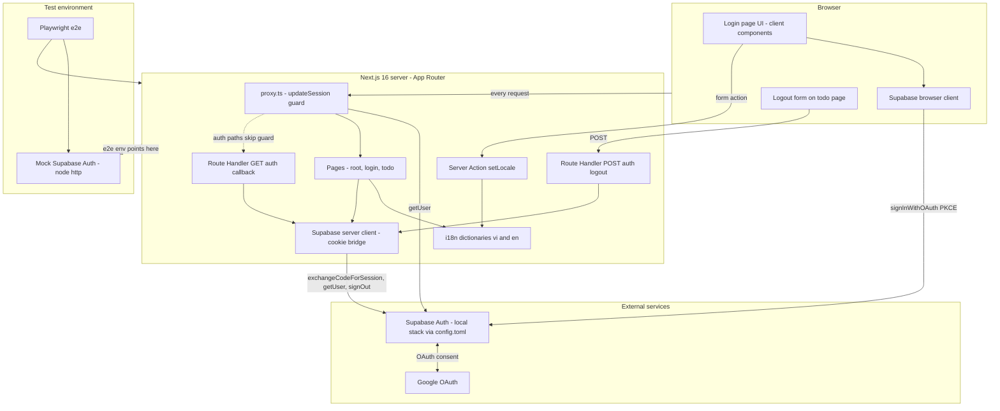
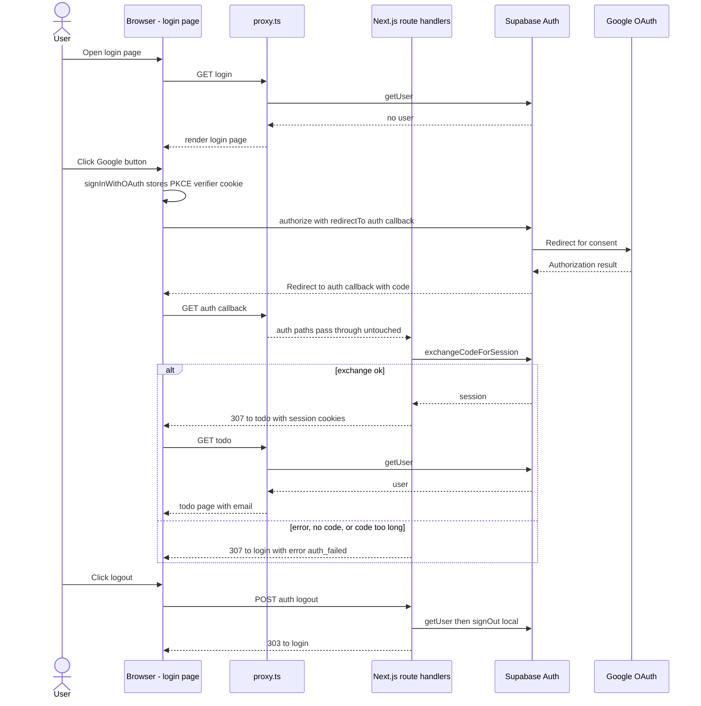

# System Overview

**Project**: agentic-coding-hands-on
**Generated**: 2026-10-08
**Architecture Type**: Monolith Next.js 16 App Router (server-rendered), xác thực giao cho Supabase Auth (BaaS), không có cơ sở dữ liệu ứng dụng

## Executive Summary

Ứng dụng web nhỏ có một mục đích: đăng nhập bằng tài khoản Google qua Supabase Auth rồi vào trang `/todo` được bảo vệ. Có hai màn hình: `/login` (giao diện theo thiết kế MoMorph, có chọn ngôn ngữ vi/en) và `/todo` (hiện email người dùng cùng nút đăng xuất). `/` chỉ chuyển hướng sang `/login`.

Toàn bộ chạy trong một dự án Next.js. Trình duyệt gọi Supabase để bắt đầu luồng OAuth PKCE trong cùng tab. Máy chủ Next.js đổi `code` lấy session ở `GET /auth/callback`, giữ session trong cookie, và `proxy.ts` kiểm tra người dùng ở mọi request. Đăng xuất là `POST /auth/logout` (Route Handler, trả 303 về `/login`, `GET` trả 405). Server Action duy nhất là `setLocale`, ghi cookie `NEXT_LOCALE`.

Mã ứng dụng không có bảng dữ liệu, ORM, migration, hàng đợi, tác vụ nền hay lời gọi HTTP ra ngoài. Thực thể dữ liệu duy nhất lúc chạy là `User` của Supabase Auth. Kiểm thử là Playwright chạy trên một máy chủ Supabase giả và Google giả (stub).

For architecture diagrams and tech stack details, see [architecture.md](architecture.md).

## System Architecture

### High-Level Architecture

Ghi chú: `LocaleAction` được gọi từ client component qua `useTransition`, không có URL riêng. Trong môi trường e2e, `NEXT_PUBLIC_SUPABASE_URL` trỏ vào máy chủ giả và Google bị chặn ở biên trình duyệt (`page.route`).

### Technology Stack

| Layer | Technology | Version |
|-------|------------|---------|
| Framework | Next.js (App Router, Turbopack, `proxy.ts`, Cache Components) | 16.4.0 |
| UI runtime | React, React DOM | 19.3.0 |
| Language | TypeScript (strict) | ^5 (cài 5.9.3) |
| Runtime types | @types/node, @types/react, @types/react-dom | ^20, ^19, ^19 |
| Styling | Tailwind CSS qua loader `@tailwindcss/turbopack` | ^4 (cài 4.3.3) |
| Fonts | `next/font/google`: Geist, Geist Mono, Montserrat, Montserrat Alternates | đi kèm Next.js 16.4.0 |
| Auth SDK (server và browser) | @supabase/ssr | ~0.12.7 |
| Auth SDK (core client) | @supabase/supabase-js | ^2.117.3 |
| Auth backend | Supabase Auth, bật provider Google (stack cục bộ khai báo ở `supabase/config.toml`) | không ghim trong repo (CLI quản lý) |
| i18n | Từ điển TypeScript tự viết, cookie `NEXT_LOCALE` (không dùng thư viện) | n/a (mã nguồn) |
| Lint | ESLint, eslint-config-next (core-web-vitals, typescript) | ^9 (cài 9.39.5), 16.4.0 |
| E2E test | @playwright/test (chromium) | ^1.64.0 |
| Test double | Máy chủ Supabase Auth giả bằng `node:http` | n/a (mã nguồn) |
| Package manager | bun | 1.4.2 |

Ghi chú: `supabase/config.toml` khai báo cả Postgres (`major_version = 17`), Storage, Realtime, Studio, nhưng mã ứng dụng không dùng thành phần nào ngoài Auth. `[db.seed]` trỏ tới `./seed.sql` không tồn tại.

## Data Flow

Luồng đăng nhập Google (PKCE, cùng tab) rồi vào `/todo`.

Luồng phụ: chọn ngôn ngữ gọi Server Action `setLocale` (ghi cookie `NEXT_LOCALE`, `refresh()`), không đi qua Supabase. Người chưa đăng nhập vào `/todo` bị `proxy.ts` chuyển về `/login`; người đã đăng nhập vào `/login` bị chuyển sang `/todo`.

## Key Design Decisions

### Decision 1: Dùng `getUser()` thay cho `getSession()` ở mọi quyết định truy cập

**Context**: Cookie session do trình duyệt gửi lên nên có thể bị sửa. `getSession()` chỉ đọc cookie, không hỏi máy chủ Auth. Proxy và các Route Handler đều cần biết ai đang đăng nhập (chú thích mã: DEC-001).

**Decision**: `lib/supabase/proxy.ts` và `app/todo/page.tsx` gọi `supabase.auth.getUser()`. Máy chủ Auth không phản hồi hoặc báo lỗi thì coi như chưa đăng nhập (fail closed). `app/todo/page.tsx` kiểm tra lại dù proxy đã chặn.

**Rationale**: Cookie giả hoặc hết hạn không qua được cổng. Mỗi request tốn thêm một lượt gọi Auth, đổi lại không tin dữ liệu từ client. Kiểm tra hai lớp (proxy và trang) tránh phụ thuộc vào matcher của proxy; test e2e có kịch bản cookie bị sửa.

### Decision 2: `GET /auth/callback` chỉ có một đích thành công và không chuyển tiếp lỗi từ nhà cung cấp

**Context**: Điểm cuối callback nhận `code`, `error` và có thể cả `next` từ URL do bên ngoài điều khiển. Nếu chuyển tiếp giá trị đó thì dễ gặp open redirect hoặc lộ nội dung lỗi lên giao diện (DEC-002, BR-001, BR-002 trong chú thích mã).

**Decision**: Thành công luôn 307 tới `/todo`, tham số `next` không bao giờ được đọc. Thất bại (`error` có mặt, thiếu `code`, `code` dài hơn 2048 ký tự, đổi code lỗi hoặc ném lỗi) luôn 307 tới `/login?error=auth_failed`. `Location` là đường dẫn tương đối, kèm `Cache-Control: private, no-store`. Trang `/login` chỉ xét tham số `error` có rỗng hay không, không hiển thị nội dung.

**Rationale**: Đích không phụ thuộc `Host` hay `X-Forwarded-Host`, nên header giả không biến thành chuyển hướng ra ngoài. Mất khả năng quay lại trang đang xem trước khi đăng nhập, nhưng ứng dụng chỉ có một trang đích nên không thiệt.

### Decision 3: Đăng xuất là Route Handler `POST /auth/logout`, không phải Server Action

**Context**: Sau khi đăng xuất không được còn trạng thái router phía client (cây `/todo` ẩn) và đường `GET` không được phép đăng xuất.

**Decision**: Nút đăng xuất là `<form action="/auth/logout" method="post">` thuần HTML. Handler chỉ export `POST`, nên `GET` và các method khác nhận 405 mặc định của Next.js. Handler gọi `getUser()` rồi `signOut({ scope: 'local' })`; nếu lỗi hoặc ném lỗi thì xoá cookie khớp `sb-*-auth-token*`. Luôn trả 303 về `/login`, `Cache-Control: private, no-store`.

**Rationale**: POST form làm trình duyệt tải lại toàn bộ tài liệu, không để lại state router. Việc đăng xuất hoàn tất ngay cả khi phiên đã hết hạn. Server Action duy nhất của ứng dụng là `setLocale`. Hệ quả: không có token CSRF riêng cho form này.

### Decision 4: `proxy.ts` làm cổng truy cập, bỏ qua `/auth/*`, mọi redirect mang theo cookie đã làm mới

**Context**: Next.js 16 đã đổi tên `middleware` thành `proxy` (docs trong `node_modules/next/dist/docs`). Cần làm mới cookie session và chặn route bảo vệ; còn callback phải tự hoàn tất việc đổi code (BR-003, BR-004 trong chú thích mã).

**Decision**: `proxy.ts` gọi `updateSession()` cho mọi đường dẫn trừ `_next/static`, `_next/image`, `favicon.ico` và ảnh tĩnh. `/auth/*` đi qua nguyên vẹn. Chưa đăng nhập vào `/todo` hoặc `/todo/*` thì redirect `/login` (bỏ query); đã đăng nhập vào `/login` thì redirect `/todo`. Mỗi redirect sao chép cookie mới và header cache mà Supabase yêu cầu.

**Rationale**: Gom việc làm mới session và việc chặn route vào một chỗ. Nếu redirect không mang cookie mới, người dùng bị đăng xuất ngầm khi token vừa được làm mới. Không có phân quyền theo vai trò nên một cổng nhị phân là đủ.

### Decision 5: Ngôn ngữ lưu trong cookie, bật Cache Components và render theo request

**Context**: `next.config.ts` bật `cacheComponents: true` và `partialPrefetching: true`. Ngôn ngữ nằm trong cookie `NEXT_LOCALE` nên layout gốc đọc `cookies()` ở mỗi request, và `supabase-js` gọi `Date.now()` khi tải session.

**Decision**: `app/layout.tsx` export `instant = false` để bỏ kiểm tra shell tĩnh. Các lời gọi request-time (`cookies()`, `searchParams`, `getUser()`) nằm trong `<Suspense>`; `/todo` gọi `connection()` trước khi chạm Supabase. i18n là hai từ điển TypeScript (`vi` mặc định, `en`); bản `en` khai báo kiểu `Dictionary` nên thiếu khoá là lỗi biên dịch. Giá trị lạ hoặc thiếu rơi về `vi`.

**Rationale**: Không phải kéo thư viện i18n cho hai ngôn ngữ và vài chục khoá. Đổi lại toàn ứng dụng render theo request, không có shell tĩnh toàn cục; với quy mô hiện tại chấp nhận được.

## Security Overview

- **Authentication**: Google OAuth qua Supabase Auth, luồng PKCE cùng tab (`signInWithOAuth`, `redirectTo` là `<origin>/auth/callback`). Session nằm trong cookie do `@supabase/ssr` quản lý. `jwt_expiry` 3600 giây, bật xoay vòng refresh token (`supabase/config.toml`).
- **Authorization**: Nhị phân đăng nhập hay chưa, không có vai trò. `/todo` và `/todo/*` yêu cầu người dùng đã xác thực (proxy cộng kiểm tra lại trong trang); `/login` chuyển người đã đăng nhập sang `/todo`.
- **Data Encryption**: Mã ứng dụng không tự mã hoá dữ liệu và không lưu dữ liệu nào ngoài cookie session. TLS không do repo cấu hình (`[api.tls] enabled = false` ở stack cục bộ). Bí mật Google OAuth nằm trong `supabase/.env` (git-ignored), không nằm trong mã.
- **API Security**: Chỉ dùng khoá publishable phía client, không có service key. Callback giới hạn `code` 2048 ký tự, đích cố định, `Location` tương đối, `no-store`. Logout chỉ nhận `POST`. Không có CORS, CSP hay giới hạn tần suất tự viết trong app; giới hạn tần suất do phần `[auth.rate_limit]` của Supabase đảm nhiệm. Biến môi trường `NEXT_PUBLIC_SUPABASE_URL` và `NEXT_PUBLIC_SUPABASE_PUBLISHABLE_KEY` bắt buộc, thiếu thì ném lỗi ngay khi import.

## Scalability

- **Current Capacity**: Một tiến trình Next.js không giữ state phía máy chủ (session ở cookie, ngôn ngữ ở cookie). Không có cơ sở dữ liệu, cache hay hàng đợi của ứng dụng. Mỗi request tốn một lượt gọi `getUser()` tới Supabase Auth, và `/todo` tốn thêm một lượt.
- **Scaling Strategy**: Repo không định nghĩa chiến lược mở rộng hay hạ tầng triển khai (không có Dockerfile, IaC hay CI). Vì không có state cục bộ nên có thể chạy nhiều bản sao Next.js song song; điểm nghẽn thực tế là Supabase Auth.
- **Performance Targets**: Không có mục tiêu hiệu năng nào trong mã. Yêu cầu giao diện duy nhất kiểm tra được là bố cục ở 1280 và 375 px, không cuộn ngang (e2e).
