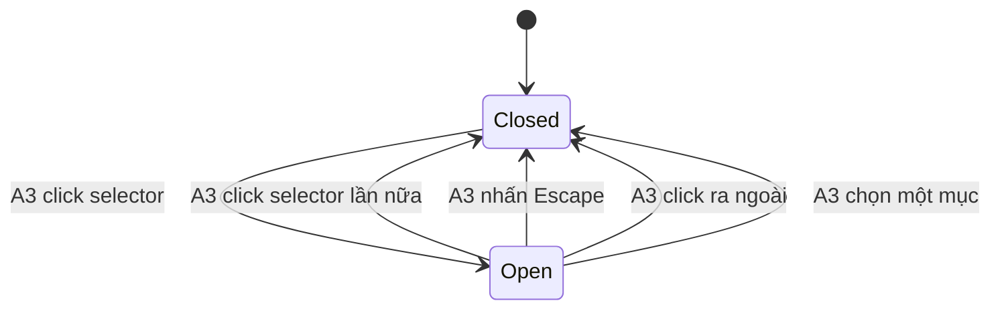

# F002_Localization — Technical Spec

**Priority**: P1
**Type**: ui

**See also:** [`functional-spec.md`](./functional-spec.md) — mô tả, yêu cầu, quy tắc, kịch bản bằng ngôn ngữ thường cho BA/QA. File này chỉ trỏ tới mã FR/BR/DEC/SM, không nhắc lại nội dung.

## 1. Technical Overview

Khách bấm bộ chọn VN/EN trên header màn Login; lựa chọn ghi vào cookie `NEXT_LOCALE` (`vi` | `en`), server render lại toàn bộ chuỗi từ từ điển vi/en tự viết, có kiểu (typed), không dùng thư viện i18n. Mỗi request, root layout đọc cookie, quy giá trị lạ về `vi`, đặt `lang` cho `<html>` rồi truyền locale + từ điển xuống cây component. Không có DB, không có URL tiền tố locale, không đụng `proxy.ts` (xác thực thuộc F001_Auth).

## 2. Action Index

| # | Action (handler) | Method · Path | Codes | Writes | Detail |
|---|---|---|---|---|---|
| **A0** | *cross-cutting — belongs to no single action* | — | FR-001, FR-601, BR-002 | — | § 4.4 |
| **A1** | `RootLayout#render` (planned) | `GET` `(mọi route trang)` | FR-002, FR-201, FR-402, FR-403, FR-404, BR-001, DEC-001, US002 | — *(read-only)* | § 3.1 |
| **A2** | `LocaleActions#setLocale` (planned) | `POST` `(route trang hiện tại, Server Action)` | FR-401, FR-402, FR-403, FR-405, BR-001, US001 | cookie `NEXT_LOCALE` | § 3.1 |
| **A3** | `LanguageSelector#toggle` (planned) *(client-only)* | — | FR-202, FR-203, FR-405, DEC-002, SM-001, US001 | — *(client state only)* | § 3.1 |

## 3. Actions

### 3.1 CAP-01 — Localization

#### A1 · Xác định ngôn ngữ và render chuỗi theo từ điển
`GET (mọi route trang)` → `RootLayout#render` (planned)
`FR-002` `FR-201` `FR-402` `FR-403` `FR-404` `BR-001` `DEC-001` `US002` · vùng header của màn Login (SCR### TBD (draft); vỏ màn thuộc F001_Auth)

**Who** · Khách truy cập, đã hoặc chưa đăng nhập *(gate A0 — § 4.4)*
**FE** · `RootLayout` (planned) đặt `lang` của `<html>` theo locale đã xác định, đưa locale + từ điển xuống `LanguageSelector` (A3) và mọi chuỗi trang. Nhãn selector là kết quả của DEC-001 bên dưới.
**Request** · cookie `NEXT_LOCALE` *(string, tùy chọn; trình duyệt tự gửi kèm request)*
**BE** · `getLocale` (planned) đọc cookie bằng `await cookies()` (Next 16), áp BR-001, trả `vi` hoặc `en`; `getDictionary` (planned) trả từ điển của locale đó.
**Rule** · **BR-001 — Chỉ `vi` hoặc `en` hợp lệ; thiếu cookie hoặc giá trị lạ đều quy về `vi`, không báo lỗi.** Cookie được đọc lại mỗi request nên không có trạng thái nào phải giữ trên server *(§ 4.4)*. DEC-001 quyết định nhãn bộ chọn theo locale:

| DEC | subtype | Condition | What the user sees | Source |
|---|---|---|---|---|
| **DEC-001** | render | `locale ∈ {vi, en}` | Nhãn selector = cờ + mã ngôn ngữ đang dùng (`vi` → cờ Việt Nam + "VN"; `en` → cờ Anh (UK) + "EN", D001 đã chốt); mọi chuỗi từ điển ở đúng ngôn ngữ đó | TBD (draft) |

**Result** · read-only — không ghi gì. Route đọc cookie nên render động (dynamic), khớp với các trang đã động vì xác thực của F001_Auth.
**Source:** TBD (draft)

---

#### A2 · Ghi cookie ngôn ngữ và render lại
`POST (route trang hiện tại, Server Action)` → `LocaleActions#setLocale` (planned)
`FR-401` `FR-402` `FR-403` `FR-405` `BR-001` `US001` · vùng header của màn Login (SCR### TBD (draft); vỏ màn thuộc F001_Auth)

**Who** · Khách truy cập *(gate A0 — § 4.4, công khai, không cần đăng nhập)*
**FE** · `LanguageSelector` (A3) gọi action khi người dùng chọn locale khác locale đang dùng; xong thì Next render lại route hiện tại phía server (cách kích hoạt: xem § 5.3 #1).
**Request** · param `locale` *(string; kỳ vọng `vi` | `en`)*
**BE** · `LocaleActions#setLocale` (planned) kiểm `locale` theo BR-001 rồi ghi cookie qua `await cookies()` — chỉ Server Function được phép `set` cookie.
**Rule** · **BR-001 — Chỉ `vi` hoặc `en` được ghi.** Giá trị khác (request giả mạo) bị từ chối: không ghi cookie, không báo lỗi, giao diện giữ nguyên *(§ 4.4)*.
**Result**
- Ghi cookie `NEXT_LOCALE` ← `locale` hợp lệ (`path=/`, `max-age` 1 năm, `SameSite=Lax` — D002)
- User sees: giao diện render lại bằng ngôn ngữ mới, nhãn selector đổi, menu đóng; lựa chọn giữ qua các lần tải lại (FR-403)
**Source:** TBD (draft)

---

#### A3 · Mở, đóng menu và chọn ngôn ngữ trên bộ chọn
`client-only (không có request)` → `LanguageSelector#toggle` (planned)
`FR-202` `FR-203` `FR-405` `DEC-002` `SM-001` `US001` · vùng header của màn Login (SCR### TBD (draft); vỏ màn thuộc F001_Auth)

**Who** · Khách truy cập
**FE** · `LanguageSelector` (planned, Client Component) là nút gồm cờ + mã + mũi tên xuống, kèm menu hai mục VN/EN. Hover: con trỏ pointer + highlight. SM-001 là trạng thái đóng/mở của menu, chỉ sống ở trình duyệt. Enter/Space bật tắt menu; khi menu mở, lắng nghe Escape và click ra ngoài để đóng; Tab tới các mục, không có điều hướng bằng phím mũi tên (D005).
**Rule** · DEC-002 quyết định khi chọn một mục:

| DEC | subtype | Condition | What the user sees | Source |
|---|---|---|---|---|
| **DEC-002** | interaction | `chosen === current ? close : setLocale(chosen)` | Chọn đúng ngôn ngữ đang dùng: menu đóng, không gì đổi, không gọi A2. Chọn ngôn ngữ khác: menu đóng, gọi A2, trang render lại | TBD (draft) |

**Result** · Không ghi gì phía server tại action này; chọn locale khác thì chuyển tiếp sang A2.
**Source:** TBD (draft)

---

### 3.2 Edge cases

| Action | Scenario | Behavior |
|---|---|---|
| A1 | Cookie rỗng, `fr`, `VI` (sai chữ hoa), hoặc rác | Quy về `vi` theo BR-001; không lỗi, không ghi đè cookie |
| A2 | Gọi thẳng action với `locale` ngoài `vi` / `en` | Từ chối, không ghi cookie, giao diện giữ nguyên |
| A2 | Trình duyệt chặn cookie | Cookie không lưu được; render lại vẫn ra ngôn ngữ cũ; không có thông báo |
| A2 · A3 | Chọn liên tiếp nhanh VN rồi EN | Lần ghi cuối thắng (last-write-wins); cookie thuộc một trình duyệt nên không có tranh chấp giữa người dùng |
| A1 | Hai tab, tab này đổi ngôn ngữ | Tab kia giữ chuỗi cũ tới khi điều hướng hoặc tải lại, rồi đọc cookie mới |
| A3 | Escape, click ngoài, hoặc click lại selector khi menu mở | Menu đóng, không đổi ngôn ngữ |
| A3 | Chọn đúng ngôn ngữ đang dùng | Chỉ đóng menu (DEC-002), không gọi A2 |
| A1-A3 | Mọi cỡ cửa sổ | Selector vẫn ở góc phải header (FR-201) |
| A1-A3 | Truy cập khi chưa hoặc đã đăng nhập | Không có cổng quyền; hành vi như nhau (FR-601, cite A0 § 4.4) |

## 4. Shared Foundation

### 4.1 Components

| Component | Responsibility | Used in | File |
|---|---|---|---|
| `RootLayout` (planned; layout gốc đã có từ scaffold, F001_Auth cũng chạm tới) | Đặt `lang`, truyền locale + từ điển | A1 | TBD (draft) |
| `getLocale` / `getDictionary` (planned) | Đọc cookie, áp BR-001, trả từ điển | A1 | TBD (draft) |
| `dictionary` vi + en (planned) | Từ điển tự viết, có kiểu, cùng bộ khóa (BR-002) | A0, A1 | TBD (draft) |
| `LocaleActions#setLocale` (planned) | Kiểm giá trị, ghi cookie | A2 | TBD (draft) |
| `LanguageSelector` (planned, Client Component) | Nút + menu, DEC-002, SM-001 | A3 | TBD (draft) |

### 4.2 Data Model

#### Key Entities

| Entity | Table | Key Columns | Purpose |
|--------|-------|-------------|---------|
| — | — | — | Không có entity DB; trạng thái duy nhất là cookie `NEXT_LOCALE` (xem § 4.6). Không có `MODEL###` |

#### Polymorphic Behavior

N/A — no discriminator fields in Key Entities.

### 4.3 State Management

### Menu bộ chọn ngôn ngữ có hai trạng thái, đóng và mở (SM-001)
**kind:** ui
**Linked FR:** FR-203
**Used in:** A3
**Source:** TBD (draft)



**Action transitions:** mọi cạnh đều thuộc A3 (chỉ ở client); chọn mục khác locale hiện tại thì A3 chuyển tiếp sang A2 sau khi đóng menu (DEC-002).

### 4.4 Shared Rules

#### Bin 3 — cross-cutting, belongs to no single action

**A0 · FR-001 / BR-002 — Từ điển vi và en có cùng bộ khóa; thiếu khóa ở một ngôn ngữ là lỗi lúc kiểm kiểu.**
**Linked FR:** FR-001. Từ điển en khai báo theo kiểu suy ra từ từ điển vi (hoặc ngược lại), nên thêm chuỗi ở một bên mà quên bên kia thì không biên dịch được. **Không** dùng thư viện i18n. **Not a rule of one action** — áp cho mọi chuỗi mà A1 trả ra.
**Source:** TBD (draft)

**A0 · FR-601 — Chọn ngôn ngữ là công khai: không cổng đăng nhập, không đụng phiên.**
Không action nào của feature này đọc hay ghi cookie phiên Supabase; `proxy.ts` của F001_Auth không có nhánh locale. **Not a rule of this feature's actions alone** — là cam kết ranh giới với F001_Auth.
**Source:** TBD (draft)

#### Bin 2 — used by ≥2 named actions

**BR-001 — Chỉ `vi` hoặc `en` hợp lệ; mọi giá trị khác quy về `vi`.**
**Linked FR:** FR-002. Used in: **A1** · **A2**. A1 áp khi đọc cookie (quy về `vi`); A2 áp trước khi ghi (từ chối, không ghi).
**Source:** TBD (draft)

```text
LOCALES = [vi, en]; DEFAULT = vi
resolve(raw):  return raw in LOCALES ? raw : DEFAULT        # A1, so khớp chính xác, phân biệt hoa thường
setLocale(raw):
  if raw not in LOCALES: return                              # A2, không ghi cookie, không lỗi
  cookie.set(NEXT_LOCALE, raw)
```

### 4.5 Algorithms & Integrations

None.

### 4.6 Configuration

```text
SUPPORTED_LOCALES = vi, en
DEFAULT_LOCALE = vi
LOCALE_COOKIE_NAME = NEXT_LOCALE
LOCALE_COOKIE_PATH = /
LOCALE_COOKIE_MAX_AGE = 31536000        # 1 năm (D002, đã chốt)
LOCALE_COOKIE_SAME_SITE = lax           # đã chốt
```

**Client behavior:** see behavior-logic.md, permissions.md, architecture.md

## 5. Verification & Technical Notes

### 5.1 Technical Verification

Chính sách test: `e2e-red-first`. Viết E2E Playwright (đỏ) trước, rồi mới code. Ánh xạ test case MoMorph: `5f1cbabd` (mặc định VN), `98e20775` (cờ + mũi tên), `8415b629` (góc phải), `4426635b` (mở menu khi click), `cb42461d` (hover), `20d87e28` (menu mở). Cookie `NEXT_LOCALE` kiểm trực tiếp qua browser context của Playwright; không stub gì trong code app.

- **SC-001** *(A1)* Không cookie hoặc cookie lạ: Login render tiếng Việt, selector hiện "VN", `<html lang="vi">` (covers FR-002, FR-404, BR-001)
- **SC-002** *(A2, A1)* Chọn EN: cookie `NEXT_LOCALE=en`, mọi chuỗi từ điển ra tiếng Anh, `lang="en"`, giữ nguyên sau khi tải lại (covers FR-401, FR-402, FR-403, FR-404)
- **SC-003** *(A3)* Menu mở khi click; đóng bằng click lại, Escape, click ngoài; chọn đúng ngôn ngữ hiện tại không đổi gì (covers FR-202, FR-203, FR-405)
- **SC-004** *(A2)* Giá trị ngoài `vi` / `en` không ghi cookie (covers BR-001)
- **SC-005** *(A0)* Hai từ điển có cùng bộ khóa; kiểm bằng kiểu lúc biên dịch (covers FR-001, BR-002)
- **SC-006** *(A1)* Selector ở góc phải header, hiện cờ + mã + mũi tên, ở mọi cỡ cửa sổ (covers FR-201)

#### US001 *(A2, A3)*

**Independent Test:** Mở Login, chọn EN trong menu, thấy mọi chuỗi chuyển tiếng Anh và cookie `NEXT_LOCALE=en`.

**Acceptance Scenarios:**

1. **Given** Login đang tiếng Việt, **When** khách mở menu và chọn EN, **Then** cookie là `en`, trang render lại tiếng Anh, nhãn selector đổi, menu đóng.
2. **Given** menu đang mở, **When** khách nhấn Escape hoặc click ra ngoài, **Then** menu đóng và ngôn ngữ không đổi.

#### US002 *(A1)*

**Independent Test:** Đặt cookie `NEXT_LOCALE=en` rồi mở Login mới, thấy tiếng Anh; đặt giá trị rác thì thấy tiếng Việt.

**Acceptance Scenarios:**

1. **Given** cookie `en`, **When** khách tải lại hoặc mở lại Login, **Then** trang ra tiếng Anh với `lang="en"`.
2. **Given** cookie `xx`, **When** khách mở Login, **Then** trang ra tiếng Việt, selector hiện "VN".

### 5.2 Assumptions

- *(A2)* Next 16: khi Server Action ghi cookie, route hiện tại được render lại phía server mà không cần điều hướng. Chưa kiểm trên docs/runtime của phiên bản đã cài (xem § 5.3 #1).
- *(A1)* Đọc cookie ở layout gốc làm mọi route động; chấp nhận được vì F001_Auth đã buộc trang xác thực động.
- *(A1, A2)* Giữ cookie tên `NEXT_LOCALE` theo `login-specs.csv` mục 1.2, nhưng chỉ là tên cookie do code tự đọc/ghi, không có thư viện i18n nào đứng sau.
- *(A3)* Menu chỉ hai mục nên Enter/Space + Escape + click ngoài + Tab là đủ; không làm điều hướng bằng phím mũi tên (D005, đã chốt).

### 5.3 Unresolved Questions

1. **Cách kích hoạt render lại sau Server Action** *(A2)*: cookie set trong Server Action có tự làm route hiện tại render lại không, hay cần `router.refresh()` / `revalidatePath` ở client? Đọc `node_modules/next/dist/docs/` (theo AGENTS.md) trước khi code.
2. **Hai feature cùng chạm layout gốc** *(A1)*: F001_Auth và F002_Localization đều sửa root layout; cần chốt thứ tự thay đổi để khỏi xung đột khi implement.
3. ~~Chuỗi `?error=` của F001_Auth~~ *(A1)* — **đã chốt**: đi qua từ điển `lib/i18n` do F002 sở hữu, F001 chỉ dùng khóa (D004) (clarifications.md, 2026-10-08).

### 5.4 Source References

Chưa có mã nguồn — xem `## 7. User Stories` trong functional-spec.md để biết hành vi dự kiến.

#### Data Flow

```text
GET trang -> RootLayout#render (planned) -> getLocale: cookie NEXT_LOCALE -> BR-001 -> vi|en -> getDictionary -> HTML (lang, chuỗi, nhãn selector)
chọn mục khác -> A3 đóng menu -> A2 setLocale(locale) -> BR-001 -> cookie.set -> render lại route -> A1
(luồng dự kiến; suy ra từ § 3, chưa có code để trích)
```

### 5.5 Artifact References

| Artifact | File | Codes Used | Reviewed |
|----------|------|------------|----------|
| Feature List | [feature-list.md](../feature-list.md) | F002 | [x] |
| Screens | [functional-spec.md § 6](./functional-spec.md#6-screens) | TBD (draft) | [ ] |
| API Map | TBD (draft) | TBD (draft) | [ ] |
| Entities | TBD (draft) | TBD (draft) | [ ] |
| Behavior Logic | TBD (draft) | TBD (draft) | [ ] |
| Permissions Matrix | TBD (draft) | TBD (draft) | [ ] |
| User Stories | TBD (draft) | TBD (draft) | [ ] |
