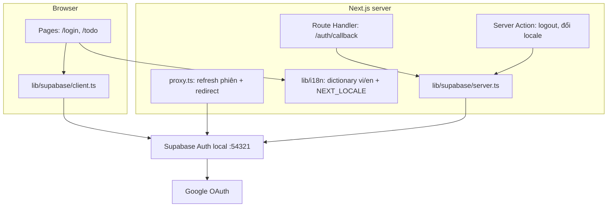
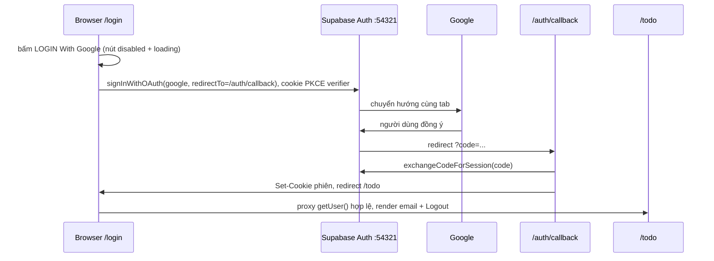
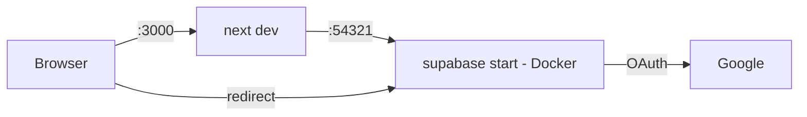

# Architecture

> Bản nháp thiết kế trước khi code (SDD Stage 1.5). Lý do chọn kiến trúc nằm ở ADR, không ghi ở đây. Mã `ROUTE###`/`SCR###`/`MODEL###` đều là `TBD (draft)`.

## System Architecture

App Next.js 16.4 (App Router) nói chuyện với Supabase Auth chạy local bằng CLI. Supabase là bên giữ phiên và gọi Google; app không lưu bảng dữ liệu riêng cho đăng nhập.

## Tech Stack

| Layer | Technology | Version |
|-------|------------|---------|
| Framework | Next.js (App Router, `proxy.ts`, Node runtime) | 16.4.0 |
| UI | React, Tailwind CSS | 19.3.0, ^4 |
| Auth SDK | `@supabase/supabase-js`, `@supabase/ssr` | TBD (draft) — pin khi cài |
| Auth backend | Supabase Auth (local CLI stack) | TBD (draft) |
| i18n | Từ điển vi/en tự viết, không dùng thư viện | n/a |
| E2E | `@playwright/test` (devDependency) | TBD (draft) |
| Package manager | bun | 1.4.2 |

## Layers

| Layer | Vị trí dự kiến | Vai trò |
|-------|----------------|---------|
| Pages | `app/login/page.tsx`, `app/todo/page.tsx`, `app/page.tsx` | Render phía server; `/login` đọc `?error=` để hiện lỗi dưới nút |
| Route Handler | `app/auth/callback/route.ts` | Đổi PKCE `code` lấy phiên, ghi cookie, redirect |
| Proxy | `proxy.ts` (gốc project) + `lib/supabase/proxy.ts` | Làm mới phiên, redirect theo trạng thái đăng nhập (xem `permissions.md`) |
| Supabase clients | `lib/supabase/client.ts`, `lib/supabase/server.ts` | Browser client (bấm nút) và server client (cookie `getAll/setAll`, tạo mới mỗi lần gọi, không giữ global) |
| i18n | `lib/i18n/*` | Từ điển vi/en duy nhất do F002 sở hữu (mọi chuỗi Login và `/todo`), đọc cookie `NEXT_LOCALE` (mặc định `vi`) khi render server |

`app/layout.tsx` hiện cố định `lang="en"` và metadata mặc định của Create Next App; thiết kế dự kiến đặt `lang` theo locale. Chi tiết: `TBD (draft)`.

## External Integration

- **Supabase Auth local**: API `http://127.0.0.1:54321`, Studio `:54323`, Postgres `:54322` (chưa dùng).
- **Google provider**: bật trong `supabase/config.toml`, client id/secret lấy qua `env(...)`; chấp nhận mọi tài khoản Google.
- **Redirect allow-list** (`auth.additional_redirect_urls`) phải chứa `http://localhost:3000/auth/callback` (hoặc `/**`).
- Google Cloud redirect URI: `http://127.0.0.1:54321/auth/v1/callback`.
- Trình duyệt dùng MỘT host duy nhất (`localhost`); lệch host làm mất cookie PKCE verifier.

## Data Flow — Login

Nhánh lỗi/huỷ: callback đọc `error` trước `code`; thiếu `code` hoặc đổi code thất bại → redirect `/login?error=...`. Tên tham số khi huỷ ở Google chưa xác nhận từ docs chính thức — `TBD (draft)`, kiểm bằng E2E. Tham số `next` (nếu dùng) phải bắt đầu bằng `/`.

Logout: Server Action kiểm lại bằng `getUser()`, gọi `signOut({ scope: 'local' })` (chỉ thiết bị hiện tại) rồi redirect `/login`.

## Environment Variables

| Biến | Nơi đặt | Ghi chú |
|------|---------|---------|
| `NEXT_PUBLIC_SUPABASE_URL` | `.env.local` | Local: `http://127.0.0.1:54321` |
| `NEXT_PUBLIC_SUPABASE_PUBLISHABLE_KEY` | `.env.local` | Key publishable (`sb_publishable_...`); tên biến đã chốt (clarifications.md, 2026-10-08) |
| `SUPABASE_AUTH_EXTERNAL_GOOGLE_CLIENT_ID` | `supabase/.env` | CLI thay vào `config.toml`; `env()` cho client id chưa được docs xác nhận |
| `SUPABASE_AUTH_EXTERNAL_GOOGLE_CLIENT_SECRET` | `supabase/.env` | Không commit |

`.env.example` được commit; `.env.local` và `supabase/.env` thì không.

## Local Dev Topology

Cần Docker và Supabase CLI trên máy. `supabase/` (`config.toml`) được commit; đổi config thì chạy lại `supabase stop && supabase start`.

## Test Topology (e2e-red-first)

- Playwright viết trước (đỏ vì chưa có `/login`), thư mục `e2e/`, không đặt trong `app/`.
- Mock Supabase server riêng (cổng dự kiến 54399) thay Supabase + Google ở biên mạng; app chạy code thật (proxy, `@supabase/ssr`, cookie). Không có mock trong code app.
- App dưới test dùng cổng riêng (dự kiến 3100), `NEXT_PUBLIC_SUPABASE_URL` trỏ vào mock.
- Mock cần các endpoint: token (`pkce`), user (cho `getUser()`) và logout; không cần JWKS.
- Điểm bắt đầu OAuth kiểm bằng `page.route` trên `/auth/v1/authorize`.
- Cookie phiên seed sẵn cho test đã đăng nhập. Chạy `@smoke` với Supabase thật (Docker) là tuỳ chọn.
