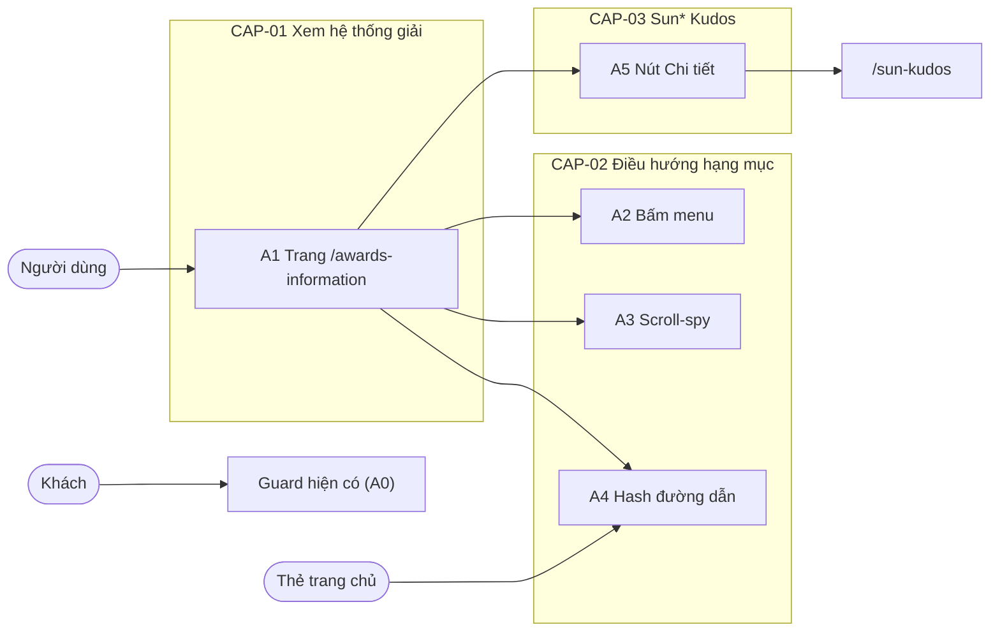

# F000_AwardsInformation

## 1. Technical Overview

Trang `/awards-information` thay trang giữ chỗ "Coming soon" ngay tại route hiện có trong nhóm `app/(main)`, nên header, footer, vỏ đăng nhập (proxy cộng layout) và ngôn ngữ đều dùng lại, không đổi. Trang chính là server component dựng hero, tiêu đề, 6 thẻ giải thưởng và khối Sun* Kudos từ danh sách 6 hạng mục dùng chung với trang chủ; chỉ menu hạng mục là thành phần client vì phải theo dõi cuộn, xử lý `#hash` và cuộn mượt. Không có bảng dữ liệu, API hay biến cấu hình mới; chuỗi mới thêm vào từ điển vi/en hiện có.



## 2. Action Index

| # | Action (handler) | Method · Path | Codes | Writes | Detail |
|---|---|---|---|---|---|
| **A0** | *cross-cutting — belongs to no single action* | — | FR-001, FR-601, BR-003 | — | § 4.4 |
| **A1** | `AwardsInformationPage` (planned) | `GET` `/awards-information` | FR-002, FR-101, FR-102, FR-201, FR-202, FR-203, FR-205, FR-406, FR-407, FR-601, BR-001, DEC-002, US001, US005 | — *(read-only)* | § 3.1 |
| **A2** | `AwardsCategoryMenu#onSelect` (planned) | browser · click | FR-401, FR-402, BR-002, DEC-001, US002 | — *(read-only)* | § 3.2 |
| **A3** | `AwardsCategoryMenu#onScroll` (planned) | browser · scroll | FR-403, BR-002, DEC-001, ALG-001, US002 | — *(read-only)* | § 3.2 |
| **A4** | `AwardsCategoryMenu#onHash` (planned) | browser · tải trang và `hashchange` | FR-404, FR-405, BR-002, DEC-001, US003 | — *(read-only)* | § 3.2 |
| **A5** | `KudosPromo` *(dùng lại của F003_Homepage)* | browser · điều hướng | FR-204, FR-408, US004 | — *(read-only)* | § 3.3 |

## 3. Actions

### 3.1 CAP-01 — Xem hệ thống giải thưởng

#### A1 · Hiển thị trang Hệ thống giải
`GET /awards-information` → `` `AwardsInformationPage` (planned) ``
`FR-002` `FR-101` `FR-102` `FR-201` `FR-202` `FR-203` `FR-205` `FR-406` `FR-407` `FR-601` `BR-001` `DEC-002` `US001` `US005` · `SCR-awards-information` (mã SCR### cấp lúc promote)

**Who** · Người dùng đã đăng nhập; khách chỉ bị chặn trước khi tới đây *(gate A0 — § 4.4)*
**FE** · Trang dựng theo thứ tự: hero keyvisual và tiêu đề (FR-201), menu hạng mục bên trái (FR-202), 6 thẻ giải thưởng ở giữa (FR-203), khối Sun* Kudos ở dưới (FR-205), cùng header và footer của layout `(main)`. Mỗi thẻ là một `<section>` có `id` bằng slug (FR-002). Mục "Awards Information" trên header tự sáng theo đường dẫn hiện tại (FR-102, hành vi sẵn có). Bố cục và phần tử chi tiết: `SCR-awards-information/spec.md`.
**Request** · không có tham số; cookie phiên và `NEXT_LOCALE`
**BE** · Server component đọc ngôn ngữ, lấy từ điển, ghép danh sách 6 hạng mục dùng chung (slug, ảnh, khoá tiêu đề, khoá mô tả) với các khoá mới cho số lượng và giá trị giải. Không gọi dịch vụ ngoài.
**Rule** · **BR-001 — Thứ tự và slug của 6 hạng mục lấy từ một danh sách duy nhất dùng chung với trang chủ.** Slug là `id` của phần tương ứng nên liên kết thẻ ở trang chủ vẫn đúng. Danh sách có sẵn ở `lib/awards/award-categories.ts` (`AWARD_SLUGS`, `AWARD_CATEGORIES`, `awardHref`).
```text
sections = AWARD_CATEGORIES in order        # same order for cards and menu items
section.id = category.slug                  # homepage links /awards-information#<slug> keep working
```

| DEC | subtype | Condition | What the user sees | Source |
|---|---|---|---|---|
| **DEC-002** | render | chiều rộng cửa sổ từ 1024px trở lên | Menu dọc bên trái, dính ngay dưới header cố định khi 6 thẻ cuộn qua (FR-406) | TBD (draft) |
| **DEC-002** | render | chiều rộng cửa sổ dưới 1024px | Menu thành một hàng tab cuộn ngang, ghim phía trên các thẻ, cùng kiểu active (FR-407) | TBD (draft) |

**Result** · read-only. Người dùng thấy toàn bộ hệ thống giải theo ngôn ngữ đã chọn (US001). Khách mở trang này bị chặn bởi guard sẵn có và về `/login` (FR-601, US005); route vẫn thuộc nhóm bảo vệ của F003_Homepage, không đổi gì.
**Source:** TBD (draft)

---

### 3.2 CAP-02 — Điều hướng giữa các hạng mục

#### A2 · Bấm mục menu để tới hạng mục
`browser · click` → `` `AwardsCategoryMenu#onSelect` (planned) ``
`FR-401` `FR-402` `BR-002` `DEC-001` `US002` · `SCR-awards-information`

**Who** · Người dùng đã đăng nhập *(gate A0 — § 4.4)*
**FE** · Mỗi mục là liên kết tới `#<slug>`; bấm thì cuộn mượt tới phần tương ứng và đặt mục đó thành active (vàng, gạch chân), mục cũ mất active (FR-401). Rê chuột làm mục sáng lên (FR-402); kiểu hover lấy từ Figma khi dựng.
**Request** · không có; chỉ thao tác phía client
**BE** · *none*
**Rule** · **BR-002 — Tại mọi thời điểm đúng một mục menu ở trạng thái active; mặc định là mục đầu.** Bấm một mục đặt riêng mục đó active. *(§ 4.4)* Nguồn nào quyết định mục active (bấm, hash, cuộn) nằm ở DEC-001 trong A4.
**Result** · trang cuộn tới phần hạng mục, đúng một mục active (US002). Khi cuộn mượt đang chạy, scroll-spy (A3) không được giành lại trạng thái active giữa chừng; cách chặn: TBD (draft).
**Source:** TBD (draft)

---

#### A3 · Scroll-spy: phần đang xem quyết định mục active
`browser · scroll` → `` `AwardsCategoryMenu#onScroll` (planned) ``
`FR-403` `BR-002` `DEC-001` `ALG-001` `US002` · `SCR-awards-information`

**Who** · Người dùng đã đăng nhập *(gate A0 — § 4.4)*
**FE** · Khi người dùng tự cuộn, mục menu của phần đang nằm trong vùng nhìn thấy trở thành active (FR-403). Trên tab ngang (dưới 1024px) cùng quy tắc áp dụng.
**Request** · không có; theo dõi vị trí 6 phần trong khung nhìn
**BE** · *none*
**Rule** · **BR-002 — Tại mọi thời điểm đúng một mục menu ở trạng thái active; mặc định là mục đầu.** Scroll-spy chỉ chọn một phần, không bao giờ để hai mục cùng active hay không mục nào. *(§ 4.4)* DEC-001 (xem A4): khi không có hash hợp lệ ép buộc, vị trí cuộn quyết định mục active; cách chọn phần nằm ở ALG-001 (§ 4.5): chọn phần gần mép trên vùng nhìn sau khi trừ chiều cao header cố định.
**Result** · mục menu active theo kịp vị trí cuộn (US002); phần đầu trang (hero, tiêu đề) giữ mục đầu active.
**Source:** TBD (draft)

---

#### A4 · Hash đường dẫn: tới đúng hạng mục khi mở trang
`browser · tải trang và hashchange` → `` `AwardsCategoryMenu#onHash` (planned) ``
`FR-404` `FR-405` `BR-002` `DEC-001` `US003` · `SCR-awards-information`

**Who** · Người dùng đã đăng nhập, thường đến từ thẻ giải thưởng ở trang chủ *(gate A0 — § 4.4)*
**FE** · Khi trang mở với `/awards-information#<slug>` hoặc hash đổi, trang cuộn tới phần đó và đặt mục tương ứng active (FR-404; áp cả khi vào từ thẻ trang chủ). Hash không khớp slug nào thì bỏ qua, không báo lỗi (FR-405).
**Request** · `#<slug>` của URL
**BE** · *none*
**Rule** · **BR-002 — Tại mọi thời điểm đúng một mục menu ở trạng thái active; mặc định là mục đầu.** Hash không hợp lệ cũng không được làm mục nào mất active hay lệch khỏi mặc định. *(§ 4.4)*

| DEC | subtype | Condition | What the user sees | Source |
|---|---|---|---|---|
| **DEC-001** | interaction | hash khớp một slug trong 6 hạng mục | Cuộn tới phần đó, mục tương ứng active (hash thắng scroll-spy lúc tải) | TBD (draft) |
| **DEC-001** | interaction | hash có nhưng không khớp slug nào | Trang ở lại đầu, mục đầu active, không lỗi JavaScript (FR-405) | TBD (draft) |
| **DEC-001** | interaction | không có hash | Vị trí cuộn quyết định mục active (A3); lúc mở trang là mục đầu | TBD (draft) |

**Result** · deep link từ trang chủ hạ cánh đúng hạng mục (US003); hash sai không phá trang. Việc bấm menu có cập nhật hash hay không: xem câu hỏi mở ở § 5.3.
**Source:** TBD (draft)

---

### 3.3 CAP-03 — Đi tới Sun* Kudos

#### A5 · Nút "Chi tiết" của khối Sun* Kudos
`browser · điều hướng` → `` `KudosPromo` (dùng lại của F003_Homepage) ``
`FR-204` `FR-408` `US004` · `SCR-awards-information`

**Who** · Người dùng đã đăng nhập *(gate A0 — § 4.4)*
**FE** · Khối Sun* Kudos ở cuối trang: nhãn, tiêu đề, mô tả, hình minh hoạ và nút "Chi tiết" (FR-204). Nút là liên kết cùng tab tới `/sun-kudos` (FR-408). Tái dùng `KudosPromo` nếu Figma node `335:12023` khớp bản của trang chủ (xem § 5.3).
**Request** · điều hướng `/sun-kudos`
**BE** · *none*
**Result** · mở trang Sun* Kudos (hiện là trang giữ chỗ do F003_Homepage dựng); route không tồn tại thì Next hiện 404 mặc định (US004).
**Source:** TBD (draft)

---

### 3.4 Edge cases

| Action | Scenario | Behavior |
|---|---|---|
| A4 | Hash không khớp slug (`#abc`) | Bỏ qua, trang ở đầu, mục đầu active, không lỗi JavaScript (DEC-001, FR-405) |
| A2 · A3 | Bấm mục rồi trang vẫn đang cuộn mượt | Scroll-spy không đổi active giữa chừng; kết thúc cuộn thì chỉ mục đã bấm active (BR-002) |
| A3 | Cuộn tới hero, tiêu đề (trước phần đầu tiên) | Mục đầu active (BR-002) |
| A1 | Cửa sổ đổi qua mốc 1024px | Menu chuyển giữa dọc dính và tab ngang, mục active giữ nguyên (DEC-002) |
| A5 | `/sun-kudos` lỗi hoặc không tồn tại | Next hiện trang 404 mặc định; không tự thêm thông báo lỗi riêng |
| A1 | Khách mở thẳng URL | Về `/login` bởi guard sẵn có (FR-601) |

## 4. Shared Foundation

### 4.1 Components

| Component | Responsibility | Used in | File |
|---|---|---|---|
| `AwardsInformationPage` (planned) | Route `/awards-information`; dựng hero, tiêu đề, lưới thẻ, khối Kudos | A1 | `app/(main)/awards-information/page.tsx` (thay trang giữ chỗ hiện có) |
| `AwardsCategoryMenu` (planned, client) | Menu dọc dính và tab ngang; scroll-spy, hash, cuộn mượt | A2, A3, A4 | TBD (draft) trong `app/(main)/_components/` |
| `AwardDetailCard` (planned) | Một thẻ: ảnh, tiêu đề, mô tả, số lượng, giá trị; `id` = slug | A1 | TBD (draft) |
| `KudosPromo` *(có sẵn)* | Khối quảng bá Sun* Kudos | A5 | `app/(main)/_components/kudos-promo.tsx` |
| Header, footer, `ComingSoonPage` bị thay | Vỏ dùng chung của `(main)` | A1 | `app/(main)/layout.tsx`, `app/(main)/_behavior/coming-soon-content.tsx` |

### 4.2 Data Model

#### Key Entities

| Entity | Table | Key Columns | Purpose |
|--------|-------|-------------|---------|
| — | — | — | Không có bảng; 6 hạng mục là dữ liệu tĩnh (`AWARD_CATEGORIES` trong `lib/awards/award-categories.ts`, có sẵn) cộng khoá chuỗi trong từ điển |

#### Polymorphic Behavior

N/A — no discriminator fields in Key Entities.

### 4.3 State Management

None — mục active là một giá trị slug nằm trong thành phần client (mặc định mục đầu), không lưu bền, không đủ ngưỡng thành state machine; hash trong URL chỉ là đầu vào lúc tải (A4).

### 4.4 Shared Rules

#### Bin 3 — cross-cutting, belongs to no single action

**A0 · FR-001 / FR-601 / BR-003 — mọi hành động của trang cần phiên đã xác minh; chuỗi lấy từ từ điển vi/en; tiếng Việt bám Figma.**
FR-601: lớp bảo vệ sẵn có (proxy cộng layout `(main)`) áp cho `/awards-information`; không xác minh được phiên thì về `/login`; feature này không đổi lớp đó. FR-001: toàn bộ chuỗi mới thêm vào từ điển hiện có của F002_Localization (không lập từ điển thứ hai), cặp khoá vi/en khớp ở lúc biên dịch. BR-003: tiếng Việt lấy nguyên văn từ Figma/MoMorph, tiếng Anh do nhóm tự soạn. **Không phải quy tắc riêng của feature này** mà kế thừa từ F001_Auth, F002_Localization và F003_Homepage.
**Source:** TBD (draft)

#### Bin 2 — used by ≥2 named actions

**BR-002 — Tại mọi thời điểm đúng một mục menu ở trạng thái active; mặc định là mục đầu.**
Used in: **A2** · **A3** · **A4**. A2 đặt mục vừa bấm active, A3 đặt mục của phần đang xem, A4 đặt mục theo hash (hash sai thì giữ mặc định). Cả ba ghi vào cùng một giá trị active để không bao giờ có hai mục sáng cùng lúc.
**Source:** TBD (draft)

```text
active = first item                       # default
on click(slug)        -> active = slug     # A2
on hash valid(slug)   -> active = slug     # A4
on hash invalid       -> active unchanged  # A4, no error
on scroll (user)      -> active = ALG-001  # A3, skipped while a click-initiated scroll runs
```

### 4.5 Algorithms & Integrations

### Chọn hạng mục đang xem khi cuộn (ALG-001)

**Linked FR:** FR-403
**Used in:** A3
**Source:** TBD (draft)
**Input:** vị trí đầu của 6 phần so với khung nhìn, chiều cao header cố định · **Output:** một slug hạng mục · **Complexity:** O(6) mỗi lần cập nhật
**Description:** Chọn phần cuối cùng có mép trên đã lên tới hoặc qua đường chuẩn ngay dưới header; chưa phần nào qua đường chuẩn thì giữ mục đầu. Ngưỡng cụ thể và cách theo dõi (sự kiện cuộn hay `IntersectionObserver`) chốt khi dựng, nhưng kết quả luôn là đúng một slug.
**Pseudocode:**
```text
line = headerHeight + tolerance          # tolerance: TBD (draft)
current = first slug
for each section in display order:
    if section.top <= line: current = section.slug
return current
```

### 4.6 Configuration

None.

**Client behavior:** see behavior-logic.md, permissions.md, architecture.md

## 5. Verification & Technical Notes

### 5.1 Technical Verification

Chính sách kiểm thử: `e2e-red-first` (Playwright đã có, chạy bằng `bun run test:e2e`): viết kịch bản E2E đỏ trước rồi làm xanh. Test case MoMorph dùng `/he-thong-giai`; đã thay bằng `/awards-information` (clarifications.md).

- **SC-001** *(A1)* Đã đăng nhập mở `/awards-information` thấy trang Hệ thống giải; khách về `/login`; bấm "Awards Information" trên header thì tới trang và mục đó sáng (covers FR-101, FR-102, FR-601)
- **SC-002** *(A1)* Có tiêu đề phụ "Sun* annual awards 2025" và tiêu đề chính "Hệ thống giải thưởng SAA 2025"; menu đủ 6 mục đúng thứ tự; 6 thẻ đủ ảnh, tiêu đề, mô tả, số lượng, giá trị theo Figma (covers FR-201, FR-202, FR-203, FR-002, BR-001)
- **SC-003** *(A2)* Bấm lần lượt từng mục: trang cuộn tới đúng phần, chỉ mục đó active; rê chuột có highlight (covers FR-401, FR-402, BR-002)
- **SC-004** *(A3)* Cuộn tay qua từng phần thì mục active theo kịp (covers FR-403, ALG-001, DEC-001)
- **SC-005** *(A4)* `/awards-information#mvp` cuộn tới và kích hoạt MVP; thẻ trang chủ tới đúng phần; `#abc` không lỗi JavaScript, ở đầu trang, mục đầu active (covers FR-404, FR-405, DEC-001)
- **SC-006** *(A1)* Từ 1024px trở lên menu dính dưới header khi cuộn; dưới 1024px là một hàng tab cuộn ngang cùng kiểu active (covers FR-406, FR-407, DEC-002)
- **SC-007** *(A5)* Khối Sun* Kudos đủ nhãn, tiêu đề, mô tả và "Chi tiết" tới `/sun-kudos`; route không có thì 404 (covers FR-204, FR-408)
- **SC-008** *(A0)* Đổi ngôn ngữ EN thì toàn bộ chuỗi trang đổi theo, VN đúng nguyên văn Figma (covers FR-001, BR-003)

#### US001 *(A1)*
**Independent Test:** Đăng nhập bằng phiên giả lập, mở `/awards-information`, đọc 6 thẻ.
**Acceptance Scenarios:**
1. **Given** người dùng đã đăng nhập, **When** mở `/awards-information`, **Then** thấy tiêu đề, menu 6 mục, 6 thẻ đủ nội dung và khối Sun* Kudos.

#### US002 *(A2, A3)*
**Independent Test:** Bấm mục menu rồi cuộn tay và đọc mục active.
**Acceptance Scenarios:**
1. **Given** trang vừa mở, **When** bấm "MVP", **Then** trang cuộn tới thẻ MVP và chỉ MVP active.
2. **Given** đang ở thẻ Top Project, **When** cuộn tới Best Manager, **Then** Best Manager active, Top Project mất active.

#### US003 *(A4)*
**Independent Test:** Mở thẳng URL kèm hash.
**Acceptance Scenarios:**
1. **Given** người dùng đang ở trang chủ, **When** bấm thẻ Best Manager, **Then** tới `/awards-information#best-manager` đúng phần và mục active.
2. **Given** hash `#abc`, **When** mở trang, **Then** không lỗi và mục đầu active.

#### US004 *(A5)*
**Independent Test:** Bấm "Chi tiết" ở khối Sun* Kudos.
**Acceptance Scenarios:**
1. **Given** ở cuối trang, **When** bấm "Chi tiết", **Then** URL thành `/sun-kudos` trong cùng tab.

#### US005 *(A1)*
**Independent Test:** Mở URL khi chưa có phiên.
**Acceptance Scenarios:**
1. **Given** khách chưa đăng nhập, **When** mở `/awards-information`, **Then** bị chuyển về `/login`.

### 5.2 Assumptions

- *(A1)* Ảnh 6 thẻ dùng lại `public/images/homepage/awards/<slug>.png` (336×336) và keyvisual dùng lại `public/images/homepage/keyvisual.png`, trừ khi node Figma khác (clarifications.md).
- *(A1, A2)* Menu dính nằm dưới header cố định cao 80px hiện có của `(main)`; vị trí cuộn tới phần phải trừ chiều cao đó để tiêu đề thẻ không bị che.
- *(A0)* Khoá từ điển mới theo tiền tố `awards.*`; dùng chung cặp khoá tiêu đề, mô tả của trang chủ nếu nội dung Figma giống nhau, nếu khác thì thêm khoá riêng (xem § 5.3).
- *(A5)* `/sun-kudos` đã là route được bảo vệ do F003_Homepage dựng.

### 5.3 Unresolved Questions

1. **Phiên bản Next.js** *(A1)*: dự án dùng Next.js có khác biệt so với kiến thức quen thuộc (xem AGENTS.md); phải đọc hướng dẫn trong `node_modules/next/dist/docs/` trước khi viết route và thành phần client.
2. **Mô tả đầy đủ 6 giải** *(A1)*: CSV chỉ ghi "description paragraph"; từ điển trang chủ chỉ có bản ngắn tối đa 2 dòng. Cần văn bản nguyên văn từ node Figma của D.1 tới D.6.
3. **Chặn scroll-spy lúc cuộn mượt** *(A2, A3)*: chọn cách (cờ trong lúc cuộn, hay sự kiện kết thúc cuộn) để không nhấp nháy active.
4. **Cập nhật hash khi bấm menu** *(A2, A4)*: đã chốt (D007) — chỉ khi bấm, dùng `history.replaceState`; scroll-spy không đổi URL.
5. **`KudosPromo` có khớp node `335:12023`** *(A5)*: nếu văn bản hoặc bố cục lệch thì thêm biến thể thay vì sửa bản của trang chủ.

### 5.4 Source References

None — mã chưa viết. Điểm chạm đã có để dựng lên: `app/(main)/awards-information/page.tsx` (sẽ thay thân trang), `lib/awards/award-categories.ts`, `app/(main)/_components/kudos-promo.tsx`, `app/(main)/layout.tsx`, `lib/i18n/*`. Hành vi: xem `## 7. User Stories` trong functional-spec.md.

#### Data Flow

```text
Request /awards-information -> guard (A0) -> AwardsInformationPage (locale, dict, 6 hạng mục) -> HTML
Click menu / hash / scroll -> AwardsCategoryMenu -> active slug (BR-002) + cuộn tới #slug
Click "Chi tiết" -> điều hướng /sun-kudos
```

### 5.5 Artifact References

| Artifact | File | Codes Used | Reviewed |
|----------|------|------------|----------|
| System Overview | [overview.md](../../system/overview.md) | — | [ ] |
| Architecture | [architecture.md](../../system/architecture.md) | — | [ ] |
| Feature List | [feature-list.md](../../generated/feature-list.md) | F### (cấp lúc promote) | [ ] |
| API Map | [api-map.md](../../generated/api-map.md) | TBD (draft) | [ ] |
| Entities | [entities.md](../../generated/entities.md) | TBD (draft) | [ ] |
| Screens | [functional-spec.md § 6](./functional-spec.md#6-screens) | TBD (draft) | [ ] |
| Behavior Logic | [behavior-logic.md](../../generated/behavior-logic.md) | TBD (draft) | [ ] |
| Permissions Matrix | [permissions-matrix.md](../../generated/permissions-matrix.md) | TBD (draft) | [ ] |
| User Stories | [user-stories.md](../../generated/user-stories.md) | TBD (draft) | [ ] |
