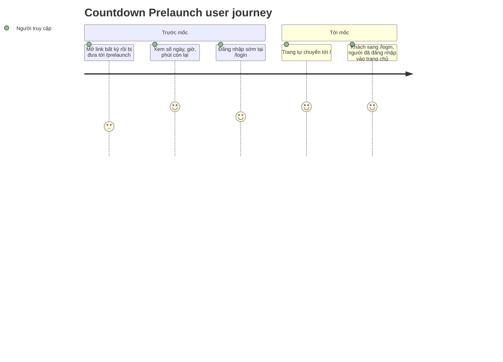

**Priority**: P1
**Type**: mixed

## 1. Overview

**Problem:** Trước ngày sự kiện, ứng dụng chưa nên mở cho người dùng vào xem trang chủ hay các trang bên trong, nhưng hiện chưa có chỗ nào báo "bao giờ thì mở". Người vào link nhận trang chủ hoặc trang Login như thể sự kiện đã bắt đầu.
**Solution:** Một trang công khai `/prelaunch` đếm ngược tới `EVENT_START_AT` (ngày, giờ, phút) trên nền ảnh toàn màn hình. Trước mốc, proxy chuyển mọi đường dẫn khác về trang này, trừ `/login` và `/auth/*` để người dùng vẫn đăng nhập được. Tới mốc, trang tự đưa người xem về `/`; mở `/prelaunch` sau mốc cũng về `/`.
**Scope:** Trang `/prelaunch` (ngoài nhóm route `(main)`, không có header, footer); lớp khóa trước mốc trong proxy; tự chuyển về `/` khi tới mốc; chuỗi vi/en cho tiêu đề và nhãn; cập nhật tài liệu quyền truy cập và kiến trúc.
**Non-Scope:** API lấy mốc thời gian (CSV ghi TODO, không làm: dùng lại biến môi trường sẵn có), hiển thị giây, bộ chọn ngôn ngữ trên trang này, đổi đích sau đăng nhập, trang chủ và đếm ngược của trang chủ (F003_Homepage, giữ nguyên), danh sách trắng theo người dùng hay IP, tính năng "xem trước" cho nội bộ.

**Actors**

| Actor | Description | Primary goal |
|-------|--------------|---------------|
| Người truy cập | Khách chưa đăng nhập hoặc người dùng đã đăng nhập; trang này công khai và khóa áp như nhau cho cả hai | Biết sự kiện bắt đầu sau bao lâu và vào được ứng dụng khi tới mốc |

Feature này liên quan tới [F001_Auth](../../../../docs/features/F001_Auth/functional-spec.md) (guard của proxy, `/login`, `/auth/*`), F002_Localization (từ điển vi/en) và [F003_Homepage](../../../../docs/features/F003_Homepage/functional-spec.md) (dùng chung `EVENT_START_AT`, cách tính đếm ngược và ô số).

## 2. Functional Capabilities

| ID | Capability | What the user can do | User Stories | Requirements | Business Rules | Screens |
|----|------------|------------------------|-----------------|---------------|-------------------|---------|
| CAP-01 | Xem đếm ngược trước ngày ra mắt | Mở `/prelaunch` (không cần đăng nhập), thấy tiêu đề và số ngày, giờ, phút còn lại cập nhật theo thời gian thực, theo ngôn ngữ đã chọn | US001 | FR-001, FR-002, FR-101, FR-201, FR-202, FR-203, FR-204, FR-205, FR-206, FR-401, FR-602 | BR-002, BR-005, DEC-003 | TBD (draft) |
| CAP-02 | Khóa site trước ngày ra mắt | Mở bất kỳ đường dẫn nào (kể cả không tồn tại) thì được đưa về `/prelaunch`; riêng `/login` và `/auth/*` vẫn dùng bình thường để đăng nhập | US002, US003 | FR-102, FR-103, FR-105, FR-601 | BR-001, BR-003, BR-004, DEC-001 | — |
| CAP-03 | Mở khóa khi tới mốc | Đang mở trang thì tự vào `/` khi đếm ngược về 0; mở `/prelaunch` sau mốc hoặc khi cấu hình sai thì về `/`; các guard hiện có chạy như cũ | US004 | FR-104, FR-106, FR-402, FR-403 | BR-001, BR-005, DEC-001, DEC-002, DEC-003 | — |

## 3. Open Decisions

| D### | Decision | Default proposal | Rationale | Blocks work |
|------|----------|-------------------|-----------|--------------|
| D001 | Trước mốc, trang nào bị khóa | **Đã chốt:** mọi trang trừ `/login`, `/auth/*`, `/prelaunch` và tài nguyên tĩnh; đường dẫn lạ cũng bị đưa về `/prelaunch` (clarifications.md, 2026-10-13) | Người dùng vẫn đăng nhập được trước mốc | no |
| D002 | `/prelaunch` có cần đăng nhập không | **Đã chốt:** không, công khai cho khách và người đã đăng nhập (clarifications.md, 2026-10-13) | Khách phải thấy được trang để biết khi nào mở | no |
| D003 | Khi đếm ngược về 0 lúc trang đang mở | **Đã chốt:** tự chuyển tới `/` (proxy sau đó đưa khách sang `/login`); mở `/prelaunch` sau mốc cũng về `/` (clarifications.md, 2026-10-13) | Không để người dùng kẹt ở trang đã hết ý nghĩa | no |
| D004 | `EVENT_START_AT` thiếu hoặc sai | **Đã chốt:** không khóa, coi như đã tới mốc; `/prelaunch` về `/` (clarifications.md, 2026-10-13) | Khớp quy tắc trang chủ "sai thì đếm ngược 00"; cấu hình hỏng không được khóa cả site | no |
| D005 | Mốc thời gian lấy từ đâu | **Đã chốt:** dùng lại biến `EVENT_START_AT` và `lib/event/event-start-config.ts`; không làm API (CSV ghi TODO) | Một nguồn duy nhất với đếm ngược trang chủ; YAGNI | no |
| D006 | Vị trí route và cơ chế khóa | **Đã chốt:** `/prelaunch` là route cấp cao nằm ngoài `(main)`; khóa là redirect 307 thật trong `lib/supabase/proxy.ts`, sau bước làm mới phiên, kèm cookie vừa làm mới | Figma không có header, footer; cookie làm mới và bỏ qua `/auth/*` giữ nguyên | no |
| D007 | Hiển thị và ô số | **Đã chốt:** chỉ Days, Hours, Minutes (Figma không có giây); dùng lại `getCountdown` và `useCountdown`; ngày từ 100 trở lên giữ 3 chữ số như trang chủ; giá trị Figma thắng khi lệch ô số của trang chủ (ô lớn hơn) | Tránh viết lại logic đã có | no |
| D008 | Nền và ngôn ngữ | **Đã chốt:** ảnh nền node Figma `2268:35129` (cover, no-repeat, lớp phủ tối), tải từ MoMorph/Figma, không tự vẽ; ngôn ngữ theo cookie như cả app, không có nút đổi ngôn ngữ | Figma không có bộ chọn ngôn ngữ | no |
| D009 | Tiêu đề thẻ trình duyệt (`<title>`) của `/prelaunch` | Đề xuất dùng lại khoá `meta.title` hiện có, không thêm khoá mới | KISS; chưa có yêu cầu riêng | no |

## 4. Requirements

### Foundation (0xx)

- **FR-001** Mốc ra mắt lấy từ biến `EVENT_START_AT` (qua `lib/event/event-start-config.ts`); đây là nguồn duy nhất cho cả lớp khóa lẫn đếm ngược, chung với trang chủ.
- **FR-002** Tiêu đề và nhãn lấy từ từ điển vi/en hiện có: "Sự kiện sẽ bắt đầu sau" (vi), "Event starts in" (en); nhãn DAYS, HOURS, MINUTES in hoa, màu trắng; hai bản vi/en khớp khoá.

### Navigation (1xx)

- **FR-101** `/prelaunch` là trang công khai: khách và người đã đăng nhập đều xem được khi chưa tới mốc, không bị chuyển về `/login`.
- **FR-102** Trước mốc, mọi yêu cầu tới đường dẫn khác ngoài `/login`, `/auth/*`, `/prelaunch` và tài nguyên tĩnh (ảnh, `_next`, favicon) bị chuyển 307 tới `/prelaunch`, kể cả đường dẫn không tồn tại và đường dẫn con của trang được bảo vệ.
- **FR-103** Trước mốc, `/login` và `/auth/*` dùng được như bình thường (đăng nhập bằng Google, đăng xuất); guard hiện có của `/login` vẫn chạy.
- **FR-104** Từ mốc trở đi, hoặc khi `EVENT_START_AT` thiếu hay sai, mở `/prelaunch` bị chuyển 307 về `/`.
- **FR-105** Mọi redirect khóa mang theo cookie phiên vừa làm mới và các header cache của Supabase, như các redirect guard khác.
- **FR-106** Từ mốc trở đi, lớp khóa không làm gì: các guard hiện có (khách vào trang được bảo vệ về `/login`, người đã đăng nhập vào `/login` về `/`, chặn `/admin` với người không phải admin) chạy y như trước.

### Countdown Display (2xx)

- **FR-201** Trang có ba khối Days, Hours, Minutes xếp ngang và căn giữa; mỗi khối là hai ô số kiểu LED với nhãn in hoa màu trắng bên dưới; tiêu đề căn giữa phía trên các khối.
- **FR-202** Mỗi khối luôn có ít nhất hai chữ số, thiếu thì thêm số 0 đứng trước (ví dụ 05, 09, 00); ngày từ 100 trở lên hiện 3 chữ số, không cắt.
- **FR-203** Giá trị là phần còn lại từ giờ tới mốc, bỏ phần lẻ theo phút: Hours trong 00 đến 23, Minutes trong 00 đến 59, Days là 00 khi còn dưới một ngày; không bao giờ âm hay vượt khoảng.
- **FR-204** Nền là ảnh Figma phủ kín khung nhìn (cover, no-repeat) với lớp phủ tối để chữ đọc rõ.
- **FR-205** Trang không có header, footer, thanh điều hướng hay bộ chọn ngôn ngữ; ngôn ngữ lấy từ cookie chung của app.
- **FR-206** Khi đã tới hoặc qua mốc (hoặc cấu hình sai) mà trang vẫn đang hiển thị, ba khối đều là 00.

### Interaction (4xx)

- **FR-401** Số tự cập nhật ngay khi phút hiển thị đổi, không cần tải lại trang.
- **FR-402** Khi đếm ngược về 0 ở mốc thật, trang tự chuyển tới `/`.
- **FR-403** Tab mở sẵn và đi qua mốc thì tự chuyển tới `/` mà không cần tải lại; tab mở lại (từ chế độ ngủ) sau mốc cũng chuyển ngay.

### Security (6xx)

- **FR-601** Quyết định khóa dựa trên đồng hồ máy chủ và `EVENT_START_AT` ở phía máy chủ; đổi giờ trên máy người dùng không mở được khóa và không làm trang bị khóa sớm.
- **FR-602** `/prelaunch` không đọc phiên của người dùng và không hiện dữ liệu riêng của ai; chỉ hiển thị mốc đếm ngược.

## 5. Business Rules

- Khóa chỉ bật khi `EVENT_START_AT` hợp lệ và giờ hiện tại sớm hơn mốc; thiếu hoặc sai thì không khóa, như đã tới mốc (BR-001)
- Một mốc duy nhất cho khóa, đếm ngược trang này và trang chủ; không có biến hay API thứ hai (BR-002)
- Phần được miễn khóa chỉ gồm `/login`, `/auth/*`, `/prelaunch` và tài nguyên tĩnh do matcher của proxy loại ra; không thêm ngoại lệ nào khác (BR-003)
- Mọi redirect của khóa giữ cookie phiên vừa làm mới (BR-004)
- Đúng lúc giờ hiện tại bằng mốc thì coi là đã tới mốc: không khóa, giống quy tắc "diff <= 0 → 00 00 00" của đếm ngược (BR-005)
- Trước mốc là trạng thái khóa, `/prelaunch` hiện; từ mốc là trạng thái mở, `/prelaunch` về `/` (DEC-001)
- Sau khi chuyển tới `/`: khách được proxy đưa tiếp sang `/login`, người đã đăng nhập vào trang chủ (DEC-002)
- Ba ô có thể hiện 00 00 00 tới khoảng 59 giây trước mốc thật (đếm ngược làm tròn xuống theo phút); việc tự chuyển trang chỉ xảy ra ở mốc thật, không phải lúc ô hiện 00 (DEC-003)
- Thời điểm tự chuyển trang tính theo phần thời gian còn lại do máy chủ gửi kèm trang, không theo đồng hồ máy người dùng; nếu bị đưa lại về `/prelaunch` thì tính lại và đợi tiếp, không lặp vô hạn (DEC-004)

## 6. Screens

| Screen Name | SCR### | What User Sees | What User Can Do |
|-------------|--------|-----------------|-------------------|
| Countdown - Prelaunch | TBD (draft) | Ảnh nền tối họa tiết nhiều màu phủ kín; tiêu đề "Sự kiện sẽ bắt đầu sau"; ba khối DAYS, HOURS, MINUTES với ô số LED | Chỉ xem; không có nút hay liên kết; trang tự cập nhật rồi tự chuyển khi tới mốc |

Chi tiết bố cục và phần tử: `screens/SCR-countdown-prelaunch/spec.md`.

### User Journey

1. Người truy cập mở bất kỳ link nào của ứng dụng trước ngày sự kiện và được đưa tới `/prelaunch`, thấy tiêu đề cùng số ngày, giờ, phút còn lại.
2. Người đó để tab mở; số phút đổi dần theo thời gian.
3. Nếu cần đăng nhập sớm, họ mở thẳng `/login` và đăng nhập bình thường; sau khi đăng nhập họ lại được đưa về `/prelaunch` cho tới khi tới mốc.
4. Tới mốc, trang tự chuyển tới `/`: khách sang `/login`, người đã đăng nhập vào trang chủ.

## 7. User Stories

### US001 — Xem đếm ngược tới ngày sự kiện

**Actor:** Người truy cập
**Goal:** Biết sự kiện bắt đầu sau bao nhiêu ngày, giờ, phút mà không cần đăng nhập.
**Business value:** Người dùng biết khi nào quay lại, thay vì tưởng ứng dụng hỏng hoặc đã mở.

**Acceptance Criteria:**
- [ ] Mở `/prelaunch` khi chưa tới mốc thì thấy tiêu đề, ba khối DAYS, HOURS, MINUTES hai chữ số, nhãn in hoa trắng, nền ảnh toàn màn hình, không header, footer
- [ ] Khách và người đã đăng nhập đều thấy trang, không ai bị chuyển về `/login`
- [ ] Số phút tự đổi khi thời gian trôi, không tải lại
- [ ] Đổi sang EN thì tiêu đề thành "Event starts in"

### US002 — Bị giữ lại ở trang đếm ngược khi sự kiện chưa bắt đầu

**Actor:** Người truy cập
**Goal:** Dù mở link nào, cũng thấy trang đếm ngược thay vì nội dung chưa tới lúc công bố.
**Business value:** Giữ kín trang chủ và các trang bên trong tới ngày ra mắt.

**Acceptance Criteria:**
- [ ] Trước mốc, mở `/`, `/awards-information`, `/admin` hoặc một đường dẫn không tồn tại thì được chuyển tới `/prelaunch`
- [ ] Việc chuyển hướng giữ cookie phiên vừa làm mới (người đã đăng nhập không bị mất phiên)
- [ ] Ảnh và tài nguyên tĩnh vẫn tải được

### US003 — Vẫn đăng nhập được trước ngày ra mắt

**Actor:** Người truy cập
**Goal:** Đăng nhập sớm bằng Google trước ngày sự kiện.
**Business value:** Tránh tắc nghẽn đăng nhập đúng giờ mở.

**Acceptance Criteria:**
- [ ] Trước mốc, `/login` hiển thị và bấm đăng nhập chạy được; `/auth/callback` và `/auth/logout` hoạt động
- [ ] Đăng nhập xong, người dùng về `/` rồi được đưa tới `/prelaunch` cho tới khi tới mốc

### US004 — Tự vào ứng dụng khi tới mốc

**Actor:** Người truy cập
**Goal:** Không phải tải lại thủ công khi sự kiện bắt đầu.
**Business value:** Người dùng vào đúng giờ mở, giảm tải F5 hàng loạt.

**Acceptance Criteria:**
- [ ] Trang đang mở khi đếm ngược về 0 thì tự chuyển tới `/`; khách sang `/login`, người đã đăng nhập vào trang chủ
- [ ] Mở `/prelaunch` sau mốc, hoặc khi `EVENT_START_AT` thiếu hay sai, thì về `/`
- [ ] Sau mốc, các guard cũ chạy như trước (khách vào trang bảo vệ về `/login`)

## 8. Scenarios

### US001 — Happy Path

**Given** giờ hiện tại là 2 ngày 5 giờ 20 phút trước mốc, **When** khách mở `/prelaunch`, **Then** thấy 02, 05, 20 trong ba khối với nhãn DAYS, HOURS, MINUTES in hoa trắng.

### US001 — Error: giá trị nhỏ và dưới một ngày

**Given** còn 9 giờ 5 phút (dưới một ngày), **When** mở trang, **Then** Days hiện 00, Hours 09, Minutes 05; không có số một chữ số hay số âm.

### US002 — Happy Path

**Given** chưa tới mốc và người dùng đã đăng nhập, **When** mở `/awards-information`, **Then** nhận redirect 307 tới `/prelaunch` và vẫn đăng nhập.

### US002 — Error: đường dẫn không tồn tại

**Given** chưa tới mốc, **When** mở `/khong-co-trang-nay`, **Then** được chuyển tới `/prelaunch`, không thấy trang 404.

### US003 — Happy Path

**Given** chưa tới mốc và khách chưa đăng nhập, **When** mở `/login` và đăng nhập thành công, **Then** về `/` rồi tới `/prelaunch`.

### US003 — Error: đăng nhập thất bại

**Given** chưa tới mốc, **When** Google trả lỗi ở `/auth/callback`, **Then** người dùng về `/login?error=auth_failed` như trước, không bị chặn bởi khóa.

### US004 — Happy Path

**Given** khách đang mở `/prelaunch` còn dưới một phút, **When** tới mốc, **Then** trang tự chuyển tới `/` rồi sang `/login`.

### US004 — Error: cấu hình sai hoặc đồng hồ máy lệch

**Given** `EVENT_START_AT` thiếu hoặc sai, **When** mở `/prelaunch`, **Then** về `/`. **Given** đồng hồ máy người dùng nhanh hơn máy chủ, **When** trang đang mở, **Then** không chuyển trang sớm theo đồng hồ máy; chỉ chuyển khi thời gian còn lại do máy chủ gửi đã hết.

## 9. Edge Cases

| Scenario | What Happens | User-Facing Message |
|----------|--------------|----------------------|
| Mở đường dẫn không tồn tại trước mốc | Chuyển 307 tới `/prelaunch` | "None — chuyển trang" |
| `EVENT_START_AT` thiếu hoặc sai | Không khóa; `/prelaunch` về `/`; trang chủ chạy theo quy tắc cũ | "None — silent handling" |
| Đúng lúc bằng mốc | Coi là đã tới mốc, không khóa (BR-005) | "None — silent handling" |
| Còn dưới 1 phút | Ba khối hiện 00 00 00 nhưng trang chưa chuyển cho tới mốc thật (DEC-003) | "None" |
| Tab ngủ rồi mở lại sau mốc | Hẹn giờ chạy muộn, trang chuyển tới `/` ngay khi tỉnh | "None — chuyển trang" |
| Đồng hồ máy người dùng lệch so với máy chủ | Thời điểm chuyển trang theo thời gian còn lại do máy chủ gửi (DEC-004); số hiển thị theo đồng hồ máy có thể lệch vài phút | "None — silent handling" |
| Đã đăng nhập, mở `/login` trước mốc | Guard cũ chuyển sang `/`, rồi khóa chuyển tiếp tới `/prelaunch` | "None — chuyển trang" |
| Máy chủ Auth không trả lời trước mốc | Khóa vẫn áp dụng (không phụ thuộc phiên); coi như chưa đăng nhập | "None — chuyển trang" |
| Sau khi tới mốc, đường dẫn tài nguyên ngoài danh sách matcher (ví dụ `.woff`) | Không khóa nữa vì khóa đã tắt | "None" |

## 10. Edge Behaviours to Verify

- **FR-101** → Khách và người đã đăng nhập đều mở được `/prelaunch` trước mốc, không bị về `/login`; phiên hết hạn cũng không bị đưa về `/login` từ trang này
- **FR-102** → Trước mốc, `/`, `/awards-information`, `/admin`, đường dẫn lạ đều tới `/prelaunch`
- **FR-103** → Trước mốc, `/login`, đăng nhập và đăng xuất vẫn chạy
- **FR-104** → Sau mốc hoặc cấu hình sai, `/prelaunch` về `/`
- **FR-105** → Redirect khóa mang cookie vừa làm mới
- **FR-106** → Sau mốc, guard cũ chạy y như trước
- **FR-201** → Ba khối, hai ô LED mỗi khối, nhãn in hoa trắng, tiêu đề phía trên, không header, footer
- **FR-202** → Số 0, 5, 9 hiện 00, 05, 09; ngày từ 100 hiện 3 chữ số
- **FR-203** → Hours luôn 00 đến 23, Minutes 00 đến 59, Days 00 khi dưới một ngày
- **FR-206** → Ở mốc hoặc sau, ba khối là 00
- **FR-401** → Phút đổi mà không tải lại
- **FR-402** → Tới mốc, trang tự vào `/`
- **FR-403** → Tab mở qua mốc, hoặc đồng hồ máy lệch, không tạo vòng chuyển hướng
- **FR-601** → Đổi đồng hồ máy người dùng không mở khóa

## 11. Risks & Known Issues

| ID | Type | Description | Impact | Status |
|----|------|--------------|--------|--------|
| RISK-01 | risk | Đồng hồ máy người dùng lệch so với máy chủ: số hiển thị lệch, và nếu chuyển trang theo đồng hồ máy thì có thể tạo vòng chuyển hướng giữa `/` và `/prelaunch` | Giải bằng DEC-004 (hẹn giờ theo thời gian còn lại do máy chủ gửi); cần kiểm thử có đồng hồ trình duyệt giả | design-level, đã giảm bằng DEC-004 |
| RISK-02 | risk | Khóa bằng proxy nên mọi đường dẫn ngoài matcher (ví dụ phông, `.json`) cũng bị khóa trước mốc | Hiện app không phục vụ tài nguyên loại này ngoài `_next`; thêm loại mới phải xét lại matcher | [NEEDS_DOMAIN_CONFIRMATION] |
| RISK-03 | risk | Các bộ test E2E hiện có chạy với `EVENT_START_AT` ở quá khứ nên không bị khóa; test cho trang này cần một máy chủ riêng với mốc tương lai | Dùng cơ chế `E2E_EVENT_START_AT` sẵn có của Playwright | design-level |

## 12. Dependencies

| Dependency | Type | Why this feature needs it | Evidence |
|------------|------|-----------------------------|----------|
| F001_Auth | feature | Proxy làm mới phiên, guard `/login` và `/auth/*` mà khóa phải đứng cùng | FR-103, FR-105, FR-106 |
| F002_Localization | feature | Từ điển vi/en và cookie ngôn ngữ | FR-002, FR-205 |
| F003_Homepage | feature | `EVENT_START_AT`, `getCountdown`, `useCountdown`, ô số; đích `/` sau mốc | FR-001, FR-203, FR-402 |
| Thiết kế MoMorph/Figma "Countdown - Prelaunch page" (node `2268:35127`) | external-service | Bố cục, ảnh nền (node `2268:35129`), chữ, kích thước ô số | FR-201, FR-204 |

## 13. Configuration

- `EVENT_START_AT` (có sẵn, chỉ phía máy chủ): thời điểm ISO-8601 bắt buộc kèm offset hoặc `Z`. Giờ nay nó còn quyết định khóa site: trước mốc thì khóa, thiếu hoặc sai thì không khóa.
