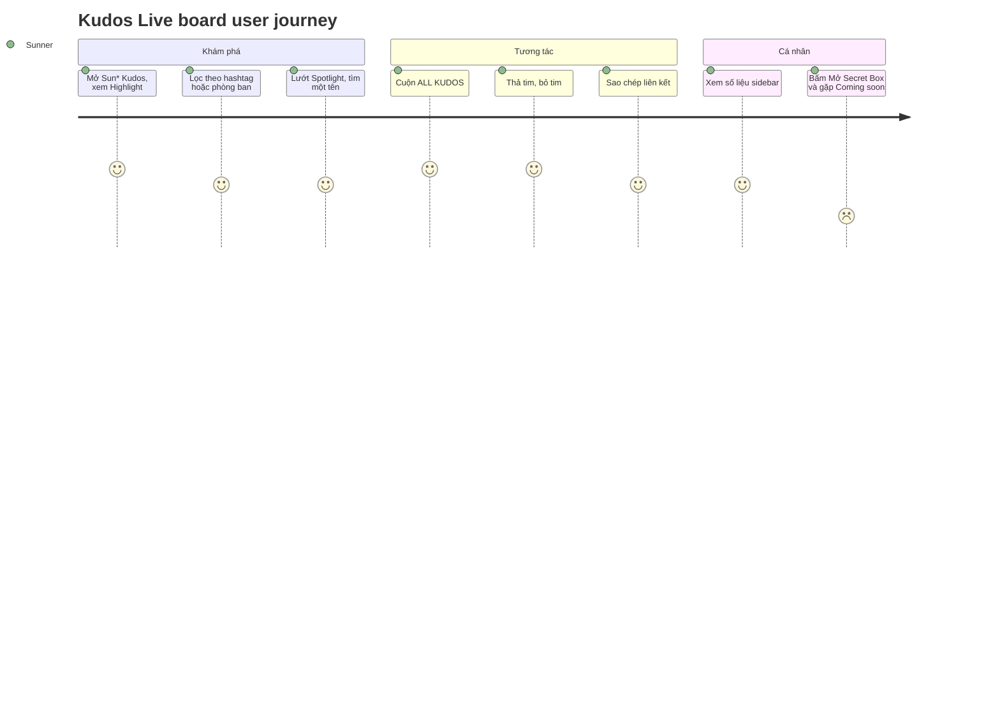

**Priority**: P1
**Type**: ui

## 1. Overview

**Problem:** Trang `/sun-kudos` hiện chỉ là trang "Coming soon", nên Sunner chưa có chỗ nào để xem lời cảm ơn mà đồng nghiệp gửi nhau, biết ai đang được ghi nhận nhiều, hay đáp lại bằng một cú thả tim.
**Solution:** Live board của Sun* Kudos gồm Highlight Kudos (5 kudo nhiều tim nhất, dạng carousel), Spotlight board (bảng tên người nhận), All Kudos (dòng thời gian cuộn vô hạn) và sidebar số liệu cá nhân. Người xem lọc theo hashtag hoặc phòng ban, thả tim hoặc bỏ tim, sao chép liên kết kudo. Dữ liệu lấy từ cơ sở dữ liệu thật; luật thả tim chạy ở phía máy chủ.
**Scope:** Trang `/sun-kudos` và đường giữ chỗ `/sun-kudos/<id>`; banner; Highlight và carousel; bộ lọc hashtag, phòng ban (lưu ở URL); All Kudos cuộn vô hạn; thả tim, bỏ tim, ngày đặc biệt; Copy Link và toast; Spotlight (tổng, node, tooltip, kéo và phóng to, tìm kiếm); sidebar số liệu, nút Secret Box, danh sách nhận quà mới nhất; huy hiệu danh hiệu và số sao; trạng thái rỗng; chuỗi vi/en; bảng dữ liệu, migration và seed.
**Non-Scope:** Dialog gửi Kudo "Viết Kudo", trang chi tiết Kudo, trang hồ sơ, xem trước hồ sơ khi rê chuột, dialog Secret Box thật (đều là màn khác; ở đây chỉ có modal "Coming soon" và route giữ chỗ), danh sách "10 SUNNER CÓ SỰ THĂNG HẠNG MỚI NHẤT" (có trong spec MoMorph nhưng khung Figma không vẽ), giao diện admin đặt ngày đặc biệt, sửa hoặc xóa kudo, nút "tải thêm" dự phòng ngoài cuộn vô hạn, thông báo thời gian thực khi có kudo mới.

**Actors**

| Actor | Description | Primary goal |
|-------|--------------|---------------|
| Sunner | Nhân viên đã đăng nhập; có thể là người gửi hoặc người nhận kudo; "người dùng hiện tại" là hàng `sunners` có `user_id` trùng tài khoản | Xem các lời cảm ơn nổi bật và mới nhất, tìm theo hashtag, phòng ban, thả tim, chia sẻ liên kết và xem số liệu của mình |

Feature này liên quan tới [F001_Auth](../../../../docs/features/F001_Auth/functional-spec.md) (guard đăng nhập, phiên), F002_Localization (từ điển vi/en), F003_Homepage (header, footer, liên kết "Sun* Kudos"), F005_CountdownPrelaunch (khóa trước ngày ra mắt áp trước trang này).

## 2. Functional Capabilities

| ID | Capability | What the user can do | User Stories | Requirements | Business Rules | Screens |
|----|------------|------------------------|-----------------|---------------|-------------------|---------|
| CAP-01 | Xem Highlight Kudos | Vào trang, xem năm kudo nhiều tim nhất trong carousel và chuyển qua lại giữa chúng | US001, US002 | FR-001, FR-002, FR-003, FR-004, FR-101, FR-102, FR-104, FR-105, FR-201, FR-202, FR-203, FR-204, FR-314, FR-601, FR-602, FR-604 | BR-001, BR-007, BR-009, BR-010, DEC-001, DEC-002, DEC-004, DEC-007 | TBD (draft) |
| CAP-02 | Lọc Kudos theo hashtag và phòng ban | Chọn một hashtag và một phòng ban, hoặc bấm hashtag trên thẻ, để Highlight và All Kudos chỉ còn kudo khớp; đường dẫn mang theo bộ lọc | US003 | FR-205, FR-206, FR-207, FR-208 | BR-008 | TBD (draft) |
| CAP-03 | Duyệt tất cả Kudos | Cuộn danh sách ALL KUDOS mới nhất trước, tự nạp thêm khi tới đáy | US004 | FR-301, FR-302 | BR-008, BR-009, DEC-004 | TBD (draft) |
| CAP-04 | Thả tim và chia sẻ Kudos | Thả tim hoặc bỏ tim một kudo của người khác; sao chép liên kết kudo | US005, US006 | FR-401, FR-402, FR-403, FR-404, FR-405, FR-406, FR-407, FR-603 | BR-002, BR-003, BR-004, BR-005, BR-006, DEC-003, SM-001 | TBD (draft) |
| CAP-05 | Khám phá Spotlight board | Xem tổng số kudo, tên người nhận trên bảng tối, rê chuột xem thời gian, kéo và phóng to, tìm một tên | US007 | FR-303, FR-304, FR-305, FR-306, FR-307, FR-308, FR-309 | BR-010, BR-011, DEC-005, SM-002 | TBD (draft) |
| CAP-06 | Xem số liệu cá nhân và người nhận quà mới nhất | Xem kudos nhận, gửi, tim nhận, Secret Box đã mở và chưa mở; xem 10 người nhận quà mới nhất | US008 | FR-310, FR-311, FR-312, FR-313 | BR-006, DEC-006 | TBD (draft) |
| CAP-07 | Vào các chức năng thuộc màn khác | Bấm thanh ghi nhận, tìm profile, Mở Secret Box thì thấy thông báo "Coming soon"; bấm kudo thì tới trang giữ chỗ | US009 | FR-103, FR-106 | — | TBD (draft) |

## 3. Open Decisions

| D### | Decision | Default proposal | Rationale | Blocks work |
|------|----------|-------------------|-----------|--------------|
| D001 | Đường dẫn và quyền vào | **Đã chốt:** `/sun-kudos` trong `app/(main)`, chỉ người đã đăng nhập; thay trang Coming soon (clarifications.md, 2026-10-14) | Header và footer đã trỏ tới đây; guard hiện có đủ | no |
| D002 | Dữ liệu tĩnh hay thật | **Đã chốt:** Postgres thật, migration đầu tiên của repo và `supabase/seed.sql` từ nội dung Figma | Spec ghi "query từ DB"; dữ liệu tĩnh là bản giả | no |
| D003 | Bảng dữ liệu | **Đã chốt:** `departments`, `sunners`, `hashtags`, `kudos`, `kudo_hashtags`, `kudo_images`, `kudo_likes`, `special_days`, `secret_boxes`; tên cuối do planner chốt, không thêm bảng | Tối thiểu cho màn này | no |
| D004 | Luật thả tim | **Đã chốt:** thi hành trong Postgres qua RPC `toggle_kudo_like` (một tim mỗi người mỗi kudo, người gửi không tim, ngày đặc biệt +2, bỏ tim thu hồi đúng số đã lưu) | Không để client tự quyết số tim | no |
| D005 | Bộ lọc | **Đã chốt:** hai dropdown đơn chọn, kết hợp AND, trạng thái ở URL `?hashtag=<slug>&department=<code>`; click hashtag trên thẻ đặt `hashtag` | Chia sẻ được, tải lại giữ nguyên | no |
| D006 | Phân trang All Kudos | **Đã chốt:** cuộn vô hạn, 10 dòng mỗi lần, mới nhất trước, con trỏ `(created_at, id)`; không có nút "tải thêm" dự phòng | YAGNI | no |
| D007 | Chức năng thuộc màn khác | **Đã chốt:** modal "Coming soon" và route giữ chỗ `/sun-kudos/<id>`; link hồ sơ tới `/profile`; không xem trước khi rê chuột | Đó là các màn MoMorph riêng | no |
| D008 | Spotlight | **Đã chốt:** tối đa 100 node tên người nhận (khác nhau, mới nhất trước), vị trí xác định theo băm `id`, kéo và phóng to bằng CSS, ô tìm kiếm rỗng không báo lỗi (spec thắng test case) | Không cần thư viện; spec "Không bắt buộc" | no |
| D009 | Sidebar | **Đã chốt:** theo khung Figma: năm số, nút Secret Box, danh sách nhận quà; không dựng danh sách thăng hạng | Figma thắng spec khi lệch | no |
| D010 | Pill "Tìm kiếm profile Sunner" cạnh thanh ghi nhận | **Đã chốt:** dựng theo Figma, mở cùng modal "Coming soon" như thanh ghi nhận | Figma có, spec không; tìm profile là màn khác | no |
| D011 | Dòng tiêu đề kudo "IDOL GIỚI TRẺ" và biểu tượng bút ở thẻ All Kudos | Đề xuất: một cột `title` hiển thị trên `kudos`, biểu tượng bút trang trí không tương tác | Figma có; spec MoMorph gọi nó là hashtag bấm được; nguồn dữ liệu chưa rõ | no |
| D012 | Click ảnh đính kèm | Đề xuất: mở ảnh gốc ở tab mới | Spec chỉ ghi "mở ảnh lớn" | no |
| D013 | Người đăng nhập chưa có hàng `sunners` | Đề xuất: số liệu sidebar là 0; thả tim báo lỗi (RPC `sunner_not_found`), không tự tạo hàng | Nhỏ hơn phương án tự tạo | no |
| D014 | Giá trị lạ của `hashtag`, `department` trong URL | Đề xuất: bỏ qua, coi như không lọc | Không làm hỏng trang vì link cũ | no |
| D015 | Cách khớp tên khi tìm trong Spotlight | Đề xuất: không phân biệt hoa thường và bỏ dấu tiếng Việt | Người dùng thường gõ không dấu | no |
| D016 | Chuỗi mới: toast lỗi (tim, clipboard, tải thêm) và bản EN của mọi nhãn | Đề xuất: người dựng thêm chuỗi vi/en ngắn, chờ xác nhận | Figma chỉ có bản VI và chữ "Link copied — ready to share!" | no |
| D017 | Phạm vi phóng to Spotlight | Đề xuất: 0.5 đến 3 | Chưa có số trong spec | no |
| D018 | "Ngày đặc biệt" tính theo múi giờ nào | Đề xuất: ngày theo Asia/Ho_Chi_Minh lúc thả tim | Cả app dùng giờ VN | no |
| D019 | Test case MoMorph "ô tìm kiếm báo bắt buộc" | **Đã chốt:** bỏ qua, spec "Không bắt buộc" thắng | Hai nguồn mâu thuẫn | no |

## 4. Requirements

### Foundation (0xx)

- **FR-001** Mọi số liệu và nội dung (kudo, hashtag, phòng ban, người dùng, tim, Secret Box) lấy từ cơ sở dữ liệu thật, seed từ nội dung Figma; mã không giữ mảng dữ liệu cứng.
- **FR-002** Chuỗi giao diện lấy từ từ điển vi/en, hai bản khớp khóa; tên, lời nhắn và hashtag của người dùng không dịch.
- **FR-003** Thời gian kudo hiển thị theo mẫu `HH:mm - MM/DD/YYYY` ở múi giờ Asia/Ho_Chi_Minh; số tim phân nghìn bằng dấu chấm (ví dụ "1.000"); cả hai không phụ thuộc đồng hồ hay locale của máy người dùng.
- **FR-004** Cạnh tên người gửi và người nhận có số sao theo số kudo đã nhận (từ 10 một sao, từ 20 hai sao, từ 50 ba sao, dưới 10 không sao) và huy hiệu danh hiệu (New Hero, Rising Hero, Super Hero, Legend Hero) nếu có; rê vào sao hiện mô tả mức sao.

### Navigation (1xx)

- **FR-101** `/sun-kudos` chỉ cho người đã đăng nhập; khách được chuyển về `/login`.
- **FR-102** Trang có header và footer chung của `(main)`, rồi từ trên xuống: banner "Hệ thống ghi nhận và cảm ơn" với logo KUDOS, thanh ghi nhận, Highlight Kudos, Spotlight board, All Kudos kèm sidebar bên phải.
- **FR-103** Thanh ghi nhận, pill "Tìm kiếm profile Sunner" và nút "Mở Secret Box" cùng mở một modal "Coming soon" có nút đóng.
- **FR-104** Bấm thẻ kudo, nội dung kudo, "Xem chi tiết" hoặc một node Spotlight dẫn tới `/sun-kudos/<kudoId>`.
- **FR-105** Bấm avatar hoặc tên người gửi, người nhận, người nhận quà dẫn tới `/profile`; rê chuột không hiện bản xem trước hồ sơ.
- **FR-106** `/sun-kudos/<id>` là trang giữ chỗ hiện "Coming soon" trong header và footer chung, sau guard đăng nhập, với mọi `id`.

### Kudos Live board — Highlight và bộ lọc (2xx)

- **FR-201** Highlight Kudos gồm tối đa 5 kudo nhiều tim nhất sau khi áp bộ lọc; bằng số tim thì kudo mới hơn đứng trước.
- **FR-202** Carousel hiển thị thẻ hiện tại rõ ở giữa, hai thẻ bên mờ và không tương tác; chỉ số "n/N" giữa hai mũi tên; mũi tên lùi vô hiệu ở thẻ đầu, mũi tên tiến vô hiệu ở thẻ cuối; đổi bộ lọc đưa về thẻ đầu.
- **FR-203** Highlight không có kudo nào thì chỉ hiện "Hiện tại chưa có Kudos nào.".
- **FR-204** Thẻ kudo hiển thị: người gửi, mũi tên, người nhận (avatar, tên, phòng ban, sao, danh hiệu), thời gian, nội dung (Highlight tối đa 3 dòng, All Kudos tối đa 5 dòng, quá thì "..."), hashtag trên một dòng tối đa 5 (quá thì "..."), số tim kèm biểu tượng tim, "Copy Link"; Highlight có thêm "Xem chi tiết"; All Kudos có thêm tối đa 5 ảnh thu nhỏ xếp ngang, bấm ảnh mở ảnh lớn (D012).
- **FR-205** Hai dropdown "Hashtag" và "Phòng ban" lấy tùy chọn từ cơ sở dữ liệu, mỗi bên chọn một và có lựa chọn bỏ lọc; hai bên kết hợp AND.
- **FR-206** Trạng thái lọc nằm ở URL (`?hashtag=<slug>&department=<code>`): đổi lọc đổi URL, tải lại hoặc gửi link giữ nguyên lọc; giá trị lạ trong URL bị bỏ qua (D014).
- **FR-207** Bấm một hashtag trên thẻ đặt bộ lọc hashtag bằng hashtag đó, giữ nguyên bộ lọc phòng ban.
- **FR-208** Bộ lọc áp cho cả Highlight lẫn All Kudos và dựng lại từ máy chủ; Spotlight và sidebar không đổi theo bộ lọc.

### Kudos Live board — Spotlight, All Kudos, sidebar (3xx)

- **FR-301** All Kudos hiển thị mới nhất trước, 10 thẻ mỗi lần; tới đáy thì tự nạp thêm 10 theo cuộn vô hạn, không trùng và không sót thẻ; hết dữ liệu thì dừng.
- **FR-302** All Kudos không có kudo nào (sau lọc) thì hiện "Hiện tại chưa có Kudos nào.".
- **FR-303** Spotlight có tiêu đề "<tổng> KUDOS" với tổng số kudo trong cơ sở dữ liệu, không phụ thuộc bộ lọc.
- **FR-304** Spotlight vẽ tên người nhận (mỗi người một node, mới nhất trước, tối đa 100) rải trên bảng tối, vị trí cố định theo từng người nên không đổi giữa các lần tải.
- **FR-305** Rê vào node hiện tooltip "tên · HH:mm - MM/DD/YYYY" của kudo mới nhất của người đó; bấm node mở kudo đó (FR-104).
- **FR-306** Nút Pan/Zoom (tooltip "Pan/Zoom") bật tắt chế độ kéo canvas bằng chuột và phóng to thu nhỏ bằng lăn chuột; khi tắt, lăn chuột cuộn trang như thường.
- **FR-307** Ô tìm kiếm Spotlight (placeholder "Tìm kiếm", biểu tượng kính lúp) nhận tối đa 100 ký tự, không bắt buộc; Enter hoặc bấm kính lúp làm nổi bật node có tên khớp; ô rỗng thì bỏ nổi bật, không báo lỗi.
- **FR-308** Spotlight có ba trạng thái: đang tải (khung chờ), không có dữ liệu ("Chưa có dữ liệu"), và tương tác được.
- **FR-309** Dòng hoạt động chạy ở góc trái dưới Spotlight liệt kê 5 kudo mới nhất; chỉ để xem.
- **FR-310** Sidebar hiện cho người dùng hiện tại: số kudo nhận, số kudo đã gửi, số tim nhận, số Secret Box đã mở, số Secret Box chưa mở; nút "Mở Secret Box" vô hiệu khi số chưa mở bằng 0, ngược lại mở modal (FR-103).
- **FR-311** Người đăng nhập chưa có hồ sơ Sunner thì cả năm số hiển thị 0.
- **FR-312** Hộp "10 SUNNER NHẬN QUÀ MỚI NHẤT" liệt kê 10 hộp đã mở gần nhất (avatar, tên, mô tả quà); chưa có thì hiện "Chưa có dữ liệu".
- **FR-313** Sidebar dính (sticky) cạnh feed và có thanh cuộn riêng khi dài hơn khung nhìn.
- **FR-314** Dưới 1024px sidebar xếp chồng với feed, carousel chỉ một thẻ, không có thanh cuộn ngang ở 375px.

### Interaction (4xx)

- **FR-401** Bấm biểu tượng tim đổi giữa tim xám (chưa tim) và tim đỏ (đã tim) và đổi số tim đúng 1; nút vô hiệu tạm trong lúc chờ máy chủ.
- **FR-402** Nút tim bị vô hiệu cho người đã gửi kudo đó.
- **FR-403** Mỗi người chỉ có một lượt tim cho một kudo; bấm lần nữa là bỏ tim.
- **FR-404** Mỗi lượt tim cộng tim cho người gửi kudo: 1 tim ngày thường, 2 tim nếu thả vào ngày đặc biệt do admin đặt; bỏ tim thu hồi đúng số đã cộng lúc thả.
- **FR-405** Thả tim lỗi (mạng, bị từ chối) thì trạng thái và số về như trước, kèm toast lỗi ngắn.
- **FR-406** "Copy Link" sao chép `<origin>/sun-kudos/<kudoId>` và hiện toast "Link copied — ready to share!" (cùng chữ ở hai ngôn ngữ), tự ẩn sau khoảng 3 giây.
- **FR-407** Sao chép thất bại (trình duyệt chặn) thì hiện toast lỗi, không hiện toast thành công.

### Security (6xx)

- **FR-601** Luật thả tim (một tim mỗi người, người gửi không tim, ngày đặc biệt, thu hồi) được thi hành ở cơ sở dữ liệu; client không ghi trực tiếp lượt tim.
- **FR-602** Người đã đăng nhập chỉ đọc được dữ liệu của màn này; không ghi trực tiếp vào bảng nào từ trình duyệt.
- **FR-603** Người đăng nhập không có hồ sơ Sunner gọi thả tim thì bị từ chối, hệ thống không tạo gì thêm.
- **FR-604** Nội dung do người dùng nhập (tên, lời nhắn, hashtag) luôn hiển thị như văn bản thuần, không diễn giải thành HTML.

## 5. Business Rules

- Chỉ người đã đăng nhập vào `/sun-kudos` và các đường dẫn con; guard hiện có đã đủ (BR-001)
- Mỗi người chỉ có một lượt tim cho một kudo; bấm lần hai là bỏ tim (BR-002)
- Người gửi không được thả tim kudo của chính mình (BR-003)
- Tim thả vào ngày đặc biệt cộng 2 tim cho người gửi, ngày thường cộng 1; số đã cộng được ghi lại theo từng lượt tim (BR-004)
- Bỏ tim thu hồi đúng số tim đã ghi lúc thả, không tính lại theo ngày hôm nay (BR-005)
- Tổng tim của một người là tổng số tim đã cộng của các lượt tim trên kudo họ gửi, không lưu riêng (BR-006)
- Highlight là 5 kudo nhiều tim nhất sau lọc, hòa thì kudo mới hơn đứng trước (BR-007)
- Bộ lọc hashtag và phòng ban kết hợp AND, mỗi bên chọn một, nằm ở URL; áp cho Highlight và All Kudos, không áp cho Spotlight và sidebar (BR-008)
- Số sao theo số kudo nhận: từ 10 một sao, từ 20 hai sao, từ 50 ba sao (BR-009)
- Thời gian hiển thị `HH:mm - MM/DD/YYYY` giờ Việt Nam; số tim phân nghìn bằng dấu chấm (BR-010)
- Tìm kiếm Spotlight không bắt buộc, tối đa 100 ký tự; rỗng nghĩa là bỏ nổi bật (BR-011)
- Truy cập `/sun-kudos`: chưa đăng nhập chuyển về `/login`, đã đăng nhập thấy trang (DEC-001)
- Mũi tên carousel: vô hiệu ở đầu và cuối, cả hai vô hiệu khi chỉ có một thẻ (DEC-002)
- Nút tim: vô hiệu cho người gửi, xám khi chưa tim, đỏ khi đã tim, tạm vô hiệu khi chờ, lỗi thì trả về trạng thái trước (DEC-003)
- Highlight hoặc All Kudos không có kudo thì hiện "Hiện tại chưa có Kudos nào." (DEC-004)
- Spotlight: đang tải hiện khung chờ, không có dữ liệu hiện "Chưa có dữ liệu", có dữ liệu thì tương tác được (DEC-005)
- Sidebar: không có hồ sơ Sunner thì số liệu là 0; nút "Mở Secret Box" vô hiệu khi chưa mở bằng 0; danh sách nhận quà rỗng hiện "Chưa có dữ liệu" (DEC-006)
- Huy hiệu danh hiệu chỉ hiện khi người đó có danh hiệu; số sao dưới 10 kudo thì không hiện sao (DEC-007)
- Trạng thái tim của một kudo với người dùng hiện tại: chưa tim, đã tim, đang chờ, vô hiệu (SM-001)
- Chế độ bảng Spotlight: đứng yên hoặc kéo và phóng to (SM-002)

## 6. Screens

| Screen Name | SCR### | What User Sees | What User Can Do |
|-------------|--------|-----------------|-------------------|
| Sun* Kudos - Live board | TBD (draft) | Banner KUDOS, thanh ghi nhận, Highlight (carousel 5 thẻ), Spotlight board, ALL KUDOS và sidebar số liệu | Lọc, chuyển slide, thả tim, sao chép liên kết, kéo, phóng to, tìm tên trên Spotlight, cuộn nạp thêm, mở modal "Coming soon" |

Chi tiết bố cục và phần tử: `screens/SCR-kudos-live-board/spec.md`.

### User Journey

1. Sunner mở "Sun* Kudos" từ header và thấy banner cùng Highlight Kudos.
2. Họ bấm hai mũi tên xem các kudo nổi bật, chọn hashtag hoặc phòng ban để thu hẹp.
3. Họ lướt Spotlight, rê chuột lên một tên để xem thời gian, gõ tên đồng nghiệp để tìm.
4. Họ cuộn tới ALL KUDOS, thả tim kudo hay, sao chép liên kết để gửi người khác.
5. Họ nhìn sidebar xem số kudo, tim, Secret Box của mình; bấm "Mở Secret Box" hoặc thanh ghi nhận thì thấy "Coming soon".

## 7. User Stories

### US001 — Vào Live board của Sun* Kudos

**Actor:** Sunner
**Goal:** Mở trang Sun* Kudos và thấy toàn bộ bảng ghi nhận.
**Business value:** Cho mọi người một nơi chung để thấy văn hóa cảm ơn của công ty, thay vì trang trống.

**Acceptance Criteria:**
- [ ] Đã đăng nhập, mở `/sun-kudos` thì thấy banner, thanh ghi nhận, Highlight, Spotlight, All Kudos và sidebar
- [ ] Chưa đăng nhập thì được chuyển về `/login`
- [ ] Chữ hiển thị theo ngôn ngữ đã chọn (vi hoặc en); tên và lời nhắn giữ nguyên

### US002 — Xem Highlight Kudos

**Actor:** Sunner
**Goal:** Xem và duyệt các kudo được thả tim nhiều nhất.
**Business value:** Làm nổi bật những lời cảm ơn có sức lan tỏa, khuyến khích ghi nhận.

**Acceptance Criteria:**
- [ ] Highlight có tối đa 5 thẻ theo tim giảm dần, hòa thì mới trước
- [ ] Thẻ giữa rõ, hai bên mờ, chỉ số "n/N" đúng; nút lùi vô hiệu ở thẻ đầu, nút tiến vô hiệu ở thẻ cuối
- [ ] Không có kudo thì hiện "Hiện tại chưa có Kudos nào."

### US003 — Lọc Kudos theo hashtag và phòng ban

**Actor:** Sunner
**Goal:** Thu hẹp Highlight và All Kudos theo hashtag và phòng ban.
**Business value:** Giúp tìm lời cảm ơn theo giá trị cốt lõi hoặc đội nhóm mình quan tâm.

**Acceptance Criteria:**
- [ ] Chọn hashtag hoặc phòng ban thì cả hai danh sách chỉ còn kudo khớp, tổ hợp là AND
- [ ] URL phản ánh bộ lọc; tải lại giữ nguyên
- [ ] Bấm hashtag trên thẻ đặt bộ lọc hashtag đó, giữ bộ lọc phòng ban
- [ ] Có lựa chọn bỏ lọc ở mỗi dropdown

### US004 — Duyệt tất cả Kudos

**Actor:** Sunner
**Goal:** Đọc dòng thời gian mọi lời cảm ơn, mới nhất trước, mà không phải bấm chuyển trang.
**Business value:** Dòng chảy ghi nhận liên tục, dễ khám phá.

**Acceptance Criteria:**
- [ ] 10 thẻ đầu hiện khi mở trang; cuộn tới đáy nạp thêm 10, không trùng
- [ ] Hết dữ liệu thì dừng nạp
- [ ] Không có kudo thì hiện "Hiện tại chưa có Kudos nào."
- [ ] Nội dung dài bị cắt ở 5 dòng với "...", hashtag một dòng tối đa 5

### US005 — Thả tim và bỏ tim cho một kudo

**Actor:** Sunner
**Goal:** Bày tỏ sự ủng hộ với một lời cảm ơn và rút lại khi muốn.
**Business value:** Thả tim cộng tim cho người gửi, khuyến khích gửi kudo.

**Acceptance Criteria:**
- [ ] Bấm tim thì tim đỏ và số tăng 1; bấm lần nữa thì xám và giảm 1
- [ ] Người gửi kudo không bấm được tim kudo của mình
- [ ] Người gửi nhận 1 tim cho mỗi lượt, 2 tim nếu thả vào ngày đặc biệt; bỏ tim thu hồi đúng số đã cộng
- [ ] Lỗi thì trạng thái trở về như trước và có thông báo ngắn

### US006 — Sao chép liên kết kudo

**Actor:** Sunner
**Goal:** Lấy liên kết một kudo để chia sẻ.
**Business value:** Lan tỏa lời cảm ơn ra ngoài trang.

**Acceptance Criteria:**
- [ ] Bấm "Copy Link" đặt `<origin>/sun-kudos/<kudoId>` vào clipboard
- [ ] Hiện toast "Link copied — ready to share!" rồi tự ẩn sau khoảng 3 giây
- [ ] Clipboard bị chặn thì hiện toast lỗi

### US007 — Khám phá Spotlight board

**Actor:** Sunner
**Goal:** Nhìn tổng quan ai đã nhận kudo và tìm một đồng nghiệp trên bảng.
**Business value:** Cho thấy quy mô ghi nhận toàn công ty và dễ tìm người.

**Acceptance Criteria:**
- [ ] Tiêu đề "<tổng> KUDOS" khớp tổng trong cơ sở dữ liệu
- [ ] Tối đa 100 tên, rê chuột có tooltip tên và thời gian; bấm tên mở kudo
- [ ] Pan/Zoom bật thì kéo và lăn chuột có tác dụng, tắt thì không
- [ ] Tìm tên làm nổi bật; ô rỗng thì hết nổi bật, không báo lỗi; tối đa 100 ký tự
- [ ] Đang tải có khung chờ; không có dữ liệu hiện "Chưa có dữ liệu"

### US008 — Xem số liệu cá nhân và người nhận quà mới nhất

**Actor:** Sunner
**Goal:** Biết mình đã nhận, gửi bao nhiêu kudo, bao nhiêu tim và Secret Box, và ai vừa nhận quà.
**Business value:** Động lực tham gia và nhìn thấy phần thưởng.

**Acceptance Criteria:**
- [ ] Năm số khớp dữ liệu của người đang đăng nhập; chưa có hồ sơ Sunner thì toàn 0
- [ ] "Mở Secret Box" vô hiệu khi chưa mở bằng 0
- [ ] Danh sách nhận quà có tối đa 10 dòng mới nhất; rỗng thì "Chưa có dữ liệu"

### US009 — Nhận biết chức năng chưa mở

**Actor:** Sunner
**Goal:** Biết các lối vào chưa sẵn sàng (gửi kudo, tìm profile, mở Secret Box, chi tiết kudo) thay vì gặp nút chết hoặc lỗi.
**Business value:** Trải nghiệm không gãy khi các màn kế tiếp chưa xong.

**Acceptance Criteria:**
- [ ] Bấm thanh ghi nhận, pill tìm profile hoặc "Mở Secret Box" thì hiện modal "Coming soon" có nút đóng
- [ ] Bấm kudo hoặc "Xem chi tiết" tới `/sun-kudos/<id>` hiện "Coming soon"
- [ ] Bấm avatar hoặc tên tới `/profile`

## 8. Scenarios

### US001 — Happy Path

**Given** Sunner đã đăng nhập, **When** mở `/sun-kudos`, **Then** thấy banner, Highlight, Spotlight, All Kudos và sidebar.

### US001 — Error: chưa đăng nhập

**Given** khách chưa đăng nhập, **When** mở `/sun-kudos`, **Then** được chuyển về `/login`.

### US002 — Happy Path

**Given** có 7 kudo với số tim khác nhau, **When** mở trang, **Then** Highlight có 5 thẻ theo tim giảm dần; bấm mũi tên tiến thì chỉ số "2/5".

### US002 — Error: không có kudo

**Given** bộ lọc không khớp kudo nào, **When** nhìn Highlight, **Then** chỉ có chữ "Hiện tại chưa có Kudos nào.", không mũi tên.

### US003 — Happy Path

**Given** có kudo gắn "#Dedicated" ở nhiều phòng ban, **When** chọn hashtag "#Dedicated" rồi phòng ban "CEVC10", **Then** URL có cả hai tham số và cả hai danh sách chỉ còn kudo khớp cả hai.

### US003 — Error: giá trị lạ trong URL

**Given** URL có `hashtag=khong-ton-tai`, **When** mở trang, **Then** trang hiện như không lọc, không lỗi.

### US004 — Happy Path

**Given** có 25 kudo, **When** cuộn tới đáy hai lần, **Then** số thẻ là 10, 20, rồi 25, không thẻ nào lặp.

### US004 — Error: không có kudo

**Given** chưa có kudo, **When** mở trang, **Then** All Kudos hiện "Hiện tại chưa có Kudos nào." và không nạp thêm.

### US005 — Happy Path

**Given** Sunner B chưa tim kudo của Sunner A, **When** B bấm tim, **Then** tim đỏ, số tăng 1, A được cộng 1 tim (hoặc 2 nếu hôm nay là ngày đặc biệt); B bấm lần nữa thì tim xám, số giảm 1, A bị thu hồi đúng số đó.

### US005 — Error: tự tim và lỗi

**Given** A mở kudo do chính A gửi, **When** nhìn nút tim, **Then** nút vô hiệu. **Given** mạng lỗi khi B bấm tim, **When** máy chủ không trả lời, **Then** tim và số về như trước và hiện toast lỗi.

### US006 — Happy Path

**Given** một thẻ kudo, **When** bấm "Copy Link", **Then** clipboard có `<origin>/sun-kudos/<kudoId>` và toast "Link copied — ready to share!" hiện rồi tự ẩn.

### US006 — Error: clipboard bị chặn

**Given** trình duyệt từ chối ghi clipboard, **When** bấm "Copy Link", **Then** hiện toast lỗi, không có toast thành công.

### US007 — Happy Path

**Given** Spotlight có dữ liệu, **When** rê chuột lên một tên, **Then** tooltip hiện tên và thời gian của kudo mới nhất; bấm tên thì tới `/sun-kudos/<id>`.

### US007 — Error: tìm không thấy và không có dữ liệu

**Given** gõ một tên không có rồi Enter, **When** không node nào khớp, **Then** không node nào nổi bật, không báo lỗi. **Given** cơ sở dữ liệu chưa có kudo, **When** mở trang, **Then** Spotlight hiện "Chưa có dữ liệu".

### US008 — Happy Path

**Given** Sunner có 25 kudo nhận và 3 Secret Box chưa mở, **When** nhìn sidebar, **Then** các số khớp và nút "Mở Secret Box" bấm được.

### US008 — Error: không có hồ sơ Sunner

**Given** người đăng nhập không có hàng `sunners`, **When** mở trang, **Then** năm số bằng 0 và nút "Mở Secret Box" vô hiệu.

### US009 — Happy Path

**Given** Sunner đã đăng nhập, **When** bấm thanh ghi nhận, **Then** modal "Coming soon" hiện; bấm đóng hoặc Esc thì đóng.

### US009 — Error: kudo không tồn tại

**Given** liên kết `/sun-kudos/khong-co`, **When** mở, **Then** vẫn thấy "Coming soon", không trang lỗi.

## 9. Edge Cases

| Scenario | What Happens | User-Facing Message |
|----------|--------------|----------------------|
| Bộ lọc không khớp kudo nào | Highlight và All Kudos đều rỗng; Spotlight và sidebar giữ nguyên | "Hiện tại chưa có Kudos nào." |
| Giá trị `hashtag` hoặc `department` lạ trong URL | Bỏ tham số, coi như không lọc | "None — silent handling" |
| Highlight có đúng một kudo | Chỉ số "1/1", hai mũi tên vô hiệu | "None" |
| Hơn 5 hashtag hoặc dài quá một dòng | Một dòng, tối đa 5, phần dư là "..." | "..." |
| Nội dung dài quá 3 dòng (Highlight) hoặc 5 dòng (All Kudos) | Cắt và thêm "..." | "..." |
| Bấm tim hai lần rất nhanh | Nút vô hiệu giữa hai lần; chỉ một yêu cầu tại một thời điểm | "None" |
| Hai thiết bị của một người cùng tim một kudo | Chỉ một lượt tim tồn tại; lần còn lại được đồng bộ lại | "None — silent handling" |
| Thả tim ngày thường, bỏ tim sau khi ngày đặc biệt bắt đầu | Thu hồi 1 tim (số đã lưu), không phải 2 | "None" |
| Người đăng nhập chưa có hồ sơ Sunner bấm tim | Từ chối, trạng thái về như trước | Toast lỗi ngắn (chuỗi chờ xác nhận, D016) |
| Có kudo mới chèn đầu khi đang cuộn | Danh sách không trùng, không sót; kudo mới thấy khi tải lại | "None" |
| Lỗi mạng khi nạp thêm | Dừng ở dòng "đang tải" rồi cho thử lại ở lần cuộn kế | Thông báo ngắn (chuỗi chờ xác nhận, D016) |
| Hơn 100 người nhận khác nhau | Spotlight chỉ vẽ 100 người có kudo mới nhất; tổng vẫn là tổng thật | "None" |
| Một người nhận nhiều kudo | Một node, tooltip và liên kết theo kudo mới nhất | "None" |
| Kéo canvas rồi thả trên một node | Không mở kudo (không tính là bấm) | "None" |
| Dán hơn 100 ký tự vào ô tìm kiếm | Cắt ở 100 ký tự | "None — silent handling" |
| Clipboard bị chặn | Không toast thành công | Toast lỗi ngắn (chuỗi chờ xác nhận, D016) |
| Mở `/sun-kudos/<id>` không tồn tại | Vẫn là trang "Coming soon" | "Coming soon" |

## 10. Edge Behaviours to Verify

- **FR-101** → Khách mở `/sun-kudos` hoặc `/sun-kudos/<id>` bị đưa về `/login`
- **FR-201** → Highlight đúng thứ tự tim, hòa thì mới trước, tối đa 5
- **FR-202** → Nút lùi vô hiệu ở thẻ đầu, nút tiến vô hiệu ở thẻ cuối, đổi lọc về thẻ đầu
- **FR-203** → Không có kudo thì chỉ hiện chữ rỗng, không mũi tên
- **FR-204** → Thời gian đúng giờ Việt Nam, nội dung cắt đúng số dòng, tối đa 5 hashtag và 5 ảnh
- **FR-206** → Đổi lọc đổi URL, tải lại giữ lọc, giá trị lạ không làm lỗi
- **FR-207** → Bấm hashtag trên thẻ giữ bộ lọc phòng ban
- **FR-301** → Cuộn nạp thêm 10, không trùng, hết thì dừng
- **FR-303** → Tiêu đề Spotlight bằng tổng kudo thật và không đổi khi lọc
- **FR-307** → Ô tìm kiếm rỗng không báo lỗi, tối đa 100 ký tự
- **FR-310** → Nút "Mở Secret Box" vô hiệu khi chưa mở bằng 0
- **FR-311** → Không có hồ sơ Sunner thì toàn 0
- **FR-402** → Người gửi thấy nút tim vô hiệu
- **FR-403** → Một người chỉ một tim cho một kudo
- **FR-404** → Ngày đặc biệt +2, ngày thường +1, bỏ tim thu hồi đúng số đã cộng
- **FR-405** → Lỗi thả tim trả về trạng thái cũ
- **FR-406** → Link đúng dạng, toast hiện rồi tự ẩn sau khoảng 3 giây
- **FR-601** → Client không ghi trực tiếp lượt tim; luật chạy ở cơ sở dữ liệu
- **FR-604** → Lời nhắn chứa ký tự HTML hiển thị như chữ

## 11. Risks & Known Issues

| ID | Type | Description | Impact | Status |
|----|------|--------------|--------|--------|
| RISK-01 | risk | Đây là feature đầu tiên của repo dùng cơ sở dữ liệu thật: migration, RLS và RPC `SECURITY DEFINER` đều mới; lỗi quyền hoặc `search_path` ảnh hưởng toàn bộ dữ liệu | Phải kiểm SQL thật (`@smoke` hoặc `supabase db reset`) ngoài E2E dùng mock | design-level |
| RISK-02 | risk | E2E dùng mock Supabase tự dựng; mock lệch với SQL thật thì test xanh mà bản thật sai luật tim | Kiểm SQL thật riêng; giữ mock bám cùng một bảng luật | design-level |
| RISK-03 | risk | Spotlight dùng vị trí băm theo `id`, node có thể chồng nhau khi dày | Chấp nhận ở bản đầu; không phụ thuộc thư viện bố trí | [NEEDS_DOMAIN_CONFIRMATION] |
| RISK-04 | risk | Figma chỉ có khung 1440 và bản VI; hành vi dưới 1024px và chuỗi EN là suy ra | Xem D016 và `screens/SCR-kudos-live-board/spec.md` mục 10 | [NEEDS_DOMAIN_CONFIRMATION] |

## 12. Dependencies

| Dependency | Type | Why this feature needs it | Evidence |
|------------|------|-----------------------------|----------|
| F001_Auth | feature | Phiên người dùng, guard đăng nhập của proxy và layout `(main)`; `auth.uid()` cho RPC | FR-101, FR-601, FR-603 |
| F002_Localization | feature | Từ điển vi/en và cookie ngôn ngữ | FR-002 |
| F003_Homepage | feature | Header, footer, liên kết "Sun* Kudos", kiểu dropdown và font | FR-102, FR-205 |
| F005_CountdownPrelaunch | feature | Trước ngày ra mắt proxy khóa mọi đường dẫn, kể cả trang này | FR-101 |
| Supabase Postgres (migration, seed, RPC, RLS) | external-service | Lưu và truy vấn kudo, tim, người dùng, Secret Box | FR-001, FR-601, FR-602 |
| Thiết kế MoMorph/Figma "Sun* Kudos - Live board" (screen `MaZUn5xHXZ`, node `2940:13431`) | external-service | Bố cục, hình, chữ, kích thước, tài liệu hành vi | FR-102, FR-204 |
| Màn gửi Kudo, chi tiết Kudo, hồ sơ, Secret Box (màn MoMorph khác) | feature | Đích thật của các lối vào hiện là "Coming soon" | FR-103, FR-104, FR-105 |

## 13. Configuration

- Ngày đặc biệt (tim đáng 2) do admin đặt trong bảng `special_days` của cơ sở dữ liệu; feature này chỉ đọc, chưa có giao diện đặt.
- Hằng số cố định trong mã (không phải cấu hình người dùng): 10 kudo mỗi lần nạp, 5 kudo Highlight, tối đa 100 node Spotlight, mốc sao 10, 20, 50, toast khoảng 3 giây, múi giờ Asia/Ho_Chi_Minh.
