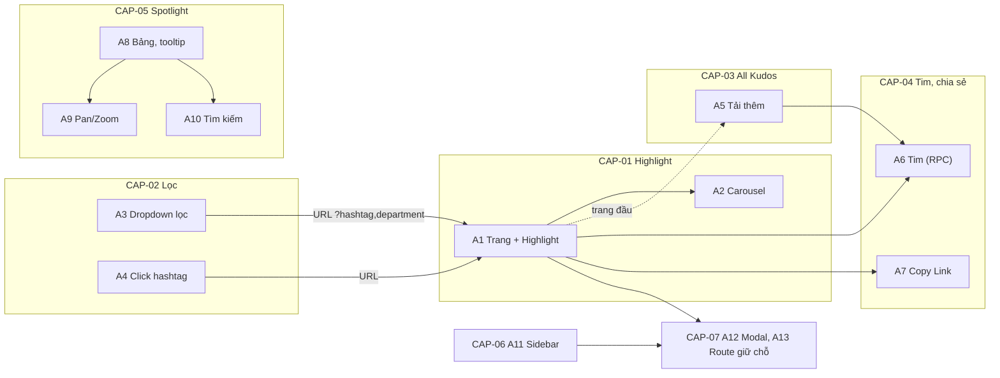
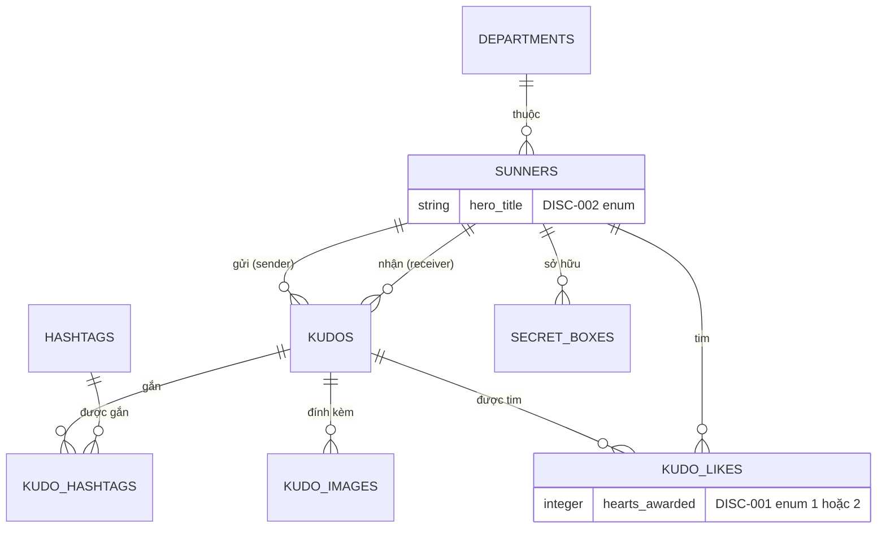
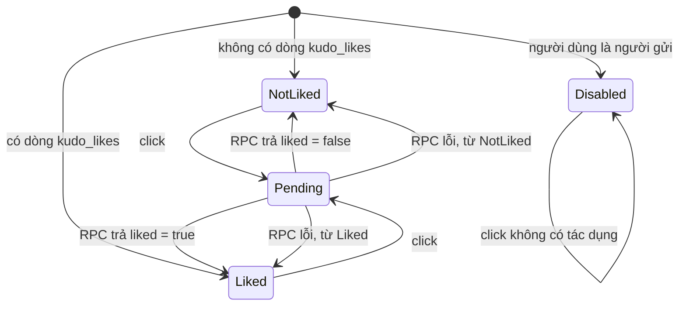
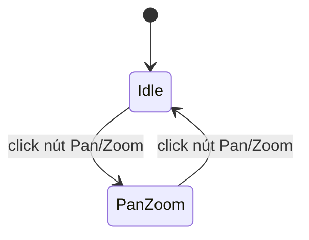

# F000_KudosLiveBoard

## 1. Technical Overview

Feature thay trang giữ chỗ `/sun-kudos` (nhóm `(main)`) bằng trang Live board: banner, Highlight Kudos (top 5 theo số tim, carousel), Spotlight board, All Kudos (cuộn vô hạn) và sidebar thống kê. Đây là feature đầu tiên của repo có dữ liệu thật: chín bảng Postgres mới (migration đầu tiên trong `supabase/migrations/` + `supabase/seed.sql` seed từ nội dung Figma), đọc bằng client Supabase phía máy chủ, và một RPC `SECURITY DEFINER` `toggle_kudo_like` giữ toàn bộ luật thả tim. Bộ lọc hashtag/phòng ban sống trong URL (`?hashtag=<slug>&department=<code>`) nên Highlight và All Kudos dựng lại từ máy chủ; Spotlight và sidebar không phụ thuộc bộ lọc. Dialog gửi Kudo, trang chi tiết, hồ sơ, hộp Secret Box là màn khác: ở đây chỉ có modal Coming soon và route giữ chỗ `/sun-kudos/<id>`.



## 2. Action Index

| # | Action (handler) | Method · Path | Codes | Writes | Detail |
|---|---|---|---|---|---|
| **A0** | *cross-cutting — belongs to no single action* | — | FR-001, FR-002, FR-003, FR-601, FR-602, FR-604, BR-001, BR-010 | — | § 4.4 |
| **A1** | `SunKudosPage` (planned) | `GET` `/sun-kudos` | FR-004, FR-101, FR-102, FR-104, FR-105, FR-201, FR-203, FR-204, FR-208, FR-314, FR-301, FR-302, BR-007, BR-008, BR-009, DEC-001, DEC-004, DEC-007, ALG-001, ALG-002, INT-001, US001, US002, US004 | — *(read-only)* | § 3.1 |
| **A2** | `HighlightCarousel#navigate` (planned) | browser · click mũi tên | FR-202, DEC-002, US002 | — *(read-only)* | § 3.1 |
| **A3** | `KudosFilterBar#select` (planned) | browser · chọn trong dropdown → đổi URL | FR-205, FR-206, BR-008, US003 | — *(read-only)* | § 3.2 |
| **A4** | `KudoHashtag#click` (planned) | browser · click hashtag trên thẻ → đổi URL | FR-207, BR-008, US003 | — *(read-only)* | § 3.2 |
| **A5** | `loadMoreKudos` (planned, server action) | `POST` server action · cuộn tới mốc | FR-301, FR-302, FR-004, BR-008, BR-009, ALG-004, INT-001, US004 | — *(read-only)* | § 3.3 |
| **A6** | `toggleKudoLikeAction` (planned, server action) → RPC `toggle_kudo_like` | `POST` server action · click tim | FR-401, FR-402, FR-403, FR-404, FR-405, FR-601, FR-603, BR-002, BR-003, BR-004, BR-005, BR-006, DEC-003, SM-001, ALG-003, INT-002, US005 | `kudo_likes` | § 3.4 |
| **A7** | `CopyLinkButton#click` (planned) | browser · click Copy Link | FR-406, FR-407, INT-003, US006 | — *(read-only)* | § 3.4 |
| **A8** | `SpotlightBoard` (planned) | `GET` `/sun-kudos` (khối trong trang) | FR-303, FR-304, FR-305, FR-308, FR-309, DEC-005, ALG-005, INT-001, US007 | — *(read-only)* | § 3.5 |
| **A9** | `SpotlightBoard#togglePanZoom` (planned) | browser · click nút, kéo, lăn chuột | FR-306, SM-002, ALG-006, US007 | — *(read-only)* | § 3.5 |
| **A10** | `SpotlightSearch#submit` (planned) | browser · Enter hoặc click kính lúp | FR-307, BR-011, US007 | — *(read-only)* | § 3.5 |
| **A11** | `SidebarPanel` (planned) | `GET` `/sun-kudos` (khối trong trang) | FR-310, FR-311, FR-312, FR-313, BR-006, DEC-006, INT-001, US008 | — *(read-only)* | § 3.6 |
| **A12** | `ComingSoonModal#open` (planned) | browser · click | FR-103, US009 | — *(read-only)* | § 3.7 |
| **A13** | `KudoDetailPlaceholderPage` (planned) | `GET` `/sun-kudos/[id]` | FR-106, US009 | — *(read-only)* | § 3.7 |

## 3. Actions

### 3.1 CAP-01 — Xem Highlight Kudos

#### A1 · Dựng trang Live board và Highlight Kudos
`GET /sun-kudos` → `` `SunKudosPage` (planned) ``
`FR-004` `FR-101` `FR-102` `FR-104` `FR-105` `FR-201` `FR-203` `FR-204` `FR-208` `FR-301` `FR-302` `FR-314` `US001` `US002` `US004` · `SCR-kudos-live-board` (mã SCR### cấp lúc promote)

**Who** · Người đã đăng nhập; khách bị proxy trả 307 về `/login` trước khi tới đây, layout `(main)` kiểm lại *(gate A0 — § 4.4, BR-001)*
**FE** · Server component dựng theo thứ tự: banner, thanh "ghi nhận" (A12), Highlight, Spotlight (A8), All Kudos cùng sidebar (A11). Các khối đọc dữ liệu nằm trong `<Suspense>` riêng để khối chậm không chặn khối khác. Chuỗi lấy từ từ điển theo cookie ngôn ngữ. Bố cục và phần tử: `SCR-kudos-live-board/spec.md`.
**Request** · query `hashtag` (slug) và `department` (mã phòng ban), cả hai tùy chọn; cookie phiên, cookie `NEXT_LOCALE`
**BE** · Trang gọi `connection()` như các trang `(main)` khác, đọc `searchParams`, đối chiếu giá trị với bảng `hashtags` và `departments` (giá trị lạ bị bỏ, coi như không lọc), rồi gọi song song: (1) 5 kudos Highlight (ALG-001), (2) trang đầu All Kudos 10 dòng (ALG-004), (3) danh sách tùy chọn cho hai dropdown, (4) `sunners` của người dùng hiện tại. Mỗi kudo kèm người gửi, người nhận, hashtag, ảnh, số tim và cờ "người dùng hiện tại đã tim" (ALG-002 tính số sao ở TS từ số kudos nhận). Truy vấn qua client Supabase của `lib/supabase/server.ts` (INT-001).
**Rule** · **BR-007 — Highlight là 5 kudos nhiều tim nhất sau khi áp bộ lọc; bằng số tim thì kudo mới hơn đứng trước.** Chi tiết ở ALG-001 (§ 4.5). Bộ lọc kết hợp AND, đơn chọn (BR-008, § 4.4 Bin 2): hashtag lọc qua `kudo_hashtags`, phòng ban lọc theo phòng ban của người nhận. Số sao theo BR-009 (§ 4.4 Bin 2): kudos nhận từ 10, 20, 50 tương ứng 1, 2, 3 sao, dưới 10 không sao.

| DEC | subtype | Condition | What the user sees | Source |
|---|---|---|---|---|
| **DEC-001** | flow | Chưa đăng nhập | 307 về `/login` (guard hiện có, FR-101) | TBD (draft) |
| **DEC-001** | render | Đã đăng nhập | Trang đủ năm khối | TBD (draft) |
| **DEC-004** | render | Highlight sau lọc có 0 kudo | Khối Highlight chỉ hiện "Hiện tại chưa có Kudos nào.", không mũi tên, không chỉ số trang (FR-203) | TBD (draft) |
| **DEC-004** | render | Trang đầu All Kudos có 0 dòng | "Hiện tại chưa có Kudos nào." (FR-302) | TBD (draft) |
| **DEC-007** | render | `hero_title` của người gửi hoặc người nhận khác null | Hiện huy hiệu danh hiệu (New, Rising, Super, Legend Hero) cạnh tên | TBD (draft) |
| **DEC-007** | render | Số kudos nhận của người đó dưới 10 | Không có sao | TBD (draft) |

**Result** · read-only. Người xem thấy trang với dữ liệu khớp bộ lọc trong URL (FR-201, FR-208). Click thẻ, nội dung, "Xem chi tiết" hay node dẫn tới `/sun-kudos/<kudoId>` (A13); click avatar hoặc tên dẫn tới `/profile` (FR-105), không có xem trước khi rê chuột. Dưới 1024px sidebar xếp chồng và carousel chỉ một thẻ (FR-314).
**Source:** TBD (draft)

---

#### A2 · Chuyển slide Highlight
`browser · click` → `` `HighlightCarousel#navigate` (planned) ``
`FR-202` `DEC-002` `US002` · `SCR-kudos-live-board`

**Who** · Người đang xem trang *(gate A1 — § 3.1)*
**FE** · Client component giữ chỉ số slide hiện tại. Thẻ giữa hiển thị đầy đủ; hai thẻ bên mờ và `inert` (không focus, không click). Chỉ số "n/N" ở giữa hai mũi tên. Khi bộ lọc đổi (URL đổi, danh sách mới) chỉ số về 1.
**Request** · không có; chỉ phía client
**BE** · *none*
**Rule** · Ba trạng thái nút ghi ở bảng dưới; nút ở hai đầu có `disabled` thật để trình đọc màn hình biết.

| DEC | subtype | Condition | What the user sees | Source |
|---|---|---|---|---|
| **DEC-002** | interaction | Đang ở slide 1 | Nút lùi vô hiệu; nút tiến bấm được nếu N > 1 | TBD (draft) |
| **DEC-002** | interaction | Đang ở slide N | Nút tiến vô hiệu | TBD (draft) |
| **DEC-002** | interaction | N = 1 | Cả hai nút vô hiệu, chỉ số "1/1" | TBD (draft) |

**Result** · read-only. Slide đổi, chỉ số "n/N" cập nhật, không tải lại và không gọi mạng.
**Source:** TBD (draft)

---

### 3.2 CAP-02 — Lọc Kudos theo hashtag và phòng ban

#### A3 · Chọn bộ lọc trong dropdown
`browser · chọn giá trị` → `` `KudosFilterBar#select` (planned) ``
`FR-205` `FR-206` `BR-008` `US003` · `SCR-kudos-live-board`

**Who** · Người đã đăng nhập *(gate A1 — § 3.1)*
**FE** · Hai nút "Hashtag" và "Phòng ban" mở panel danh sách (tái dùng kiểu `dropdown-panel-styles.ts` và hook dropdown hiện có, hoặc khung Figma "Dropdown Hashtag filter" `JWpsISMAaM` và "Dropdown Phòng ban" `WXK5AYB_rG` nếu cần). Mỗi dropdown chọn một; có dòng bỏ lọc. Chọn xong gọi `router.replace` với URL mới, giữ tham số kia và bỏ tham số vừa xóa; cuộn trang không nhảy.
**Request** · điều hướng `GET /sun-kudos?hashtag=<slug>&department=<code>`
**BE** · Như A1: server component dựng lại Highlight và All Kudos từ URL.
**Rule** · BR-008 *(§ 4.4 Bin 2)*: lọc kết hợp AND, đơn chọn mỗi bên; trạng thái chỉ nằm ở URL, không ở client store. Lọc xong còn 0 kudo thì rơi vào DEC-004 của A1.
**Result** · read-only. Highlight về slide 1 và All Kudos về đầu danh sách; URL chia sẻ được và tải lại giữ nguyên bộ lọc.
**Source:** TBD (draft)

---

#### A4 · Click hashtag trên thẻ để lọc
`browser · click` → `` `KudoHashtag#click` (planned) ``
`FR-207` `BR-008` `US003` · `SCR-kudos-live-board`

**Who** · Người đã đăng nhập *(gate A1 — § 3.1)*
**FE** · Mỗi hashtag trên thẻ Highlight và All Kudos là nút. Click đặt `hashtag=<slug>` vào URL (thay giá trị cũ, giữ `department`), giống A3. Hashtag bị cắt bởi dấu "…" không bấm được.
**Request** · điều hướng `GET /sun-kudos?hashtag=<slug>[&department=<code>]`
**BE** · Như A1.
**Rule** · BR-008 *(§ 4.4 Bin 2)*. Dropdown "Hashtag" phản ánh giá trị mới ngay khi trang dựng lại.
**Result** · read-only. Cả Highlight lẫn All Kudos chỉ còn kudo có hashtag đó.
**Source:** TBD (draft)

---

### 3.3 CAP-03 — Duyệt tất cả Kudos

#### A5 · Tải thêm khi cuộn
`browser · IntersectionObserver` → `` `loadMoreKudos` (planned, server action) ``
`FR-301` `FR-302` `FR-004` `BR-008` `BR-009` `US004` · `SCR-kudos-live-board`

**Who** · Người đã đăng nhập *(gate A1 — § 3.1)*
**FE** · Mốc (sentinel) cuối danh sách do `IntersectionObserver` theo dõi. Khi mốc lọt vào khung nhìn và chưa hết dữ liệu, gọi action với con trỏ của dòng cuối, nối 10 dòng mới vào danh sách. Trong lúc tải hiện dòng "đang tải"; không có nút "tải thêm" dự phòng (YAGNI, clarifications.md). Hết dữ liệu thì dừng quan sát.
**Request** · `{ cursor: { createdAt, id }, hashtag?, department? }`
**BE** · Server action kiểm phiên rồi truy vấn kudos `(created_at, id) < cursor` theo `created_at desc, id desc`, giới hạn 10, kèm cùng dữ liệu liên quan như A1; trả `{ items, nextCursor | null }`. Dùng cùng hàm truy vấn với trang đầu để thẻ giống nhau (DRY).
**Rule** · **ALG-004 (§ 4.5)** — phân trang theo con trỏ ổn định khi có kudo mới chèn đầu. Bộ lọc đi kèm mỗi lần gọi (BR-008); số sao theo BR-009 (§ 4.4 Bin 2).
**Result** · read-only. Danh sách dài thêm tối đa 10 thẻ mỗi lần, không trùng, không sót. Lỗi mạng: dòng "đang tải" đổi thành thông báo ngắn kèm thử lại ở lần cuộn kế (xem 3.8).
**Source:** TBD (draft)

---

### 3.4 CAP-04 — Thả tim và chia sẻ Kudos

#### A6 · Thả tim hoặc bỏ tim
`browser · click` → `` `toggleKudoLikeAction` (planned, server action) `` → `rpc('toggle_kudo_like')`
`FR-401` `FR-402` `FR-403` `FR-404` `FR-405` `FR-601` `FR-603` `BR-002` `BR-003` `BR-004` `BR-005` `BR-006` `DEC-003` `SM-001` `US005` · `SCR-kudos-live-board`

**Who** · Người đã đăng nhập và có hàng `sunners` ứng với `auth.uid()`; không phải người gửi kudo đó *(gate: BR-003 ở RPC, DEC-003 ở FE)*
**FE** · Nút tim ở thẻ Highlight và All Kudos. Click thì nút vô hiệu tạm trong lúc gọi (FR-401), sau đó áp kết quả trả về: màu và số. Hai thẻ cùng một kudo (Highlight và All Kudos) dùng chung một map trạng thái theo `kudoId` nên đồng bộ. Không sắp xếp lại Highlight sau khi tim; thứ tự chỉ đổi khi tải lại.
**Request** · `{ kudoId }`
**BE** · Server action kiểm phiên rồi gọi `supabase.rpc('toggle_kudo_like', { p_kudo_id })` bằng phiên của người dùng; RPC trả `{ liked, like_count }`. Client không ghi trực tiếp `kudo_likes` (FR-601). Chi tiết thuật toán ở ALG-003.
**Rule** · Năm quy tắc nằm trong RPC, chạy trong một giao dịch.
**BR-002 — Mỗi người một lượt tim cho một kudo.** Khóa duy nhất `(kudo_id, sunner_id)`; gọi lần hai là bỏ tim, không phải tim thứ hai.
**BR-003 — Người gửi không thả tim kudo của mình.** RPC báo lỗi `self_like`; nút ở FE bị vô hiệu sẵn (DEC-003).
**BR-004 — Tim thả vào ngày đặc biệt cộng 2 tim cho người gửi, ngày thường cộng 1.** "Ngày đặc biệt" là ngày (múi giờ Asia/Ho_Chi_Minh) có trong `special_days`; giá trị 1 hoặc 2 được ghi vào `hearts_awarded` của dòng tim (DISC-001).
**BR-005 — Bỏ tim thu hồi đúng `hearts_awarded` đã lưu.** Không tính lại theo ngày hiện tại; xóa dòng tim là thu hồi.
**BR-006 — Tổng tim của một sunner là tổng `hearts_awarded` của các tim trên kudos họ gửi** (cũng dùng ở A11, § 4.4 Bin 2). Nó là giá trị suy ra, không có cột lưu.

| DEC | subtype | Condition | What the user sees | Source |
|---|---|---|---|---|
| **DEC-003** | render | Người dùng là người gửi kudo | Tim xám, vô hiệu, không bấm được (FR-402) | TBD (draft) |
| **DEC-003** | render | Chưa tim, không phải người gửi | Tim xám, bấm được | TBD (draft) |
| **DEC-003** | render | Đã tim | Tim đỏ, bấm là bỏ tim | TBD (draft) |
| **DEC-003** | interaction | Đang chờ phản hồi RPC | Nút vô hiệu tạm, chưa đổi màu hoặc số | TBD (draft) |
| **DEC-003** | flow | RPC lỗi (mạng, `self_like`, `sunner_not_found`) | Trả về trạng thái trước, toast lỗi ngắn (FR-405) | TBD (draft) |

**Result** · ghi `kudo_likes` (insert hoặc delete một dòng). Số tim trên thẻ khớp `like_count` trả về; tổng tim của người gửi thay đổi 1 hoặc 2 (BR-004, BR-005). Người dùng không có hàng `sunners`: RPC báo lỗi `sunner_not_found`, không tạo gì (FR-603).
**Source:** TBD (draft)

---

#### A7 · Sao chép liên kết kudo
`browser · click` → `` `CopyLinkButton#click` (planned) ``
`FR-406` `FR-407` `INT-003` `US006` · `SCR-kudos-live-board`

**Who** · Người đã đăng nhập *(gate A1 — § 3.1)*
**FE** · Nút "Copy Link" trên mỗi thẻ. Click ghi `${window.location.origin}/sun-kudos/<kudoId>` vào clipboard (INT-003), rồi hiện toast "Link copied — ready to share!" (cùng chữ ở hai ngôn ngữ, đúng Figma), tự ẩn sau khoảng 3 giây. Bấm liên tiếp thì toast được làm mới, không chồng.
**Request** · không có; chỉ phía client
**BE** · *none*
**Rule** · Chỉ khi ghi clipboard thành công mới hiện toast xác nhận; thất bại hiện toast lỗi (FR-407).
**Result** · liên kết nằm trong clipboard; mở nó dẫn tới route giữ chỗ A13.
**Source:** TBD (draft)

---

### 3.5 CAP-05 — Khám phá Spotlight board

#### A8 · Hiển thị Spotlight và tooltip
`GET /sun-kudos` → `` `SpotlightBoard` (planned) ``
`FR-303` `FR-304` `FR-305` `FR-308` `FR-309` `US007` · `SCR-kudos-live-board`

**Who** · Người đã đăng nhập *(gate A1 — § 3.1)*
**FE** · Khối tối có hai lớp: lớp canvas chứa các node tên, và lớp phủ gồm ô tìm kiếm (A10), tiêu đề "<tổng> KUDOS", nút Pan/Zoom (A9) và dòng hoạt động chạy góc trái dưới. Node ở vị trí tính trước (ALG-005). Hover node hiện tooltip "tên · HH:mm - MM/DD/YYYY" của kudo mới nhất của người đó; click node dẫn tới `/sun-kudos/<latestKudoId>`.
**Request** · không có tham số; **không** phụ thuộc bộ lọc của trang
**BE** · Một truy vấn (INT-001) trả: tổng số dòng `kudos`; tối đa 100 người nhận khác nhau, sắp theo kudo mới nhất của họ giảm dần, kèm `latestKudoId` và `latestCreatedAt`; 5 kudo mới nhất cho dòng hoạt động. Bọc trong `<Suspense>` riêng.
**Rule** · Hiển thị theo bảng; thuật toán đặt vị trí ở ALG-005 (§ 4.5).

| DEC | subtype | Condition | What the user sees | Source |
|---|---|---|---|---|
| **DEC-005** | render | Đang tải | Khung tối với fallback của Suspense, chưa có node | TBD (draft) |
| **DEC-005** | render | Không có kudo nào | "Chưa có dữ liệu" giữa canvas; tiêu đề "0 KUDOS" | TBD (draft) |
| **DEC-005** | interaction | Có dữ liệu | Node bấm và hover được; tooltip theo node | TBD (draft) |

**Result** · read-only. Tiêu đề "388 KUDOS" ở Figma là minh họa; giá trị thật là tổng trong DB, định dạng số theo BR-010.
**Source:** TBD (draft)

---

#### A9 · Bật tắt chế độ Pan/Zoom
`browser · click, kéo, lăn chuột` → `` `SpotlightBoard#togglePanZoom` (planned) ``
`FR-306` `SM-002` `ALG-006` `US007` · `SCR-kudos-live-board`

**Who** · Người đang xem Spotlight *(gate A1 — § 3.1)*
**FE** · Nút Pan/Zoom đổi chế độ (SM-002). Khi bật: kéo chuột (hoặc chạm kéo) trượt canvas, lăn chuột phóng to thu nhỏ quanh con trỏ; biến đổi bằng CSS `transform` (không thư viện). Khi tắt: canvas đứng yên, trang cuộn bình thường (lăn chuột không bị chặn). Rê vào nút hiện tooltip "Pan/Zoom".
**Request** · không có; chỉ phía client
**BE** · *none*
**Rule** · **ALG-006 (§ 4.5)** — phạm vi zoom và giới hạn kéo.
**Result** · canvas dịch và co giãn; tooltip node vẫn đúng chỗ vì tọa độ tính theo `transform` hiện tại. Click node trong lúc kéo (di chuyển vượt ngưỡng nhỏ) không được tính là click mở kudo.
**Source:** TBD (draft)

---

#### A10 · Tìm Sunner trong Spotlight
`browser · Enter hoặc click kính lúp` → `` `SpotlightSearch#submit` (planned) ``
`FR-307` `BR-011` `US007` · `SCR-kudos-live-board`

**Who** · Người đang xem Spotlight *(gate A1 — § 3.1)*
**FE** · Ô nhập có `maxLength=100`, placeholder "Tìm kiếm", icon kính lúp, viền khi focus. Enter hoặc click kính lúp làm nổi bật các node có tên khớp (đổi màu, phóng đậm), node không khớp mờ đi. Tìm với ô rỗng thì xóa hiệu ứng, không báo lỗi.
**Request** · không có; lọc trên 100 node đã có ở client
**BE** · *none*
**Rule** · **BR-011 — Tìm kiếm không bắt buộc, tối đa 100 ký tự; ô rỗng nghĩa là bỏ làm nổi bật, không có thông báo "bắt buộc".** Test case MoMorph ghi "required message" mâu thuẫn spec "Không bắt buộc"; spec thắng (clarifications.md). Cách khớp tên: TBD (draft), xem § 5.3.
**Result** · chỉ đổi hiển thị; không tải trang, không gọi mạng, không dịch chuyển canvas.
**Source:** TBD (draft)

---

### 3.6 CAP-06 — Xem số liệu cá nhân và người nhận quà mới nhất

#### A11 · Dựng sidebar
`GET /sun-kudos` → `` `SidebarPanel` (planned) ``
`FR-310` `FR-311` `FR-312` `FR-313` `BR-006` `DEC-006` `US008` · `SCR-kudos-live-board`

**Who** · Người đã đăng nhập; "người dùng hiện tại" là hàng `sunners` có `user_id = auth.uid()` *(gate A1 — § 3.1)*
**FE** · Hộp thống kê năm dòng (kudos nhận, kudos gửi, tim nhận, Secret Box đã mở, Secret Box chưa mở), nút "Mở Secret Box", và hộp "10 SUNNER NHẬN QUÀ MỚI NHẤT" (avatar, tên, mô tả quà). Sidebar `sticky` cạnh feed và có thanh cuộn riêng khi cao hơn khung nhìn (FR-313). Nút "Mở Secret Box" mở modal A12.
**Request** · không có tham số; không phụ thuộc bộ lọc
**BE** · Truy vấn (INT-001): đếm kudos nhận và gửi theo `sunners.id` hiện tại; tổng `hearts_awarded` các tim trên kudos họ gửi (BR-006, § 4.4 Bin 2); đếm `secret_boxes` của họ theo `opened_at` có hay chưa; 10 `secret_boxes` có `opened_at` mới nhất cùng người nhận và `prize_description`.
**Rule** · Bảng sau. Mục "10 SUNNER CÓ SỰ THĂNG HẠNG MỚI NHẤT" có trong spec MoMorph nhưng khung Figma không vẽ; theo Figma, không dựng.

| DEC | subtype | Condition | What the user sees | Source |
|---|---|---|---|---|
| **DEC-006** | render | Người dùng không có hàng `sunners` | Cả năm số là 0; vẫn xem được trang (FR-311) | TBD (draft) |
| **DEC-006** | interaction | Số Secret Box chưa mở > 0 | Nút "Mở Secret Box" bấm được, mở modal A12 | TBD (draft) |
| **DEC-006** | interaction | Số Secret Box chưa mở = 0 | Nút vô hiệu | TBD (draft) |
| **DEC-006** | render | Chưa có hộp nào được mở | Hộp danh sách hiện "Chưa có dữ liệu" (FR-312) | TBD (draft) |

**Result** · read-only. Số liệu là của người đang đăng nhập, không phải của ai khác. Thả tim của chính người này không làm đổi số "tim nhận" (họ không tim được kudo của mình, BR-003); số này đổi khi tải lại.
**Source:** TBD (draft)

---

### 3.7 CAP-07 — Lối vào các chức năng thuộc màn khác

#### A12 · Mở modal Coming soon
`browser · click` → `` `ComingSoonModal#open` (planned) ``
`FR-103` `US009` · `SCR-kudos-live-board`

**Who** · Người đã đăng nhập *(gate A1 — § 3.1)*
**FE** · Ba chỗ gọi: thanh "ghi nhận" (A.1), pill "Tìm kiếm profile Sunner" cạnh nó (Figma vẽ, spec không có), nút "Mở Secret Box" (A11). Cả ba mở cùng một modal nhỏ: tiêu đề lấy khóa `comingSoon.title` có sẵn, nút đóng, đóng được bằng phím Esc và click nền. Tiêu điểm vào modal khi mở và trả về nút gọi khi đóng.
**Request** · không có
**BE** · *none*
**Rule** · Không có logic; không gửi, không lưu gì. Dialog gửi Kudo thật và dialog Secret Box thật là hai màn khác (ngoài phạm vi, clarifications.md).
**Result** · modal hiện rồi đóng; trang bên dưới không đổi.
**Source:** TBD (draft)

---

#### A13 · Route giữ chỗ chi tiết Kudo
`GET /sun-kudos/[id]` → `` `KudoDetailPlaceholderPage` (planned) ``
`FR-106` `US009` · `SCR-kudos-live-board`

**Who** · Người đã đăng nhập; proxy đã bảo vệ mọi đường dẫn con của `/sun-kudos` *(gate A0 — § 4.4, BR-001)*
**FE** · Hiển thị `ComingSoonPage` (header và footer của `(main)`), không đọc `id`.
**Request** · tham số động `id`
**BE** · *none*
**Rule** · Không kiểm `id` có tồn tại: đây là giữ chỗ cho màn chi tiết sau này; link đã sao chép (A7) mở ra không lỗi.
**Result** · trang "Coming soon".
**Source:** TBD (draft)

---

### 3.8 Edge cases

| Action | Scenario | Behavior |
|---|---|---|
| A1 | `hashtag` hoặc `department` trong URL không có trong DB | Bỏ tham số đó, coi như không lọc; dropdown hiện "tất cả" (§ 5.3) |
| A1 | Highlight có ít hơn 5 kudo (kể cả 1) | Carousel N bằng số có; N = 1 thì cả hai mũi tên vô hiệu |
| A1 | Kudo có hơn 5 hashtag hoặc hashtag dài quá một dòng | Một dòng, tối đa 5, phần dư là "…" |
| A1 | Nội dung quá 3 dòng (Highlight) hoặc 5 dòng (All Kudos) | Cắt bằng `line-clamp`, thêm "…" |
| A1 | Người gửi hoặc người nhận chưa có ảnh đại diện | Hiện avatar mặc định (hình tròn chữ cái đầu) |
| A1 | Kudo không có ảnh đính kèm | Không có hàng thumbnail; có nhiều hơn 5 thì chỉ lấy 5 |
| A2 | Đổi bộ lọc khi đang ở slide 4 | Về slide 1 theo danh sách mới |
| A3 | Chọn tổ hợp không có kudo | Cả Highlight lẫn All Kudos hiện "Hiện tại chưa có Kudos nào." |
| A5 | Cuộn nhanh, mốc vào khung nhìn hai lần khi đang tải | Chỉ một yêu cầu tại một thời điểm (cờ đang tải); không nối trùng |
| A5 | Có kudo mới chèn đầu trong lúc đang cuộn | Con trỏ không đổi nên không trùng, không sót; kudo mới thấy khi tải lại |
| A6 | Bấm tim hai lần liên tiếp rất nhanh | Nút vô hiệu giữa hai lần; chỉ một RPC tại một thời điểm |
| A6 | Hai thiết bị cùng một người tim cùng kudo cùng lúc | Khóa duy nhất `(kudo_id, sunner_id)` giữ đúng một dòng; lần thua nhận kết quả bỏ tim hoặc lỗi và đồng bộ lại |
| A6 | Tim lúc 23:59 VN ngày thường, bỏ tim sau nửa đêm vào ngày đặc biệt | Thu hồi 1 (giá trị đã lưu), không phải 2 (BR-005) |
| A6 | Người dùng không có hàng `sunners` | RPC lỗi `sunner_not_found`, toast lỗi, tim trở về trạng thái trước |
| A7 | Trình duyệt chặn clipboard | Toast lỗi, không toast "Link copied" (FR-407) |
| A8 | Hơn 100 người nhận khác nhau | Chỉ lấy 100 người có kudo mới nhất; tiêu đề vẫn là tổng kudo trong DB |
| A8 | Một người nhận nhiều kudo | Một node, tooltip và liên kết theo kudo mới nhất |
| A9 | Kéo vượt ngưỡng nhỏ rồi thả trên một node | Không mở kudo (không tính là click) |
| A10 | Dán chuỗi dài hơn 100 ký tự | `maxLength` cắt ở 100 |
| A11 | Người dùng không có hàng `sunners` | Năm số bằng 0, nút "Mở Secret Box" vô hiệu (chưa mở = 0) |
| A12 | Mở modal bằng bàn phím | Esc đóng, tiêu điểm trả về nút gọi |
| A13 | `id` không tồn tại | Vẫn là trang "Coming soon" (không 404) |

## 4. Shared Foundation

### 4.1 Components

| Component | Responsibility | Used in | File |
|---|---|---|---|
| `SunKudosPage` (planned) | Route `/sun-kudos` (thay `ComingSoonPage` hiện tại); đọc `searchParams`, dựng các khối | A1 | `app/(main)/sun-kudos/page.tsx` |
| `KudoCard` (planned) | Thẻ Kudo dùng cho cả Highlight và All Kudos (biến thể theo số dòng clamp, có hay không "Xem chi tiết", ảnh đính kèm) | A1, A5, A6, A7 | TBD (draft) trong `app/(main)/sun-kudos/_components/` |
| `HighlightCarousel` (planned, client) | Chỉ số slide, mũi tên, "n/N", thẻ bên mờ và `inert` | A2 | TBD (draft) |
| `KudosFilterBar` (planned, client) | Hai dropdown, ghi bộ lọc vào URL | A3, A4 | TBD (draft); tái dùng `use-dropdown-menu.ts`, `dropdown-panel-styles.ts` |
| `KudosFeed` (planned, client) | Danh sách, sentinel, nối trang | A5 | TBD (draft) |
| `LikeButton` (planned, client) | Nút tim, map trạng thái theo `kudoId` | A6 | TBD (draft) |
| `CopyLinkButton`, `Toast` (planned, client) | Sao chép và toast tự ẩn (một toast dùng chung cho A6 lỗi, A7) | A6, A7 | TBD (draft) |
| `SpotlightBoard`, `SpotlightSearch` (planned, client) | Canvas, node, tooltip, pan/zoom, tìm kiếm | A8, A9, A10 | TBD (draft) |
| `SidebarPanel` (planned) | Thống kê, nút Secret Box, danh sách nhận quà | A11 | TBD (draft) |
| `ComingSoonModal` (planned, client) | Modal dùng chung ba lối vào | A12, A11 | TBD (draft) |
| `KudoDetailPlaceholderPage` (planned) | Route `[id]` giữ chỗ | A13 | `app/(main)/sun-kudos/[id]/page.tsx` |
| `ComingSoonPage` *(có sẵn)* | Nội dung "Coming soon" | A13 | `app/(main)/_behavior/coming-soon-content.tsx` |
| `createClient` *(có sẵn)* | Client Supabase phía máy chủ và trình duyệt | A1, A5, A6, A8, A11 | `lib/supabase/server.ts`, `lib/supabase/client.ts` |
| Từ điển *(mở rộng)* | `dictionary-kudos-vi.ts`, `dictionary-kudos-en.ts` gộp vào `get-dictionary.ts` như từ điển awards | A0 | `lib/i18n/` |
| Layout `(main)` *(có sẵn)* | Header, footer, guard đăng nhập | A0, A1 | `app/(main)/layout.tsx` |
| Mock Supabase *(mở rộng)* | Thêm các đường `/rest/v1/...` và RPC cho E2E | kiểm thử | `e2e/support/mock-supabase-server.ts` |

### 4.2 Data Model



Tên bảng và cột do planner chốt cuối; không thêm bảng ngoài danh sách này (YAGNI).

#### Key Entities

| Entity | Table | Key Columns | Purpose |
|--------|-------|-------------|---------|
| Department | `departments` | `id`, `code` (duy nhất, dùng trong URL), `name` | Tùy chọn dropdown "Phòng ban"; phòng ban của người nhận dùng để lọc |
| Sunner | `sunners` | `id`, `user_id` (nullable, liên kết `auth.users`), `full_name`, `avatar_url`, `department_id`, `hero_title` (DISC-002, nullable) | Hồ sơ người gửi, người nhận, chủ Secret Box; "người dùng hiện tại" là hàng có `user_id = auth.uid()` |
| Hashtag | `hashtags` | `id`, `slug` (duy nhất, dùng trong URL), `label` | Tùy chọn dropdown "Hashtag"; nhãn hiển thị trên thẻ |
| Kudo | `kudos` | `id`, `sender_id`, `receiver_id`, `content`, `created_at` (có thể thêm `title`, xem § 5.3) | Lời cảm ơn; nguồn của Highlight, All Kudos, Spotlight |
| KudoHashtag | `kudo_hashtags` | `kudo_id`, `hashtag_id` (khóa chính ghép) | Gắn nhiều hashtag cho một kudo |
| KudoImage | `kudo_images` | `id`, `kudo_id`, `url`, `position` | Ảnh đính kèm, hiển thị tối đa 5 |
| KudoLike | `kudo_likes` | `kudo_id`, `sunner_id` (duy nhất theo cặp), `hearts_awarded` (DISC-001: 1 hoặc 2), `created_at` | Một lượt tim; `hearts_awarded` lưu số tim đã cộng để thu hồi đúng |
| SpecialDay | `special_days` | `day` (date, duy nhất) | Ngày admin đặt để tim đáng 2 |
| SecretBox | `secret_boxes` | `id`, `owner_id`, `opened_at` (nullable), `prize_description` (nullable) | Đếm hộp đã mở và chưa mở; danh sách nhận quà |

#### Polymorphic Behavior

##### DISC-001 — KudoLike.hearts_awarded

| Value | Render | Validation | Persistence |
|-------|--------|------------|-------------|
| 1 | Không hiển thị riêng; cùng một tim đỏ | Tim đặt ngoài ngày đặc biệt | Ghi bởi A6 khi ngày hiện tại (VN) không có trong `special_days`; bỏ tim thu hồi 1 |
| 2 | Không hiển thị riêng; cùng một tim đỏ | Tim đặt vào ngày có trong `special_days` | Ghi bởi A6; bỏ tim thu hồi 2 dù hôm nay đã hết ngày đặc biệt (BR-005) |

**Source:** TBD (draft) — mã DISC-### tạm; cấp thật khi promote. Bảng `entities.md` chưa có mục này.

##### DISC-002 — Sunner.hero_title

| Value | Render | Validation | Persistence |
|-------|--------|------------|-------------|
| `new_hero` | Huy hiệu "New Hero" | Không có | Ghi bởi seed (không có action ghi trong feature này) |
| `rising_hero` | Huy hiệu "Rising Hero" | Không có | Như trên |
| `super_hero` | Huy hiệu "Super Hero" | Không có | Như trên |
| `legend_hero` | Huy hiệu "Legend Hero" | Không có | Như trên |
| null | Không có huy hiệu | Không có | Như trên |

**Source:** TBD (draft) — mã tạm. Số sao không nằm ở đây mà suy ra từ số kudos nhận (ALG-002).

### 4.3 State Management

### Trạng thái tim của một kudo với người dùng hiện tại (SM-001)

**Linked FR:** FR-401, FR-402, FR-403, FR-405
**Used in:** A6
**kind:** ui *(trạng thái hiển thị; sự thật nằm ở dòng `kudo_likes`)*
**Source:** TBD (draft)



### Chế độ bảng Spotlight (SM-002)

**Linked FR:** FR-306
**Used in:** A9
**kind:** ui
**Source:** TBD (draft)



Chỉ số slide Highlight, bộ lọc (ở URL), nội dung ô tìm kiếm, danh sách đã tải của feed là state cục bộ, không đủ ngưỡng thành state machine.

### 4.4 Shared Rules

#### Bin 2 — dùng bởi từ hai action trở lên

**BR-006 — Tổng tim của sunner là tổng `hearts_awarded` của các tim trên kudos họ gửi.** Dùng ở A6 (RPC ghi hoặc xóa dòng tim làm tổng đổi) và A11 (dòng "tim nhận được"). Không có cột lưu tổng, nên không thể lệch với `kudo_likes`.
**Linked FR:** FR-310, FR-404
**Source:** TBD (draft)

**BR-008 — Bộ lọc hashtag và phòng ban kết hợp AND, mỗi bên chọn một, và nằm trong URL.** Dùng ở A1 (đọc URL, dựng Highlight và trang đầu), A3 (dropdown ghi URL), A4 (click hashtag ghi URL), A5 (mỗi lần tải thêm mang cùng bộ lọc). Cả Highlight và All Kudos áp bộ lọc; Spotlight và sidebar thì không.
**Linked FR:** FR-205, FR-206, FR-207, FR-208
**Source:** TBD (draft)

**BR-009 — Số sao theo số kudos đã nhận: từ 10 là 1 sao, từ 20 là 2, từ 50 là 3, dưới 10 không sao.** Dùng ở A1 và A5 (mọi thẻ), thuật toán ở ALG-002. Rê vào sao hiện tooltip mô tả bằng thuộc tính `title`.
**Linked FR:** FR-004
**Source:** TBD (draft)

#### Bin 3 — cross-cutting, belongs to no single action

**A0 · FR-001 / FR-002 / FR-003 / FR-601 / FR-602 / FR-604 / BR-001 / BR-010 — dữ liệu thật, chuỗi từ từ điển, định dạng, RLS, chỉ người đăng nhập.**
FR-001: mọi số liệu đến từ bảng ở Key Entities, seed từ nội dung Figma; không có mảng dữ liệu cứng trong mã chạy thật. FR-002: chuỗi giao diện thêm vào `dictionary-kudos-vi.ts` và `dictionary-kudos-en.ts`, cặp khóa khớp lúc biên dịch; tên, lời nhắn, hashtag không dịch. BR-010 (FR-003): thời gian `HH:mm - MM/DD/YYYY` theo Asia/Ho_Chi_Minh, số tim phân nghìn bằng dấu `.` ("1.000"); cả hai do hàm thuần dùng múi giờ và locale cố định (không lấy từ máy người dùng) để SSR và CSR cho cùng chuỗi, tránh lệch hydration. FR-601, FR-602: bảng bật RLS; vai trò `authenticated` chỉ có `select`; không có chính sách `insert`, `update`, `delete` cho client, riêng `kudo_likes` chỉ đổi qua RPC `SECURITY DEFINER` (có `set search_path` cố định, kiểm `auth.uid()` bên trong). FR-604: nội dung người dùng render như văn bản, không HTML thô. BR-001: chỉ người đã đăng nhập vào `/sun-kudos` và đường dẫn con; guard hiện có (proxy lớp 1 và layout `(main)`) đã bao phủ, không thêm cổng mới. Kế thừa từ F001_Auth, F002_Localization, F005_CountdownPrelaunch (khóa trước ngày ra mắt vẫn áp trước mọi thứ ở đây).
**Source:** TBD (draft)

### 4.5 Algorithms & Integrations

### Chọn Highlight Kudos (ALG-001)

**Linked FR:** FR-201, FR-202
**Used in:** A1
**Source:** TBD (draft)
**Input:** `hashtagSlug?`, `departmentCode?` · **Output:** tối đa 5 kudo, thứ tự hiển thị slide 1..N · **Complexity:** một truy vấn có nhóm và sắp xếp, tiếp cận `O(K log K)` với K kudo khớp lọc
**Description:** Đếm tim theo số dòng `kudo_likes` (không theo `hearts_awarded`). Hòa thì kudo mới hơn đứng trước; nếu còn hòa thì `id` giảm dần để thứ tự xác định.
**Pseudocode:**
```text
rows = kudos
  where (hashtagSlug is null or exists kudo_hashtags with that slug)
    and (departmentCode is null or receiver.department.code = departmentCode)
order by count(kudo_likes) desc, created_at desc, id desc
limit 5
```

### Số sao theo số kudos nhận (ALG-002)

**Linked FR:** FR-004
**Used in:** A1, A5
**Source:** TBD (draft)
**Input:** `receivedCount` (số kudo có `receiver_id` là người đó) · **Output:** 0, 1, 2 hoặc 3 · **Complexity:** O(1)
**Description:** Hàm thuần dùng cho mọi thẻ; số đếm lấy một lần cho tập sunner có mặt trong trang, không truy vấn từng thẻ.
**Pseudocode:**
```text
if receivedCount >= 50: return 3
if receivedCount >= 20: return 2
if receivedCount >= 10: return 1
return 0
```

### Bật hoặc bỏ tim trong RPC (ALG-003)

**Linked FR:** FR-401, FR-403, FR-404, FR-601, FR-603
**Used in:** A6
**Source:** TBD (draft)
**Input:** `p_kudo_id` và `auth.uid()` · **Output:** `{ liked, like_count }` hoặc lỗi · **Complexity:** O(1) theo khóa
**Description:** Một hàm `toggle_kudo_like(p_kudo_id)` `SECURITY DEFINER`, chạy một giao dịch. Việc xóa dựa vào dòng đã lưu nên không cần biết hôm nay có phải ngày đặc biệt hay không.
**Pseudocode:**
```text
me = sunner where user_id = auth.uid()
if me is null: raise 'sunner_not_found'
k = kudo where id = p_kudo_id (lock row for share)
if k is null: raise 'kudo_not_found'
if k.sender_id = me.id: raise 'self_like'
existing = kudo_likes where (kudo_id, sunner_id) = (k.id, me.id)
if existing: delete existing                       # revokes existing.hearts_awarded
else: insert (k.id, me.id,
        hearts_awarded = 2 if (now() at Asia/Ho_Chi_Minh)::date in special_days else 1)
return (liked = not existing, like_count = count(kudo_likes of k))
```

### Phân trang con trỏ cho All Kudos (ALG-004)

**Linked FR:** FR-301
**Used in:** A1, A5
**Source:** TBD (draft)
**Input:** `cursor? = (createdAt, id)`, bộ lọc · **Output:** 10 dòng và `nextCursor` hoặc null · **Complexity:** O(log N + 10) với chỉ mục `(created_at desc, id desc)`
**Description:** Dùng so sánh bộ đôi thay vì offset để kudo mới chèn đầu không làm trùng hoặc sót. Lấy 11 dòng để biết còn trang sau mà không phải đếm.
**Pseudocode:**
```text
q = kudos filtered by BR-008
if cursor: q = q where (created_at, id) < (cursor.createdAt, cursor.id)
rows = q order by created_at desc, id desc limit 11
items = rows[0..10]
nextCursor = (items.last.created_at, items.last.id) if len(rows) == 11 else null
```

### Vị trí node Spotlight (ALG-005)

**Linked FR:** FR-304
**Used in:** A8
**Source:** TBD (draft)
**Input:** danh sách người nhận (tối đa 100) với `id` · **Output:** tọa độ phần trăm `(x, y)` mỗi node · **Complexity:** O(n)
**Description:** Vị trí chỉ phụ thuộc `id` nên máy chủ và trình duyệt cho cùng kết quả (không `Math.random`), nên không lệch hydration và không nhảy khi tải lại. Va chạm giữa hai node chấp nhận được ở bản đầu.
**Pseudocode:**
```text
for r in receivers[0..100]:
    h = hash32(r.id)                 # pure, deterministic
    x = margin + (h        % 1000) / 1000 * (100 - 2*margin)
    y = margin + ((h >> 10) % 1000) / 1000 * (100 - 2*margin)
```

### Pan và zoom của canvas (ALG-006)

**Linked FR:** FR-306
**Used in:** A9
**Source:** TBD (draft)
**Input:** sự kiện kéo và lăn chuột khi ở `PanZoom` · **Output:** `transform: translate(tx,ty) scale(s)` · **Complexity:** O(1) mỗi sự kiện
**Description:** Zoom giữ điểm dưới con trỏ đứng yên; `s` kẹp trong khoảng `[S_MIN, S_MAX]` (đề xuất 0.5 đến 3, TBD (draft), § 5.3). `tx, ty` kẹp để canvas không trôi hoàn toàn ra khỏi khung.
**Pseudocode:**
```text
onWheel(e): s2 = clamp(s * (e.deltaY < 0 ? 1.1 : 0.9), S_MIN, S_MAX)
            tx = e.px - (e.px - tx) * s2 / s ; ty = e.py - (e.py - ty) * s2 / s ; s = s2
onDrag(dx, dy): tx += dx ; ty += dy ; clampToBounds(tx, ty, s)
```

### Đọc dữ liệu từ Supabase (INT-001)

**Linked FR:** FR-001, FR-201, FR-301, FR-303, FR-310
**Used in:** A1, A5, A8, A11
**Source:** TBD (draft)
**Input:** truy vấn PostgREST bằng client phiên người dùng · **Output:** dòng theo RLS · **Complexity:** theo từng truy vấn
**Description:** Dùng `lib/supabase/server.ts` (chung cookie phiên). Truy vấn đi qua một lớp truy cập dữ liệu nhỏ (một file) để trang, A5 và các khối dùng cùng hàm. Với E2E, `e2e/support/mock-supabase-server.ts` trả cùng hình dữ liệu và cùng luật tim (clarifications.md); SQL thật kiểm riêng bằng `@smoke` hoặc `supabase db reset` khi có Docker.

### RPC toggle_kudo_like (INT-002)

**Linked FR:** FR-401, FR-601
**Used in:** A6
**Source:** TBD (draft)
**Input:** `{ p_kudo_id: uuid }` · **Output:** `{ liked: boolean, like_count: integer }` · **Complexity:** O(1)
**Description:** Gọi qua `supabase.rpc` trong server action bằng phiên của người dùng; mã lỗi nhận ra: `self_like`, `sunner_not_found`, `kudo_not_found`. Nội dung lỗi thô không hiển thị cho người dùng; FE ánh xạ sang một chuỗi từ điển.

### Clipboard của trình duyệt (INT-003)

**Linked FR:** FR-406, FR-407
**Used in:** A7
**Source:** TBD (draft)
**Input:** chuỗi URL · **Output:** hứa hẹn thành công hoặc từ chối · **Complexity:** O(1)
**Description:** `navigator.clipboard.writeText`; cần ngữ cảnh an toàn (HTTPS hoặc localhost). Không có phương án dự phòng `execCommand` (YAGNI); từ chối thì rơi vào toast lỗi.

### 4.6 Configuration

Không có biến môi trường mới: kết nối Supabase dùng cấu hình sẵn có (`lib/supabase/config.ts`). Hằng số trong mã (không phải cấu hình người dùng): cỡ trang 10, số Highlight 5, số node Spotlight tối đa 100, mốc sao 10, 20, 50, thời lượng toast khoảng 3 giây, múi giờ `Asia/Ho_Chi_Minh`. Dữ liệu cấu hình sống trong DB: `special_days` (admin đặt ngày; không có giao diện ở feature này).

**Client behavior:** see behavior-logic.md, permissions.md, architecture.md

## 5. Verification & Technical Notes

### 5.1 Technical Verification

Chính sách kiểm thử: `e2e-red-first` (Playwright, `bun run test:e2e`): viết kịch bản E2E đỏ trước rồi làm xanh. Dữ liệu E2E từ `mock-supabase-server.ts` mở rộng, giữ luật tim giống RPC; SQL thật (RPC, RLS, ràng buộc duy nhất) kiểm bằng `@smoke` hoặc `supabase db reset` khi có Docker, không bắt buộc ở lần chạy mặc định. Thay đổi đụng: migration, RLS, RPC `SECURITY DEFINER`, hợp đồng dữ liệu (an toàn: dữ liệu, quyền) nên phần SQL không được bỏ qua khi có Docker. Test case MoMorph có 41 ca; ca "chưa đăng nhập về login" do guard hiện có phủ; ca "Ô nhập required" và "Form submission" thuộc dialog gửi Kudo (ngoài phạm vi); ca ô tìm kiếm "required message" mâu thuẫn spec, spec thắng (BR-011).

- **SC-001** *(A1)* Đăng nhập rồi mở `/sun-kudos` thấy đủ banner, Highlight, Spotlight, All Kudos, sidebar; khách bị 307 về `/login`; `/sun-kudos/<id>` cũng được bảo vệ (covers FR-101, FR-102, FR-106, BR-001, DEC-001; TC ACCESSING 3, GUI 1 đến 3)
- **SC-002** *(A1, A2)* Highlight có đúng 5 thẻ theo thứ tự tim giảm dần, hòa thì mới trước; thẻ giữa rõ, hai bên mờ; nút lùi vô hiệu ở 1, tiến vô hiệu ở N; "n/N" cập nhật; đổi lọc về 1 (covers FR-201, FR-202, BR-007, DEC-002, ALG-001; TC FUNCTION Highlight carousel, GUI Highlight)
- **SC-003** *(A3, A4)* Chọn hashtag, phòng ban và tổ hợp: URL đổi, Highlight và All Kudos cùng lọc; click hashtag trên thẻ đặt `hashtag`; tải lại giữ lọc; tổ hợp rỗng hiện thông báo rỗng (covers FR-205 đến FR-208, BR-008, DEC-004; TC FUNCTION Hashtag, Phòng ban, Hashtag tag)
- **SC-004** *(A1)* Thẻ: thời gian `HH:mm - MM/DD/YYYY` giờ VN; nội dung clamp 3 và 5 dòng; hashtag một dòng tối đa 5; thumbnail tối đa 5; số tim "1.000"; huy hiệu và số sao theo số kudos nhận (covers FR-003, FR-004, FR-204, BR-009, BR-010, DEC-007, ALG-002; TC GUI Kudos card)
- **SC-005** *(A5)* Feed nạp 10 thẻ, cuộn tới đáy nạp thêm 10 không trùng, hết thì dừng; feed rỗng hiện "Hiện tại chưa có Kudos nào." (covers FR-301, FR-302, ALG-004, DEC-004; TC FUNCTION Empty list display)
- **SC-006** *(A6)* Tim lần một đỏ và +1, lần hai xám và −1; người gửi thấy nút vô hiệu; ngày thường người gửi +1 tim, ngày đặc biệt +2, bỏ tim thu hồi đúng giá trị đã lưu dù ngày đã đổi; hai tim cùng người cùng kudo không tạo hai dòng; người không có hàng `sunners` nhận lỗi (covers FR-401 đến FR-405, FR-601, FR-603, BR-002 đến BR-006, DEC-003, SM-001, ALG-003; TC FUNCTION Like business rule ×3, Button [Heart]). Luật ngày đặc biệt và khóa duy nhất chạy ở cả mock E2E và SQL `@smoke`
- **SC-007** *(A7)* Click Copy Link: clipboard có `${origin}/sun-kudos/<id>`, toast "Link copied — ready to share!" hiện rồi tự ẩn sau khoảng 3 giây (covers FR-406; TC FUNCTION Button [Copy Link])
- **SC-008** *(A8, A9, A10)* Tiêu đề "<tổng> KUDOS" đúng tổng trong DB; tối đa 100 node; hover tooltip có tên và thời gian; click node tới `/sun-kudos/<latestKudoId>`; Pan/Zoom đổi chế độ, kéo và lăn có tác dụng khi bật; tìm kiếm làm nổi bật, ô rỗng xóa nổi bật không thông báo, `maxLength` 100; loading và rỗng đúng DEC-005 (covers FR-303 đến FR-309, SM-002, BR-011, DEC-005, ALG-005, ALG-006; TC FUNCTION Spotlight ×3, Maximum 100 characters)
- **SC-009** *(A11)* Năm số đúng với dữ liệu seed của người dùng hiện tại; không có hàng `sunners` thì toàn 0; nút "Mở Secret Box" vô hiệu khi chưa mở = 0; danh sách nhận quà 10 dòng mới nhất, rỗng thì "Chưa có dữ liệu" (covers FR-310 đến FR-313, BR-006, DEC-006; TC FUNCTION Open box, Sidebar leaderboard)
- **SC-010** *(A12, A13)* A.1, pill tìm profile và "Mở Secret Box" cùng mở modal "Coming soon" có nút đóng; `/sun-kudos/<id>` hiện "Coming soon" sau guard; link avatar, tên dẫn `/profile` (covers FR-103, FR-105, FR-106, FR-104; TC ACCESSING 1, 2, FUNCTION View Details, Profile navigation)
- **SC-011** *(A1)* Dưới 1024px sidebar xếp chồng, carousel một thẻ, không cuộn ngang ở 375px (covers FR-314). Xem lại các bộ E2E guard và trang `(main)` hiện có vì trang `/sun-kudos` thay đổi và layout dùng chung (covers FR-101)

#### US001 *(A1)*
**Independent Test:** Đăng nhập bằng Google giả lập rồi mở `/sun-kudos`.
**Acceptance Scenarios:**
1. **Given** đã đăng nhập, **When** mở `/sun-kudos`, **Then** thấy banner, Highlight, Spotlight, All Kudos và sidebar.
2. **Given** chưa đăng nhập, **When** mở `/sun-kudos`, **Then** 307 về `/login`.

#### US002 *(A1, A2)*
**Independent Test:** Với dữ liệu seed, đọc năm thẻ Highlight và bấm mũi tên.
**Acceptance Scenarios:**
1. **Given** có hơn 5 kudo, **When** mở trang, **Then** Highlight có 5 thẻ theo tim giảm dần.
2. **Given** đang ở slide 1, **When** nhìn nút lùi, **Then** nó vô hiệu; sang slide 2 thì chỉ số "2/5".

#### US003 *(A3, A4)*
**Independent Test:** Chọn hashtag trong dropdown, rồi click hashtag trên một thẻ.
**Acceptance Scenarios:**
1. **Given** có kudo, **When** chọn hashtag "#Dedicated", **Then** URL có `hashtag=` và cả hai danh sách chỉ còn kudo có hashtag đó.
2. **Given** đang lọc phòng ban, **When** click hashtag trên thẻ, **Then** lọc phòng ban được giữ và thêm lọc hashtag.

#### US004 *(A1, A5)*
**Independent Test:** Cuộn xuống đáy All Kudos với hơn 10 kudo.
**Acceptance Scenarios:**
1. **Given** có 25 kudo, **When** cuộn tới đáy hai lần, **Then** hiện lần lượt 10, 20, 25 thẻ, không trùng.
2. **Given** chưa có kudo, **When** mở trang, **Then** hiện "Hiện tại chưa có Kudos nào."

#### US005 *(A6)*
**Independent Test:** Bấm tim một kudo của người khác, rồi bấm lại.
**Acceptance Scenarios:**
1. **Given** chưa tim, **When** bấm tim, **Then** tim đỏ và số tăng 1; bấm lần nữa thì xám và giảm 1.
2. **Given** là người gửi, **When** nhìn nút tim, **Then** nút vô hiệu.

#### US006 *(A7)*
**Independent Test:** Bấm Copy Link và đọc clipboard.
**Acceptance Scenarios:**
1. **Given** thẻ kudo, **When** bấm Copy Link, **Then** clipboard có `${origin}/sun-kudos/<id>` và toast hiện rồi tự ẩn.

#### US007 *(A8, A9, A10)*
**Independent Test:** Rê chuột, bật Pan/Zoom, tìm một tên trong Spotlight.
**Acceptance Scenarios:**
1. **Given** có dữ liệu, **When** rê vào một node, **Then** tooltip có tên và thời gian; click thì tới `/sun-kudos/<id>`.
2. **Given** gõ một tên rồi Enter, **When** có node khớp, **Then** node đó nổi bật; ô rỗng rồi Enter thì hết nổi bật.

#### US008 *(A11)*
**Independent Test:** Mở trang với người dùng có hàng `sunners` và với người không có.
**Acceptance Scenarios:**
1. **Given** người dùng có dữ liệu, **When** mở trang, **Then** năm số khớp seed và danh sách nhận quà có 10 dòng.
2. **Given** chưa mở hộp nào, **When** nhìn nút, **Then** "Mở Secret Box" vô hiệu nếu chưa mở = 0.

#### US009 *(A12, A13)*
**Independent Test:** Bấm thanh ghi nhận và mở `/sun-kudos/abc`.
**Acceptance Scenarios:**
1. **Given** đã đăng nhập, **When** bấm thanh "ghi nhận", **Then** modal "Coming soon" hiện và đóng được.
2. **Given** đã đăng nhập, **When** mở `/sun-kudos/abc`, **Then** thấy trang "Coming soon".

### 5.2 Assumptions

- *(A1)* Next.js của dự án có khác biệt so với kiến thức quen thuộc (AGENTS.md): trước khi dựng phải đọc `node_modules/next/dist/docs/` (searchParams, server action, `connection()`, `proxy`, Cache Components).
- *(A6)* Client Supabase phiên người dùng gọi được RPC `SECURITY DEFINER` và `auth.uid()` trong hàm trả đúng người; cần xác nhận khi viết migration.
- *(A1)* Ảnh đại diện, ảnh đính kèm trong seed là URL tĩnh do Figma cấp hoặc tệp dưới `public/images/` (đuôi png, jpg, webp để qua matcher của proxy).
- *(A5)* Server action được phép dùng cho cả đọc (tải thêm); nếu tài liệu Next.js khuyến nghị Route Handler cho đọc thì đổi mà không đổi hợp đồng `{ items, nextCursor }` (clarifications.md cho phép cả hai).
- *(A8)* 100 node tên với `transform` CSS đủ nhẹ; không cần canvas hay thư viện đồ thị.
- *(A11)* Danh hiệu thăng hạng ở spec MoMorph là mục thừa so với Figma; không dựng.

### 5.3 Unresolved Questions

1. **Dòng tiêu đề kudo "IDOL GIỚI TRẺ" và biểu tượng bút** *(A1)*: khung Figma có một dòng chữ in hoa dưới thời gian ở thẻ All Kudos kèm biểu tượng bút; spec MoMorph D.4 coi nó là hashtag bấm được lọc. Chưa rõ là cột `title` của kudo hay hashtag đặc biệt; biểu tượng bút dựng như trang trí, không tương tác.
2. **Hành vi click ảnh đính kèm** *(A1)*: spec ghi "mở ảnh lớn" nhưng không nói bằng gì; đề xuất mở ảnh gốc ở tab mới (nhỏ nhất).
3. **Giá trị lạ trong URL** *(A1)*: đề xuất bỏ qua tham số (coi như không lọc).
4. **Cách khớp tên ở ô tìm kiếm Spotlight** *(A10)*: đề xuất không phân biệt hoa thường và bỏ dấu tiếng Việt.
5. **Chuỗi lỗi và EN mới** *(A6, A7)*: toast lỗi tim, lỗi clipboard, lỗi tải thêm, chuỗi EN của mọi nhãn mới chưa có trong Figma (chỉ VI), cần người xác nhận.
6. **Phạm vi zoom và ngưỡng kéo** *(A9)*: đề xuất 0.5 đến 3, ngưỡng click vs kéo vài pixel.
7. **Múi giờ của "ngày đặc biệt"** *(A6)*: đề xuất ngày theo Asia/Ho_Chi_Minh lúc thả tim.
8. **Người dùng đăng nhập nhưng chưa có hàng `sunners`** *(A6, A11)*: chọn RPC báo lỗi (nhỏ hơn tự tạo hàng); xem § 5.1 SC-006.
9. **Next.js và Cache Components** *(A1)*: cách đặt `<Suspense>` và `connection()` cho trang có `searchParams` cần đọc tài liệu đi kèm trước khi dựng.
10. **Hai pill ở banner** *(A12)*: pill "Tìm kiếm profile Sunner" có trong Figma, không có trong spec; dựng theo Figma, mở modal giống A.1 (clarifications.md).

### 5.4 Source References

None — mã chưa viết. Điểm chạm đã có để dựng lên: `app/(main)/layout.tsx`, `app/(main)/sun-kudos/page.tsx` (hiện là Coming soon), `app/(main)/_behavior/coming-soon-content.tsx`, `app/(main)/_behavior/use-dropdown-menu.ts`, `app/(main)/_behavior/dropdown-panel-styles.ts`, `lib/supabase/server.ts`, `lib/supabase/client.ts`, `lib/supabase/proxy.ts`, `lib/i18n/*`, `e2e/support/mock-supabase-server.ts`, `supabase/config.toml`. Hành vi: xem `## 7. User Stories` trong functional-spec.md.

#### Data Flow

```text
GET /sun-kudos?hashtag&department -> proxy (khóa, guard) -> layout (getCurrentUser) -> SunKudosPage
   -> song song: highlight(ALG-001) | feed trang 1 (ALG-004) | filter options | spotlight | sidebar
   -> HTML (Suspense từng khối)
Cuộn đáy -> loadMoreKudos(cursor, filters) -> 10 dòng + nextCursor -> nối vào danh sách
Click tim -> toggleKudoLikeAction(kudoId) -> rpc toggle_kudo_like (ALG-003) -> { liked, like_count } -> map trạng thái theo kudoId
Click Copy Link -> clipboard.writeText(origin + /sun-kudos/<id>) -> toast ~3 s
Đổi bộ lọc / click hashtag -> router.replace(URL mới) -> dựng lại từ máy chủ
```

### 5.5 Artifact References

| Artifact | File | Codes Used | Reviewed |
|----------|------|------------|----------|
| System Overview | [overview.md](../../../../docs/system/overview.md) | — | [ ] |
| Architecture | [architecture.md](../../../../docs/system/architecture.md) | — | [ ] |
| Permissions | [permissions.md](../../../../docs/system/permissions.md) | — | [ ] |
| Feature List | [feature-list.md](../../../../docs/generated/feature-list.md) | F### (cấp lúc promote) | [ ] |
| API Map | [api-map.md](../../../../docs/generated/api-map.md) | TBD (draft) | [ ] |
| Entities | [entities.md](../../../../docs/generated/entities.md) | TBD (draft) | [ ] |
| Screens | [functional-spec.md § 6](./functional-spec.md#6-screens) | TBD (draft) | [ ] |
| Behavior Logic | [behavior-logic.md](../../../../docs/generated/behavior-logic.md) | TBD (draft) | [ ] |
| Permissions Matrix | [permissions-matrix.md](../../../../docs/generated/permissions-matrix.md) | TBD (draft) | [ ] |
| User Stories | [user-stories.md](../../../../docs/generated/user-stories.md) | TBD (draft) | [ ] |
