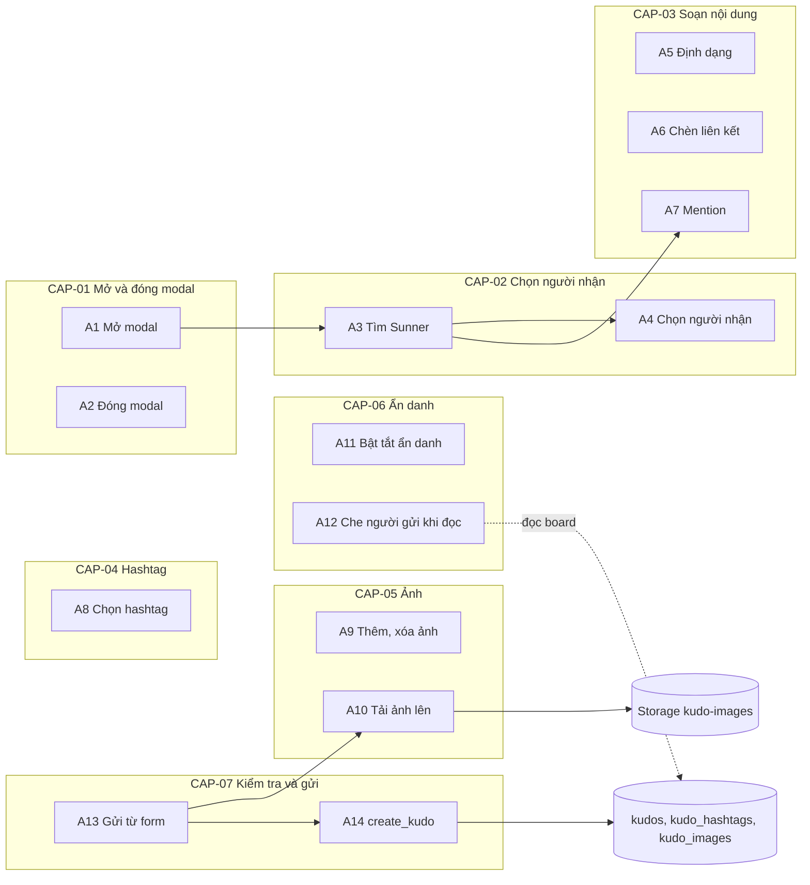
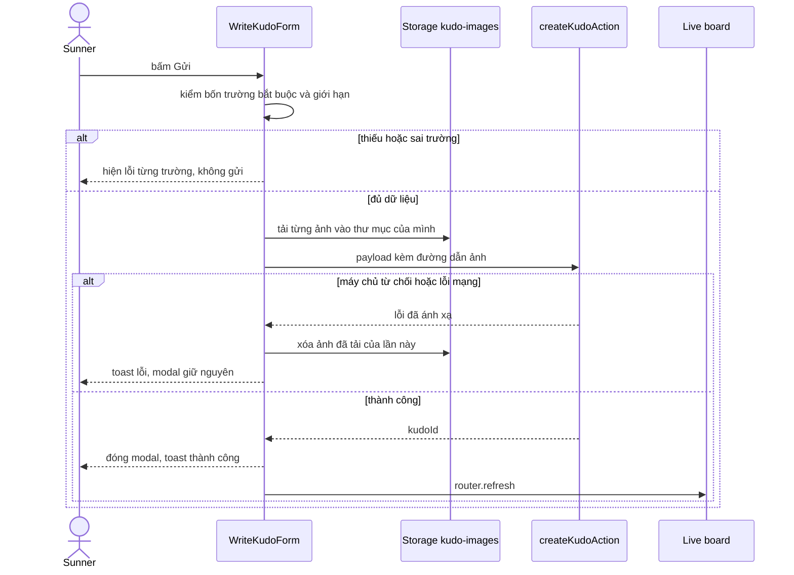
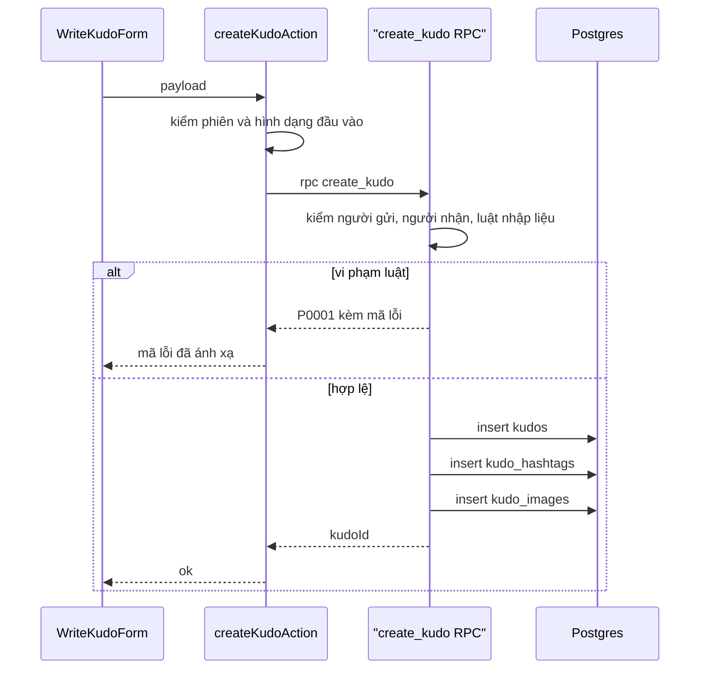
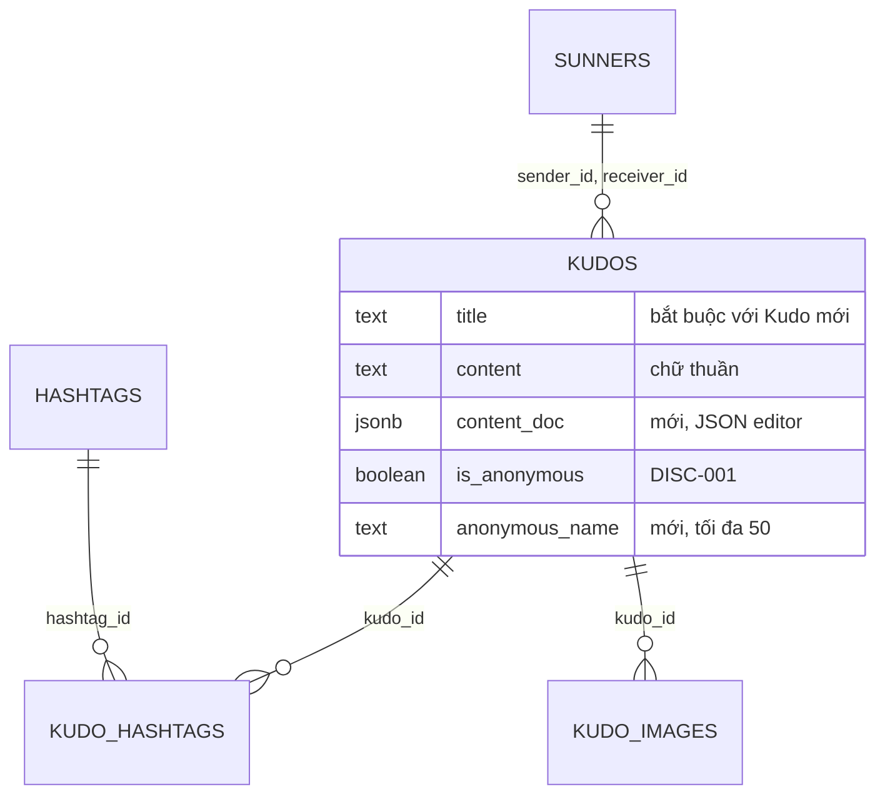
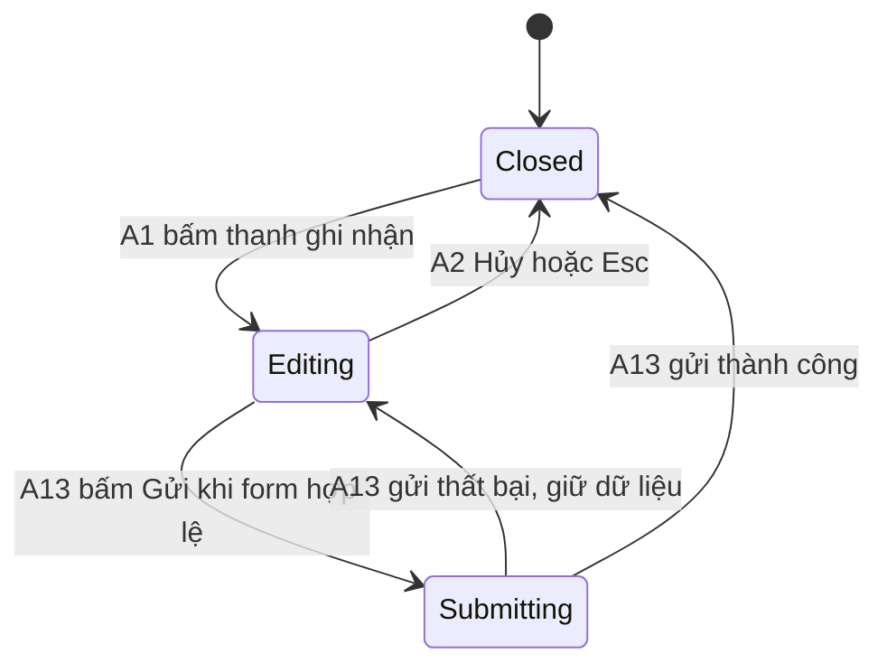

# F000_WriteKudo

## 1. Technical Overview

Feature thêm modal "Viết Kudo" trên `/sun-kudos` (nhóm route `(main)`): Sunner đã đăng nhập chọn người nhận, đặt danh hiệu, soạn lời cảm ơn trong trình soạn thảo ràng buộc theo lược đồ (đậm, nghiêng, gạch ngang, danh sách số, trích dẫn, liên kết, mention `@`), gắn 1 đến 5 hashtag có sẵn, đính tối đa 5 ảnh, tuỳ chọn gửi ẩn danh rồi gửi. Đây là đường ghi Kudo đầu tiên của repo và là lần đầu dùng Supabase Storage: ảnh đi vào bucket `kudo-images` ngay từ trình duyệt (phiên người dùng, RLS theo thư mục), sau đó một Server Action gọi RPC `SECURITY DEFINER` `create_kudo` kiểm lại toàn bộ luật và ghi `kudos`, `kudo_hashtags`, `kudo_images` trong một giao dịch. Tìm người nhận và mention dùng chung RPC đọc `search_sunners`. Kudo ẩn danh buộc sửa đường đọc của F006: cột `kudos.sender_id` và `sunners.user_id` không còn đọc được từ client, `kudos_private.kudo_cards` trả tên ẩn danh thay cho người gửi, và URL ảnh không được mang mã người gửi.



## 2. Action Index

| # | Action (handler) | Method · Path | Codes | Writes | Detail |
|---|---|---|---|---|---|
| **A0** | *cross-cutting — belongs to no single action* | — | FR-001, FR-002, FR-102, FR-226, FR-227, FR-601, FR-604 | — | § 4.4 |
| **A1** | `KudosActionPills#openCompose` (planned) | browser · click thanh ghi nhận | FR-101, FR-103, FR-201, FR-202, FR-206, FR-225, DEC-008, US001, US003 | — *(read-only)* | § 3.1 |
| **A2** | `WriteKudoModal#close` (planned) | browser · click Hủy, phím Esc, click nền | FR-104, FR-221, FR-224, DEC-006, US012 | — *(read-only)* | § 3.1 |
| **A3** | `searchSunnersAction` (planned, server action) → RPC `search_sunners` | `POST` server action · gõ vào ô Người nhận hoặc sau `@` | FR-203, FR-204, BR-008, DEC-009, ALG-001, INT-003, US002, US006 | — *(read-only)* | § 3.2 |
| **A4** | `RecipientPicker#select` (planned) | browser · click dòng gợi ý hoặc nút xóa | FR-205, US002 | — *(read-only)* | § 3.2 |
| **A5** | `KudoEditor#applyFormat` (planned) | browser · click nút trên thanh công cụ | FR-105, FR-207, FR-209, FR-605, US004 | — *(read-only)* | § 3.3 |
| **A6** | `AddLinkDialog#save` (planned) | browser · click Lưu trong hộp thoại | FR-210, BR-007, US005 | — *(read-only)* | § 3.3 |
| **A7** | `KudoEditor#mention` (planned) | browser · gõ `@` rồi chọn | FR-211, US006 | — *(read-only)* | § 3.3 |
| **A8** | `HashtagPicker#toggle` (planned) | browser · click dòng hashtag, click x trên chip | FR-212, FR-213, FR-214, BR-004, DEC-003, US007 | — *(read-only)* | § 3.4 |
| **A9** | `ImagePicker#change` (planned) | browser · chọn tệp, click x trên thu nhỏ | FR-215, FR-216, BR-005, DEC-004, US008 | — *(read-only)* | § 3.5 |
| **A10** | `uploadKudoImages` (planned, browser → Storage) | `POST` Storage · khi bấm Gửi | FR-002, FR-217, BR-005, ALG-003, INT-001, US008 | `storage.objects` | § 3.5 |
| **A11** | `AnonymousToggle#toggle` (planned) | browser · click ô ẩn danh | FR-218, BR-006, DEC-005, US009 | — *(read-only)* | § 3.6 |
| **A12** | `kudos_private.kudo_cards` (planned change) | rpc · mọi RPC đọc của Live board | FR-401, FR-402, FR-604, BR-006, US009 | — *(read-only)* | § 3.6 |
| **A13** | `WriteKudoForm#submit` (planned) | browser · click Gửi | FR-208, FR-219, FR-220, FR-222, FR-223, FR-403, BR-001, BR-003, BR-009, BR-010, DEC-001, DEC-002, DEC-007, ALG-002, SM-001, US003, US010, US011 | — *(ghi qua A10, A14)* | § 3.7 ▸ **diagram** |
| **A14** | `createKudoAction` (planned, server action) → RPC `create_kudo` | `POST` server action · từ A13 | FR-001, FR-003, FR-223, FR-601, FR-602, FR-603, BR-001, BR-002, BR-003, BR-004, BR-005, BR-006, BR-007, BR-009, ALG-002, ALG-003, INT-002, US011 | `kudos`, `kudo_hashtags`, `kudo_images` | § 3.7 ▸ **diagram** |

## 3. Actions

### 3.1 CAP-01 — Mở và đóng modal Viết Kudo

#### A1 · Mở modal Viết Kudo từ thanh ghi nhận
`browser · click` → `` `KudosActionPills#openCompose` (planned) ``
`FR-101` `FR-103` `FR-201` `FR-202` `FR-206` `FR-225` `DEC-008` `US001` `US003` · `SCR-write-kudo-modal`

**Who** · Sunner đã đăng nhập đang ở `/sun-kudos` *(gate A0 — § 4.4)*
**FE** · `ActionPillsContainer` (hiện mở modal Coming soon) đổi pill ghi nhận `data-testid="kudos-compose-pill"` sang mở modal Viết Kudo; hai pill còn lại vẫn gọi `openModal` của `KudoFeedbackProvider`. Modal dựng trong portal, trường xếp theo thứ tự tiêu đề, Người nhận, Danh hiệu, thanh công cụ + ô soạn thảo, gợi ý "@", Hashtag, Image, ô ẩn danh, Hủy và Gửi (FR-201); chữ gợi ý và ô ẩn danh bỏ chọn mặc định (FR-202). Ô Danh hiệu có nhãn, dấu `*` đỏ, placeholder "Dành tặng một danh hiệu cho đồng đội" và hai dòng ví dụ (FR-206). Focus bị bẫy trong modal, focus đầu vào ô Người nhận (FR-225). Danh sách hashtag lấy từ `kudos_filter_options` mà trang đã tải cho bộ lọc, không thêm truy vấn.
**Request** · không có; props từ server: danh sách hashtag, `hasSunner` (từ `kudos_sidebar`), chuỗi i18n
**Rule** · Chỉ người xem có hàng `sunners` mới mở được modal, cùng luật với nút tim của F006:

| DEC | subtype | Condition | What the user sees | Source |
|---|---|---|---|---|
| **DEC-008** | render | `hasSunner = false` | Pill ghi nhận vô hiệu (`disabled`), không mở modal; RPC `create_kudo` vẫn là chốt chặn phía máy chủ | TBD (draft) |
| **DEC-008** | render | `hasSunner = true` | Pill bấm được, mở modal | TBD (draft) |

**Result** · không ghi DB. Modal chuyển từ trạng thái đóng sang đang soạn (SM-001, § 4.3).
**Source:** TBD (draft)

<!-- No diagram: below threshold — chỉ client, không ghi bảng nào. -->

---

#### A2 · Đóng modal bằng Hủy, Esc hoặc click nền
`browser · click Hủy, phím Esc, click nền` → `` `WriteKudoModal#close` (planned) ``
`FR-104` `FR-221` `FR-224` `DEC-006` `US012` · `SCR-write-kudo-modal`

**Who** · Sunner đang soạn Kudo *(gate A1 — § 3.1)*
**FE** · Nút Hủy luôn bật trừ khi đang gửi. Esc bắt ở cấp modal (hộp thoại liên kết A6 tự xử Esc trước, chỉ đóng chính nó). Lớp nền mờ không gắn handler đóng. Đóng thì unmount toàn bộ state của form, thu hồi `URL.createObjectURL` của ảnh xem trước, trả focus về pill đã mở modal.
**Rule** · Cách đóng modal và khi nào bị khóa:

| DEC | subtype | Condition | What the user sees | Source |
|---|---|---|---|---|
| **DEC-006** | flow | Bấm Hủy, hoặc Esc, khi không đang gửi | Modal đóng, bỏ mọi dữ liệu, không hỏi lại (FR-221, FR-224) | TBD (draft) |
| **DEC-006** | interaction | Click nền mờ ngoài modal | Không có gì xảy ra; modal và dữ liệu giữ nguyên (FR-224) | TBD (draft) |
| **DEC-006** | interaction | Đang gửi (SM-001 `submitting`) | Hủy bị khóa, Esc bị bỏ qua [INFERRED] | TBD (draft) |

**Result** · không ghi DB, không lưu nháp. Ảnh chưa được tải lên (chỉ tải khi gửi, A10) nên không có gì phải dọn. Focus về thanh ghi nhận (FR-104). Modal về trạng thái đóng (SM-001, § 4.3).
**Source:** TBD (draft)

<!-- No diagram: below threshold — chỉ client. -->

---

### 3.2 CAP-02 — Chọn người nhận

#### A3 · Tìm Sunner theo tên (dùng cho Người nhận và mention)
`POST` server action → `` `searchSunnersAction` (planned) `` → RPC `search_sunners`
`FR-203` `FR-204` `BR-008` `DEC-009` `ALG-001` `INT-003` `US002` `US006` · `SCR-write-kudo-modal`

**Who** · Sunner đã đăng nhập *(gate A0 — § 4.4)*
**FE** · Client component gọi action sau debounce khoảng 250 ms. Chuỗi gõ được `trim`; dưới 1 ký tự thì không gọi và đóng danh sách. Server Action chạy tuần tự nên mỗi lần gọi mang số thứ tự, kết quả cũ hơn lần mới nhất bị bỏ (không nhấp nháy danh sách cũ). Mỗi dòng hiện avatar, họ tên, phòng ban (FR-203). Dùng chung cho ô Người nhận và danh sách mention của A7.
**Request** · param `query` *(string, đã trim, 1 đến 100 ký tự)*
**BE** · `searchSunnersAction` gọi `getCurrentUser()` (không có phiên thì trả lỗi), kiểm `query` là chuỗi hợp lệ, rồi `supabase.rpc('search_sunners', { p_query })` qua `lib/supabase/server.ts` (INT-003). Trả mảng `{ id, name, avatarUrl, department }` — không trả `user_id`.
**Rule** · Luật tìm và hiển thị kết quả rỗng:
- **BR-008 — Tìm người nhận bỏ khoảng trắng đầu cuối, không phân biệt hoa thường và dấu, khớp theo tên, tối đa 10 kết quả, loại chính người gửi.** Phép khớp là chuỗi con nguyên văn (không `LIKE`, nên `%`, `_` không là ký tự đại diện) nhờ ALG-001 *(§ 4.5)*.

| DEC | subtype | Condition | What the user sees | Source |
|---|---|---|---|---|
| **DEC-009** | render | Kết quả rỗng sau khi gõ ≥ 1 ký tự | Danh sách hiện một dòng "Không tìm thấy kết quả" (FR-204); gõ "@ # $" cũng vào nhánh này | TBD (draft) |
| **DEC-009** | render | Có kết quả | Tối đa 10 dòng avatar, họ tên, phòng ban | TBD (draft) |

**Result** · read-only. Không đổi dữ liệu.
**Source:** TBD (draft)
**Shared structure:** `ALG-001` — chuẩn hóa chuỗi gõ và khớp chuỗi con theo tên không dấu, full detail *(§ 4.5)*; `INT-003` — RPC đọc `search_sunners`, full detail *(§ 4.5)*

<!-- No diagram: below threshold — một lần đọc, không ghi. -->

---

#### A4 · Chọn hoặc xóa người nhận
`browser · click dòng gợi ý, click nút xóa` → `` `RecipientPicker#select` (planned) ``
`FR-205` `US002` · `SCR-write-kudo-modal`

**Who** · Sunner đang soạn Kudo *(gate A1 — § 3.1)*
**FE** · Click một dòng gợi ý (A3) lưu `receiverId` vào state của form, điền ô bằng tên kèm avatar, đóng danh sách. Ô có nút xóa/đổi: xóa thì `receiverId` về null và ô về chế độ tìm kiếm. Lỗi "Không được để trống" của ô tự mất khi đã chọn (DEC-002, A13).
**Result** · không ghi DB; chỉ state của form.
**Source:** TBD (draft)

<!-- No diagram: below threshold — chỉ client. -->

---

### 3.3 CAP-03 — Soạn nội dung Kudo

#### A5 · Định dạng lời cảm ơn và nút Tiêu chuẩn cộng đồng
`browser · click nút B, I, S, danh sách số, trích dẫn` → `` `KudoEditor#applyFormat` (planned) ``
`FR-105` `FR-207` `FR-209` `FR-605` `US004` · `SCR-write-kudo-modal`

**Who** · Sunner đang soạn Kudo *(gate A1 — § 3.1)*
**FE** · Trình soạn thảo ràng buộc theo lược đồ (gợi ý Tiptap/ProseMirror, § 5.3): mark `bold`, `italic`, `strike`; node `paragraph`, `orderedList`, `listItem`, `blockquote`, `mention`, `hardBreak` và mark `link` (A6). Không có node HTML thô. Nút trên thanh công cụ bật/tắt mark hay node cho đoạn đang chọn hoặc nội dung gõ tiếp (FR-207). Dưới ô soạn thảo là dòng gợi ý "Bạn có thể “@ + tên” để nhắc tới đồng nghiệp khác", không bộ đếm ký tự (FR-209). Cạnh thanh công cụ có link "Tiêu chuẩn cộng đồng" tới `/standards`, `target="_blank"` kèm `rel="noopener noreferrer"` (FR-105). Dán nội dung ngoài vào bị lọc theo lược đồ (mọi thứ ngoài whitelist thành chữ thuần).
**Rule** · **BR-007 — Liên kết chỉ nhận http hoặc https** áp lên nội dung dán vào, giống hộp thoại A6 *(§ 4.4)*.
**Result** · không ghi DB. State của editor (JSON tài liệu) được A13 đọc lúc gửi. Nội dung người dùng chỉ render qua node của lược đồ, không `dangerouslySetInnerHTML` (FR-605).
**Source:** TBD (draft)

<!-- No diagram: below threshold — chỉ client. -->

---

#### A6 · Chèn liên kết qua hộp thoại Addlink
`browser · click Lưu` → `` `AddLinkDialog#save` (planned) ``
`FR-210` `BR-007` `US005` · `SCR-write-kudo-modal`

**Who** · Sunner đang soạn Kudo *(gate A1 — § 3.1)*
**FE** · Nút liên kết (C.5) mở hộp thoại xếp trên modal, có bẫy focus riêng và trả focus về nút liên kết khi đóng. Ô Text (bắt buộc, 1 đến 100 ký tự, không toàn khoảng trắng), ô Link (bắt buộc, 5 đến 2048 ký tự, chỉ http hoặc https), nút Hủy và Lưu. Lưu hợp lệ thì áp mark `link` lên vùng chọn, hoặc chèn Text thành đoạn có liên kết nếu không có vùng chọn [INFERRED], rồi đóng hộp thoại. Liên kết hiển thị mở tab mới với `rel="noopener noreferrer"`.
**Rule** · **BR-007 — Liên kết chỉ nhận http hoặc https, dài 5 đến 2048 ký tự, phần chữ 1 đến 100 ký tự không toàn khoảng trắng; máy chủ kiểm lại.** `javascript:`, `data:` và địa chỉ không có scheme bị từ chối ở hộp thoại và lần nữa ở A14 *(§ 4.4)*.
**Result** · không ghi DB; thêm mark `link` vào tài liệu của editor.
**Source:** TBD (draft)

<!-- No diagram: below threshold — chỉ client. -->

---

#### A7 · Nhắc đồng nghiệp bằng "@"
`browser · gõ @ kèm chữ rồi chọn` → `` `KudoEditor#mention` (planned) ``
`FR-211` `US006` · `SCR-write-kudo-modal`

**Who** · Sunner đang soạn Kudo *(gate A1 — § 3.1)*
**FE** · Plugin gợi ý của editor bắt chuỗi sau `@`, gọi A3 (cùng debounce, cùng danh sách tối đa 10, loại chính người gửi). Chọn một dòng thì chèn node `mention` mang `id` Sunner và tên, hiển thị "@Họ tên". Esc đóng danh sách mà không đổi chữ đang gõ. Mention không có bảng riêng và không phát thông báo.
**Rule** · Tìm kiếm tuân theo luật của A3: tối đa 10 kết quả, bỏ dấu, không phân biệt hoa thường, loại người gửi (BR-008 ở A3); chữ thuần lưu kèm sẽ viết mention thành "@Họ tên" (ALG-002 ở A13).
**Result** · không ghi DB; thêm node `mention` vào tài liệu.
**Source:** TBD (draft)

<!-- No diagram: below threshold — chỉ client; phần đọc là A3. -->

---

### 3.4 CAP-04 — Gắn hashtag

#### A8 · Chọn hoặc gỡ hashtag
`browser · click dòng hashtag, click x trên chip` → `` `HashtagPicker#toggle` (planned) ``
`FR-212` `FR-213` `FR-214` `BR-004` `DEC-003` `US007` · `SCR-write-kudo-modal`

**Who** · Sunner đang soạn Kudo *(gate A1 — § 3.1)*
**FE** · "+ Hashtag" mở panel danh sách hashtag có sẵn (nhãn có "#"); click dòng bật/tắt chọn, dòng chọn nền đậm kèm dấu tick (FR-212). Chip dưới nhãn có nút "x" gỡ từng cái (FR-214). Không có ô nhập tự do, không tạo hashtag mới. Panel cuộn khi danh sách dài.
**Rule** · Giới hạn và trạng thái các dòng:
- **BR-004 — Hashtag đã chọn từ 1 đến 5, đều có sẵn trong dữ liệu, không trùng nhau.** Phía client chỉ cho chọn từ danh sách đã nạp; A14 kiểm lại theo `slug` *(§ 4.4)*.

| DEC | subtype | Condition | What the user sees | Source |
|---|---|---|---|---|
| **DEC-003** | render | Đã chọn 5 hashtag | Các dòng chưa chọn bị vô hiệu, panel hiện "Tối đa 5 hashtag" (FR-213) | TBD (draft) |
| **DEC-003** | render | Đã chọn dưới 5 | Mọi dòng bấm được | TBD (draft) |
| **DEC-003** | render | Chưa chọn cái nào lúc bấm Gửi | Lỗi "Không được để trống" ở hàng Hashtag (DEC-002, A13) | TBD (draft) |

**Result** · không ghi DB; state form giữ danh sách `slug`.
**Source:** TBD (draft)

<!-- No diagram: below threshold — chỉ client. -->

---

### 3.5 CAP-05 — Đính ảnh

#### A9 · Thêm hoặc xóa ảnh trên form
`browser · chọn tệp, click x trên thu nhỏ` → `` `ImagePicker#change` (planned) ``
`FR-215` `FR-216` `BR-005` `DEC-004` `US008` · `SCR-write-kudo-modal`

**Who** · Sunner đang soạn Kudo *(gate A1 — § 3.1)*
**FE** · "+ Image" mở file picker (`accept="image/jpeg,image/png,image/webp"`, nhiều tệp). Mỗi tệp kiểm MIME thật và kích thước ≤ 5 MB trước khi nhận; tệp sai định dạng (pdf, mp4, txt) bị bỏ và hiện "Định dạng file không hợp lệ"; quá 5 MB hiện "Ảnh vượt quá 5 MB" [INFERRED, D008]. Tệp nhận được hiện thu nhỏ ngay từ `URL.createObjectURL` kèm nút "x". Chưa gửi gì lên mạng.
**Rule** · Giới hạn ảnh và trạng thái nút:
- **BR-005 — Tối đa 5 ảnh, chỉ JPEG, PNG, WebP, mỗi ảnh ≤ 5 MB, tải lên khi gửi vào thư mục của người gửi.** Client kiểm ở đây, A10 đặt tên và tải lên, A14 kiểm lại đường dẫn *(§ 4.4)*.

| DEC | subtype | Condition | What the user sees | Source |
|---|---|---|---|---|
| **DEC-004** | render | Số ảnh < 5 | Nút "+ Image" hiện (FR-216) | TBD (draft) |
| **DEC-004** | render | Số ảnh = 5 | Nút "+ Image" ẩn; không thêm được ảnh thứ 6 | TBD (draft) |
| **DEC-004** | render | Xóa một ảnh khi đang đủ 5 | Nút "+ Image" hiện lại | TBD (draft) |

**Result** · không ghi DB, không ghi Storage. State form giữ mảng `File` và URL xem trước.
**Source:** TBD (draft)

<!-- No diagram: below threshold — chỉ client. -->

---

#### A10 · Tải ảnh lên Storage khi bấm Gửi
`POST` Storage `kudo-images` → `` `uploadKudoImages` (planned, browser → Storage) ``
`FR-002` `FR-217` `BR-005` `ALG-003` `INT-001` `US008` · `SCR-write-kudo-modal`

**Who** · Sunner đã đăng nhập, chạy trong phiên của chính họ *(gate A0 — § 4.4)*
**FE** · Gọi từ A13 sau khi kiểm form hợp lệ và trước A14. Dùng `lib/supabase/client.ts` (browser client, phiên người dùng): với từng ảnh, `storage.from('kudo-images').upload(path, file, { contentType, upsert: false })`. Chọn client-direct vì 5 ảnh × 5 MB vượt xa giới hạn thân Server Action mặc định; không đổi `serverActions.bodySizeLimit` (§ 5.3).
**Request** · mỗi tệp: `path` *(ALG-003)*, `file`, `contentType`
**Rule** · **BR-005 — Ảnh chỉ nhận JPEG, PNG, WebP, ≤ 5 MB, tối đa 5, tải vào thư mục của người gửi.** Bucket tự từ chối định dạng và cỡ sai (`allowed_mime_types`, `file_size_limit`); policy chỉ cho `insert` khi thư mục đầu của đường dẫn khớp `auth.uid()`; không có `update`/`delete` cho người dùng ngoài xóa chính tệp mình khi dọn lỗi [INFERRED] *(§ 4.4)*.
**Result**
- Ghi mỗi ảnh thành một đối tượng ở `storage.objects` (bucket `kudo-images`), đường dẫn theo ALG-003; INT-001 tải tệp lên kho đối tượng của Supabase *(§ 4.5)*
- Một ảnh lỗi thì dừng, xóa các ảnh đã tải của lần này (best-effort), A13 báo lỗi
**Source:** TBD (draft)

<!-- No diagram: below threshold (một bảng Storage, tuần tự); thứ tự cả luồng gửi nằm ở sơ đồ cấp capability § 3.7. -->

---

### 3.6 CAP-06 — Gửi ẩn danh

#### A11 · Bật hoặc tắt ẩn danh trên form
`browser · click ô ẩn danh` → `` `AnonymousToggle#toggle` (planned) ``
`FR-218` `BR-006` `DEC-005` `US009` · `SCR-write-kudo-modal`

**Who** · Sunner đang soạn Kudo *(gate A1 — § 3.1)*
**FE** · Checkbox mặc định bỏ chọn (FR-202). Ô "Tên ẩn danh" là text input tuỳ chọn, `maxLength` 50.
**Rule** · Hiển thị ô tên và luật tên:
- **BR-006 — Tên ẩn danh tối đa 50 ký tự; để trống thì hiển thị "Người gửi ẩn danh" (do UI dịch theo ngôn ngữ, DB lưu `null`); người gửi thật vẫn nằm ở `sender_id` để tính tim và số liệu.** Dùng ở A11, A12, A14 *(§ 4.4)*.

| DEC | subtype | Condition | What the user sees | Source |
|---|---|---|---|---|
| **DEC-005** | render | Checkbox được chọn | Hiện ô "Tên ẩn danh" (FR-218) | TBD (draft) |
| **DEC-005** | render | Checkbox bị bỏ chọn | Ô ẩn đi và giá trị bị xóa; bật lại thì ô trống | TBD (draft) |

**Result** · không ghi DB; state form giữ `isAnonymous` và `anonymousName`.
**Source:** TBD (draft)

<!-- No diagram: below threshold — chỉ client. -->

---

#### A12 · Che người gửi thật của Kudo ẩn danh ở mọi đường đọc
`rpc · mọi RPC đọc của Live board` → `` `kudos_private.kudo_cards` (planned change) ``
`FR-401` `FR-402` `FR-604` `BR-006` `US009` · `SCR-write-kudo-modal`

**Who** · Sunner khác đang xem Live board hoặc gọi thẳng PostgREST *(gate A0 — § 4.4, FR-604)*
**FE** · Thẻ Kudo ẩn danh (`isAnonymous = true`) hiện tên ẩn danh (nếu `anonymousName` null thì dùng chuỗi i18n "Người gửi ẩn danh"), không avatar, không huy hiệu hero, không liên kết `/profile`. Sửa `kudo-card.tsx` và `kudo-person.tsx` của F006.
**BE** · `kudos_private.kudo_cards` thay khối `sender` của thẻ ẩn danh bằng `{ isAnonymous: true, name: anonymousName }`, không `id`, `avatarUrl`, `department`, `heroTitle`, `receivedCount`. `kudos_highlight`, `kudos_feed_page` gọi nó nên đổi theo. `canLike` vẫn tính từ người gửi thật, nên chỉ chính người gửi thấy `false`. Các hàm đọc đụng `kudos.sender_id` hoặc `sunners.user_id` (`kudos_sidebar`, `kudos_private.viewer_sunner_id`, `toggle_kudo_like` đã là DEFINER) chuyển sang `SECURITY DEFINER` hẹp, vì client không còn quyền đọc hai cột đó (cơ chế § 4.4 Bin 3).
**Rule** · **BR-006 — Kudo ẩn danh hiển thị tên ẩn danh (mặc định "Người gửi ẩn danh") thay người gửi; người gửi thật vẫn được tính tim và "Kudos đã gửi".** `kudos_sidebar` vẫn đếm `sent` và `hearts` theo `sender_id` thật (FR-402) *(§ 4.4)*.
**Result** · read-only. Không đường đọc nào trả người gửi thật cho người khác: không RPC đọc, không `select` trực tiếp `kudos.sender_id`, không URL ảnh mang mã người gửi (FR-604). pgTAP phải chứng minh cả ba (§ 5.1 SC-006).
**Source:** TBD (draft)

<!-- No diagram: below threshold — read-only, không ghi bảng. -->

---

### 3.7 CAP-07 — Kiểm tra và gửi Kudo

Luồng gửi trải trên ba action (A13 trên trình duyệt, A10 vào Storage, A14 ở máy chủ), không action nào sở hữu trọn thứ tự, nên sơ đồ đặt ở cấp capability:



#### A13 · Kiểm tra form, tải ảnh, gửi và báo kết quả
`browser · click Gửi` → `` `WriteKudoForm#submit` (planned) ``
`FR-208` `FR-219` `FR-220` `FR-222` `FR-223` `FR-403` `BR-001` `BR-003` `BR-009` `BR-010` `DEC-001` `DEC-002` `DEC-007` `ALG-002` `SM-001` `US003` `US010` `US011` · `SCR-write-kudo-modal`

**Who** · Sunner đang soạn Kudo *(gate A1 — § 3.1)*
**FE** · Nút Gửi luôn bấm được; khi thiếu trường bắt buộc nó mang `aria-disabled="true"` và kiểu mờ (DEC-001). Mỗi trường bắt buộc có trạng thái "đã chạm"; lỗi hiện khi bấm Gửi hoặc khi rời ô đã chạm mà trống, và tắt ngay khi hợp lệ (DEC-002): viền đỏ + "Không được để trống", riêng hashtag hiện tại hàng Hashtag. Bấm khi thiếu thì hiện mọi lỗi và không gửi. Đang gửi thì nút Gửi quay vòng tải, khóa mọi ô và Hủy (DEC-007). Toast dùng `KudoFeedbackProvider.show`; thành công gọi `router.refresh()` (FR-403).
**Request** · gửi cho A14: `receiverId`, `title`, `content` (chữ thuần, ALG-002), `contentDoc` (JSON editor), `hashtagSlugs[]`, `imagePaths[]` (từ A10), `isAnonymous`, `anonymousName`
**Rule** · Form kiểm trước khi gọi mạng, bằng đúng các luật mà A14 kiểm lại:
- **BR-001 — Bốn trường bắt buộc: Người nhận, Danh hiệu, nội dung, ít nhất 1 hashtag; ảnh và ẩn danh tuỳ chọn.** *(§ 4.4)*
- **BR-003 — Nội dung: chữ thuần không rỗng sau `trim`, tối đa 2000 ký tự; mention thành "@Họ tên"; lưu cả chữ thuần và bản JSON.** *(§ 4.4)*
- **BR-009 — Danh hiệu dài 1 đến 100 ký tự sau `trim`.** *(§ 4.4)*
- **BR-010 — Gửi thất bại (từ chối, mạng, một ảnh lỗi) thì modal giữ nguyên dữ liệu và ảnh đã tải của lần này bị xóa best-effort.** Chỉ A13 sở hữu việc dọn này, vì chỉ nó biết đường dẫn vừa tải.

| DEC | subtype | Condition | What the user sees | Source |
|---|---|---|---|---|
| **DEC-001** | render | Còn thiếu Người nhận, Danh hiệu, nội dung hoặc hashtag | Gửi `aria-disabled="true"`, kiểu mờ, vẫn bấm được; bấm thì hiện mọi lỗi, không gọi mạng (FR-219) | TBD (draft) |
| **DEC-001** | render | Đủ bốn trường | Gửi bình thường, bấm thì gửi | TBD (draft) |
| **DEC-002** | interaction | Bấm Gửi, hoặc `blur` ở trường đã chạm mà trống | Viền đỏ + "Không được để trống" (hashtag: ở hàng Hashtag) (FR-220) | TBD (draft) |
| **DEC-002** | interaction | Trường trở nên hợp lệ | Lỗi và viền đỏ biến mất ngay | TBD (draft) |
| **DEC-007** | render | Đang gửi | Gửi quay vòng tải; mọi ô nhập, Hủy bị khóa; bấm Gửi lần nữa bị bỏ qua (FR-222) | TBD (draft) |

**Result** · không ghi trực tiếp; sau khi hợp lệ gọi A10 (ảnh) rồi A14 (Kudo). Thành công: modal đóng, toast "Đã gửi Kudos thành công!", `router.refresh()` nạp lại board để Kudo mới đứng đầu All Kudos (FR-403). Thất bại: toast lỗi chung (không chuyển tiếp nguyên văn lỗi RPC), modal ở lại, dọn ảnh (BR-010, FR-223). Vòng đời modal: đang soạn → đang gửi → đóng hoặc đang soạn (SM-001, § 4.3).
**Source:** TBD (draft)
**Shared structure:** `ALG-002` — dựng chữ thuần từ tài liệu editor và kiểm lược đồ, full detail *(§ 4.5)*

---

#### A14 · Ghi Kudo trọn gói qua RPC create_kudo
`POST` server action → `` `createKudoAction` (planned) `` → RPC `create_kudo`
`FR-001` `FR-003` `FR-223` `FR-601` `FR-602` `FR-603` `BR-001` `BR-002` `BR-003` `BR-004` `BR-005` `BR-006` `BR-007` `BR-009` `ALG-002` `ALG-003` `INT-002` `US011` · `SCR-write-kudo-modal`

**Who** · Sunner đã đăng nhập và có hàng `sunners` *(gate A0 — § 4.4)*
**Request** · `receiverId` *(uuid)*, `title`, `content`, `contentDoc` *(object)*, `hashtagSlugs` *(1 đến 5)*, `imagePaths` *(0 đến 5)*, `isAnonymous` *(boolean)*, `anonymousName` *(≤ 50, tuỳ chọn)*
**BE** · `createKudoAction` gọi `getCurrentUser()` (không có phiên thì lỗi), kiểm hình dạng đầu vào bằng type guard rồi `supabase.rpc('create_kudo', {...})` qua `lib/supabase/server.ts` (INT-002). Lỗi `P0001` của RPC được ánh xạ sang mã (`sunner_not_found`, `receiver_not_found`, `self_kudo`, `title_invalid`, `content_invalid`, `content_doc_invalid`, `hashtags_invalid`, `images_invalid`, `anonymous_name_invalid`), không chuyển tiếp nguyên văn. Trả `{ kudoId }`.
**Rule** · RPC `SECURITY DEFINER`, `set search_path = ''`, lấy người gửi từ `auth.uid()` rồi kiểm lại mọi luật trong một giao dịch:
- **BR-002 — Người gửi lấy từ phiên (`auth.uid()` → `sunners`), không nhận từ tham số, và không được trùng người nhận.** Không có hàng `sunners` thì `sunner_not_found`; người nhận không tồn tại thì `receiver_not_found`; trùng thì `self_kudo` (ràng buộc `sender_id <> receiver_id` là lớp thứ hai).
- **BR-001 — Bốn trường bắt buộc đều có giá trị hợp lệ** (người nhận, danh hiệu, nội dung, ≥ 1 hashtag) *(§ 4.4)*.
- **BR-009 — Danh hiệu 1 đến 100 ký tự sau `btrim`.** *(§ 4.4)*
- **BR-003 — Nội dung chữ thuần 1 đến 2000 ký tự sau `btrim`; `content_doc` đúng lược đồ và đủ nhỏ (ALG-002).** *(§ 4.4)*
- **BR-007 — Mọi mark `link` trong `content_doc` là http hoặc https, 5 đến 2048 ký tự.** *(§ 4.4)*
- **BR-004 — 1 đến 5 hashtag, mỗi `slug` phải có trong `hashtags`, không trùng.** *(§ 4.4)*
- **BR-005 — 0 đến 5 ảnh, mỗi đường dẫn đúng mẫu ALG-003 và nằm trong thư mục được phép của người gọi.** *(§ 4.4)*
- **BR-006 — `anonymous_name` ≤ 50 ký tự và chỉ có khi `is_anonymous`; `sender_id` luôn là người gửi thật.** *(§ 4.4)*

**Result**
- Ghi `kudos` ← `sender_id` (người gọi), `receiver_id`, `title` (đã `btrim`), `content`, `content_doc`, `is_anonymous`, `anonymous_name`; `created_at` mặc định giữ độ chính xác mili giây của F006
- Ghi `kudo_hashtags` ← một dòng mỗi hashtag đã đối chiếu theo `slug`
- Ghi `kudo_images` ← một dòng mỗi ảnh, `position` 1 đến N theo thứ tự chọn, `url` là địa chỉ phục vụ suy ra từ đường dẫn đã kiểm (§ 5.3)
- Trả `{ kudoId }`; vi phạm luật thì không ghi gì (INT-002 chạy trọn trong một giao dịch)
**Source:** TBD (draft)
**Shared structure:** `ALG-002` — kiểm lược đồ `content_doc` ở phía SQL, `ALG-003` — kiểm đường dẫn ảnh theo người gọi, `INT-002` — RPC ghi `create_kudo`, đều ở *(§ 4.5)*



---

### 3.8 Edge cases

| Action | Scenario | Behavior |
|---|---|---|
| A1 | Người xem không có hàng `sunners` | Pill vô hiệu; `create_kudo` vẫn báo `sunner_not_found` nếu bị gọi trực tiếp |
| A2 | Esc khi đang gửi | Bỏ qua; modal đóng theo kết quả gửi |
| A2 · A13 | Hủy hoặc Esc ngay sau khi ảnh đã tải xong nhưng trước khi gửi xong | Không xảy ra: Hủy và Esc bị khóa từ lúc bấm Gửi |
| A3 | Kết quả của chuỗi gõ cũ về sau kết quả của chuỗi mới | Bỏ qua theo số thứ tự yêu cầu |
| A3 | Gõ `%` hoặc `_` | Khớp nguyên văn như ký tự thường (ALG-001), không phải ký tự đại diện |
| A3 | Chuỗi gõ toàn khoảng trắng | Sau `trim` là rỗng nên không gọi, đóng danh sách |
| A3 | Danh sách có người trùng tên | Hiển thị cả hai, phân biệt bằng phòng ban |
| A5 | Dán HTML hoặc nội dung ngoài lược đồ | Giữ chữ thuần, bỏ định dạng và thẻ không nằm trong whitelist |
| A6 | Link nhập `javascript:alert(1)` hoặc `ftp://` | Hộp thoại không cho Lưu; A14 vẫn từ chối nếu `content_doc` bị chèn tay |
| A6 | Esc khi hộp thoại mở | Chỉ đóng hộp thoại, modal ở lại [EXPECTED] |
| A7 | Gõ `@` rồi xóa | Danh sách đóng, không chèn mention |
| A8 | Chọn hashtag đã bị xóa khỏi DB giữa lúc soạn | A14 trả `hashtags_invalid`; form giữ nguyên, toast lỗi |
| A9 | Chọn nhiều tệp làm vượt 5 ảnh | Nhận đủ 5, phần dư bỏ, hiện "Tối đa 5 ảnh" |
| A9 | Tệp đuôi `.jpg` nhưng thực là pdf | Kiểm MIME thật nên từ chối; bucket cũng từ chối lần nữa |
| A10 | Một ảnh tải lỗi giữa chừng | Dừng, xóa ảnh đã tải của lần này, A13 báo lỗi |
| A10 · A14 | Người gọi RPC nhét đường dẫn thuộc thư mục người khác | `images_invalid`, không ghi gì (BR-005) |
| A11 | Bật ẩn danh, gõ tên, tắt, bật lại | Ô trống (DEC-005) |
| A12 | `select sender_id` trực tiếp từ `kudos` bằng token người dùng | Từ chối do thiếu quyền cột (FR-604) |
| A12 | Người gửi chính mình xem Kudo ẩn danh của mình | Thấy tên ẩn danh như mọi người; `canLike = false` (D007) |
| A13 | Bấm Gửi hai lần nhanh | Lần hai bị bỏ qua vì đang ở `submitting` (DEC-007) |
| A13 | Mất mạng sau khi ảnh đã tải xong | Lỗi, xóa ảnh đã tải (best-effort), modal giữ nguyên (BR-010) |
| A13 · A14 | Hai lần gửi trùng nội dung | Tạo hai Kudo riêng; không chống trùng (YAGNI, D015) |
| A14 | Người nhận bị xóa giữa lúc soạn | `receiver_not_found`, không ghi gì |
| A14 | Lỗi ghi `kudo_images` sau khi đã ghi `kudos` | Cả giao dịch lùi lại; không còn Kudo mồ côi |
| A1-A14 | Khách gọi thẳng RPC hoặc Server Action | Proxy/`getCurrentUser()` chặn; RPC chỉ cấp `EXECUTE` cho `authenticated` (A0, § 4.4) |

## 4. Shared Foundation

### 4.1 Components

| Component | Responsibility | Used in | File |
|---|---|---|---|
| `ActionPillsContainer` | Pill ghi nhận mở modal Viết Kudo thay Coming soon; hai pill kia giữ `openModal` | A1 | `app/(main)/sun-kudos/_wiring/action-pills-container.tsx` (sửa) |
| `KudoFeedbackProvider` | Toast thành công/lỗi dùng chung (đã có) | A13 | `app/(main)/sun-kudos/_behavior/kudo-feedback-provider.tsx` |
| `WriteKudoModalView` | Khung modal, bố cục, bẫy focus, đóng | A1, A2 | `app/(main)/sun-kudos/_components/write-kudo-modal-view.tsx` (planned) |
| `WriteKudoFormContainer` | State form, kiểm lỗi, điều phối gửi, `router.refresh()` | A13 | `app/(main)/sun-kudos/_wiring/write-kudo-form-container.tsx` (planned) |
| `RecipientPickerView` + `useSunnerSearch` | Ô tìm, danh sách gợi ý, debounce, bỏ kết quả cũ | A3, A4, A7 | `app/(main)/sun-kudos/_components/recipient-picker-view.tsx`, `_behavior/use-sunner-search.ts` (planned) |
| `KudoEditorView` + `kudo-editor-schema` | Editor, thanh công cụ, lược đồ, mention | A5, A6, A7 | `app/(main)/sun-kudos/_components/kudo-editor-view.tsx`, `_behavior/kudo-editor-schema.ts` (planned) |
| `AddLinkDialogView` | Hộp thoại Addlink | A6 | `app/(main)/sun-kudos/_components/add-link-dialog-view.tsx` (planned) |
| `HashtagPickerView` | Nút, panel đa chọn, chip | A8 | `app/(main)/sun-kudos/_components/hashtag-picker-view.tsx` (planned) |
| `ImagePickerView` + `uploadKudoImages` | Chọn ảnh, thu nhỏ, tải lên Storage | A9, A10 | `app/(main)/sun-kudos/_components/image-picker-view.tsx`, `lib/kudos/upload-kudo-images.ts` (planned) |
| `AnonymousFieldView` | Checkbox và ô tên ẩn danh | A11 | `app/(main)/sun-kudos/_components/anonymous-field-view.tsx` (planned) |
| `searchSunnersAction`, `createKudoAction` | Hai Server Action mới, mỗi cái tự kiểm phiên và đầu vào | A3, A14 | `lib/kudos/search-sunners-action.ts`, `lib/kudos/create-kudo-action.ts` (planned) |
| `kudo-doc-to-plain-text` | Dựng chữ thuần từ JSON editor (ALG-002) | A13 | `lib/kudos/kudo-doc-to-plain-text.ts` (planned) |
| `kudo-card.tsx`, `kudo-person.tsx` | Hiện tên ẩn danh, không avatar, không liên kết hồ sơ | A12 | `app/(main)/sun-kudos/_components/` (sửa) |
| Migration mới | Cột mới của `kudos`, quyền cột, bucket, policy Storage, `search_sunners`, `create_kudo`, sửa `kudo_cards` và các hàm đọc | A3, A10, A12, A14 | `supabase/migrations/…_write_kudo_*.sql` (planned) |
| Mock E2E | Thêm route tìm Sunner, danh sách hashtag, upload Storage, `create_kudo`, cùng luật với SQL | A3, A10, A14 | `e2e/support/mock-supabase-server.ts`, `mock-kudos-*.ts` (sửa) |

### 4.2 Data Model



#### Key Entities

| Entity | Table | Key Columns | Purpose |
|--------|-------|-------------|---------|
| Kudo | `kudos` | `id`, `sender_id` (người gửi thật; client mất quyền đọc cột này), `receiver_id`, `title`, `content` (chữ thuần, hiện trên board), `content_doc` (jsonb, mới), `is_anonymous` (DISC-001, mới, mặc định false), `anonymous_name` (mới, ≤ 50), `created_at` | Kudo; thêm bốn cột, ghi duy nhất qua `create_kudo` |
| KudoHashtag | `kudo_hashtags` | `kudo_id`, `hashtag_id` | Nối Kudo và hashtag, 1 đến 5 dòng mỗi Kudo |
| KudoImage | `kudo_images` | `kudo_id`, `url`, `position` | Ảnh đính kèm, 0 đến 5 dòng mỗi Kudo; đóng mục theo dõi L7 của F006 ở đường ghi |
| Hashtag | `hashtags` | `slug`, `label` | Danh sách hashtag có sẵn để chọn (đọc, không ghi) |
| Sunner | `sunners` | `id`, `full_name`, `avatar_url`, `department_id`, `user_id` (client mất quyền đọc cột này) | Nguồn của tìm người nhận, mention; "người dùng hiện tại" |
| Department | `departments` | `id`, `name` | Phòng ban hiện ở dòng gợi ý (đọc) |
| Ảnh đối tượng | `storage.objects` (bucket `kudo-images`) | `bucket_id`, `name` (đường dẫn), `owner` | Tệp ảnh Kudo; bucket giới hạn MIME và 5 MB |

#### Polymorphic Behavior

##### DISC-001 — Kudo.is_anonymous

| Value | Render | Validation | Persistence |
|-------|--------|------------|-------------|
| `true` | Thẻ hiện `anonymous_name` hoặc "Người gửi ẩn danh"; không avatar, huy hiệu, liên kết hồ sơ (A12) | `anonymous_name` ≤ 50, được phép có (BR-006) | A14 ghi `is_anonymous = true`; `sender_id` vẫn là người gửi thật |
| `false` | Thẻ hiện người gửi như F006 | `anonymous_name` phải null | A14 ghi `false` (mặc định); `anonymous_name` = null |

**Source:** TBD (draft) — mã DISC-001 cấp lại lúc promote cho khớp bảng `entities.md`; bảng này chưa có mục nào cho cột mới.

### 4.3 State Management

### Vòng đời của modal Viết Kudo từ đóng tới đã gửi (SM-001)
**kind:** ui
**Linked FR:** FR-222
**Used in:** A1, A2, A13
**Source:** TBD (draft)



**Action transitions:** guard và tác dụng phụ của từng cạnh nằm ở rung **Result** của action ghi trên cạnh (§ 3.1, § 3.7); không lặp lại ở đây.

### 4.4 Shared Rules

#### Bin 2 — dùng bởi từ hai action trở lên

**BR-001 — Bốn trường bắt buộc: Người nhận, Danh hiệu, nội dung, ít nhất 1 hashtag; ảnh và ẩn danh tuỳ chọn.**
Used in: **A13** (kiểm trước khi gọi mạng, quyết định DEC-001 và DEC-002) · **A14** (kiểm lại ở RPC). Client chỉ để UX; RPC mới là chốt.
**Linked FR:** FR-219, FR-603
**Source:** TBD (draft)
```text
valid = receiverId != null
        and 1 <= len(trim(title)) <= 100
        and 1 <= len(trim(plainText(contentDoc))) <= 2000
        and 1 <= count(distinct hashtagSlugs) <= 5
```

**BR-003 — Nội dung gồm chữ thuần 1 đến 2000 ký tự sau `trim` và bản JSON đúng lược đồ; mention thành "@Họ tên" trong chữ thuần.**
Used in: **A13** (dựng chữ thuần bằng ALG-002) · **A14** (kiểm `content` và `content_doc`). Chữ thuần là cái Live board hiện; bản JSON dành cho trang chi tiết sau này.
**Linked FR:** FR-208, FR-603
**Source:** TBD (draft)

**BR-004 — Hashtag đã chọn từ 1 đến 5, mỗi cái có sẵn trong `hashtags`, không trùng.**
Used in: **A8** (chỉ chọn trong danh sách đã nạp, chặn ở 5) · **A14** (đối chiếu `slug`, đếm lại).
**Linked FR:** FR-213, FR-214
**Source:** TBD (draft)

**BR-005 — Ảnh: tối đa 5, JPEG, PNG, WebP, mỗi ảnh ≤ 5 MB; đường dẫn `<auth.uid()>/<uuid>.<ext>`; tải lên khi gửi.**
Used in: **A9** (kiểm MIME và cỡ ở client) · **A10** (đặt tên, tải lên; bucket và policy chặn lần nữa) · **A14** (kiểm từng đường dẫn đúng mẫu và đúng thư mục). Với Kudo ẩn danh, thư mục theo `auth.uid()` làm lộ danh tính qua URL — cách xử lý là D010 / § 5.3.
**Linked FR:** FR-215, FR-216, FR-217
**Source:** TBD (draft)

**BR-006 — Tên ẩn danh ≤ 50 ký tự, để trống thì UI hiện "Người gửi ẩn danh"; `sender_id` luôn là người gửi thật.**
Used in: **A11** (ô tên), **A12** (che khi đọc), **A14** (lưu và kiểm).
**Linked FR:** FR-218, FR-401, FR-402
**Source:** TBD (draft)

**BR-007 — Liên kết chỉ http hoặc https, 5 đến 2048 ký tự; phần chữ 1 đến 100 ký tự không toàn khoảng trắng.**
Used in: **A5** (lọc nội dung dán) · **A6** (hộp thoại) · **A14** (duyệt mọi mark `link` của `content_doc`).
**Linked FR:** FR-210, FR-605
**Source:** TBD (draft)

**BR-009 — Danh hiệu 1 đến 100 ký tự sau `trim`.**
Used in: **A13** (kiểm form) · **A14** (kiểm lại).
**Linked FR:** FR-206
**Source:** TBD (draft)

#### Bin 3 — cross-cutting, belongs to no single action

**A0 · FR-001 / FR-002 / FR-102 / FR-226 / FR-227 / FR-601 / FR-604 — cross-cutting: dữ liệu, kho ảnh, chỉ người đã đăng nhập, i18n, responsive và giữ kín người gửi ẩn danh.**
FR-001: bốn cột mới của `kudos` (`content_doc`, `is_anonymous`, `anonymous_name`; `title` thành bắt buộc cho Kudo mới qua RPC) do migration mới thêm, các dòng seed của F006 giữ `null`/`false`. FR-002: bucket `kudo-images` tạo bằng migration (`insert into storage.buckets` với `file_size_limit` 5 MiB, `allowed_mime_types` JPEG/PNG/WebP); policy trên `storage.objects` chỉ cho `authenticated` `insert` khi thư mục đầu của `name` bằng `auth.uid()::text`, `select` mở cho đọc [D009]. FR-102, FR-601: modal chỉ có trong `(main)`, đã có proxy lớp 1 và layout kiểm lại phiên; hai Server Action tự gọi `getCurrentUser()` vì là endpoint công khai; `search_sunners` và `create_kudo` chỉ cấp `EXECUTE` cho `authenticated` (thu của `PUBLIC`, `anon`), `create_kudo` lấy người gửi từ `auth.uid()`. FR-226: chuỗi mới vào `dictionary-kudos-vi.ts` và `dictionary-kudos-en.ts`, khớp khóa lúc biên dịch; nội dung người dùng không dịch. FR-227: modal `width: min(752px, 100vw − 32px)`, `max-height: calc(100dvh − 32px)` cuộn trong; dưới 640 px nhãn và ô xếp dọc.
FR-604 (cơ chế giữ kín, planner được đổi chi tiết nhưng không được bỏ lớp nào): (1) thu quyền `select` ở cấp bảng của `authenticated` trên `kudos` và `sunners` rồi cấp lại `select` theo cột, trừ `kudos.sender_id` và `sunners.user_id` — nên PostgREST không đọc, không lọc, không join được hai cột này; (2) mọi hàm cần hai cột đó (`kudo_cards`, `kudos_sidebar`, `viewer_sunner_id`, `search_sunners` khi loại người gửi) là `SECURITY DEFINER` hẹp, `search_path = ''`, đặt trong `kudos_private`, chỉ trả dữ liệu đã che; (3) `kudo_cards` thay khối `sender`; (4) URL ảnh của Kudo ẩn danh không chứa mã người gửi (D010). Mọi lớp phải có pgTAP chứng minh.
**Source:** TBD (draft)

### 4.5 Algorithms & Integrations

### Chuẩn hóa chuỗi gõ và khớp tên người nhận (ALG-001)
**Linked FR:** FR-203, FR-204
**Used in:** A3
**Source:** TBD (draft)
**Input:** `p_query` (chuỗi thô) · **Output:** tối đa 10 Sunner, sắp theo tên · **Complexity:** O(n) trên bảng `sunners` (n nhỏ, chưa cần chỉ mục trigram)
**Description:** `trim` chuỗi gõ; rỗng thì trả mảng rỗng. Khớp bằng `strpos(lower(unaccent(full_name)), lower(unaccent(query))) > 0`, không dùng `LIKE`/`ILIKE` nên `%` và `_` là chữ thường. Loại hàng có `id` bằng người gọi. `unaccent` gọi đủ schema (`extensions.unaccent`) vì `search_path = ''`; cần xác nhận nó đổi cả "đ/Đ" thành "d" (§ 5.2).

**Pseudocode:**
```text
q = lower(unaccent(trim(p_query)))
if q = '' then return []
return select id, full_name, avatar_url, department_name
       from sunners left join departments
       where strpos(lower(unaccent(full_name)), q) > 0
         and id <> viewer_sunner_id()
       order by full_name limit 10
```

### Dựng chữ thuần từ tài liệu editor và kiểm lược đồ (ALG-002)
**Linked FR:** FR-208, FR-603, FR-605
**Used in:** A13, A14
**Source:** TBD (draft)
**Input:** `content_doc` (JSON editor) · **Output:** chữ thuần, hoặc từ chối · **Complexity:** O(số node)
**Description:** Phía client (TS) đi cây tài liệu: text giữ nguyên, mention thành "@" + tên, đoạn và mục danh sách nối bằng xuống dòng; kết quả là `content`. Phía SQL (`create_kudo`) đi cùng cây để kiểm: chỉ nhận node/mark whitelist (`doc`, `paragraph`, `text`, `orderedList`, `listItem`, `blockquote`, `hardBreak`, `mention`; mark `bold`, `italic`, `strike`, `link`), độ sâu và dung lượng JSON có trần [D011], `mention.attrs.id` phải là `sunners.id` có thật. Server không dựng lại `content` từ `content_doc`: hai giá trị lệch nhau chỉ làm hỏng Kudo của chính người gửi (§ 5.2).

**Pseudocode:**
```text
plain(node):
  text    -> node.text
  mention -> "@" + node.attrs.name
  block   -> join(map(plain, node.content), "\n")
validate(doc): every node.type, mark.type in WHITELIST
               and depth <= MAX_DEPTH and byte_size(doc) <= MAX_BYTES
               and every link.href matches ^https?:// and 5 <= len <= 2048
```

### Đặt tên và kiểm đường dẫn ảnh (ALG-003)
**Linked FR:** FR-002, FR-215, FR-217
**Used in:** A10, A14
**Source:** TBD (draft)
**Input:** `auth.uid()`, đuôi tệp · **Output:** đường dẫn đối tượng hoặc từ chối · **Complexity:** O(1) mỗi ảnh
**Description:** Client đặt tên `<auth.uid()>/<uuid-v4>.<ext>` với `ext` ∈ `jpg`, `png`, `webp` suy từ MIME đã kiểm. `create_kudo` kiểm từng `p_image_paths` khớp mẫu và thư mục đầu bằng `auth.uid()::text`, không trùng nhau, tối đa 5. Với Kudo ẩn danh mẫu này phải đổi sang đường dẫn trung lập khi D010 được chốt; hợp đồng "RPC kiểm quyền sở hữu đường dẫn" vẫn giữ.

**Pseudocode:**
```text
path = auth.uid() + "/" + uuid4() + "." + ext
ok = path matches ^<uid>/[0-9a-f-]{36}\.(jpg|png|webp)$
     and count(paths) <= 5 and distinct(paths)
```

### Tải ảnh lên Supabase Storage từ trình duyệt (INT-001)
**Linked FR:** FR-002, FR-217
**Used in:** A10
**Source:** TBD (draft)
**Type:** api-call
**Target:** Supabase Storage, bucket `kudo-images` (qua `lib/supabase/client.ts`, phiên người dùng)
**Payload:** tệp ảnh, `contentType`, đường dẫn từ ALG-003, `upsert: false`
**Failure handling:** Một ảnh lỗi thì dừng, xóa các ảnh đã tải của lần này (best-effort, lỗi xóa bị bỏ qua), A13 báo lỗi chung; không retry tự động.

### RPC đọc tìm Sunner theo tên (INT-003)
**Linked FR:** FR-203, FR-211
**Used in:** A3 → A7
**Source:** TBD (draft)
**Type:** api-call
**Target:** Postgres RPC `public.search_sunners(p_query text)` qua PostgREST, `SECURITY DEFINER` hẹp (phải đọc `sunners.user_id` để loại người gọi), chỉ cấp `EXECUTE` cho `authenticated`
**Payload:** `p_query` đã `trim`; trả `{ id, name, avatarUrl, department }[]`, không `user_id`
**Failure handling:** Lỗi thì `searchSunnersAction` trả mảng rỗng kèm cờ lỗi; UI hiện "Không tìm thấy kết quả", không crash.

### RPC ghi Kudo create_kudo (INT-002)
**Linked FR:** FR-001, FR-003, FR-601, FR-603
**Used in:** A14
**Source:** TBD (draft)
**Type:** api-call
**Target:** Postgres RPC `public.create_kudo(p_receiver_id uuid, p_title text, p_content text, p_content_doc jsonb, p_hashtag_slugs text[], p_image_paths text[], p_is_anonymous boolean, p_anonymous_name text)` trả `jsonb { kudoId }`, `SECURITY DEFINER`, `set search_path = ''`, `EXECUTE` chỉ cho `authenticated`
**Payload:** tám tham số trên; không có tham số người gửi
**Failure handling:** Vi phạm luật thì `raise exception` với `errcode P0001` và mã cố định, cả giao dịch lùi lại; Server Action ánh xạ sang mã và toast chung, không retry.

### 4.6 Configuration

```text
SEARCH_DEBOUNCE_MS = 250            # chờ sau lần gõ cuối rồi mới gọi tìm người (A3)
SEARCH_QUERY_MAX_LENGTH = 100       # trần độ dài chuỗi tìm (A3)
SEARCH_MAX_RESULTS = 10             # trần kết quả của search_sunners (ALG-001)
CONTENT_DOC_MAX_BYTES = 65536       # D011: trần dung lượng content_doc (ALG-002)
KUDO_IMAGES_BUCKET = kudo-images    # tên bucket
KUDO_IMAGES_FILE_SIZE_LIMIT = 5 MiB
KUDO_IMAGES_ALLOWED_MIME = image/jpeg, image/png, image/webp
```

`serverActions.bodySizeLimit` không đổi (ảnh không đi qua Server Action). Biến môi trường mới: không có.

**Client behavior:** see
[`behavior-logic.md`](../../generated/behavior-logic.md) (debounce tìm người, bỏ kết quả cũ, xem trước ảnh bằng object URL, tải ảnh trực tiếp),
[`permissions.md`](../../system/permissions.md) (policy Storage, quyền cột, chốt chặn `create_kudo`),
[`architecture.md`](../../system/architecture.md) (bucket mới, hai Server Action mới, browser client dùng cho Storage).

## 5. Verification & Technical Notes

### 5.1 Technical Verification

Chính sách test `e2e-red-first`: hành vi UI (mở, đóng, validate, dropdown, gửi) viết E2E Playwright đỏ trước; luật dữ liệu, RLS, Storage, che người gửi kiểm bằng pgTAP (`supabase test db`). Máy chủ mock E2E cài lại cùng luật (bản SQL là chuẩn). Case E2E "thanh ghi nhận mở Coming soon" của F006 đổi thành mở modal Viết Kudo.

- **SC-001** *(A1, A2)* Bấm thanh ghi nhận mở modal đủ trường theo thứ tự; Hủy và Esc đóng, click nền không đóng, focus về pill; hai pill kia vẫn mở Coming soon (covers FR-101, FR-104, FR-201, FR-224, DEC-006)
- **SC-002** *(A3, A4, A7)* Gõ "Nguyễn", "An", "  Nguyễn  ", "@ # $" cho đúng kết quả hoặc "Không tìm thấy kết quả"; tối đa 10 dòng; không có chính người gửi; chọn điền ô và đóng danh sách (covers FR-203, FR-204, FR-205, BR-008)
- **SC-003** *(A5, A6, A13)* B, I, S, danh sách số, trích dẫn áp được; hộp thoại liên kết nhận https và từ chối `javascript:`; nội dung trống báo lỗi (covers FR-207, FR-208, FR-210, BR-007)
- **SC-004** *(A8, A9)* Chọn tới 5 hashtag, dòng còn lại vô hiệu và hiện "Tối đa 5 hashtag"; ảnh jpg/png nhận, pdf/mp4/txt bị từ chối, đủ 5 ảnh ẩn "+ Image", xóa thì hiện lại (covers FR-213, FR-215, FR-216, DEC-003, DEC-004)
- **SC-005** *(A13)* Gửi `aria-disabled` khi thiếu trường nhưng bấm vẫn hiện đủ lỗi ở Người nhận, Danh hiệu, nội dung, Hashtag và không gọi mạng; đủ trường thì gửi, có vòng tải, modal đóng, toast, Kudo mới đứng đầu All Kudos (covers FR-219, FR-220, FR-222, FR-403, DEC-001, DEC-002)
- **SC-006** *(A12, A14)* pgTAP: người nhận ≠ người gửi; danh hiệu, nội dung, hashtag, ảnh, tên ẩn danh, liên kết sai đều bị `P0001` và không ghi gì; Kudo ẩn danh không lộ người gửi qua `kudos_feed_page`, `kudos_highlight`, `select` trực tiếp `kudos.sender_id`, `sunners.user_id` và đường dẫn ảnh; `sent`, `hearts` vẫn tính cho người gửi thật (covers FR-401, FR-402, FR-602, FR-603, FR-604, BR-002)
- **SC-007** *(A10, A13)* pgTAP và E2E: insert Storage chỉ vào thư mục `auth.uid()`, MIME và cỡ sai bị từ chối; gửi thất bại giữ form và xóa ảnh đã tải; hủy trước khi gửi không để tệp nào (covers FR-002, FR-217, FR-223, BR-005, BR-010)

#### Ánh xạ test case MoMorph (57 case) sang user story

| User story | Test case | Tầng kiểm |
|---|---|---|
| US001 | ID-0, ID-1, ID-2, ID-3, ID-4, ID-5, ID-6 | E2E |
| US002 | ID-8, ID-9, ID-10, ID-25, ID-26 | E2E + pgTAP (ALG-001) |
| US004 | ID-27, ID-28, ID-29, ID-30, ID-32 | E2E |
| US005 | ID-31 | E2E |
| US006 | ID-12, ID-13, ID-33 | E2E |
| US007 | ID-15, ID-16, ID-17, ID-34, ID-35, ID-36, ID-53 | E2E |
| US008 | ID-18, ID-19, ID-20, ID-21, ID-22, ID-23, ID-24, ID-37, ID-38, ID-39, ID-40, ID-54, ID-55 | E2E + pgTAP (Storage) |
| US009 | ID-41, ID-42, ID-43, ID-44 | E2E + pgTAP (che người gửi) |
| US010 | ID-7, ID-11, ID-14, ID-48, ID-49, ID-50, ID-51, ID-52, ID-56 | E2E |
| US011 | ID-46, ID-47 | E2E + pgTAP (`create_kudo`) |
| US012 | ID-45 | E2E |
| US003 | không có case MoMorph (Danh hiệu chỉ có trong Figma) | E2E mới theo D002 |

Đủ 57 case, ID-0 đến ID-56, mỗi case đúng một story.

#### US001 *(A1)*

**Independent Test:** Đăng nhập, mở `/sun-kudos`, bấm thanh ghi nhận, kiểm modal.

**Acceptance Scenarios:**

1. **Given** người dùng có hàng `sunners`, **When** bấm `kudos-compose-pill`, **Then** modal hiện, focus ở ô Người nhận, pill không còn mở Coming soon.
2. **Given** người dùng không có hàng `sunners`, **When** mở trang, **Then** pill `disabled`.

#### US002 *(A3, A4)*

**Independent Test:** Gọi `search_sunners` với chuỗi có dấu, không dấu, có khoảng trắng và ký tự đặc biệt; kiểm kết quả và giới hạn 10.

**Acceptance Scenarios:**

1. **Given** có "Nguyễn Văn An", **When** gõ "nguyen van", **Then** dòng đó nằm trong kết quả, không có chính người gọi.
2. **Given** chuỗi `%`, **When** tìm, **Then** chỉ khớp tên chứa ký tự `%`, không trả mọi người.

#### US003 *(A1, A13)*

**Independent Test:** Điền Danh hiệu rồi gửi, đọc thẻ trên All Kudos.

**Acceptance Scenarios:**

1. **Given** Danh hiệu "Người truyền động lực", **When** gửi thành công, **Then** thẻ hiện đúng chữ đó làm tiêu đề.
2. **Given** Danh hiệu toàn khoảng trắng, **When** bấm Gửi, **Then** lỗi tại ô và không gửi.

#### US004 *(A5)*

**Independent Test:** Gõ chữ, chọn, bấm từng nút công cụ, đọc JSON tài liệu của editor.

**Acceptance Scenarios:**

1. **Given** chữ "Cảm ơn bạn" được chọn, **When** bấm B, **Then** mark `bold` bật trên đúng đoạn đó.

#### US005 *(A6)*

**Independent Test:** Mở hộp thoại, nhập Text và Link hợp lệ rồi sai.

**Acceptance Scenarios:**

1. **Given** Link `https://example.com`, **When** bấm Lưu, **Then** mark `link` được chèn, hộp thoại đóng.
2. **Given** Link `javascript:alert(1)`, **When** bấm Lưu, **Then** lỗi tại ô Link, không chèn.

#### US006 *(A3, A7)*

**Independent Test:** Gõ "@Nguyen" trong editor, chọn một dòng.

**Acceptance Scenarios:**

1. **Given** có "NguyenVanA", **When** chọn trong danh sách sau `@`, **Then** node `mention` mang `id` đúng và chữ thuần chứa "@NguyenVanA".

#### US007 *(A8)*

**Independent Test:** Chọn và gỡ hashtag trong panel với ít nhất 6 hashtag mẫu.

**Acceptance Scenarios:**

1. **Given** đã chọn 5, **When** thử chọn cái thứ 6, **Then** dòng vô hiệu và hiện "Tối đa 5 hashtag".
2. **Given** 2 chip, **When** bấm "x" trên chip đầu, **Then** chỉ chip đó mất.

#### US008 *(A9, A10)*

**Independent Test:** Chọn tệp hợp lệ và không hợp lệ; gửi; kiểm `storage.objects` và `kudo_images`.

**Acceptance Scenarios:**

1. **Given** 5 ảnh hợp lệ, **When** thêm xong, **Then** nút "+ Image" ẩn; xóa một thì nút hiện lại.
2. **Given** tệp pdf, **When** chọn, **Then** "Định dạng file không hợp lệ" và không thêm.
3. **Given** Hủy sau khi chọn ảnh, **When** modal đóng, **Then** `storage.objects` không có đối tượng mới.

#### US009 *(A11, A12)*

**Independent Test:** Gửi một Kudo ẩn danh rồi đọc bằng token của Sunner thứ ba qua RPC và PostgREST.

**Acceptance Scenarios:**

1. **Given** bật ẩn danh với tên "Một người bạn", **When** gửi và người khác xem board, **Then** thẻ hiện "Một người bạn", không avatar, không liên kết.
2. **Given** Kudo ẩn danh, **When** người khác `select sender_id` từ `kudos`, **Then** bị từ chối thiếu quyền.
3. **Given** người khác thả tim, **When** tính số liệu, **Then** tim cộng cho người gửi thật.

#### US010 *(A13)*

**Independent Test:** Để trống các trường theo từng tổ hợp rồi bấm Gửi.

**Acceptance Scenarios:**

1. **Given** mọi trường bắt buộc trống, **When** bấm Gửi, **Then** bốn lỗi hiện đồng thời, RPC không được gọi.
2. **Given** đủ Người nhận, Danh hiệu, nội dung, 1 hashtag, **When** nhìn nút Gửi, **Then** không còn `aria-disabled="true"`.

#### US011 *(A13, A14)*

**Independent Test:** Gửi form đủ dữ liệu với 2 hashtag và 2 ảnh; sau đó ép RPC lỗi.

**Acceptance Scenarios:**

1. **Given** form đủ dữ liệu, **When** bấm Gửi, **Then** có một dòng `kudos`, 2 dòng `kudo_hashtags`, 2 dòng `kudo_images`, modal đóng, Kudo đứng đầu All Kudos.
2. **Given** RPC từ chối, **When** gửi, **Then** không có dòng nào được ghi, modal giữ dữ liệu, ảnh đã tải bị xóa.

#### US012 *(A2)*

**Independent Test:** Nhập dữ liệu rồi Hủy, Esc, click nền.

**Acceptance Scenarios:**

1. **Given** đã nhập dữ liệu, **When** bấm Hủy, **Then** modal đóng, không ghi gì, focus về pill.
2. **Given** đã nhập dữ liệu, **When** click nền mờ, **Then** modal ở lại.

### 5.2 Assumptions

- *(A1)* Next.js của dự án có khác biệt so với kiến thức quen thuộc (AGENTS.md): trước khi dựng phải đọc `node_modules/next/dist/docs/` (Server Action, Cache Components, `router.refresh`).
- *(A5)* Tiptap/ProseMirror khớp Next 16.4 và React 19.3; cần planner xác nhận phiên bản và dung lượng bundle, chỉ tải phần editor ở client.
- *(A3)* `extensions.unaccent` có trong Postgres 17 của stack Supabase và đổi "đ/Đ" thành "d"; xác nhận bằng pgTAP.
- *(A10)* Browser client với phiên người dùng gọi được Storage `upload` và policy `auth.uid()::text` khớp thư mục đầu của `name`; xác nhận khi viết migration.
- *(A14)* Server dùng `content` do client gửi (đã dựng bằng ALG-002) mà không dựng lại từ `content_doc`: nếu hai giá trị lệch nhau thì chỉ Kudo của chính người gửi bị hỏng, không có hệ quả bảo mật.
- *(A12)* Thu quyền `select` theo cột trên `kudos.sender_id` và `sunners.user_id` không làm hỏng `select *` nào trong mã hiện có: toàn bộ đường đọc của F006 đi qua RPC; phải rà lại trước khi migration.

### 5.3 Unresolved Questions

1. **Cơ chế giữ kín người gửi ẩn danh** *(A12)*: đề xuất quyền cột + hàm DEFINER hẹp (§ 4.4 Bin 3); planner có thể chọn tách `sender_id` ra bảng riêng, miễn pgTAP chứng minh cả RPC, `select` trực tiếp và URL ảnh.
2. **Đường dẫn ảnh của Kudo ẩn danh** *(A10, A14)*: thư mục `<auth.uid()>` nối các Kudo cùng một người; chưa chọn giữa đường dẫn trung lập với RPC kiểm sở hữu qua `storage.objects.owner`, hay proxy ảnh qua Route Handler (D010).
3. **Dạng lưu của `kudo_images.url`** *(A14)*: lưu địa chỉ tuyệt đối (ghép từ `NEXT_PUBLIC_SUPABASE_URL` ở Server Action rồi RPC kiểm hậu tố) hay lưu đường dẫn đối tượng và dựng địa chỉ lúc đọc; chọn một và giữ hợp đồng của `kudo_cards` (trường `images[].url`).
4. **Client-direct upload hay Server Action** *(A10)*: đề xuất client-direct vì giới hạn thân Server Action; nếu chọn Server Action phải nâng `serverActions.bodySizeLimit` đủ 25 MB và ghi vào § 4.6, không để cắt âm thầm.
5. **Esc khi đang gửi và Esc trong hộp thoại liên kết** *(A2, A6)*: đề xuất bỏ qua khi đang gửi, chỉ đóng hộp thoại liên kết; chưa có trong clarifications.
6. **`title` null của Kudo cũ** *(A14)*: thêm `check` cho `title` hay chỉ ép ở RPC; seed F006 có thể có tiêu đề dài hơn 100 ký tự.
7. **Hàm DEFINER mới trong `kudos_private`** *(A12)*: `kudos_private` hiện chỉ cấp `usage` cho `authenticated`, `service_role`; kiểm lại grant khi thêm hàm DEFINER để không phơi ra PostgREST.

### 5.4 Source References

None — mã chưa viết. Điểm chạm đã có để dựng lên: `app/(main)/sun-kudos/_wiring/action-pills-container.tsx`, `app/(main)/sun-kudos/_components/kudos-banner.tsx`, `app/(main)/sun-kudos/_behavior/kudo-feedback-provider.tsx`, `app/(main)/sun-kudos/_components/kudo-card.tsx`, `app/(main)/sun-kudos/_components/kudo-person.tsx`, `lib/kudos/kudo-board-types.ts`, `lib/kudos/kudo-input-validation.ts`, `lib/kudos/toggle-kudo-like-action.ts`, `lib/supabase/server.ts`, `lib/supabase/client.ts`, `lib/i18n/dictionary-kudos-vi.ts`, `lib/i18n/dictionary-kudos-en.ts`, `supabase/migrations/20261014095439_kudos_live_board_tables.sql`, `supabase/migrations/20261014095441_kudos_live_board_functions.sql`, `supabase/migrations/20261014095442_kudos_live_board_grants.sql`, `e2e/support/mock-supabase-server.ts`, `e2e/kudos-sidebar-and-modal.spec.ts`. Hành vi: xem `## 7. User Stories` trong functional-spec.md.

#### Data Flow

```text
Bấm pill -> modal mở (props: hashtag từ kudos_filter_options, hasSunner từ kudos_sidebar)
Gõ ô Người nhận / "@" -> debounce 250 ms -> searchSunnersAction(query) -> rpc search_sunners (ALG-001)
   -> [{id, name, avatarUrl, department}] x <= 10 -> chọn: receiverId vào state form (mention: node vào JSON editor)
Bấm Gửi -> kiểm form (BR-001, 003, 009) -> plain = ALG-002(contentDoc)
   -> upload từng ảnh vào kudo-images/<path> (ALG-003, INT-001) -> imagePaths[]
   -> createKudoAction(payload) -> rpc create_kudo (INT-002): kiểm lại -> insert kudos, kudo_hashtags, kudo_images -> { kudoId }
   -> thành công: đóng modal, toast, router.refresh() -> kudos_feed_page (kudo_cards che người gửi ẩn danh) -> Kudo mới đứng đầu
   -> thất bại: toast lỗi, xóa ảnh đã tải, modal giữ nguyên
```

### 5.5 Artifact References

| Artifact | File | Codes Used | Reviewed |
|----------|------|------------|----------|
| System Overview | [overview.md](../../system/overview.md) | — | [ ] |
| Architecture | [architecture.md](../../system/architecture.md) | — | [ ] |
| Permissions | [permissions.md](../../system/permissions.md) | — | [ ] |
| Feature List | [feature-list.md](../../generated/feature-list.md) | TBD (draft) | [ ] |
| API Map | [api-map.md](../../generated/api-map.md) | TBD (draft) | [ ] |
| Entities | [entities.md](../../generated/entities.md) | TBD (draft) | [ ] |
| Screens | [functional-spec.md § 6](./functional-spec.md#6-screens) | TBD (draft) | [ ] |
| Behavior Logic | [behavior-logic.md](../../generated/behavior-logic.md) | TBD (draft) | [ ] |
| Permissions Matrix | [permissions-matrix.md](../../generated/permissions-matrix.md) | TBD (draft) | [ ] |
| User Stories | [user-stories.md](../../generated/user-stories.md) | TBD (draft) | [ ] |
